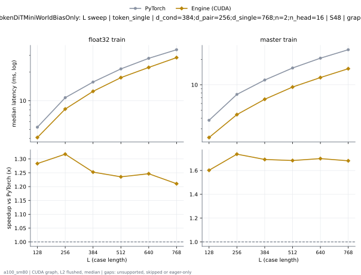
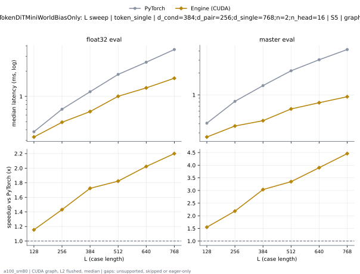
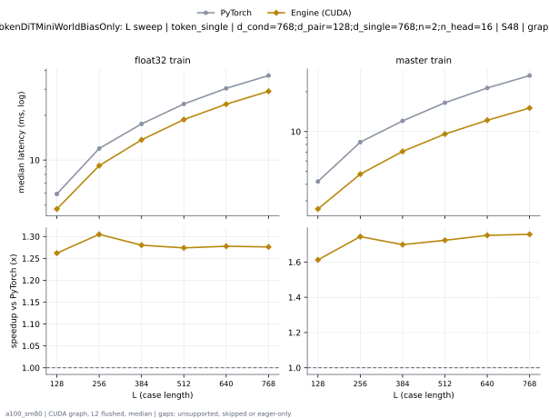
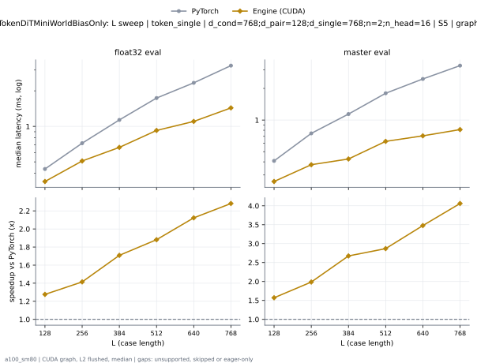
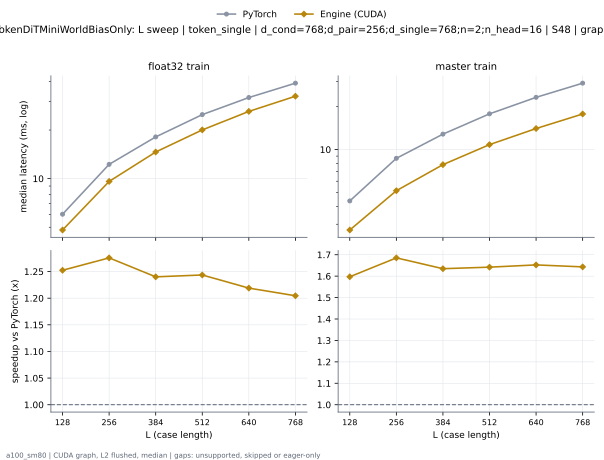
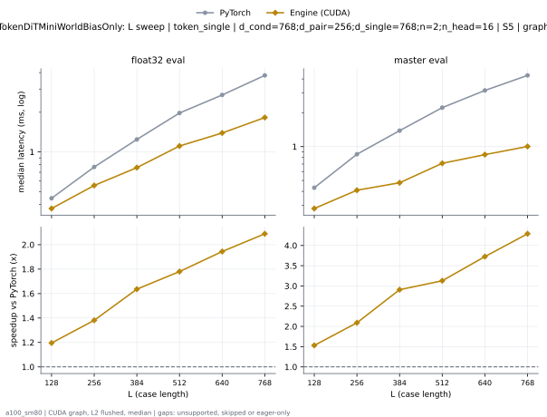
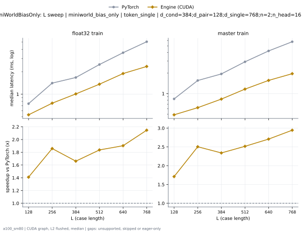
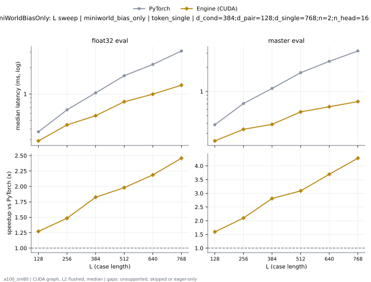

# TokenDiTMiniWorldBiasOnly on a100_sm80

Generated by `python -m miniworld_engine.measure.plot` from speed tokens `judge/tokens/a100_sm80/`; do not edit.

### L sweep: token_single | d_cond=384;d_pair=256;d_single=768;n=2;n_head=16 | S48 | graph

**float32 train** (median ms; x = speedup vs PyTorch)

| L | PyTorch | Engine (CUDA) |
|---|---|---|
| 128 | 5.26 | 4.099 (1.28x) |
| 256 | 10.75 | 8.163 (1.32x) |
| 384 | 15.7 | 12.54 (1.25x) |
| 512 | 21.59 | 17.47 (1.24x) |
| 640 | 27.89 | 22.37 (1.25x) |
| 768 | 34.35 | 28.38 (1.21x) |

**master train** (median ms; x = speedup vs PyTorch)

| L | PyTorch | Engine (CUDA) |
|---|---|---|
| 128 | 3.79 | 2.366 (1.60x) |
| 256 | 7.69 | 4.428 (1.74x) |
| 384 | 11.4 | 6.736 (1.69x) |
| 512 | 15.84 | 9.408 (1.68x) |
| 640 | 20.73 | 12.2 (1.70x) |
| 768 | 26.12 | 15.53 (1.68x) |

### L sweep: token_single | d_cond=384;d_pair=256;d_single=768;n=2;n_head=16 | S5 | graph

**float32 eval** (median ms; x = speedup vs PyTorch)

| L | PyTorch | Engine (CUDA) |
|---|---|---|
| 128 | 0.3789 | 0.3282 (1.15x) |
| 256 | 0.7035 | 0.4915 (1.43x) |
| 384 | 1.137 | 0.6595 (1.72x) |
| 512 | 1.828 | 1.003 (1.82x) |
| 640 | 2.554 | 1.263 (2.02x) |
| 768 | 3.618 | 1.645 (2.20x) |

**master eval** (median ms; x = speedup vs PyTorch)

| L | PyTorch | Engine (CUDA) |
|---|---|---|
| 128 | 0.4076 | 0.2632 (1.55x) |
| 256 | 0.8141 | 0.3727 (2.18x) |
| 384 | 1.34 | 0.4413 (3.04x) |
| 512 | 2.143 | 0.64 (3.35x) |
| 640 | 3.04 | 0.7793 (3.90x) |
| 768 | 4.202 | 0.9426 (4.46x) |

### L sweep: token_single | d_cond=768;d_pair=128;d_single=768;n=2;n_head=16 | S48 | graph

**float32 train** (median ms; x = speedup vs PyTorch)

| L | PyTorch | Engine (CUDA) |
|---|---|---|
| 128 | 5.906 | 4.68 (1.26x) |
| 256 | 11.96 | 9.163 (1.30x) |
| 384 | 17.51 | 13.68 (1.28x) |
| 512 | 23.86 | 18.73 (1.27x) |
| 640 | 30.4 | 23.79 (1.28x) |
| 768 | 37.07 | 29.05 (1.28x) |

**master train** (median ms; x = speedup vs PyTorch)

| L | PyTorch | Engine (CUDA) |
|---|---|---|
| 128 | 4.199 | 2.604 (1.61x) |
| 256 | 8.323 | 4.772 (1.74x) |
| 384 | 12.03 | 7.082 (1.70x) |
| 512 | 16.5 | 9.575 (1.72x) |
| 640 | 21.32 | 12.17 (1.75x) |
| 768 | 26.46 | 15.06 (1.76x) |

### L sweep: token_single | d_cond=768;d_pair=128;d_single=768;n=2;n_head=16 | S5 | graph

**float32 eval** (median ms; x = speedup vs PyTorch)

| L | PyTorch | Engine (CUDA) |
|---|---|---|
| 128 | 0.4352 | 0.341 (1.28x) |
| 256 | 0.7199 | 0.5089 (1.41x) |
| 384 | 1.134 | 0.6636 (1.71x) |
| 512 | 1.737 | 0.9231 (1.88x) |
| 640 | 2.337 | 1.101 (2.12x) |
| 768 | 3.27 | 1.433 (2.28x) |

**master eval** (median ms; x = speedup vs PyTorch)

| L | PyTorch | Engine (CUDA) |
|---|---|---|
| 128 | 0.4086 | 0.2601 (1.57x) |
| 256 | 0.7465 | 0.3758 (1.99x) |
| 384 | 1.14 | 0.426 (2.68x) |
| 512 | 1.798 | 0.6267 (2.87x) |
| 640 | 2.461 | 0.7076 (3.48x) |
| 768 | 3.295 | 0.8115 (4.06x) |

### L sweep: token_single | d_cond=768;d_pair=256;d_single=768;n=2;n_head=16 | S48 | graph

**float32 train** (median ms; x = speedup vs PyTorch)

| L | PyTorch | Engine (CUDA) |
|---|---|---|
| 128 | 6.021 | 4.808 (1.25x) |
| 256 | 12.26 | 9.609 (1.28x) |
| 384 | 18.13 | 14.62 (1.24x) |
| 512 | 24.92 | 20.04 (1.24x) |
| 640 | 31.79 | 26.08 (1.22x) |
| 768 | 39.02 | 32.4 (1.20x) |

**master train** (median ms; x = speedup vs PyTorch)

| L | PyTorch | Engine (CUDA) |
|---|---|---|
| 128 | 4.368 | 2.735 (1.60x) |
| 256 | 8.68 | 5.151 (1.69x) |
| 384 | 12.82 | 7.84 (1.63x) |
| 512 | 17.77 | 10.82 (1.64x) |
| 640 | 23.18 | 14.03 (1.65x) |
| 768 | 29.14 | 17.73 (1.64x) |

### L sweep: token_single | d_cond=768;d_pair=256;d_single=768;n=2;n_head=16 | S5 | graph

**float32 eval** (median ms; x = speedup vs PyTorch)

| L | PyTorch | Engine (CUDA) |
|---|---|---|
| 128 | 0.4444 | 0.3717 (1.20x) |
| 256 | 0.768 | 0.556 (1.38x) |
| 384 | 1.243 | 0.7598 (1.64x) |
| 512 | 1.973 | 1.108 (1.78x) |
| 640 | 2.705 | 1.392 (1.94x) |
| 768 | 3.81 | 1.824 (2.09x) |

**master eval** (median ms; x = speedup vs PyTorch)

| L | PyTorch | Engine (CUDA) |
|---|---|---|
| 128 | 0.4311 | 0.2816 (1.53x) |
| 256 | 0.8561 | 0.4096 (2.09x) |
| 384 | 1.388 | 0.4772 (2.91x) |
| 512 | 2.223 | 0.7107 (3.13x) |
| 640 | 3.162 | 0.8489 (3.72x) |
| 768 | 4.304 | 1.004 (4.29x) |

### L sweep: miniworld_bias_only | token_single | d_cond=384;d_pair=128;d_single=768;n=2;n_head=16 | S1 | graph

**float32 train** (median ms; x = speedup vs PyTorch)

| L | PyTorch | Engine (CUDA) |
|---|---|---|
| 128 | 0.7465 | 0.5294 (1.41x) |
| 256 | 1.409 | 0.7578 (1.86x) |
| 384 | 1.675 | 1.009 (1.66x) |
| 512 | 2.502 | 1.362 (1.84x) |
| 640 | 3.601 | 1.892 (1.90x) |
| 768 | 5.058 | 2.356 (2.15x) |

**master train** (median ms; x = speedup vs PyTorch)

| L | PyTorch | Engine (CUDA) |
|---|---|---|
| 128 | 0.8356 | 0.4884 (1.71x) |
| 256 | 1.556 | 0.6216 (2.50x) |
| 384 | 1.943 | 0.8305 (2.34x) |
| 512 | 2.927 | 1.163 (2.52x) |
| 640 | 4.229 | 1.562 (2.71x) |
| 768 | 5.771 | 1.96 (2.94x) |

### L sweep: miniworld_bias_only | token_single | d_cond=384;d_pair=128;d_single=768;n=2;n_head=16 | S5 | graph

**float32 eval** (median ms; x = speedup vs PyTorch)

| L | PyTorch | Engine (CUDA) |
|---|---|---|
| 128 | 0.3697 | 0.2908 (1.27x) |
| 256 | 0.6584 | 0.4434 (1.48x) |
| 384 | 1.03 | 0.5642 (1.82x) |
| 512 | 1.614 | 0.8151 (1.98x) |
| 640 | 2.175 | 0.9948 (2.19x) |
| 768 | 3.096 | 1.26 (2.46x) |

**master eval** (median ms; x = speedup vs PyTorch)

| L | PyTorch | Engine (CUDA) |
|---|---|---|
| 128 | 0.384 | 0.2412 (1.59x) |
| 256 | 0.7066 | 0.3369 (2.10x) |
| 384 | 1.091 | 0.3881 (2.81x) |
| 512 | 1.717 | 0.556 (3.09x) |
| 640 | 2.38 | 0.6441 (3.69x) |
| 768 | 3.205 | 0.7485 (4.28x) |

