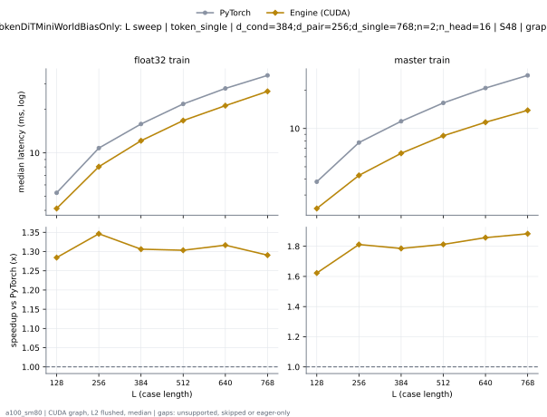
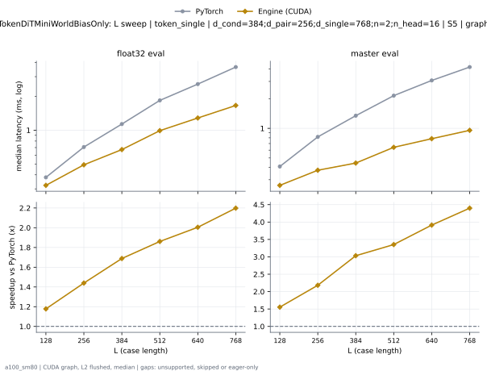
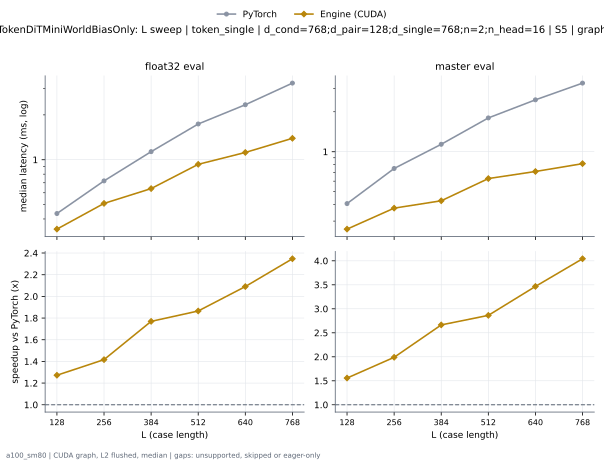
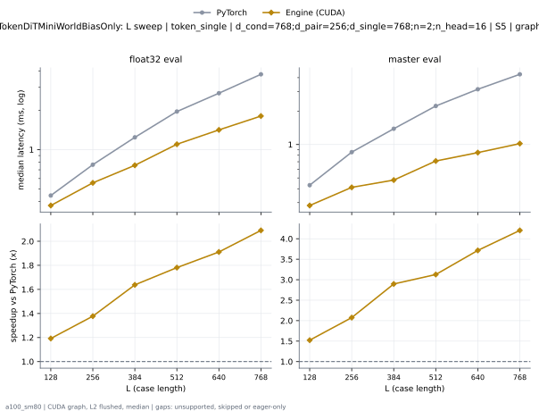
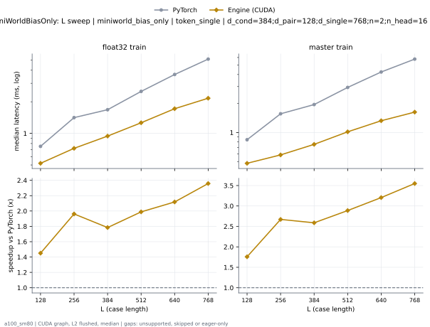
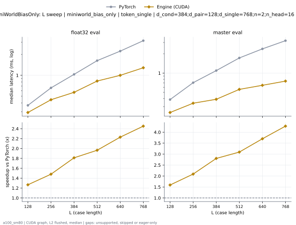

# TokenDiTMiniWorldBiasOnly on a100_sm80

Generated by `python -m foldjet_engine.measure.plot` from speed tokens `judge/tokens/a100_sm80/`; do not edit.

### L sweep: token_single | d_cond=384;d_pair=256;d_single=768;n=2;n_head=16 | S48 | graph

**float32 train** (median ms; x = speedup vs PyTorch)

| L | PyTorch | Engine (Triton) | Engine (CUDA) |
|---|---|---|---|
| 128 | 5.289 | 5.073 (1.04x) | 4.118 (1.28x) |
| 256 | 10.8 | 9.518 (1.13x) | 8.022 (1.35x) |
| 384 | 15.85 | 13.93 (1.14x) | 12.14 (1.31x) |
| 512 | 21.83 | 18.89 (1.16x) | 16.75 (1.30x) |
| 640 | 27.97 | 24.16 (1.16x) | 21.25 (1.32x) |
| 768 | 34.44 | 29.26 (1.18x) | 26.69 (1.29x) |

**master train** (median ms; x = speedup vs PyTorch)

| L | PyTorch | Engine (Triton) | Engine (CUDA) |
|---|---|---|---|
| 128 | 3.813 | 3.479 (1.10x) | 2.35 (1.62x) |
| 256 | 7.755 | 6.147 (1.26x) | 4.28 (1.81x) |
| 384 | 11.4 | 7.417 (1.54x) | 6.384 (1.79x) |
| 512 | 15.89 | 10.11 (1.57x) | 8.767 (1.81x) |
| 640 | 20.8 | 12.75 (1.63x) | 11.2 (1.86x) |
| 768 | 26.16 | 15.64 (1.67x) | 13.9 (1.88x) |

### L sweep: token_single | d_cond=384;d_pair=256;d_single=768;n=2;n_head=16 | S5 | graph

**float32 eval** (median ms; x = speedup vs PyTorch)

| L | PyTorch | Engine (Triton) | Engine (CUDA) |
|---|---|---|---|
| 128 | 0.3799 | 0.4004 (0.95x) | 0.3226 (1.18x) |
| 256 | 0.7076 | 0.5637 (1.26x) | 0.4915 (1.44x) |
| 384 | 1.134 | 0.8361 (1.36x) | 0.6717 (1.69x) |
| 512 | 1.843 | 1.112 (1.66x) | 0.9902 (1.86x) |
| 640 | 2.574 | 1.407 (1.83x) | 1.284 (2.00x) |
| 768 | 3.652 | 1.849 (1.97x) | 1.661 (2.20x) |

**master eval** (median ms; x = speedup vs PyTorch)

| L | PyTorch | Engine (Triton) | Engine (CUDA) |
|---|---|---|---|
| 128 | 0.4091 | 0.3011 (1.36x) | 0.2632 (1.55x) |
| 256 | 0.8182 | 0.4086 (2.00x) | 0.3748 (2.18x) |
| 384 | 1.345 | 0.553 (2.43x) | 0.4434 (3.03x) |
| 512 | 2.149 | 0.7066 (3.04x) | 0.641 (3.35x) |
| 640 | 3.069 | 0.8909 (3.44x) | 0.7844 (3.91x) |
| 768 | 4.199 | 1.14 (3.68x) | 0.9544 (4.40x) |

### L sweep: token_single | d_cond=768;d_pair=128;d_single=768;n=2;n_head=16 | S48 | graph

**float32 train** (median ms; x = speedup vs PyTorch)

| L | PyTorch | Engine (Triton) | Engine (CUDA) |
|---|---|---|---|
| 128 | 5.906 | 6.379 (0.93x) | 4.62 (1.28x) |
| 256 | 11.95 | 12.03 (0.99x) | 9.095 (1.31x) |
| 384 | 17.5 | 17.58 (1.00x) | 13.64 (1.28x) |
| 512 | 23.86 | 23.59 (1.01x) | 18.62 (1.28x) |
| 640 | 30.33 | 29.94 (1.01x) | 23.5 (1.29x) |
| 768 | 37.01 | 35.74 (1.04x) | 28.73 (1.29x) |

**master train** (median ms; x = speedup vs PyTorch)

| L | PyTorch | Engine (Triton) | Engine (CUDA) |
|---|---|---|---|
| 128 | 4.196 | 5.33 (0.79x) | 2.616 (1.60x) |
| 256 | 8.315 | 8.612 (0.97x) | 4.727 (1.76x) |
| 384 | 12.03 | 8.53 (1.41x) | 6.984 (1.72x) |
| 512 | 16.52 | 11.41 (1.45x) | 9.439 (1.75x) |
| 640 | 21.24 | 14.24 (1.49x) | 12 (1.77x) |
| 768 | 26.46 | 17.29 (1.53x) | 14.7 (1.80x) |

### L sweep: token_single | d_cond=768;d_pair=128;d_single=768;n=2;n_head=16 | S5 | graph

**float32 eval** (median ms; x = speedup vs PyTorch)

| L | PyTorch | Engine (Triton) | Engine (CUDA) |
|---|---|---|---|
| 128 | 0.4352 | 0.4782 (0.91x) | 0.342 (1.27x) |
| 256 | 0.7209 | 0.6195 (1.16x) | 0.5089 (1.42x) |
| 384 | 1.133 | 0.8991 (1.26x) | 0.64 (1.77x) |
| 512 | 1.737 | 1.133 (1.53x) | 0.9313 (1.87x) |
| 640 | 2.339 | 1.352 (1.73x) | 1.119 (2.09x) |
| 768 | 3.268 | 1.71 (1.91x) | 1.392 (2.35x) |

**master eval** (median ms; x = speedup vs PyTorch)

| L | PyTorch | Engine (Triton) | Engine (CUDA) |
|---|---|---|---|
| 128 | 0.4065 | 0.3543 (1.15x) | 0.2611 (1.56x) |
| 256 | 0.7475 | 0.4557 (1.64x) | 0.3758 (1.99x) |
| 384 | 1.138 | 0.6164 (1.85x) | 0.427 (2.66x) |
| 512 | 1.797 | 0.7598 (2.37x) | 0.6277 (2.86x) |
| 640 | 2.46 | 0.9149 (2.69x) | 0.7096 (3.47x) |
| 768 | 3.287 | 1.152 (2.85x) | 0.8131 (4.04x) |

### L sweep: token_single | d_cond=768;d_pair=256;d_single=768;n=2;n_head=16 | S48 | graph

**float32 train** (median ms; x = speedup vs PyTorch)

| L | PyTorch | Engine (Triton) | Engine (CUDA) |
|---|---|---|---|
| 128 | 6.019 | 6.431 (0.94x) | 4.758 (1.27x) |
| 256 | 12.17 | 12.06 (1.01x) | 9.351 (1.30x) |
| 384 | 18.01 | 17.87 (1.01x) | 14.2 (1.27x) |
| 512 | 24.72 | 24.12 (1.02x) | 19.42 (1.27x) |
| 640 | 31.58 | 30.43 (1.04x) | 24.73 (1.28x) |
| 768 | 38.74 | 36.81 (1.05x) | 30.53 (1.27x) |

**master train** (median ms; x = speedup vs PyTorch)

| L | PyTorch | Engine (Triton) | Engine (CUDA) |
|---|---|---|---|
| 128 | 4.346 | 5.362 (0.81x) | 2.679 (1.62x) |
| 256 | 8.676 | 8.684 (1.00x) | 4.912 (1.77x) |
| 384 | 12.75 | 8.568 (1.49x) | 7.337 (1.74x) |
| 512 | 17.77 | 11.7 (1.52x) | 10 (1.78x) |
| 640 | 23.09 | 14.62 (1.58x) | 12.86 (1.80x) |
| 768 | 29.11 | 17.9 (1.63x) | 16.04 (1.81x) |

### L sweep: token_single | d_cond=768;d_pair=256;d_single=768;n=2;n_head=16 | S5 | graph

**float32 eval** (median ms; x = speedup vs PyTorch)

| L | PyTorch | Engine (Triton) | Engine (CUDA) |
|---|---|---|---|
| 128 | 0.4444 | 0.4946 (0.90x) | 0.3727 (1.19x) |
| 256 | 0.766 | 0.6646 (1.15x) | 0.556 (1.38x) |
| 384 | 1.241 | 0.9969 (1.24x) | 0.7578 (1.64x) |
| 512 | 1.957 | 1.294 (1.51x) | 1.099 (1.78x) |
| 640 | 2.705 | 1.616 (1.67x) | 1.416 (1.91x) |
| 768 | 3.777 | 2.109 (1.79x) | 1.807 (2.09x) |

**master eval** (median ms; x = speedup vs PyTorch)

| L | PyTorch | Engine (Triton) | Engine (CUDA) |
|---|---|---|---|
| 128 | 0.4306 | 0.3584 (1.20x) | 0.2826 (1.52x) |
| 256 | 0.854 | 0.4731 (1.81x) | 0.4116 (2.07x) |
| 384 | 1.386 | 0.6589 (2.10x) | 0.4787 (2.90x) |
| 512 | 2.222 | 0.8151 (2.73x) | 0.7107 (3.13x) |
| 640 | 3.143 | 1.002 (3.13x) | 0.8458 (3.72x) |
| 768 | 4.285 | 1.283 (3.34x) | 1.019 (4.20x) |

### L sweep: miniworld_bias_only | token_single | d_cond=384;d_pair=128;d_single=768;n=2;n_head=16 | S1 | graph

**float32 train** (median ms; x = speedup vs PyTorch)

| L | PyTorch | Engine (Triton) | Engine (CUDA) |
|---|---|---|---|
| 128 | 0.7521 | 1.052 (0.72x) | 0.5187 (1.45x) |
| 256 | 1.413 | 1.204 (1.17x) | 0.7204 (1.96x) |
| 384 | 1.681 | 1.418 (1.19x) | 0.9421 (1.78x) |
| 512 | 2.511 | 1.711 (1.47x) | 1.263 (1.99x) |
| 640 | 3.639 | 2.133 (1.71x) | 1.718 (2.12x) |
| 768 | 5.102 | 2.544 (2.01x) | 2.163 (2.36x) |

**master train** (median ms; x = speedup vs PyTorch)

| L | PyTorch | Engine (Triton) | Engine (CUDA) |
|---|---|---|---|
| 128 | 0.8417 | 1.015 (0.83x) | 0.4792 (1.76x) |
| 256 | 1.565 | 1.134 (1.38x) | 0.5857 (2.67x) |
| 384 | 1.951 | 1.276 (1.53x) | 0.7537 (2.59x) |
| 512 | 2.937 | 1.483 (1.98x) | 1.017 (2.89x) |
| 640 | 4.248 | 1.792 (2.37x) | 1.325 (3.21x) |
| 768 | 5.779 | 2.149 (2.69x) | 1.628 (3.55x) |

### L sweep: miniworld_bias_only | token_single | d_cond=384;d_pair=128;d_single=768;n=2;n_head=16 | S5 | graph

**float32 eval** (median ms; x = speedup vs PyTorch)

| L | PyTorch | Engine (Triton) | Engine (CUDA) |
|---|---|---|---|
| 128 | 0.3697 | 0.385 (0.96x) | 0.2918 (1.27x) |
| 256 | 0.6595 | 0.5207 (1.27x) | 0.4454 (1.48x) |
| 384 | 1.032 | 0.7424 (1.39x) | 0.5693 (1.81x) |
| 512 | 1.626 | 0.9462 (1.72x) | 0.8274 (1.96x) |
| 640 | 2.228 | 1.157 (1.93x) | 0.9994 (2.23x) |
| 768 | 3.149 | 1.468 (2.14x) | 1.284 (2.45x) |

**master eval** (median ms; x = speedup vs PyTorch)

| L | PyTorch | Engine (Triton) | Engine (CUDA) |
|---|---|---|---|
| 128 | 0.386 | 0.2959 (1.30x) | 0.2427 (1.59x) |
| 256 | 0.7086 | 0.3901 (1.82x) | 0.3389 (2.09x) |
| 384 | 1.094 | 0.5212 (2.10x) | 0.3901 (2.80x) |
| 512 | 1.723 | 0.642 (2.68x) | 0.5571 (3.09x) |
| 640 | 2.387 | 0.7916 (3.02x) | 0.6451 (3.70x) |
| 768 | 3.206 | 1.017 (3.15x) | 0.7496 (4.28x) |

