# TokenDiTProtenix on a100_sm80

Generated by `python -m miniworld_engine.measure.plot` from speed tokens `judge/tokens/a100_sm80/`; do not edit.

### L sweep: token_single | d_cond=384;d_pair=128;d_single=1024;n=2;n_head=16 | S1 | graph

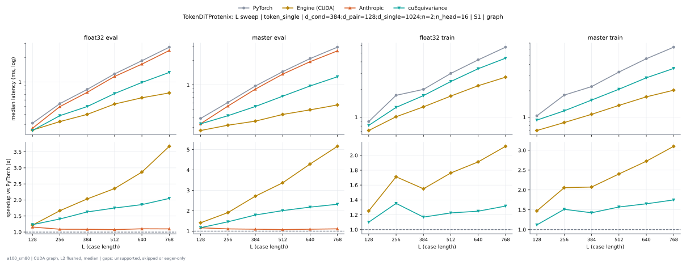

**float32 eval** (median ms; x = speedup vs PyTorch)

| L | PyTorch | Engine (Triton) | Engine (CUDA) | Anthropic | cuEquivariance |
|---|---|---|---|---|---|
| 128 | 0.3103 | 0.2918 (1.06x) | 0.255 (1.22x) | 0.2683 (1.16x) | 0.2519 (1.23x) |
| 256 | 0.5407 | 0.5171 (1.05x) | 0.3246 (1.67x) | 0.4966 (1.09x) | 0.384 (1.41x) |
| 384 | 0.81 | 0.768 (1.05x) | 0.3983 (2.03x) | 0.7455 (1.09x) | 0.4977 (1.63x) |
| 512 | 1.26 | 1.194 (1.05x) | 0.5345 (2.36x) | 1.17 (1.08x) | 0.7199 (1.75x) |
| 640 | 1.834 | 1.673 (1.10x) | 0.639 (2.87x) | 1.664 (1.10x) | 0.9882 (1.86x) |
| 768 | 2.692 | 2.462 (1.09x) | 0.7332 (3.67x) | 2.45 (1.10x) | 1.314 (2.05x) |

**master eval** (median ms; x = speedup vs PyTorch)

| L | PyTorch | Engine (Triton) | Engine (CUDA) | Anthropic | cuEquivariance |
|---|---|---|---|---|---|
| 128 | 0.386 | 0.3604 (1.07x) | 0.2739 (1.41x) | 0.3318 (1.16x) | 0.3308 (1.17x) |
| 256 | 0.6083 | 0.5704 (1.07x) | 0.3185 (1.91x) | 0.5489 (1.11x) | 0.4173 (1.46x) |
| 384 | 0.9697 | 0.9134 (1.06x) | 0.3574 (2.71x) | 0.8868 (1.09x) | 0.5417 (1.79x) |
| 512 | 1.457 | 1.378 (1.06x) | 0.4321 (3.37x) | 1.359 (1.07x) | 0.726 (2.01x) |
| 640 | 2.114 | 1.956 (1.08x) | 0.4925 (4.29x) | 1.934 (1.09x) | 0.9708 (2.18x) |
| 768 | 2.922 | 2.659 (1.10x) | 0.5663 (5.16x) | 2.631 (1.11x) | 1.261 (2.32x) |

**float32 train** (median ms; x = speedup vs PyTorch)

| L | PyTorch | Engine (Triton) | Engine (CUDA) | Anthropic | cuEquivariance |
|---|---|---|---|---|---|
| 128 | 0.896 | 0.8673 (1.03x) | 0.7158 (1.25x) | unsupported | 0.8141 (1.10x) |
| 256 | 1.73 | 1.704 (1.02x) | 1.011 (1.71x) | unsupported | 1.278 (1.35x) |
| 384 | 2.006 | 1.954 (1.03x) | 1.294 (1.55x) | unsupported | 1.716 (1.17x) |
| 512 | 2.993 | 2.876 (1.04x) | 1.698 (1.76x) | unsupported | 2.443 (1.23x) |
| 640 | 4.204 | 3.928 (1.07x) | 2.199 (1.91x) | unsupported | 3.367 (1.25x) |
| 768 | 5.776 | 5.373 (1.07x) | 2.723 (2.12x) | unsupported | 4.385 (1.32x) |

**master train** (median ms; x = speedup vs PyTorch)

| L | PyTorch | Engine (Triton) | Engine (CUDA) | Anthropic | cuEquivariance |
|---|---|---|---|---|---|
| 128 | 1.035 | 0.9851 (1.05x) | 0.7035 (1.47x) | unsupported | 0.9247 (1.12x) |
| 256 | 1.784 | 1.715 (1.04x) | 0.8673 (2.06x) | unsupported | 1.18 (1.51x) |
| 384 | 2.231 | 2.136 (1.04x) | 1.076 (2.07x) | unsupported | 1.566 (1.43x) |
| 512 | 3.27 | 3.113 (1.05x) | 1.361 (2.40x) | unsupported | 2.082 (1.57x) |
| 640 | 4.64 | 4.355 (1.07x) | 1.704 (2.72x) | unsupported | 2.81 (1.65x) |
| 768 | 6.286 | 5.804 (1.08x) | 2.029 (3.10x) | unsupported | 3.596 (1.75x) |

### L sweep: token_single | d_cond=384;d_pair=128;d_single=768;n=2;n_head=12 | S1 | graph

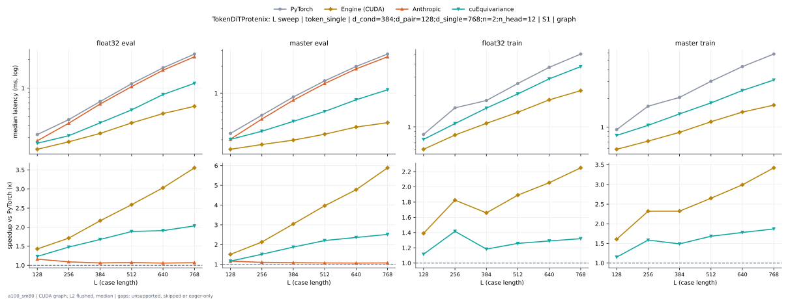

**float32 eval** (median ms; x = speedup vs PyTorch)

| L | PyTorch | Engine (Triton) | Engine (CUDA) | Anthropic | cuEquivariance |
|---|---|---|---|---|---|
| 128 | 0.3236 | 0.3062 (1.06x) | 0.2263 (1.43x) | 0.2785 (1.16x) | 0.2621 (1.23x) |
| 256 | 0.4649 | 0.4434 (1.05x) | 0.2714 (1.71x) | 0.426 (1.09x) | 0.3144 (1.48x) |
| 384 | 0.7219 | 0.6902 (1.05x) | 0.3328 (2.17x) | 0.6789 (1.06x) | 0.4301 (1.68x) |
| 512 | 1.111 | 1.06 (1.05x) | 0.4291 (2.59x) | 1.035 (1.07x) | 0.5888 (1.89x) |
| 640 | 1.633 | 1.553 (1.05x) | 0.5386 (3.03x) | 1.542 (1.06x) | 0.855 (1.91x) |
| 768 | 2.282 | 2.131 (1.07x) | 0.642 (3.56x) | 2.135 (1.07x) | 1.122 (2.03x) |

**master eval** (median ms; x = speedup vs PyTorch)

| L | PyTorch | Engine (Triton) | Engine (CUDA) | Anthropic | cuEquivariance |
|---|---|---|---|---|---|
| 128 | 0.3533 | 0.3308 (1.07x) | 0.2345 (1.51x) | 0.3041 (1.16x) | 0.3031 (1.17x) |
| 256 | 0.5652 | 0.5315 (1.06x) | 0.2652 (2.13x) | 0.512 (1.10x) | 0.3738 (1.51x) |
| 384 | 0.9042 | 0.8561 (1.06x) | 0.297 (3.04x) | 0.8335 (1.08x) | 0.4823 (1.87x) |
| 512 | 1.373 | 1.309 (1.05x) | 0.3461 (3.97x) | 1.281 (1.07x) | 0.6226 (2.21x) |
| 640 | 1.992 | 1.889 (1.05x) | 0.4168 (4.78x) | 1.87 (1.07x) | 0.8428 (2.36x) |
| 768 | 2.742 | 2.575 (1.06x) | 0.4659 (5.89x) | 2.555 (1.07x) | 1.09 (2.52x) |

**float32 train** (median ms; x = speedup vs PyTorch)

| L | PyTorch | Engine (Triton) | Engine (CUDA) | Anthropic | cuEquivariance |
|---|---|---|---|---|---|
| 128 | 0.8448 | 0.8218 (1.03x) | 0.6077 (1.39x) | unsupported | 0.7567 (1.12x) |
| 256 | 1.522 | 1.5 (1.01x) | 0.8335 (1.83x) | unsupported | 1.074 (1.42x) |
| 384 | 1.79 | 1.761 (1.02x) | 1.079 (1.66x) | unsupported | 1.512 (1.18x) |
| 512 | 2.609 | 2.555 (1.02x) | 1.379 (1.89x) | unsupported | 2.073 (1.26x) |
| 640 | 3.732 | 3.602 (1.04x) | 1.817 (2.05x) | unsupported | 2.893 (1.29x) |
| 768 | 5.009 | 4.782 (1.05x) | 2.227 (2.25x) | unsupported | 3.794 (1.32x) |

**master train** (median ms; x = speedup vs PyTorch)

| L | PyTorch | Engine (Triton) | Engine (CUDA) | Anthropic | cuEquivariance |
|---|---|---|---|---|---|
| 128 | 0.9431 | 0.898 (1.05x) | 0.5868 (1.61x) | unsupported | 0.8192 (1.15x) |
| 256 | 1.658 | 1.603 (1.03x) | 0.7148 (2.32x) | unsupported | 1.046 (1.59x) |
| 384 | 2.049 | 1.975 (1.04x) | 0.8827 (2.32x) | unsupported | 1.376 (1.49x) |
| 512 | 3.021 | 2.914 (1.04x) | 1.14 (2.65x) | unsupported | 1.795 (1.68x) |
| 640 | 4.305 | 4.125 (1.04x) | 1.439 (2.99x) | unsupported | 2.42 (1.78x) |
| 768 | 5.823 | 5.518 (1.06x) | 1.701 (3.42x) | unsupported | 3.115 (1.87x) |

### L sweep: token_single | d_cond=384;d_pair=128;d_single=768;n=2;n_head=24 | S1 | graph

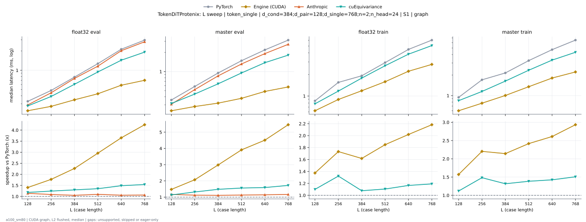

**float32 eval** (median ms; x = speedup vs PyTorch)

| L | PyTorch | Engine (Triton) | Engine (CUDA) | Anthropic | cuEquivariance |
|---|---|---|---|---|---|
| 128 | 0.3277 | 0.3082 (1.06x) | 0.2335 (1.40x) | 0.2877 (1.14x) | 0.2775 (1.18x) |
| 256 | 0.4844 | 0.4485 (1.08x) | 0.2734 (1.77x) | 0.4454 (1.09x) | 0.3901 (1.24x) |
| 384 | 0.7844 | 0.7096 (1.11x) | 0.3461 (2.27x) | 0.7475 (1.05x) | 0.6052 (1.30x) |
| 512 | 1.272 | 1.115 (1.14x) | 0.4301 (2.96x) | 1.161 (1.10x) | 0.9421 (1.35x) |
| 640 | 2.135 | 1.883 (1.13x) | 0.5847 (3.65x) | 2.025 (1.05x) | 1.438 (1.49x) |
| 768 | 2.964 | 2.611 (1.14x) | 0.6984 (4.24x) | 2.791 (1.06x) | 1.926 (1.54x) |

**master eval** (median ms; x = speedup vs PyTorch)

| L | PyTorch | Engine (Triton) | Engine (CUDA) | Anthropic | cuEquivariance |
|---|---|---|---|---|---|
| 128 | 0.3569 | 0.3308 (1.08x) | 0.2417 (1.48x) | 0.3062 (1.17x) | 0.3144 (1.14x) |
| 256 | 0.5827 | 0.5345 (1.09x) | 0.2816 (2.07x) | 0.5202 (1.12x) | 0.4424 (1.32x) |
| 384 | 0.9492 | 0.8694 (1.09x) | 0.3185 (2.98x) | 0.855 (1.11x) | 0.641 (1.48x) |
| 512 | 1.482 | 1.331 (1.11x) | 0.3789 (3.91x) | 1.316 (1.13x) | 0.9503 (1.56x) |
| 640 | 2.192 | 1.926 (1.14x) | 0.4864 (4.51x) | 1.916 (1.14x) | 1.379 (1.59x) |
| 768 | 3.125 | 2.713 (1.15x) | 0.5724 (5.46x) | 2.684 (1.16x) | 1.815 (1.72x) |

**float32 train** (median ms; x = speedup vs PyTorch)

| L | PyTorch | Engine (Triton) | Engine (CUDA) | Anthropic | cuEquivariance |
|---|---|---|---|---|---|
| 128 | 0.8561 | 0.8192 (1.05x) | 0.6231 (1.37x) | unsupported | 0.7782 (1.10x) |
| 256 | 1.55 | 1.493 (1.04x) | 0.895 (1.73x) | unsupported | 1.172 (1.32x) |
| 384 | 1.917 | 1.79 (1.07x) | 1.185 (1.62x) | unsupported | 1.78 (1.08x) |
| 512 | 2.929 | 2.629 (1.11x) | 1.585 (1.85x) | unsupported | 2.649 (1.11x) |
| 640 | 4.477 | 4.036 (1.11x) | 2.218 (2.02x) | unsupported | 3.841 (1.17x) |
| 768 | 6.036 | 5.423 (1.11x) | 2.766 (2.18x) | unsupported | 5.067 (1.19x) |

**master train** (median ms; x = speedup vs PyTorch)

| L | PyTorch | Engine (Triton) | Engine (CUDA) | Anthropic | cuEquivariance |
|---|---|---|---|---|---|
| 128 | 0.9411 | 0.8899 (1.06x) | 0.599 (1.57x) | unsupported | 0.8417 (1.12x) |
| 256 | 1.704 | 1.596 (1.07x) | 0.7731 (2.20x) | unsupported | 1.149 (1.48x) |
| 384 | 2.149 | 1.982 (1.08x) | 1.004 (2.14x) | unsupported | 1.632 (1.32x) |
| 512 | 3.261 | 2.95 (1.11x) | 1.35 (2.42x) | unsupported | 2.355 (1.39x) |
| 640 | 4.723 | 4.19 (1.13x) | 1.809 (2.61x) | unsupported | 3.316 (1.42x) |
| 768 | 6.519 | 5.721 (1.14x) | 2.222 (2.93x) | unsupported | 4.323 (1.51x) |

### L sweep: af3|opendde|openfold3|openfold3_preview2|protenix | token_single | d_cond=384;d_pair=128;d_single=768;n=2;n_head=16 | S1 | graph

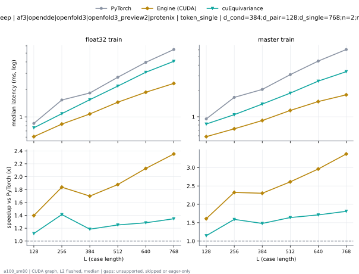

**float32 train** (median ms; x = speedup vs PyTorch)

| L | PyTorch | Engine (Triton) | Engine (CUDA) | Anthropic | cuEquivariance |
|---|---|---|---|---|---|
| 128 | 0.8479 | 0.8284 (1.02x) | 0.6072 (1.40x) | unsupported | 0.7588 (1.12x) |
| 256 | 1.531 | 1.505 (1.02x) | 0.8335 (1.84x) | unsupported | 1.084 (1.41x) |
| 384 | 1.828 | 1.774 (1.03x) | 1.076 (1.70x) | unsupported | 1.543 (1.18x) |
| 512 | 2.719 | 2.618 (1.04x) | 1.448 (1.88x) | unsupported | 2.174 (1.25x) |
| 640 | 3.961 | 3.682 (1.08x) | 1.862 (2.13x) | unsupported | 3.084 (1.28x) |
| 768 | 5.471 | 5.069 (1.08x) | 2.326 (2.35x) | unsupported | 4.063 (1.35x) |

**master train** (median ms; x = speedup vs PyTorch)

| L | PyTorch | Engine (Triton) | Engine (CUDA) | Anthropic | cuEquivariance |
|---|---|---|---|---|---|
| 128 | 0.9441 | 0.896 (1.05x) | 0.5868 (1.61x) | unsupported | 0.8233 (1.15x) |
| 256 | 1.682 | 1.609 (1.05x) | 0.724 (2.32x) | unsupported | 1.058 (1.59x) |
| 384 | 2.081 | 1.981 (1.05x) | 0.9042 (2.30x) | unsupported | 1.406 (1.48x) |
| 512 | 3.095 | 2.942 (1.05x) | 1.185 (2.61x) | unsupported | 1.886 (1.64x) |
| 640 | 4.454 | 4.169 (1.07x) | 1.504 (2.96x) | unsupported | 2.601 (1.71x) |
| 768 | 6.07 | 5.577 (1.09x) | 1.801 (3.37x) | unsupported | 3.354 (1.81x) |

### L sweep: af3|opendde|openfold3|openfold3_preview2|protenix | token_single | d_cond=384;d_pair=128;d_single=768;n=2;n_head=16 | S5 | graph

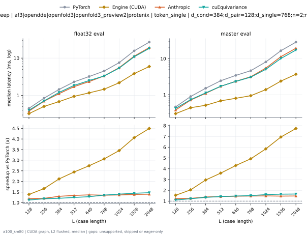

**float32 eval** (median ms; x = speedup vs PyTorch)

| L | PyTorch | Engine (Triton) | Engine (CUDA) | Anthropic | cuEquivariance |
|---|---|---|---|---|---|
| 128 | 0.4516 | 0.4055 (1.11x) | 0.3256 (1.39x) | 0.3809 (1.19x) | 0.4014 (1.13x) |
| 256 | 0.8438 | 0.7229 (1.17x) | 0.5079 (1.66x) | 0.7014 (1.20x) | 0.7137 (1.18x) |
| 384 | 1.448 | 1.169 (1.24x) | 0.6835 (2.12x) | 1.116 (1.30x) | 1.202 (1.20x) |
| 512 | 2.31 | 1.786 (1.29x) | 0.9452 (2.44x) | 1.723 (1.34x) | 1.855 (1.24x) |
| 640 | 3.21 | 2.401 (1.34x) | 1.172 (2.74x) | 2.349 (1.37x) | 2.507 (1.28x) |
| 768 | 4.499 | 3.366 (1.34x) | 1.469 (3.06x) | 3.333 (1.35x) | 3.321 (1.35x) |
| 1024 | 7.557 | 5.59 (1.35x) | 2.188 (3.45x) | 5.545 (1.36x) | 5.394 (1.40x) |
| 1536 | 15.64 | 11.35 (1.38x) | 3.849 (4.06x) | 11.28 (1.39x) | 10.85 (1.44x) |
| 2048 | 26.73 | 19.02 (1.41x) | 5.946 (4.49x) | 19.12 (1.40x) | 18.21 (1.47x) |

**master eval** (median ms; x = speedup vs PyTorch)

| L | PyTorch | Engine (Triton) | Engine (CUDA) | Anthropic | cuEquivariance |
|---|---|---|---|---|---|
| 128 | 0.4608 | 0.4014 (1.15x) | 0.299 (1.54x) | 0.3773 (1.22x) | 0.4178 (1.10x) |
| 256 | 0.8919 | 0.7322 (1.22x) | 0.4362 (2.04x) | 0.7117 (1.25x) | 0.7311 (1.22x) |
| 384 | 1.51 | 1.124 (1.34x) | 0.51 (2.96x) | 1.093 (1.38x) | 1.122 (1.35x) |
| 512 | 2.434 | 1.764 (1.38x) | 0.6769 (3.60x) | 1.708 (1.43x) | 1.714 (1.42x) |
| 640 | 3.423 | 2.396 (1.43x) | 0.7956 (4.30x) | 2.355 (1.45x) | 2.33 (1.47x) |
| 768 | 4.627 | 3.195 (1.45x) | 0.939 (4.93x) | 3.146 (1.47x) | 3.068 (1.51x) |
| 1024 | 8.096 | 5.567 (1.45x) | 1.384 (5.85x) | 5.46 (1.48x) | 5.058 (1.60x) |
| 1536 | 16.52 | 11.4 (1.45x) | 2.378 (6.94x) | 11.28 (1.46x) | 10.05 (1.64x) |
| 2048 | 28.52 | 19.49 (1.46x) | 3.687 (7.74x) | 19.33 (1.48x) | 17.23 (1.66x) |

### L sweep: af3|opendde|openfold3|openfold3_preview2|protenix | token_single_shared_cond | d_cond=384;d_pair=128;d_single=768;n=2;n_head=16 | S5 | graph

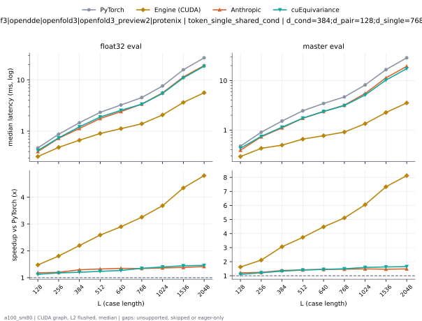

**float32 eval** (median ms; x = speedup vs PyTorch)

| L | PyTorch | Engine (Triton) | Engine (CUDA) | Anthropic | cuEquivariance |
|---|---|---|---|---|---|
| 128 | 0.471 | 0.425 (1.11x) | 0.3195 (1.47x) | 0.3994 (1.18x) | 0.4188 (1.12x) |
| 256 | 0.8714 | 0.7516 (1.16x) | 0.4823 (1.81x) | 0.7265 (1.20x) | 0.7404 (1.18x) |
| 384 | 1.462 | 1.177 (1.24x) | 0.6656 (2.20x) | 1.13 (1.29x) | 1.217 (1.20x) |
| 512 | 2.336 | 1.814 (1.29x) | 0.9021 (2.59x) | 1.766 (1.32x) | 1.891 (1.23x) |
| 640 | 3.248 | 2.416 (1.34x) | 1.12 (2.90x) | 2.413 (1.35x) | 2.56 (1.27x) |
| 768 | 4.537 | 3.387 (1.34x) | 1.394 (3.25x) | 3.384 (1.34x) | 3.364 (1.35x) |
| 1024 | 7.642 | 5.62 (1.36x) | 2.075 (3.68x) | 5.608 (1.36x) | 5.464 (1.40x) |
| 1536 | 15.82 | 11.44 (1.38x) | 3.641 (4.34x) | 11.46 (1.38x) | 10.96 (1.44x) |
| 2048 | 27.06 | 19.19 (1.41x) | 5.633 (4.80x) | 19.14 (1.41x) | 18.56 (1.46x) |

**master eval** (median ms; x = speedup vs PyTorch)

| L | PyTorch | Engine (Triton) | Engine (CUDA) | Anthropic | cuEquivariance |
|---|---|---|---|---|---|
| 128 | 0.4751 | 0.4147 (1.15x) | 0.2929 (1.62x) | 0.3932 (1.21x) | 0.4311 (1.10x) |
| 256 | 0.9073 | 0.7485 (1.21x) | 0.4291 (2.11x) | 0.7311 (1.24x) | 0.7496 (1.21x) |
| 384 | 1.526 | 1.138 (1.34x) | 0.4977 (3.07x) | 1.112 (1.37x) | 1.147 (1.33x) |
| 512 | 2.458 | 1.78 (1.38x) | 0.6584 (3.73x) | 1.731 (1.42x) | 1.747 (1.41x) |
| 640 | 3.455 | 2.425 (1.42x) | 0.7716 (4.48x) | 2.384 (1.45x) | 2.376 (1.45x) |
| 768 | 4.673 | 3.219 (1.45x) | 0.9134 (5.12x) | 3.184 (1.47x) | 3.125 (1.50x) |
| 1024 | 8.172 | 5.602 (1.46x) | 1.349 (6.06x) | 5.494 (1.49x) | 5.126 (1.59x) |
| 1536 | 16.61 | 11.48 (1.45x) | 2.266 (7.33x) | 11.34 (1.46x) | 10.22 (1.63x) |
| 2048 | 28.78 | 19.61 (1.47x) | 3.541 (8.13x) | 19.38 (1.48x) | 17.43 (1.65x) |

### L sweep: af3|opendde|openfold3|openfold3_preview2|protenix | token_single_shared_cond | d_cond=384;d_pair=128;d_single=768;n=2;n_head=16 | S8 | graph

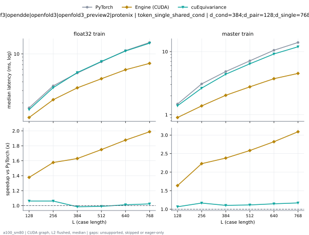

**float32 train** (median ms; x = speedup vs PyTorch)

| L | PyTorch | Engine (Triton) | Engine (CUDA) | Anthropic | cuEquivariance |
|---|---|---|---|---|---|
| 128 | 1.7 | 1.608 (1.06x) | 1.234 (1.38x) | unsupported | 1.602 (1.06x) |
| 256 | 3.496 | 3.07 (1.14x) | 2.217 (1.58x) | unsupported | 3.294 (1.06x) |
| 384 | 5.337 | 4.491 (1.19x) | 3.275 (1.63x) | unsupported | 5.419 (0.98x) |
| 512 | 7.731 | 6.269 (1.23x) | 4.419 (1.75x) | unsupported | 7.809 (0.99x) |
| 640 | 11.14 | 8.883 (1.25x) | 5.937 (1.88x) | unsupported | 11.01 (1.01x) |
| 768 | 14.57 | 11.46 (1.27x) | 7.328 (1.99x) | unsupported | 14.24 (1.02x) |

**master train** (median ms; x = speedup vs PyTorch)

| L | PyTorch | Engine (Triton) | Engine (CUDA) | Anthropic | cuEquivariance |
|---|---|---|---|---|---|
| 128 | 1.481 | 1.333 (1.11x) | 0.9047 (1.64x) | unsupported | 1.39 (1.07x) |
| 256 | 3.077 | 2.576 (1.19x) | 1.38 (2.23x) | unsupported | 2.639 (1.17x) |
| 384 | 4.835 | 3.662 (1.32x) | 2.032 (2.38x) | unsupported | 4.384 (1.10x) |
| 512 | 7.147 | 5.183 (1.38x) | 2.766 (2.58x) | unsupported | 6.41 (1.11x) |
| 640 | 10.51 | 7.463 (1.41x) | 3.725 (2.82x) | unsupported | 9.176 (1.15x) |
| 768 | 13.95 | 9.701 (1.44x) | 4.513 (3.09x) | unsupported | 11.93 (1.17x) |

### L sweep: esmfold2 | token_single | d_cond=768;d_pair=256;d_single=768;n=2;n_head=16 | S48 | graph

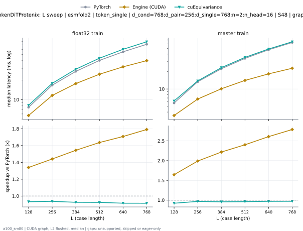

**float32 train** (median ms; x = speedup vs PyTorch)

| L | PyTorch | Engine (Triton) | Engine (CUDA) | Anthropic | cuEquivariance |
|---|---|---|---|---|---|
| 128 | 7.605 | 6.806 (1.12x) | 5.678 (1.34x) | unsupported | 8.159 (0.93x) |
| 256 | 16.71 | 14.5 (1.15x) | 11.6 (1.44x) | unsupported | 17.85 (0.94x) |
| 384 | 27.36 | 22.24 (1.23x) | 17.72 (1.54x) | unsupported | 29.57 (0.93x) |
| 512 | 40.44 | 31.59 (1.28x) | 24.71 (1.64x) | unsupported | 43.76 (0.92x) |
| 640 | 54.96 | 41.54 (1.32x) | 32.18 (1.71x) | unsupported | 60.1 (0.91x) |
| 768 | 71.86 | 52.55 (1.37x) | 40.12 (1.79x) | unsupported | 78.63 (0.91x) |

**master train** (median ms; x = speedup vs PyTorch)

| L | PyTorch | Engine (Triton) | Engine (CUDA) | Anthropic | cuEquivariance |
|---|---|---|---|---|---|
| 128 | 5.73 | 4.898 (1.17x) | 3.485 (1.64x) | unsupported | 6.217 (0.92x) |
| 256 | 13.34 | 10.16 (1.31x) | 6.706 (1.99x) | unsupported | 13.79 (0.97x) |
| 384 | 22.35 | 15.63 (1.43x) | 10.08 (2.22x) | unsupported | 23.35 (0.96x) |
| 512 | 33.76 | 22.14 (1.52x) | 14.06 (2.40x) | unsupported | 35.12 (0.96x) |
| 640 | 47.57 | 29.99 (1.59x) | 18.24 (2.61x) | unsupported | 49.06 (0.97x) |
| 768 | 63.55 | 38.57 (1.65x) | 22.8 (2.79x) | unsupported | 65.39 (0.97x) |

### L sweep: esmfold2 | token_single | d_cond=768;d_pair=256;d_single=768;n=2;n_head=16 | S5 | graph

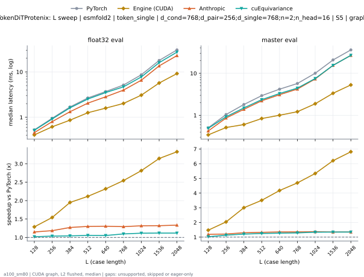

**float32 eval** (median ms; x = speedup vs PyTorch)

| L | PyTorch | Engine (Triton) | Engine (CUDA) | Anthropic | cuEquivariance |
|---|---|---|---|---|---|
| 128 | 0.5274 | 0.4823 (1.09x) | 0.4096 (1.29x) | 0.4588 (1.15x) | 0.5171 (1.02x) |
| 256 | 0.9523 | 0.8335 (1.14x) | 0.6175 (1.54x) | 0.8038 (1.18x) | 0.9185 (1.04x) |
| 384 | 1.686 | 1.379 (1.22x) | 0.8643 (1.95x) | 1.326 (1.27x) | 1.616 (1.04x) |
| 512 | 2.666 | 2.125 (1.25x) | 1.261 (2.12x) | 2.052 (1.30x) | 2.526 (1.06x) |
| 640 | 3.688 | 2.91 (1.27x) | 1.59 (2.32x) | 2.826 (1.31x) | 3.504 (1.05x) |
| 768 | 5.137 | 4.047 (1.27x) | 2.019 (2.54x) | 3.971 (1.29x) | 4.688 (1.10x) |
| 1024 | 8.647 | 6.67 (1.30x) | 3.074 (2.81x) | 6.568 (1.32x) | 7.748 (1.12x) |
| 1536 | 17.88 | 13.64 (1.31x) | 5.69 (3.14x) | 13.56 (1.32x) | 15.98 (1.12x) |
| 2048 | 30.56 | 23.08 (1.32x) | 9.189 (3.33x) | 22.9 (1.33x) | 27.32 (1.12x) |

**master eval** (median ms; x = speedup vs PyTorch)

| L | PyTorch | Engine (Triton) | Engine (CUDA) | Anthropic | cuEquivariance |
|---|---|---|---|---|---|
| 128 | 0.5038 | 0.4475 (1.13x) | 0.342 (1.47x) | 0.4239 (1.19x) | 0.4905 (1.03x) |
| 256 | 1.043 | 0.8837 (1.18x) | 0.512 (2.04x) | 0.8612 (1.21x) | 0.9216 (1.13x) |
| 384 | 1.807 | 1.418 (1.27x) | 0.6016 (3.00x) | 1.391 (1.30x) | 1.499 (1.21x) |
| 512 | 2.939 | 2.268 (1.30x) | 0.8376 (3.51x) | 2.215 (1.33x) | 2.357 (1.25x) |
| 640 | 4.19 | 3.145 (1.33x) | 1.004 (4.18x) | 3.094 (1.35x) | 3.302 (1.27x) |
| 768 | 5.716 | 4.287 (1.33x) | 1.218 (4.69x) | 4.209 (1.36x) | 4.437 (1.29x) |
| 1024 | 10.04 | 7.441 (1.35x) | 1.882 (5.34x) | 7.34 (1.37x) | 7.516 (1.34x) |
| 1536 | 20.79 | 15.64 (1.33x) | 3.348 (6.21x) | 15.47 (1.34x) | 15.46 (1.35x) |
| 2048 | 36.09 | 26.96 (1.34x) | 5.294 (6.82x) | 26.77 (1.35x) | 26.8 (1.35x) |

### L sweep: esmfold2 | token_single_shared_cond | d_cond=768;d_pair=256;d_single=768;n=2;n_head=16 | S5 | graph

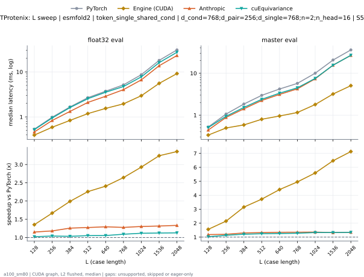

**float32 eval** (median ms; x = speedup vs PyTorch)

| L | PyTorch | Engine (Triton) | Engine (CUDA) | Anthropic | cuEquivariance |
|---|---|---|---|---|---|
| 128 | 0.5335 | 0.4874 (1.09x) | 0.3948 (1.35x) | 0.4639 (1.15x) | 0.5222 (1.02x) |
| 256 | 0.9841 | 0.8643 (1.14x) | 0.5898 (1.67x) | 0.8335 (1.18x) | 0.9462 (1.04x) |
| 384 | 1.666 | 1.369 (1.22x) | 0.8366 (1.99x) | 1.325 (1.26x) | 1.614 (1.03x) |
| 512 | 2.673 | 2.13 (1.25x) | 1.184 (2.26x) | 2.098 (1.27x) | 2.541 (1.05x) |
| 640 | 3.722 | 2.891 (1.29x) | 1.546 (2.41x) | 2.878 (1.29x) | 3.532 (1.05x) |
| 768 | 5.154 | 4.038 (1.28x) | 1.951 (2.64x) | 4.037 (1.28x) | 4.731 (1.09x) |
| 1024 | 8.663 | 6.689 (1.30x) | 2.956 (2.93x) | 6.652 (1.30x) | 7.758 (1.12x) |
| 1536 | 18.01 | 13.68 (1.32x) | 5.556 (3.24x) | 13.7 (1.31x) | 16.04 (1.12x) |
| 2048 | 30.79 | 23.1 (1.33x) | 9.174 (3.36x) | 23.11 (1.33x) | 27.32 (1.13x) |

**master eval** (median ms; x = speedup vs PyTorch)

| L | PyTorch | Engine (Triton) | Engine (CUDA) | Anthropic | cuEquivariance |
|---|---|---|---|---|---|
| 128 | 0.5202 | 0.4628 (1.12x) | 0.3338 (1.56x) | 0.4403 (1.18x) | 0.5053 (1.03x) |
| 256 | 1.06 | 0.9001 (1.18x) | 0.4936 (2.15x) | 0.8806 (1.20x) | 0.938 (1.13x) |
| 384 | 1.84 | 1.446 (1.27x) | 0.5837 (3.15x) | 1.414 (1.30x) | 1.524 (1.21x) |
| 512 | 2.966 | 2.286 (1.30x) | 0.7967 (3.72x) | 2.236 (1.33x) | 2.386 (1.24x) |
| 640 | 4.202 | 3.167 (1.33x) | 0.9533 (4.41x) | 3.12 (1.35x) | 3.342 (1.26x) |
| 768 | 5.724 | 4.271 (1.34x) | 1.155 (4.96x) | 4.233 (1.35x) | 4.482 (1.28x) |
| 1024 | 10.02 | 7.452 (1.34x) | 1.79 (5.60x) | 7.363 (1.36x) | 7.539 (1.33x) |
| 1536 | 20.66 | 15.61 (1.32x) | 3.191 (6.47x) | 15.6 (1.32x) | 15.54 (1.33x) |
| 2048 | 36.03 | 26.91 (1.34x) | 5.051 (7.13x) | 26.72 (1.35x) | 26.87 (1.34x) |

### L sweep: intellifold2 | token_single | d_cond=384;d_pair=512;d_single=768;n=2;n_head=16 | S1 | graph

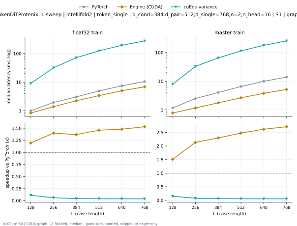

**float32 train** (median ms; x = speedup vs PyTorch)

| L | PyTorch | Engine (Triton) | Engine (CUDA) | Anthropic | cuEquivariance |
|---|---|---|---|---|---|
| 128 | 0.9984 | 0.9769 (1.02x) | 0.8356 (1.19x) | unsupported | 8.995 (0.11x) |
| 256 | 1.949 | 1.921 (1.01x) | 1.393 (1.40x) | unsupported | 31.89 (0.06x) |
| 384 | 3.059 | 3.002 (1.02x) | 2.235 (1.37x) | unsupported | 71.46 (0.04x) |
| 512 | 4.956 | 4.881 (1.02x) | 3.395 (1.46x) | unsupported | 124.4 (0.04x) |
| 640 | 7.45 | 7.228 (1.03x) | 5.033 (1.48x) | unsupported | 194.2 (0.04x) |
| 768 | 10.51 | 10.17 (1.03x) | 6.862 (1.53x) | unsupported | 277.7 (0.04x) |

**master train** (median ms; x = speedup vs PyTorch)

| L | PyTorch | Engine (Triton) | Engine (CUDA) | Anthropic | cuEquivariance |
|---|---|---|---|---|---|
| 128 | 1.175 | 1.124 (1.04x) | 0.7762 (1.51x) | unsupported | 7.859 (0.15x) |
| 256 | 2.479 | 2.4 (1.03x) | 1.162 (2.13x) | unsupported | 32.86 (0.08x) |
| 384 | 4.034 | 3.933 (1.03x) | 1.757 (2.30x) | unsupported | 64.9 (0.06x) |
| 512 | 6.537 | 6.413 (1.02x) | 2.64 (2.48x) | unsupported | 114.5 (0.06x) |
| 640 | 9.901 | 9.614 (1.03x) | 3.782 (2.62x) | unsupported | 179 (0.06x) |
| 768 | 13.94 | 13.47 (1.04x) | 5.144 (2.71x) | unsupported | 256.4 (0.05x) |

### L sweep: intellifold2 | token_single | d_cond=384;d_pair=512;d_single=768;n=2;n_head=16 | S5 | graph

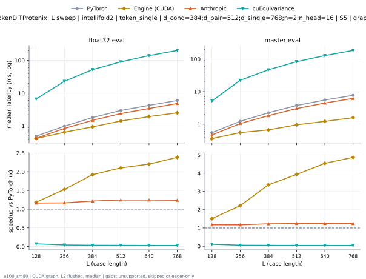

**float32 eval** (median ms; x = speedup vs PyTorch)

| L | PyTorch | Engine (Triton) | Engine (CUDA) | Anthropic | cuEquivariance |
|---|---|---|---|---|---|
| 128 | 0.4895 | 0.4434 (1.10x) | 0.4127 (1.19x) | 0.4209 (1.16x) | 6.661 (0.07x) |
| 256 | 0.983 | 0.8632 (1.14x) | 0.6436 (1.53x) | 0.8417 (1.17x) | 23.09 (0.04x) |
| 384 | 1.81 | 1.51 (1.20x) | 0.9416 (1.92x) | 1.488 (1.22x) | 52.71 (0.03x) |
| 512 | 2.976 | 2.438 (1.22x) | 1.416 (2.10x) | 2.391 (1.24x) | 90.82 (0.03x) |
| 640 | 4.262 | 3.461 (1.23x) | 1.934 (2.20x) | 3.426 (1.24x) | 141.1 (0.03x) |
| 768 | 6.016 | 4.949 (1.22x) | 2.523 (2.38x) | 4.857 (1.24x) | 202.8 (0.03x) |

**master eval** (median ms; x = speedup vs PyTorch)

| L | PyTorch | Engine (Triton) | Engine (CUDA) | Anthropic | cuEquivariance |
|---|---|---|---|---|---|
| 128 | 0.5478 | 0.4895 (1.12x) | 0.3615 (1.52x) | 0.4659 (1.18x) | 5.178 (0.11x) |
| 256 | 1.226 | 1.066 (1.15x) | 0.5509 (2.22x) | 1.046 (1.17x) | 22.38 (0.05x) |
| 384 | 2.248 | 1.86 (1.21x) | 0.6676 (3.37x) | 1.828 (1.23x) | 47.09 (0.05x) |
| 512 | 3.758 | 3.083 (1.22x) | 0.9549 (3.94x) | 3.028 (1.24x) | 83.59 (0.04x) |
| 640 | 5.545 | 4.514 (1.23x) | 1.221 (4.54x) | 4.46 (1.24x) | 129.1 (0.04x) |
| 768 | 7.711 | 6.288 (1.23x) | 1.583 (4.87x) | 6.198 (1.24x) | 185.5 (0.04x) |

### L sweep: intellifold2 | token_single_shared_cond | d_cond=384;d_pair=512;d_single=768;n=2;n_head=16 | S5 | graph

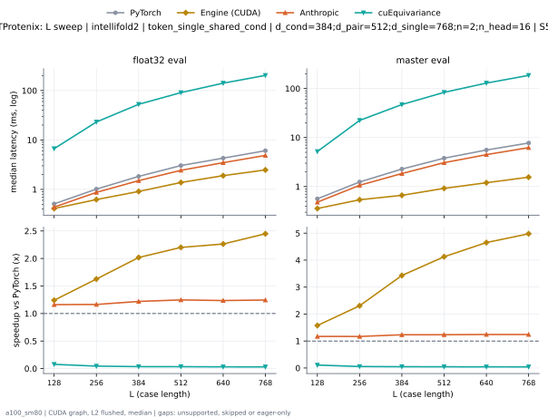

**float32 eval** (median ms; x = speedup vs PyTorch)

| L | PyTorch | Engine (Triton) | Engine (CUDA) | Anthropic | cuEquivariance |
|---|---|---|---|---|---|
| 128 | 0.5089 | 0.4628 (1.10x) | 0.4101 (1.24x) | 0.4383 (1.16x) | 6.667 (0.08x) |
| 256 | 1.013 | 0.8909 (1.14x) | 0.6226 (1.63x) | 0.8694 (1.16x) | 23.13 (0.04x) |
| 384 | 1.832 | 1.549 (1.18x) | 0.9078 (2.02x) | 1.502 (1.22x) | 52.73 (0.03x) |
| 512 | 3.034 | 2.483 (1.22x) | 1.378 (2.20x) | 2.433 (1.25x) | 90.87 (0.03x) |
| 640 | 4.289 | 3.509 (1.22x) | 1.895 (2.26x) | 3.47 (1.24x) | 141.2 (0.03x) |
| 768 | 6.067 | 4.957 (1.22x) | 2.477 (2.45x) | 4.873 (1.25x) | 202.9 (0.03x) |

**master eval** (median ms; x = speedup vs PyTorch)

| L | PyTorch | Engine (Triton) | Engine (CUDA) | Anthropic | cuEquivariance |
|---|---|---|---|---|---|
| 128 | 0.5632 | 0.5038 (1.12x) | 0.3574 (1.58x) | 0.4813 (1.17x) | 5.192 (0.11x) |
| 256 | 1.243 | 1.083 (1.15x) | 0.5386 (2.31x) | 1.063 (1.17x) | 22.39 (0.06x) |
| 384 | 2.277 | 1.879 (1.21x) | 0.6636 (3.43x) | 1.847 (1.23x) | 47.15 (0.05x) |
| 512 | 3.797 | 3.124 (1.22x) | 0.9201 (4.13x) | 3.075 (1.23x) | 83.62 (0.05x) |
| 640 | 5.573 | 4.53 (1.23x) | 1.198 (4.65x) | 4.483 (1.24x) | 129.1 (0.04x) |
| 768 | 7.747 | 6.317 (1.23x) | 1.556 (4.98x) | 6.231 (1.24x) | 185.5 (0.04x) |

### L sweep: protenix | token_folds | d_cond=384;d_pair=128;d_single=768;n=2;n_head=16 | D5 | S5 | graph

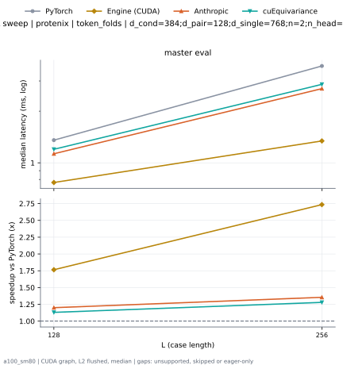

**master eval** (median ms; x = speedup vs PyTorch)

| L | PyTorch | Engine (Triton) | Engine (CUDA) | Anthropic | cuEquivariance |
|---|---|---|---|---|---|
| 128 | 1.356 | 1.143 (1.19x) | 0.768 (1.77x) | 1.129 (1.20x) | 1.199 (1.13x) |
| 256 | 3.668 | 2.767 (1.33x) | 1.341 (2.73x) | 2.707 (1.35x) | 2.867 (1.28x) |

### L sweep: protenix | token_folds_shared_cond | d_cond=384;d_pair=128;d_single=768;n=2;n_head=16 | D5 | S5 | graph

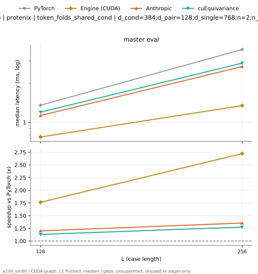

**master eval** (median ms; x = speedup vs PyTorch)

| L | PyTorch | Engine (Triton) | Engine (CUDA) | Anthropic | cuEquivariance |
|---|---|---|---|---|---|
| 128 | 1.357 | 1.145 (1.19x) | 0.769 (1.76x) | 1.129 (1.20x) | 1.199 (1.13x) |
| 256 | 3.67 | 2.771 (1.32x) | 1.348 (2.72x) | 2.707 (1.36x) | 2.877 (1.28x) |

### L sweep: protenix_v2 | token_single | d_cond=384;d_pair=256;d_single=768;n=2;n_head=16 | S1 | graph

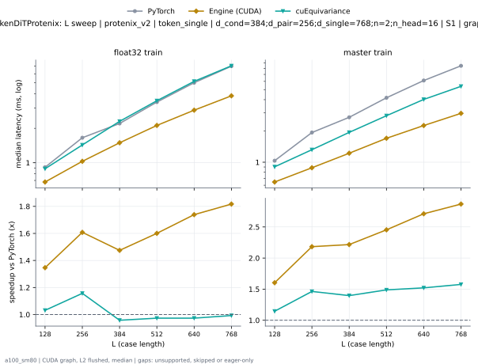

**float32 train** (median ms; x = speedup vs PyTorch)

| L | PyTorch | Engine (Triton) | Engine (CUDA) | Anthropic | cuEquivariance |
|---|---|---|---|---|---|
| 128 | 0.9134 | 0.8909 (1.03x) | 0.6784 (1.35x) | unsupported | 0.8858 (1.03x) |
| 256 | 1.655 | 1.626 (1.02x) | 1.029 (1.61x) | unsupported | 1.431 (1.16x) |
| 384 | 2.205 | 2.147 (1.03x) | 1.495 (1.47x) | unsupported | 2.302 (0.96x) |
| 512 | 3.394 | 3.295 (1.03x) | 2.12 (1.60x) | unsupported | 3.487 (0.97x) |
| 640 | 5.012 | 4.763 (1.05x) | 2.883 (1.74x) | unsupported | 5.15 (0.97x) |
| 768 | 6.995 | 6.612 (1.06x) | 3.85 (1.82x) | unsupported | 7.047 (0.99x) |

**master train** (median ms; x = speedup vs PyTorch)

| L | PyTorch | Engine (Triton) | Engine (CUDA) | Anthropic | cuEquivariance |
|---|---|---|---|---|---|
| 128 | 1.034 | 0.983 (1.05x) | 0.6451 (1.60x) | unsupported | 0.9032 (1.15x) |
| 256 | 1.931 | 1.853 (1.04x) | 0.8847 (2.18x) | unsupported | 1.32 (1.46x) |
| 384 | 2.705 | 2.607 (1.04x) | 1.221 (2.22x) | unsupported | 1.937 (1.40x) |
| 512 | 4.171 | 4.015 (1.04x) | 1.7 (2.45x) | unsupported | 2.803 (1.49x) |
| 640 | 6.114 | 5.837 (1.05x) | 2.255 (2.71x) | unsupported | 4.02 (1.52x) |
| 768 | 8.472 | 8.005 (1.06x) | 2.954 (2.87x) | unsupported | 5.375 (1.58x) |

### L sweep: protenix_v2 | token_single | d_cond=384;d_pair=256;d_single=768;n=2;n_head=16 | S5 | graph

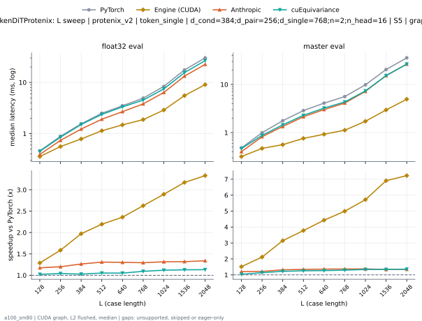

**float32 eval** (median ms; x = speedup vs PyTorch)

| L | PyTorch | Engine (Triton) | Engine (CUDA) | Anthropic | cuEquivariance |
|---|---|---|---|---|---|
| 128 | 0.4608 | 0.4157 (1.11x) | 0.3574 (1.29x) | 0.3922 (1.17x) | 0.4506 (1.02x) |
| 256 | 0.8888 | 0.768 (1.16x) | 0.5601 (1.59x) | 0.7404 (1.20x) | 0.854 (1.04x) |
| 384 | 1.552 | 1.255 (1.24x) | 0.7869 (1.97x) | 1.228 (1.26x) | 1.51 (1.03x) |
| 512 | 2.503 | 1.958 (1.28x) | 1.14 (2.19x) | 1.913 (1.31x) | 2.378 (1.05x) |
| 640 | 3.504 | 2.697 (1.30x) | 1.485 (2.36x) | 2.69 (1.30x) | 3.333 (1.05x) |
| 768 | 4.935 | 3.835 (1.29x) | 1.878 (2.63x) | 3.812 (1.29x) | 4.516 (1.09x) |
| 1024 | 8.376 | 6.358 (1.32x) | 2.893 (2.90x) | 6.368 (1.32x) | 7.483 (1.12x) |
| 1536 | 17.54 | 13.19 (1.33x) | 5.531 (3.17x) | 13.29 (1.32x) | 15.55 (1.13x) |
| 2048 | 30.24 | 22.5 (1.34x) | 9.076 (3.33x) | 22.57 (1.34x) | 26.7 (1.13x) |

**master eval** (median ms; x = speedup vs PyTorch)

| L | PyTorch | Engine (Triton) | Engine (CUDA) | Anthropic | cuEquivariance |
|---|---|---|---|---|---|
| 128 | 0.4813 | 0.4219 (1.14x) | 0.3185 (1.51x) | 0.4014 (1.20x) | 0.4659 (1.03x) |
| 256 | 0.9964 | 0.8376 (1.19x) | 0.4705 (2.12x) | 0.8212 (1.21x) | 0.8755 (1.14x) |
| 384 | 1.768 | 1.378 (1.28x) | 0.5622 (3.14x) | 1.341 (1.32x) | 1.449 (1.22x) |
| 512 | 2.867 | 2.192 (1.31x) | 0.7588 (3.78x) | 2.136 (1.34x) | 2.286 (1.25x) |
| 640 | 4.097 | 3.057 (1.34x) | 0.9247 (4.43x) | 3.012 (1.36x) | 3.231 (1.27x) |
| 768 | 5.603 | 4.147 (1.35x) | 1.122 (4.99x) | 4.1 (1.37x) | 4.33 (1.29x) |
| 1024 | 9.838 | 7.277 (1.35x) | 1.72 (5.72x) | 7.18 (1.37x) | 7.352 (1.34x) |
| 1536 | 20.41 | 15.27 (1.34x) | 2.955 (6.91x) | 15.27 (1.34x) | 15.24 (1.34x) |
| 2048 | 35.69 | 26.52 (1.35x) | 4.939 (7.23x) | 26.49 (1.35x) | 26.44 (1.35x) |

### L sweep: protenix_v2 | token_single_shared_cond | d_cond=384;d_pair=256;d_single=768;n=2;n_head=16 | S5 | graph

**float32 eval** (median ms; x = speedup vs PyTorch)

| L | PyTorch | Engine (Triton) | Engine (CUDA) | Anthropic | cuEquivariance |
|---|---|---|---|---|---|
| 128 | 0.4782 | 0.4332 (1.10x) | 0.3512 (1.36x) | 0.4096 (1.17x) | 0.469 (1.02x) |
| 256 | 0.9165 | 0.7987 (1.15x) | 0.5335 (1.72x) | 0.768 (1.19x) | 0.8817 (1.04x) |
| 384 | 1.572 | 1.282 (1.23x) | 0.7613 (2.07x) | 1.238 (1.27x) | 1.524 (1.03x) |
| 512 | 2.548 | 2.018 (1.26x) | 1.083 (2.35x) | 1.971 (1.29x) | 2.424 (1.05x) |
| 640 | 3.566 | 2.765 (1.29x) | 1.404 (2.54x) | 2.758 (1.29x) | 3.39 (1.05x) |
| 768 | 4.997 | 3.897 (1.28x) | 1.786 (2.80x) | 3.891 (1.28x) | 4.566 (1.09x) |
| 1024 | 8.409 | 6.492 (1.30x) | 2.767 (3.04x) | 6.46 (1.30x) | 7.553 (1.11x) |
| 1536 | 17.66 | 13.36 (1.32x) | 5.203 (3.39x) | 13.29 (1.33x) | 15.67 (1.13x) |
| 2048 | 30.3 | 22.77 (1.33x) | 8.593 (3.53x) | 22.64 (1.34x) | 26.97 (1.12x) |

**master eval** (median ms; x = speedup vs PyTorch)

| L | PyTorch | Engine (Triton) | Engine (CUDA) | Anthropic | cuEquivariance |
|---|---|---|---|---|---|
| 128 | 0.4966 | 0.4383 (1.13x) | 0.3144 (1.58x) | 0.4168 (1.19x) | 0.4823 (1.03x) |
| 256 | 1.019 | 0.8581 (1.19x) | 0.4669 (2.18x) | 0.8376 (1.22x) | 0.898 (1.13x) |
| 384 | 1.779 | 1.39 (1.28x) | 0.5519 (3.22x) | 1.361 (1.31x) | 1.466 (1.21x) |
| 512 | 2.885 | 2.211 (1.30x) | 0.7434 (3.88x) | 2.158 (1.34x) | 2.3 (1.25x) |
| 640 | 4.107 | 3.079 (1.33x) | 0.9006 (4.56x) | 3.058 (1.34x) | 3.218 (1.28x) |
| 768 | 5.604 | 4.168 (1.34x) | 1.105 (5.07x) | 4.147 (1.35x) | 4.342 (1.29x) |
| 1024 | 9.82 | 7.261 (1.35x) | 1.7 (5.78x) | 7.165 (1.37x) | 7.291 (1.35x) |
| 1536 | 20.47 | 15.42 (1.33x) | 3.058 (6.69x) | 15.21 (1.35x) | 15.29 (1.34x) |
| 2048 | 35.85 | 26.6 (1.35x) | 4.942 (7.26x) | 26.44 (1.36x) | 26.48 (1.35x) |

### d_pair sweep at L768: token_single | n=2 | S1 | graph

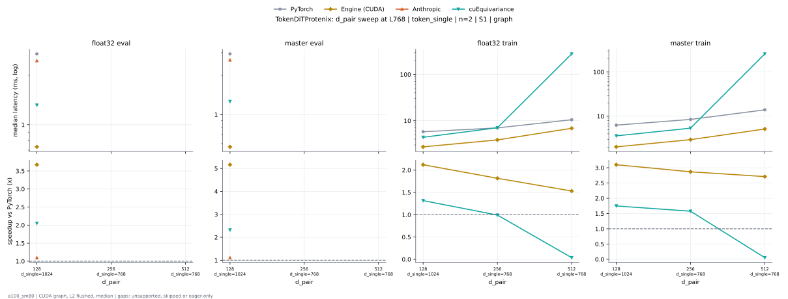

**float32 eval** (median ms; x = speedup vs PyTorch)

| d_pair | PyTorch | Engine (Triton) | Engine (CUDA) | Anthropic | cuEquivariance |
|---|---|---|---|---|---|
| 128 d_single=1024 | 2.692 | 2.462 (1.09x) | 0.7332 (3.67x) | 2.45 (1.10x) | 1.314 (2.05x) |
| 256 d_single=768 |  |  |  |  |  |
| 512 d_single=768 |  |  |  |  |  |

**master eval** (median ms; x = speedup vs PyTorch)

| d_pair | PyTorch | Engine (Triton) | Engine (CUDA) | Anthropic | cuEquivariance |
|---|---|---|---|---|---|
| 128 d_single=1024 | 2.922 | 2.659 (1.10x) | 0.5663 (5.16x) | 2.631 (1.11x) | 1.261 (2.32x) |
| 256 d_single=768 |  |  |  |  |  |
| 512 d_single=768 |  |  |  |  |  |

**float32 train** (median ms; x = speedup vs PyTorch)

| d_pair | PyTorch | Engine (Triton) | Engine (CUDA) | Anthropic | cuEquivariance |
|---|---|---|---|---|---|
| 128 d_single=1024 | 5.776 | 5.373 (1.07x) | 2.723 (2.12x) | unsupported | 4.385 (1.32x) |
| 256 d_single=768 | 6.995 | 6.612 (1.06x) | 3.85 (1.82x) | unsupported | 7.047 (0.99x) |
| 512 d_single=768 | 10.51 | 10.17 (1.03x) | 6.862 (1.53x) | unsupported | 277.7 (0.04x) |

**master train** (median ms; x = speedup vs PyTorch)

| d_pair | PyTorch | Engine (Triton) | Engine (CUDA) | Anthropic | cuEquivariance |
|---|---|---|---|---|---|
| 128 d_single=1024 | 6.286 | 5.804 (1.08x) | 2.029 (3.10x) | unsupported | 3.596 (1.75x) |
| 256 d_single=768 | 8.472 | 8.005 (1.06x) | 2.954 (2.87x) | unsupported | 5.375 (1.58x) |
| 512 d_single=768 | 13.94 | 13.47 (1.04x) | 5.144 (2.71x) | unsupported | 256.4 (0.05x) |

### d_pair sweep at L768: token_single | n=2 | S5 | graph

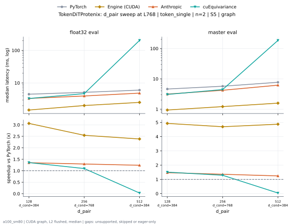

**float32 eval** (median ms; x = speedup vs PyTorch)

| d_pair | PyTorch | Engine (Triton) | Engine (CUDA) | Anthropic | cuEquivariance |
|---|---|---|---|---|---|
| 128 d_cond=384 | 4.499 | 3.366 (1.34x) | 1.469 (3.06x) | 3.333 (1.35x) | 3.321 (1.35x) |
| 256 d_cond=768 | 5.137 | 4.047 (1.27x) | 2.019 (2.54x) | 3.971 (1.29x) | 4.688 (1.10x) |
| 512 d_cond=384 | 6.016 | 4.949 (1.22x) | 2.523 (2.38x) | 4.857 (1.24x) | 202.8 (0.03x) |

**master eval** (median ms; x = speedup vs PyTorch)

| d_pair | PyTorch | Engine (Triton) | Engine (CUDA) | Anthropic | cuEquivariance |
|---|---|---|---|---|---|
| 128 d_cond=384 | 4.627 | 3.195 (1.45x) | 0.939 (4.93x) | 3.146 (1.47x) | 3.068 (1.51x) |
| 256 d_cond=768 | 5.716 | 4.287 (1.33x) | 1.218 (4.69x) | 4.209 (1.36x) | 4.437 (1.29x) |
| 512 d_cond=384 | 7.711 | 6.288 (1.23x) | 1.583 (4.87x) | 6.198 (1.24x) | 185.5 (0.04x) |

### d_pair sweep at L768: token_single_shared_cond | n=2 | S5 | graph

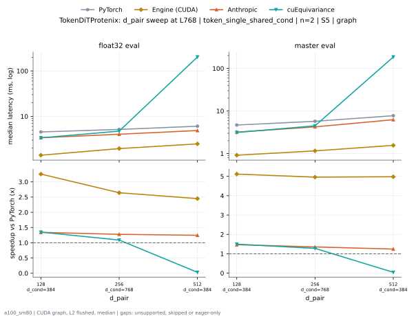

**float32 eval** (median ms; x = speedup vs PyTorch)

| d_pair | PyTorch | Engine (Triton) | Engine (CUDA) | Anthropic | cuEquivariance |
|---|---|---|---|---|---|
| 128 d_cond=384 | 4.537 | 3.387 (1.34x) | 1.394 (3.25x) | 3.384 (1.34x) | 3.364 (1.35x) |
| 256 d_cond=768 | 5.154 | 4.038 (1.28x) | 1.951 (2.64x) | 4.037 (1.28x) | 4.731 (1.09x) |
| 512 d_cond=384 | 6.067 | 4.957 (1.22x) | 2.477 (2.45x) | 4.873 (1.25x) | 202.9 (0.03x) |

**master eval** (median ms; x = speedup vs PyTorch)

| d_pair | PyTorch | Engine (Triton) | Engine (CUDA) | Anthropic | cuEquivariance |
|---|---|---|---|---|---|
| 128 d_cond=384 | 4.673 | 3.219 (1.45x) | 0.9134 (5.12x) | 3.184 (1.47x) | 3.125 (1.50x) |
| 256 d_cond=768 | 5.724 | 4.271 (1.34x) | 1.155 (4.96x) | 4.233 (1.35x) | 4.482 (1.28x) |
| 512 d_cond=384 | 7.747 | 6.317 (1.23x) | 1.556 (4.98x) | 6.231 (1.24x) | 185.5 (0.04x) |

### n_head sweep at L768: token_single | n=2 | S1 | graph

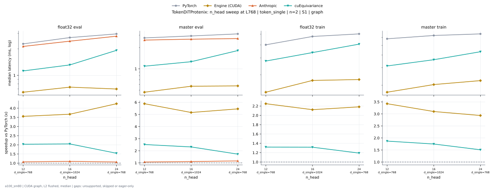

**float32 eval** (median ms; x = speedup vs PyTorch)

| n_head | PyTorch | Engine (Triton) | Engine (CUDA) | Anthropic | cuEquivariance |
|---|---|---|---|---|---|
| 12 d_single=768 | 2.282 | 2.131 (1.07x) | 0.642 (3.56x) | 2.135 (1.07x) | 1.122 (2.03x) |
| 16 d_single=1024 | 2.692 | 2.462 (1.09x) | 0.7332 (3.67x) | 2.45 (1.10x) | 1.314 (2.05x) |
| 24 d_single=768 | 2.964 | 2.611 (1.14x) | 0.6984 (4.24x) | 2.791 (1.06x) | 1.926 (1.54x) |

**master eval** (median ms; x = speedup vs PyTorch)

| n_head | PyTorch | Engine (Triton) | Engine (CUDA) | Anthropic | cuEquivariance |
|---|---|---|---|---|---|
| 12 d_single=768 | 2.742 | 2.575 (1.06x) | 0.4659 (5.89x) | 2.555 (1.07x) | 1.09 (2.52x) |
| 16 d_single=1024 | 2.922 | 2.659 (1.10x) | 0.5663 (5.16x) | 2.631 (1.11x) | 1.261 (2.32x) |
| 24 d_single=768 | 3.125 | 2.713 (1.15x) | 0.5724 (5.46x) | 2.684 (1.16x) | 1.815 (1.72x) |

**float32 train** (median ms; x = speedup vs PyTorch)

| n_head | PyTorch | Engine (Triton) | Engine (CUDA) | Anthropic | cuEquivariance |
|---|---|---|---|---|---|
| 12 d_single=768 | 5.009 | 4.782 (1.05x) | 2.227 (2.25x) | unsupported | 3.794 (1.32x) |
| 16 d_single=1024 | 5.776 | 5.373 (1.07x) | 2.723 (2.12x) | unsupported | 4.385 (1.32x) |
| 24 d_single=768 | 6.036 | 5.423 (1.11x) | 2.766 (2.18x) | unsupported | 5.067 (1.19x) |

**master train** (median ms; x = speedup vs PyTorch)

| n_head | PyTorch | Engine (Triton) | Engine (CUDA) | Anthropic | cuEquivariance |
|---|---|---|---|---|---|
| 12 d_single=768 | 5.823 | 5.518 (1.06x) | 1.701 (3.42x) | unsupported | 3.115 (1.87x) |
| 16 d_single=1024 | 6.286 | 5.804 (1.08x) | 2.029 (3.10x) | unsupported | 3.596 (1.75x) |
| 24 d_single=768 | 6.519 | 5.721 (1.14x) | 2.222 (2.93x) | unsupported | 4.323 (1.51x) |

