# TokenDiTProtenix on a100_sm80

Generated by `python -m miniworld_engine.measure.plot` from speed tokens `judge/tokens/a100_sm80/`; do not edit.

### L sweep: token_single | d_cond=384;d_pair=128;d_single=1024;n=2;n_head=16 | S1 | graph

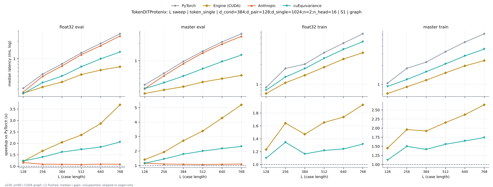

**float32 eval** (median ms; x = speedup vs PyTorch)

| L | PyTorch | Engine (Triton) | Engine (CUDA) | Anthropic | cuEquivariance |
|---|---|---|---|---|---|
| 128 | 0.3103 | 0.2913 (1.07x) | 0.254 (1.22x) | 0.2673 (1.16x) | 0.2519 (1.23x) |
| 256 | 0.5448 | 0.5202 (1.05x) | 0.3267 (1.67x) | 0.4977 (1.09x) | 0.3871 (1.41x) |
| 384 | 0.8182 | 0.7762 (1.05x) | 0.3994 (2.05x) | 0.7485 (1.09x) | 0.5018 (1.63x) |
| 512 | 1.269 | 1.203 (1.05x) | 0.5366 (2.36x) | 1.174 (1.08x) | 0.727 (1.75x) |
| 640 | 1.833 | 1.684 (1.09x) | 0.6359 (2.88x) | 1.667 (1.10x) | 0.9933 (1.85x) |
| 768 | 2.692 | 2.467 (1.09x) | 0.7311 (3.68x) | 2.457 (1.10x) | 1.3 (2.07x) |

**master eval** (median ms; x = speedup vs PyTorch)

| L | PyTorch | Engine (Triton) | Engine (CUDA) | Anthropic | cuEquivariance |
|---|---|---|---|---|---|
| 128 | 0.3871 | 0.3615 (1.07x) | 0.2724 (1.42x) | 0.3318 (1.17x) | 0.3323 (1.16x) |
| 256 | 0.6124 | 0.5745 (1.07x) | 0.3174 (1.93x) | 0.5519 (1.11x) | 0.4198 (1.46x) |
| 384 | 0.9789 | 0.9196 (1.06x) | 0.3594 (2.72x) | 0.8909 (1.10x) | 0.5448 (1.80x) |
| 512 | 1.466 | 1.383 (1.06x) | 0.4311 (3.40x) | 1.363 (1.08x) | 0.7291 (2.01x) |
| 640 | 2.12 | 1.963 (1.08x) | 0.4946 (4.29x) | 1.936 (1.09x) | 0.9697 (2.19x) |
| 768 | 2.927 | 2.674 (1.09x) | 0.5632 (5.20x) | 2.636 (1.11x) | 1.255 (2.33x) |

**float32 train** (median ms; x = speedup vs PyTorch)

| L | PyTorch | Engine (Triton) | Engine (CUDA) | Anthropic | cuEquivariance |
|---|---|---|---|---|---|
| 128 | 0.8975 | 0.8817 (1.02x) | 0.7281 (1.23x) | unsupported | 0.8151 (1.10x) |
| 256 | 1.741 | 1.726 (1.01x) | 1.056 (1.65x) | unsupported | 1.287 (1.35x) |
| 384 | 2.02 | 2.01 (1.01x) | 1.369 (1.48x) | unsupported | 1.724 (1.17x) |
| 512 | 3.009 | 2.943 (1.02x) | 1.818 (1.66x) | unsupported | 2.457 (1.22x) |
| 640 | 4.188 | 4.016 (1.04x) | 2.406 (1.74x) | unsupported | 3.356 (1.25x) |
| 768 | 5.738 | 5.477 (1.05x) | 2.951 (1.94x) | unsupported | 4.369 (1.31x) |

**master train** (median ms; x = speedup vs PyTorch)

| L | PyTorch | Engine (Triton) | Engine (CUDA) | Anthropic | cuEquivariance |
|---|---|---|---|---|---|
| 128 | 1.037 | 1.009 (1.03x) | 0.7158 (1.45x) | unsupported | 0.9257 (1.12x) |
| 256 | 1.797 | 1.76 (1.02x) | 0.9134 (1.97x) | unsupported | 1.191 (1.51x) |
| 384 | 2.246 | 2.201 (1.02x) | 1.165 (1.93x) | unsupported | 1.576 (1.42x) |
| 512 | 3.277 | 3.217 (1.02x) | 1.519 (2.16x) | unsupported | 2.095 (1.56x) |
| 640 | 4.637 | 4.499 (1.03x) | 1.956 (2.37x) | unsupported | 2.803 (1.65x) |
| 768 | 6.261 | 6.012 (1.04x) | 2.368 (2.64x) | unsupported | 3.581 (1.75x) |

### L sweep: token_single | d_cond=384;d_pair=128;d_single=768;n=2;n_head=12 | S1 | graph

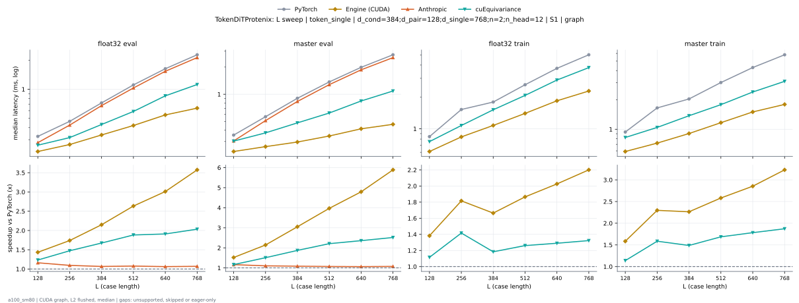

**float32 eval** (median ms; x = speedup vs PyTorch)

| L | PyTorch | Engine (Triton) | Engine (CUDA) | Anthropic | cuEquivariance |
|---|---|---|---|---|---|
| 128 | 0.3246 | 0.3062 (1.06x) | 0.2263 (1.43x) | 0.2796 (1.16x) | 0.2632 (1.23x) |
| 256 | 0.4649 | 0.4413 (1.05x) | 0.2662 (1.75x) | 0.425 (1.09x) | 0.3154 (1.47x) |
| 384 | 0.7209 | 0.6892 (1.05x) | 0.3359 (2.15x) | 0.6769 (1.07x) | 0.4311 (1.67x) |
| 512 | 1.109 | 1.057 (1.05x) | 0.4209 (2.64x) | 1.031 (1.08x) | 0.5888 (1.88x) |
| 640 | 1.631 | 1.546 (1.05x) | 0.5371 (3.04x) | 1.535 (1.06x) | 0.854 (1.91x) |
| 768 | 2.279 | 2.126 (1.07x) | 0.6349 (3.59x) | 2.128 (1.07x) | 1.119 (2.04x) |

**master eval** (median ms; x = speedup vs PyTorch)

| L | PyTorch | Engine (Triton) | Engine (CUDA) | Anthropic | cuEquivariance |
|---|---|---|---|---|---|
| 128 | 0.3543 | 0.3308 (1.07x) | 0.2324 (1.52x) | 0.3041 (1.16x) | 0.3031 (1.17x) |
| 256 | 0.5652 | 0.5315 (1.06x) | 0.2632 (2.15x) | 0.511 (1.11x) | 0.3738 (1.51x) |
| 384 | 0.9042 | 0.854 (1.06x) | 0.2964 (3.05x) | 0.8325 (1.09x) | 0.4823 (1.87x) |
| 512 | 1.37 | 1.306 (1.05x) | 0.3451 (3.97x) | 1.278 (1.07x) | 0.62 (2.21x) |
| 640 | 1.99 | 1.885 (1.06x) | 0.4157 (4.79x) | 1.866 (1.07x) | 0.8428 (2.36x) |
| 768 | 2.738 | 2.569 (1.07x) | 0.4649 (5.89x) | 2.547 (1.08x) | 1.087 (2.52x) |

**float32 train** (median ms; x = speedup vs PyTorch)

| L | PyTorch | Engine (Triton) | Engine (CUDA) | Anthropic | cuEquivariance |
|---|---|---|---|---|---|
| 128 | 0.8458 | 0.8315 (1.02x) | 0.64 (1.32x) | unsupported | 0.7567 (1.12x) |
| 256 | 1.523 | 1.514 (1.01x) | 0.8392 (1.81x) | unsupported | 1.075 (1.42x) |
| 384 | 1.791 | 1.78 (1.01x) | 1.072 (1.67x) | unsupported | 1.513 (1.18x) |
| 512 | 2.609 | 2.589 (1.01x) | 1.401 (1.86x) | unsupported | 2.07 (1.26x) |
| 640 | 3.726 | 3.66 (1.02x) | 1.846 (2.02x) | unsupported | 2.891 (1.29x) |
| 768 | 5.004 | 4.861 (1.03x) | 2.245 (2.23x) | unsupported | 3.788 (1.32x) |

**master train** (median ms; x = speedup vs PyTorch)

| L | PyTorch | Engine (Triton) | Engine (CUDA) | Anthropic | cuEquivariance |
|---|---|---|---|---|---|
| 128 | 0.937 | 0.9114 (1.03x) | 0.5893 (1.59x) | unsupported | 0.8233 (1.14x) |
| 256 | 1.658 | 1.641 (1.01x) | 0.724 (2.29x) | unsupported | 1.044 (1.59x) |
| 384 | 2.049 | 2.052 (1.00x) | 0.9052 (2.26x) | unsupported | 1.376 (1.49x) |
| 512 | 3.015 | 3.044 (0.99x) | 1.168 (2.58x) | unsupported | 1.789 (1.69x) |
| 640 | 4.299 | 4.325 (0.99x) | 1.506 (2.85x) | unsupported | 2.412 (1.78x) |
| 768 | 5.817 | 5.832 (1.00x) | 1.791 (3.25x) | unsupported | 3.104 (1.87x) |

### L sweep: token_single | d_cond=384;d_pair=128;d_single=768;n=2;n_head=24 | S1 | graph

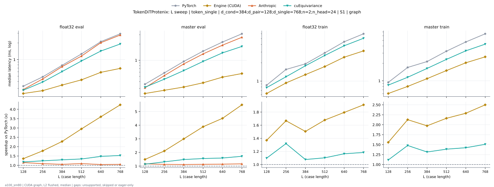

**float32 eval** (median ms; x = speedup vs PyTorch)

| L | PyTorch | Engine (Triton) | Engine (CUDA) | Anthropic | cuEquivariance |
|---|---|---|---|---|---|
| 128 | 0.3287 | 0.3082 (1.07x) | 0.2324 (1.41x) | 0.2867 (1.15x) | 0.2785 (1.18x) |
| 256 | 0.4854 | 0.4495 (1.08x) | 0.2734 (1.78x) | 0.4454 (1.09x) | 0.3912 (1.24x) |
| 384 | 0.7864 | 0.7107 (1.11x) | 0.3451 (2.28x) | 0.7455 (1.05x) | 0.6062 (1.30x) |
| 512 | 1.269 | 1.117 (1.14x) | 0.4291 (2.96x) | 1.158 (1.10x) | 0.9441 (1.34x) |
| 640 | 2.119 | 1.874 (1.13x) | 0.5806 (3.65x) | 2.026 (1.05x) | 1.43 (1.48x) |
| 768 | 2.939 | 2.594 (1.13x) | 0.6932 (4.24x) | 2.788 (1.05x) | 1.918 (1.53x) |

**master eval** (median ms; x = speedup vs PyTorch)

| L | PyTorch | Engine (Triton) | Engine (CUDA) | Anthropic | cuEquivariance |
|---|---|---|---|---|---|
| 128 | 0.3584 | 0.3318 (1.08x) | 0.2406 (1.49x) | 0.3072 (1.17x) | 0.3154 (1.14x) |
| 256 | 0.5847 | 0.5366 (1.09x) | 0.2775 (2.11x) | 0.5192 (1.13x) | 0.4444 (1.32x) |
| 384 | 0.9523 | 0.8714 (1.09x) | 0.3185 (2.99x) | 0.854 (1.12x) | 0.6431 (1.48x) |
| 512 | 1.481 | 1.333 (1.11x) | 0.3809 (3.89x) | 1.314 (1.13x) | 0.9528 (1.55x) |
| 640 | 2.188 | 1.927 (1.14x) | 0.4864 (4.50x) | 1.914 (1.14x) | 1.374 (1.59x) |
| 768 | 3.115 | 2.692 (1.16x) | 0.5652 (5.51x) | 2.681 (1.16x) | 1.81 (1.72x) |

**float32 train** (median ms; x = speedup vs PyTorch)

| L | PyTorch | Engine (Triton) | Engine (CUDA) | Anthropic | cuEquivariance |
|---|---|---|---|---|---|
| 128 | 0.8571 | 0.8376 (1.02x) | 0.6318 (1.36x) | unsupported | 0.7793 (1.10x) |
| 256 | 1.552 | 1.527 (1.02x) | 0.9318 (1.67x) | unsupported | 1.177 (1.32x) |
| 384 | 1.919 | 1.846 (1.04x) | 1.276 (1.50x) | unsupported | 1.783 (1.08x) |
| 512 | 2.909 | 2.711 (1.07x) | 1.739 (1.67x) | unsupported | 2.637 (1.10x) |
| 640 | 4.434 | 4.142 (1.07x) | 2.469 (1.80x) | unsupported | 3.806 (1.16x) |
| 768 | 5.954 | 5.564 (1.07x) | 3.138 (1.90x) | unsupported | 5.058 (1.18x) |

**master train** (median ms; x = speedup vs PyTorch)

| L | PyTorch | Engine (Triton) | Engine (CUDA) | Anthropic | cuEquivariance |
|---|---|---|---|---|---|
| 128 | 0.9462 | 0.9042 (1.05x) | 0.6052 (1.56x) | unsupported | 0.8438 (1.12x) |
| 256 | 1.702 | 1.622 (1.05x) | 0.8003 (2.13x) | unsupported | 1.152 (1.48x) |
| 384 | 2.153 | 2.032 (1.06x) | 1.093 (1.97x) | unsupported | 1.636 (1.32x) |
| 512 | 3.254 | 3.017 (1.08x) | 1.503 (2.16x) | unsupported | 2.345 (1.39x) |
| 640 | 4.697 | 4.312 (1.09x) | 2.052 (2.29x) | unsupported | 3.296 (1.42x) |
| 768 | 6.487 | 5.876 (1.10x) | 2.596 (2.50x) | unsupported | 4.3 (1.51x) |

### L sweep: af3|opendde|openfold3|openfold3_preview2|protenix | token_single | d_cond=384;d_pair=128;d_single=768;n=2;n_head=16 | S1 | graph

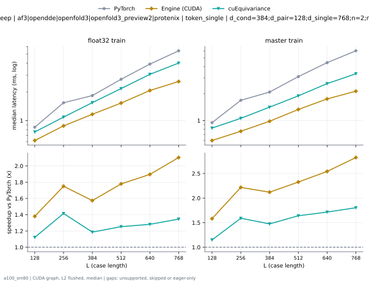

**float32 train** (median ms; x = speedup vs PyTorch)

| L | PyTorch | Engine (Triton) | Engine (CUDA) | Anthropic | cuEquivariance |
|---|---|---|---|---|---|
| 128 | 0.8499 | 0.8387 (1.01x) | 0.6159 (1.38x) | unsupported | 0.7588 (1.12x) |
| 256 | 1.532 | 1.523 (1.01x) | 0.8786 (1.74x) | unsupported | 1.086 (1.41x) |
| 384 | 1.829 | 1.819 (1.01x) | 1.149 (1.59x) | unsupported | 1.544 (1.18x) |
| 512 | 2.715 | 2.669 (1.02x) | 1.526 (1.78x) | unsupported | 2.169 (1.25x) |
| 640 | 3.923 | 3.751 (1.05x) | 2.07 (1.90x) | unsupported | 3.063 (1.28x) |
| 768 | 5.413 | 5.144 (1.05x) | 2.573 (2.10x) | unsupported | 4.024 (1.35x) |

**master train** (median ms; x = speedup vs PyTorch)

| L | PyTorch | Engine (Triton) | Engine (CUDA) | Anthropic | cuEquivariance |
|---|---|---|---|---|---|
| 128 | 0.9472 | 0.9155 (1.03x) | 0.5985 (1.58x) | unsupported | 0.8243 (1.15x) |
| 256 | 1.69 | 1.642 (1.03x) | 0.7619 (2.22x) | unsupported | 1.06 (1.59x) |
| 384 | 2.084 | 2.037 (1.02x) | 0.9841 (2.12x) | unsupported | 1.412 (1.48x) |
| 512 | 3.089 | 3.033 (1.02x) | 1.331 (2.32x) | unsupported | 1.888 (1.64x) |
| 640 | 4.435 | 4.3 (1.03x) | 1.747 (2.54x) | unsupported | 2.587 (1.71x) |
| 768 | 6.023 | 5.765 (1.04x) | 2.131 (2.83x) | unsupported | 3.335 (1.81x) |

### L sweep: af3|opendde|openfold3|openfold3_preview2|protenix | token_single | d_cond=384;d_pair=128;d_single=768;n=2;n_head=16 | S5 | graph

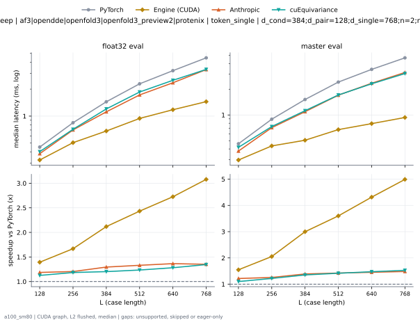

**float32 eval** (median ms; x = speedup vs PyTorch)

| L | PyTorch | Engine (Triton) | Engine (CUDA) | Anthropic | cuEquivariance |
|---|---|---|---|---|---|
| 128 | 0.4516 | 0.4045 (1.12x) | 0.3241 (1.39x) | 0.3809 (1.19x) | 0.4014 (1.13x) |
| 256 | 0.8438 | 0.724 (1.17x) | 0.5059 (1.67x) | 0.7009 (1.20x) | 0.7127 (1.18x) |
| 384 | 1.445 | 1.168 (1.24x) | 0.682 (2.12x) | 1.116 (1.29x) | 1.202 (1.20x) |
| 512 | 2.292 | 1.782 (1.29x) | 0.9421 (2.43x) | 1.722 (1.33x) | 1.857 (1.23x) |
| 640 | 3.211 | 2.382 (1.35x) | 1.178 (2.73x) | 2.354 (1.36x) | 2.507 (1.28x) |
| 768 | 4.462 | 3.336 (1.34x) | 1.449 (3.08x) | 3.302 (1.35x) | 3.316 (1.35x) |

**master eval** (median ms; x = speedup vs PyTorch)

| L | PyTorch | Engine (Triton) | Engine (CUDA) | Anthropic | cuEquivariance |
|---|---|---|---|---|---|
| 128 | 0.4598 | 0.4004 (1.15x) | 0.297 (1.55x) | 0.3779 (1.22x) | 0.4178 (1.10x) |
| 256 | 0.8919 | 0.7322 (1.22x) | 0.4342 (2.05x) | 0.7096 (1.26x) | 0.7311 (1.22x) |
| 384 | 1.517 | 1.122 (1.35x) | 0.5059 (3.00x) | 1.092 (1.39x) | 1.121 (1.35x) |
| 512 | 2.426 | 1.761 (1.38x) | 0.6738 (3.60x) | 1.704 (1.42x) | 1.712 (1.42x) |
| 640 | 3.415 | 2.389 (1.43x) | 0.7916 (4.31x) | 2.35 (1.45x) | 2.316 (1.47x) |
| 768 | 4.66 | 3.184 (1.46x) | 0.9339 (4.99x) | 3.142 (1.48x) | 3.05 (1.53x) |

### L sweep: esmfold2 | token_single | d_cond=768;d_pair=256;d_single=768;n=2;n_head=16 | S48 | graph

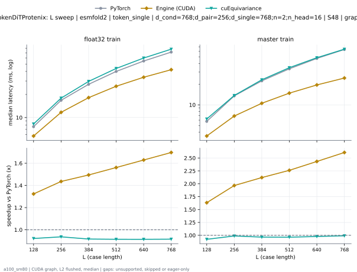

**float32 train** (median ms; x = speedup vs PyTorch)

| L | PyTorch | Engine (Triton) | Engine (CUDA) | Anthropic | cuEquivariance |
|---|---|---|---|---|---|
| 128 | 7.678 | 6.884 (1.12x) | 5.797 (1.32x) | unsupported | 8.246 (0.93x) |
| 256 | 16.92 | 14.61 (1.16x) | 11.82 (1.43x) | unsupported | 17.94 (0.94x) |
| 384 | 27.48 | 22.47 (1.22x) | 18.28 (1.50x) | unsupported | 29.66 (0.93x) |
| 512 | 40.02 | 31.72 (1.26x) | 25.62 (1.56x) | unsupported | 43.75 (0.91x) |
| 640 | 54.93 | 41.79 (1.31x) | 33.63 (1.63x) | unsupported | 59.89 (0.92x) |
| 768 | 71.48 | 52.74 (1.36x) | 41.73 (1.71x) | unsupported | 78.16 (0.91x) |

**master train** (median ms; x = speedup vs PyTorch)

| L | PyTorch | Engine (Triton) | Engine (CUDA) | Anthropic | cuEquivariance |
|---|---|---|---|---|---|
| 128 | 5.783 | 4.953 (1.17x) | 3.552 (1.63x) | unsupported | 6.234 (0.93x) |
| 256 | 13.53 | 10.19 (1.33x) | 6.939 (1.95x) | unsupported | 13.69 (0.99x) |
| 384 | 22.45 | 15.66 (1.43x) | 10.66 (2.11x) | unsupported | 23.17 (0.97x) |
| 512 | 33.48 | 22.31 (1.50x) | 14.88 (2.25x) | unsupported | 34.76 (0.96x) |
| 640 | 47.28 | 30.22 (1.56x) | 19.36 (2.44x) | unsupported | 48.55 (0.97x) |
| 768 | 63.89 | 38.79 (1.65x) | 24.45 (2.61x) | unsupported | 64.66 (0.99x) |

### L sweep: esmfold2 | token_single | d_cond=768;d_pair=256;d_single=768;n=2;n_head=16 | S5 | graph

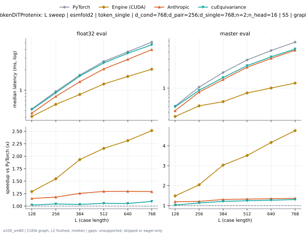

**float32 eval** (median ms; x = speedup vs PyTorch)

| L | PyTorch | Engine (Triton) | Engine (CUDA) | Anthropic | cuEquivariance |
|---|---|---|---|---|---|
| 128 | 0.5274 | 0.4813 (1.10x) | 0.4086 (1.29x) | 0.4577 (1.15x) | 0.5161 (1.02x) |
| 256 | 0.9533 | 0.832 (1.15x) | 0.6164 (1.55x) | 0.8079 (1.18x) | 0.9144 (1.04x) |
| 384 | 1.668 | 1.375 (1.21x) | 0.8632 (1.93x) | 1.329 (1.26x) | 1.615 (1.03x) |
| 512 | 2.659 | 2.102 (1.26x) | 1.233 (2.16x) | 2.054 (1.29x) | 2.521 (1.05x) |
| 640 | 3.683 | 2.882 (1.28x) | 1.593 (2.31x) | 2.842 (1.30x) | 3.502 (1.05x) |
| 768 | 5.117 | 4.011 (1.28x) | 2.036 (2.51x) | 3.967 (1.29x) | 4.677 (1.09x) |

**master eval** (median ms; x = speedup vs PyTorch)

| L | PyTorch | Engine (Triton) | Engine (CUDA) | Anthropic | cuEquivariance |
|---|---|---|---|---|---|
| 128 | 0.5048 | 0.4465 (1.13x) | 0.34 (1.48x) | 0.4229 (1.19x) | 0.4905 (1.03x) |
| 256 | 1.041 | 0.8837 (1.18x) | 0.51 (2.04x) | 0.8602 (1.21x) | 0.9216 (1.13x) |
| 384 | 1.812 | 1.417 (1.28x) | 0.598 (3.03x) | 1.388 (1.31x) | 1.496 (1.21x) |
| 512 | 2.927 | 2.265 (1.29x) | 0.8335 (3.51x) | 2.209 (1.32x) | 2.353 (1.24x) |
| 640 | 4.184 | 3.15 (1.33x) | 1.005 (4.17x) | 3.11 (1.35x) | 3.296 (1.27x) |
| 768 | 5.767 | 4.277 (1.35x) | 1.211 (4.76x) | 4.232 (1.36x) | 4.432 (1.30x) |

### L sweep: intellifold2 | token_single | d_cond=384;d_pair=512;d_single=768;n=2;n_head=16 | S1 | graph

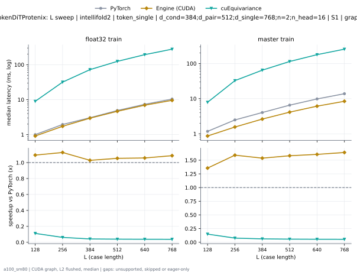

**float32 train** (median ms; x = speedup vs PyTorch)

| L | PyTorch | Engine (Triton) | Engine (CUDA) | Anthropic | cuEquivariance |
|---|---|---|---|---|---|
| 128 | 0.9989 | 0.9861 (1.01x) | 0.9155 (1.09x) | unsupported | 8.971 (0.11x) |
| 256 | 1.95 | 1.943 (1.00x) | 1.731 (1.13x) | unsupported | 31.75 (0.06x) |
| 384 | 3.049 | 3.033 (1.01x) | 2.993 (1.02x) | unsupported | 72.2 (0.04x) |
| 512 | 4.943 | 4.892 (1.01x) | 4.676 (1.06x) | unsupported | 124.5 (0.04x) |
| 640 | 7.397 | 7.258 (1.02x) | 6.943 (1.07x) | unsupported | 193.5 (0.04x) |
| 768 | 10.5 | 10.24 (1.02x) | 9.57 (1.10x) | unsupported | 277.9 (0.04x) |

**master train** (median ms; x = speedup vs PyTorch)

| L | PyTorch | Engine (Triton) | Engine (CUDA) | Anthropic | cuEquivariance |
|---|---|---|---|---|---|
| 128 | 1.175 | 1.147 (1.02x) | 0.8632 (1.36x) | unsupported | 7.878 (0.15x) |
| 256 | 2.477 | 2.417 (1.02x) | 1.561 (1.59x) | unsupported | 32.57 (0.08x) |
| 384 | 4.034 | 3.966 (1.02x) | 2.62 (1.54x) | unsupported | 64.65 (0.06x) |
| 512 | 6.534 | 6.451 (1.01x) | 4.126 (1.58x) | unsupported | 114.2 (0.06x) |
| 640 | 9.862 | 9.69 (1.02x) | 6.11 (1.61x) | unsupported | 178.5 (0.06x) |
| 768 | 13.92 | 13.57 (1.03x) | 8.424 (1.65x) | unsupported | 255.9 (0.05x) |

### L sweep: intellifold2 | token_single | d_cond=384;d_pair=512;d_single=768;n=2;n_head=16 | S5 | graph

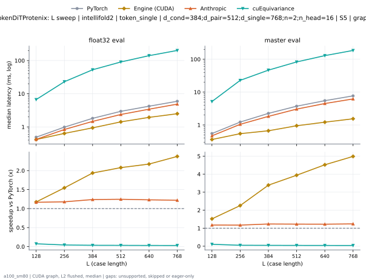

**float32 eval** (median ms; x = speedup vs PyTorch)

| L | PyTorch | Engine (Triton) | Engine (CUDA) | Anthropic | cuEquivariance |
|---|---|---|---|---|---|
| 128 | 0.49 | 0.4434 (1.11x) | 0.4106 (1.19x) | 0.4198 (1.17x) | 6.666 (0.07x) |
| 256 | 0.983 | 0.8622 (1.14x) | 0.638 (1.54x) | 0.8346 (1.18x) | 23 (0.04x) |
| 384 | 1.807 | 1.507 (1.20x) | 0.9308 (1.94x) | 1.465 (1.23x) | 52.81 (0.03x) |
| 512 | 2.974 | 2.451 (1.21x) | 1.417 (2.10x) | 2.367 (1.26x) | 90.64 (0.03x) |
| 640 | 4.236 | 3.481 (1.22x) | 1.906 (2.22x) | 3.419 (1.24x) | 140.5 (0.03x) |
| 768 | 5.967 | 4.938 (1.21x) | 2.514 (2.37x) | 4.859 (1.23x) | 202 (0.03x) |

**master eval** (median ms; x = speedup vs PyTorch)

| L | PyTorch | Engine (Triton) | Engine (CUDA) | Anthropic | cuEquivariance |
|---|---|---|---|---|---|
| 128 | 0.5478 | 0.4884 (1.12x) | 0.3594 (1.52x) | 0.4659 (1.18x) | 5.168 (0.11x) |
| 256 | 1.225 | 1.065 (1.15x) | 0.5417 (2.26x) | 1.046 (1.17x) | 22.81 (0.05x) |
| 384 | 2.254 | 1.857 (1.21x) | 0.6646 (3.39x) | 1.826 (1.23x) | 46.69 (0.05x) |
| 512 | 3.746 | 3.077 (1.22x) | 0.9359 (4.00x) | 3.037 (1.23x) | 82.95 (0.05x) |
| 640 | 5.53 | 4.491 (1.23x) | 1.228 (4.50x) | 4.492 (1.23x) | 129.3 (0.04x) |
| 768 | 7.75 | 6.246 (1.24x) | 1.578 (4.91x) | 6.199 (1.25x) | 185.9 (0.04x) |

### L sweep: protenix_v2 | token_single | d_cond=384;d_pair=256;d_single=768;n=2;n_head=16 | S1 | graph

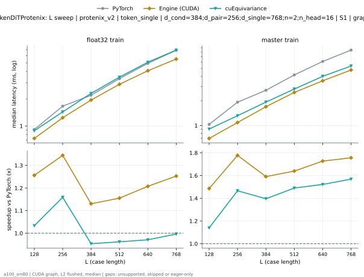

**float32 train** (median ms; x = speedup vs PyTorch)

| L | PyTorch | Engine (Triton) | Engine (CUDA) | Anthropic | cuEquivariance |
|---|---|---|---|---|---|
| 128 | 0.9155 | 0.9021 (1.01x) | 0.7291 (1.26x) | unsupported | 0.8847 (1.03x) |
| 256 | 1.656 | 1.645 (1.01x) | 1.231 (1.34x) | unsupported | 1.432 (1.16x) |
| 384 | 2.192 | 2.16 (1.02x) | 1.937 (1.13x) | unsupported | 2.298 (0.95x) |
| 512 | 3.356 | 3.295 (1.02x) | 2.902 (1.16x) | unsupported | 3.48 (0.96x) |
| 640 | 4.95 | 4.772 (1.04x) | 4.095 (1.21x) | unsupported | 5.093 (0.97x) |
| 768 | 6.92 | 6.644 (1.04x) | 5.539 (1.25x) | unsupported | 6.941 (1.00x) |

**master train** (median ms; x = speedup vs PyTorch)

| L | PyTorch | Engine (Triton) | Engine (CUDA) | Anthropic | cuEquivariance |
|---|---|---|---|---|---|
| 128 | 1.033 | 1.005 (1.03x) | 0.6932 (1.49x) | unsupported | 0.9052 (1.14x) |
| 256 | 1.93 | 1.916 (1.01x) | 1.091 (1.77x) | unsupported | 1.319 (1.46x) |
| 384 | 2.701 | 2.723 (0.99x) | 1.702 (1.59x) | unsupported | 1.937 (1.39x) |
| 512 | 4.169 | 4.193 (0.99x) | 2.545 (1.64x) | unsupported | 2.8 (1.49x) |
| 640 | 6.112 | 6.095 (1.00x) | 3.534 (1.73x) | unsupported | 4.012 (1.52x) |
| 768 | 8.426 | 8.35 (1.01x) | 4.798 (1.76x) | unsupported | 5.37 (1.57x) |

### L sweep: protenix_v2 | token_single | d_cond=384;d_pair=256;d_single=768;n=2;n_head=16 | S5 | graph

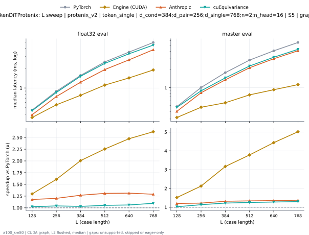

**float32 eval** (median ms; x = speedup vs PyTorch)

| L | PyTorch | Engine (Triton) | Engine (CUDA) | Anthropic | cuEquivariance |
|---|---|---|---|---|---|
| 128 | 0.4608 | 0.4147 (1.11x) | 0.3553 (1.30x) | 0.3912 (1.18x) | 0.4506 (1.02x) |
| 256 | 0.8899 | 0.77 (1.16x) | 0.554 (1.61x) | 0.7404 (1.20x) | 0.855 (1.04x) |
| 384 | 1.553 | 1.267 (1.23x) | 0.7741 (2.01x) | 1.225 (1.27x) | 1.507 (1.03x) |
| 512 | 2.493 | 1.965 (1.27x) | 1.106 (2.25x) | 1.906 (1.31x) | 2.369 (1.05x) |
| 640 | 3.518 | 2.715 (1.30x) | 1.422 (2.47x) | 2.68 (1.31x) | 3.317 (1.06x) |
| 768 | 4.929 | 3.856 (1.28x) | 1.88 (2.62x) | 3.822 (1.29x) | 4.496 (1.10x) |

**master eval** (median ms; x = speedup vs PyTorch)

| L | PyTorch | Engine (Triton) | Engine (CUDA) | Anthropic | cuEquivariance |
|---|---|---|---|---|---|
| 128 | 0.4818 | 0.4229 (1.14x) | 0.3174 (1.52x) | 0.4014 (1.20x) | 0.469 (1.03x) |
| 256 | 0.9994 | 0.8397 (1.19x) | 0.47 (2.13x) | 0.8182 (1.22x) | 0.8796 (1.14x) |
| 384 | 1.767 | 1.37 (1.29x) | 0.5581 (3.17x) | 1.34 (1.32x) | 1.446 (1.22x) |
| 512 | 2.853 | 2.187 (1.30x) | 0.7547 (3.78x) | 2.13 (1.34x) | 2.274 (1.25x) |
| 640 | 4.073 | 3.045 (1.34x) | 0.9185 (4.43x) | 3.005 (1.36x) | 3.185 (1.28x) |
| 768 | 5.601 | 4.127 (1.36x) | 1.117 (5.01x) | 4.083 (1.37x) | 4.307 (1.30x) |

### d_pair sweep at L768: token_single | n=2 | S1 | graph

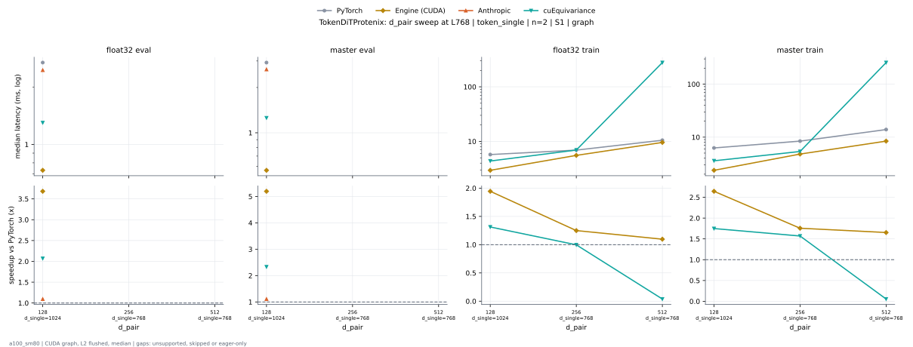

**float32 eval** (median ms; x = speedup vs PyTorch)

| d_pair | PyTorch | Engine (Triton) | Engine (CUDA) | Anthropic | cuEquivariance |
|---|---|---|---|---|---|
| 128 d_single=1024 | 2.692 | 2.467 (1.09x) | 0.7311 (3.68x) | 2.457 (1.10x) | 1.3 (2.07x) |
| 256 d_single=768 |  |  |  |  |  |
| 512 d_single=768 |  |  |  |  |  |

**master eval** (median ms; x = speedup vs PyTorch)

| d_pair | PyTorch | Engine (Triton) | Engine (CUDA) | Anthropic | cuEquivariance |
|---|---|---|---|---|---|
| 128 d_single=1024 | 2.927 | 2.674 (1.09x) | 0.5632 (5.20x) | 2.636 (1.11x) | 1.255 (2.33x) |
| 256 d_single=768 |  |  |  |  |  |
| 512 d_single=768 |  |  |  |  |  |

**float32 train** (median ms; x = speedup vs PyTorch)

| d_pair | PyTorch | Engine (Triton) | Engine (CUDA) | Anthropic | cuEquivariance |
|---|---|---|---|---|---|
| 128 d_single=1024 | 5.738 | 5.477 (1.05x) | 2.951 (1.94x) | unsupported | 4.369 (1.31x) |
| 256 d_single=768 | 6.92 | 6.644 (1.04x) | 5.539 (1.25x) | unsupported | 6.941 (1.00x) |
| 512 d_single=768 | 10.5 | 10.24 (1.02x) | 9.57 (1.10x) | unsupported | 277.9 (0.04x) |

**master train** (median ms; x = speedup vs PyTorch)

| d_pair | PyTorch | Engine (Triton) | Engine (CUDA) | Anthropic | cuEquivariance |
|---|---|---|---|---|---|
| 128 d_single=1024 | 6.261 | 6.012 (1.04x) | 2.368 (2.64x) | unsupported | 3.581 (1.75x) |
| 256 d_single=768 | 8.426 | 8.35 (1.01x) | 4.798 (1.76x) | unsupported | 5.37 (1.57x) |
| 512 d_single=768 | 13.92 | 13.57 (1.03x) | 8.424 (1.65x) | unsupported | 255.9 (0.05x) |

### d_pair sweep at L768: token_single | n=2 | S5 | graph

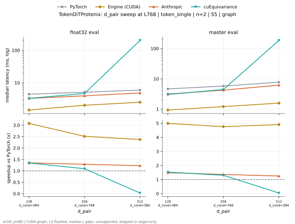

**float32 eval** (median ms; x = speedup vs PyTorch)

| d_pair | PyTorch | Engine (Triton) | Engine (CUDA) | Anthropic | cuEquivariance |
|---|---|---|---|---|---|
| 128 d_cond=384 | 4.462 | 3.336 (1.34x) | 1.449 (3.08x) | 3.302 (1.35x) | 3.316 (1.35x) |
| 256 d_cond=768 | 5.117 | 4.011 (1.28x) | 2.036 (2.51x) | 3.967 (1.29x) | 4.677 (1.09x) |
| 512 d_cond=384 | 5.967 | 4.938 (1.21x) | 2.514 (2.37x) | 4.859 (1.23x) | 202 (0.03x) |

**master eval** (median ms; x = speedup vs PyTorch)

| d_pair | PyTorch | Engine (Triton) | Engine (CUDA) | Anthropic | cuEquivariance |
|---|---|---|---|---|---|
| 128 d_cond=384 | 4.66 | 3.184 (1.46x) | 0.9339 (4.99x) | 3.142 (1.48x) | 3.05 (1.53x) |
| 256 d_cond=768 | 5.767 | 4.277 (1.35x) | 1.211 (4.76x) | 4.232 (1.36x) | 4.432 (1.30x) |
| 512 d_cond=384 | 7.75 | 6.246 (1.24x) | 1.578 (4.91x) | 6.199 (1.25x) | 185.9 (0.04x) |

### n_head sweep at L768: token_single | n=2 | S1 | graph

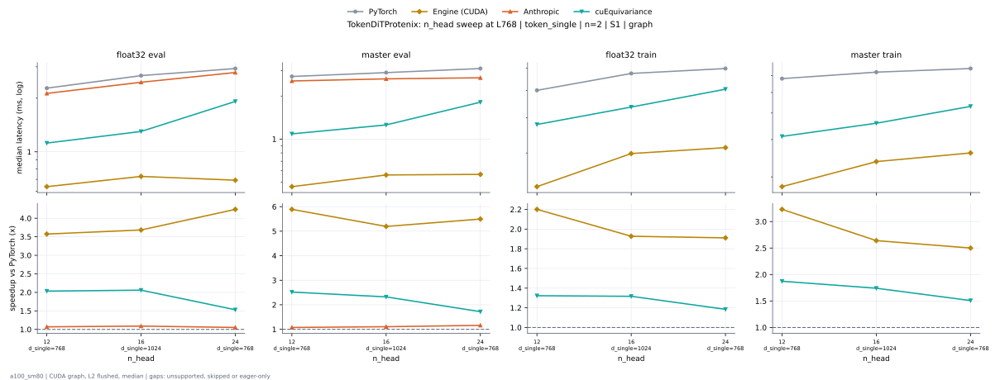

**float32 eval** (median ms; x = speedup vs PyTorch)

| n_head | PyTorch | Engine (Triton) | Engine (CUDA) | Anthropic | cuEquivariance |
|---|---|---|---|---|---|
| 12 d_single=768 | 2.279 | 2.126 (1.07x) | 0.6349 (3.59x) | 2.128 (1.07x) | 1.119 (2.04x) |
| 16 d_single=1024 | 2.692 | 2.467 (1.09x) | 0.7311 (3.68x) | 2.457 (1.10x) | 1.3 (2.07x) |
| 24 d_single=768 | 2.939 | 2.594 (1.13x) | 0.6932 (4.24x) | 2.788 (1.05x) | 1.918 (1.53x) |

**master eval** (median ms; x = speedup vs PyTorch)

| n_head | PyTorch | Engine (Triton) | Engine (CUDA) | Anthropic | cuEquivariance |
|---|---|---|---|---|---|
| 12 d_single=768 | 2.738 | 2.569 (1.07x) | 0.4649 (5.89x) | 2.547 (1.08x) | 1.087 (2.52x) |
| 16 d_single=1024 | 2.927 | 2.674 (1.09x) | 0.5632 (5.20x) | 2.636 (1.11x) | 1.255 (2.33x) |
| 24 d_single=768 | 3.115 | 2.692 (1.16x) | 0.5652 (5.51x) | 2.681 (1.16x) | 1.81 (1.72x) |

**float32 train** (median ms; x = speedup vs PyTorch)

| n_head | PyTorch | Engine (Triton) | Engine (CUDA) | Anthropic | cuEquivariance |
|---|---|---|---|---|---|
| 12 d_single=768 | 5.004 | 4.861 (1.03x) | 2.245 (2.23x) | unsupported | 3.788 (1.32x) |
| 16 d_single=1024 | 5.738 | 5.477 (1.05x) | 2.951 (1.94x) | unsupported | 4.369 (1.31x) |
| 24 d_single=768 | 5.954 | 5.564 (1.07x) | 3.138 (1.90x) | unsupported | 5.058 (1.18x) |

**master train** (median ms; x = speedup vs PyTorch)

| n_head | PyTorch | Engine (Triton) | Engine (CUDA) | Anthropic | cuEquivariance |
|---|---|---|---|---|---|
| 12 d_single=768 | 5.817 | 5.832 (1.00x) | 1.791 (3.25x) | unsupported | 3.104 (1.87x) |
| 16 d_single=1024 | 6.261 | 6.012 (1.04x) | 2.368 (2.64x) | unsupported | 3.581 (1.75x) |
| 24 d_single=768 | 6.487 | 5.876 (1.10x) | 2.596 (2.50x) | unsupported | 4.3 (1.51x) |

