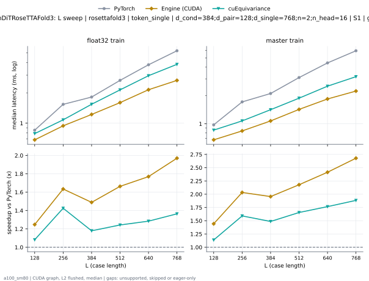
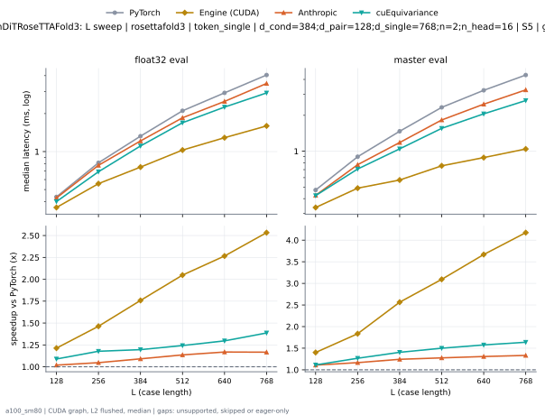

# TokenDiTRoseTTAFold3 on a100_sm80

Generated by `python -m miniworld_engine.measure.plot` from speed tokens `judge/tokens/a100_sm80/`; do not edit.

### L sweep: rosettafold3 | token_single | d_cond=384;d_pair=128;d_single=768;n=2;n_head=16 | S1 | graph

**float32 train** (median ms; x = speedup vs PyTorch)

| L | PyTorch | Engine (Triton) | Engine (CUDA) | Anthropic | cuEquivariance |
|---|---|---|---|---|---|
| 128 | 0.853 | 0.8489 (1.00x) | 0.6758 (1.26x) | unsupported | 0.7875 (1.08x) |
| 256 | 1.534 | 1.547 (0.99x) | 0.9421 (1.63x) | unsupported | 1.079 (1.42x) |
| 384 | 1.82 | 1.843 (0.99x) | 1.222 (1.49x) | unsupported | 1.541 (1.18x) |
| 512 | 2.662 | 2.676 (1.00x) | 1.594 (1.67x) | unsupported | 2.142 (1.24x) |
| 640 | 3.802 | 3.766 (1.01x) | 2.149 (1.77x) | unsupported | 2.961 (1.28x) |
| 768 | 5.24 | 5.162 (1.02x) | 2.627 (1.99x) | unsupported | 3.841 (1.36x) |

**master train** (median ms; x = speedup vs PyTorch)

| L | PyTorch | Engine (Triton) | Engine (CUDA) | Anthropic | cuEquivariance |
|---|---|---|---|---|---|
| 128 | 0.9774 | 0.9513 (1.03x) | 0.6758 (1.45x) | unsupported | 0.8571 (1.14x) |
| 256 | 1.711 | 1.688 (1.01x) | 0.8417 (2.03x) | unsupported | 1.074 (1.59x) |
| 384 | 2.106 | 2.089 (1.01x) | 1.074 (1.96x) | unsupported | 1.412 (1.49x) |
| 512 | 3.099 | 3.079 (1.01x) | 1.422 (2.18x) | unsupported | 1.872 (1.66x) |
| 640 | 4.43 | 4.348 (1.02x) | 1.838 (2.41x) | unsupported | 2.51 (1.76x) |
| 768 | 5.969 | 5.811 (1.03x) | 2.228 (2.68x) | unsupported | 3.167 (1.88x) |

### L sweep: rosettafold3 | token_single | d_cond=384;d_pair=128;d_single=768;n=2;n_head=16 | S5 | graph

**float32 eval** (median ms; x = speedup vs PyTorch)

| L | PyTorch | Engine (Triton) | Engine (CUDA) | Anthropic | cuEquivariance |
|---|---|---|---|---|---|
| 128 | 0.4383 | 0.4065 (1.08x) | 0.3604 (1.22x) | 0.4291 (1.02x) | 0.4014 (1.09x) |
| 256 | 0.8151 | 0.7383 (1.10x) | 0.556 (1.47x) | 0.7782 (1.05x) | 0.6922 (1.18x) |
| 384 | 1.326 | 1.176 (1.13x) | 0.7485 (1.77x) | 1.214 (1.09x) | 1.108 (1.20x) |
| 512 | 2.103 | 1.81 (1.16x) | 1.025 (2.05x) | 1.853 (1.13x) | 1.694 (1.24x) |
| 640 | 2.9 | 2.419 (1.20x) | 1.275 (2.28x) | 2.499 (1.16x) | 2.253 (1.29x) |
| 768 | 4.038 | 3.411 (1.18x) | 1.603 (2.52x) | 3.466 (1.16x) | 2.917 (1.38x) |

**master eval** (median ms; x = speedup vs PyTorch)

| L | PyTorch | Engine (Triton) | Engine (CUDA) | Anthropic | cuEquivariance |
|---|---|---|---|---|---|
| 128 | 0.471 | 0.4239 (1.11x) | 0.3359 (1.40x) | 0.426 (1.11x) | 0.4239 (1.11x) |
| 256 | 0.9001 | 0.769 (1.17x) | 0.4895 (1.84x) | 0.77 (1.17x) | 0.7086 (1.27x) |
| 384 | 1.47 | 1.167 (1.26x) | 0.5734 (2.56x) | 1.182 (1.24x) | 1.046 (1.41x) |
| 512 | 2.331 | 1.819 (1.28x) | 0.7537 (3.09x) | 1.827 (1.28x) | 1.554 (1.50x) |
| 640 | 3.241 | 2.468 (1.31x) | 0.8837 (3.67x) | 2.479 (1.31x) | 2.057 (1.58x) |
| 768 | 4.352 | 3.273 (1.33x) | 1.042 (4.17x) | 3.268 (1.33x) | 2.659 (1.64x) |

