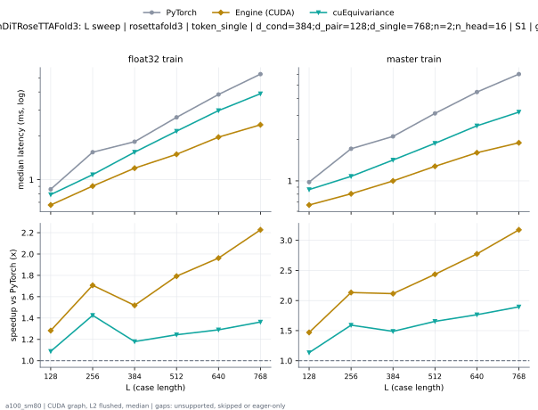
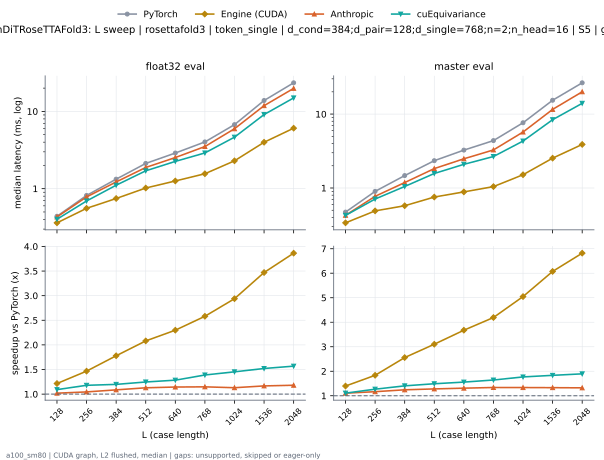
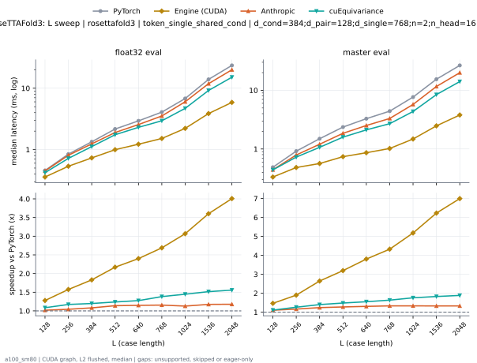

# TokenDiTRoseTTAFold3 on a100_sm80

Generated by `python -m miniworld_engine.measure.plot` from speed tokens `judge/tokens/a100_sm80/`; do not edit.

### L sweep: rosettafold3 | token_single | d_cond=384;d_pair=128;d_single=768;n=2;n_head=16 | S1 | graph

**float32 train** (median ms; x = speedup vs PyTorch)

| L | PyTorch | Engine (Triton) | Engine (CUDA) | Anthropic | cuEquivariance |
|---|---|---|---|---|---|
| 128 | 0.8602 | 0.8489 (1.01x) | 0.6707 (1.28x) | unsupported | 0.7905 (1.09x) |
| 256 | 1.544 | 1.536 (1.01x) | 0.9047 (1.71x) | unsupported | 1.083 (1.43x) |
| 384 | 1.823 | 1.803 (1.01x) | 1.2 (1.52x) | unsupported | 1.545 (1.18x) |
| 512 | 2.678 | 2.637 (1.02x) | 1.494 (1.79x) | unsupported | 2.153 (1.24x) |
| 640 | 3.843 | 3.701 (1.04x) | 1.959 (1.96x) | unsupported | 2.98 (1.29x) |
| 768 | 5.301 | 5.095 (1.04x) | 2.381 (2.23x) | unsupported | 3.89 (1.36x) |

**master train** (median ms; x = speedup vs PyTorch)

| L | PyTorch | Engine (Triton) | Engine (CUDA) | Anthropic | cuEquivariance |
|---|---|---|---|---|---|
| 128 | 0.98 | 0.9421 (1.04x) | 0.6666 (1.47x) | unsupported | 0.8637 (1.13x) |
| 256 | 1.717 | 1.66 (1.03x) | 0.8049 (2.13x) | unsupported | 1.079 (1.59x) |
| 384 | 2.114 | 2.038 (1.04x) | 0.9994 (2.11x) | unsupported | 1.42 (1.49x) |
| 512 | 3.113 | 3 (1.04x) | 1.278 (2.44x) | unsupported | 1.882 (1.65x) |
| 640 | 4.458 | 4.226 (1.06x) | 1.607 (2.78x) | unsupported | 2.526 (1.76x) |
| 768 | 6.027 | 5.632 (1.07x) | 1.898 (3.17x) | unsupported | 3.181 (1.90x) |

### L sweep: rosettafold3 | token_single | d_cond=384;d_pair=128;d_single=768;n=2;n_head=16 | S5 | graph

**float32 eval** (median ms; x = speedup vs PyTorch)

| L | PyTorch | Engine (Triton) | Engine (CUDA) | Anthropic | cuEquivariance |
|---|---|---|---|---|---|
| 128 | 0.4393 | 0.4076 (1.08x) | 0.3615 (1.22x) | 0.4311 (1.02x) | 0.4024 (1.09x) |
| 256 | 0.8172 | 0.7404 (1.10x) | 0.5571 (1.47x) | 0.7823 (1.04x) | 0.6932 (1.18x) |
| 384 | 1.328 | 1.163 (1.14x) | 0.7465 (1.78x) | 1.223 (1.09x) | 1.109 (1.20x) |
| 512 | 2.122 | 1.802 (1.18x) | 1.02 (2.08x) | 1.881 (1.13x) | 1.703 (1.25x) |
| 640 | 2.893 | 2.407 (1.20x) | 1.258 (2.30x) | 2.529 (1.14x) | 2.254 (1.28x) |
| 768 | 4.028 | 3.375 (1.19x) | 1.561 (2.58x) | 3.51 (1.15x) | 2.901 (1.39x) |
| 1024 | 6.739 | 5.601 (1.20x) | 2.294 (2.94x) | 5.964 (1.13x) | 4.639 (1.45x) |
| 1536 | 13.84 | 11.36 (1.22x) | 3.988 (3.47x) | 11.86 (1.17x) | 9.102 (1.52x) |
| 2048 | 23.44 | 19.08 (1.23x) | 6.067 (3.86x) | 19.86 (1.18x) | 14.95 (1.57x) |

**master eval** (median ms; x = speedup vs PyTorch)

| L | PyTorch | Engine (Triton) | Engine (CUDA) | Anthropic | cuEquivariance |
|---|---|---|---|---|---|
| 128 | 0.4721 | 0.425 (1.11x) | 0.3379 (1.40x) | 0.427 (1.11x) | 0.426 (1.11x) |
| 256 | 0.9001 | 0.7711 (1.17x) | 0.4905 (1.84x) | 0.7721 (1.17x) | 0.7096 (1.27x) |
| 384 | 1.473 | 1.168 (1.26x) | 0.5755 (2.56x) | 1.185 (1.24x) | 1.049 (1.40x) |
| 512 | 2.342 | 1.823 (1.28x) | 0.7547 (3.10x) | 1.831 (1.28x) | 1.572 (1.49x) |
| 640 | 3.255 | 2.466 (1.32x) | 0.8858 (3.68x) | 2.485 (1.31x) | 2.09 (1.56x) |
| 768 | 4.379 | 3.281 (1.33x) | 1.044 (4.19x) | 3.275 (1.34x) | 2.666 (1.64x) |
| 1024 | 7.634 | 5.693 (1.34x) | 1.512 (5.05x) | 5.717 (1.34x) | 4.317 (1.77x) |
| 1536 | 15.39 | 11.64 (1.32x) | 2.534 (6.07x) | 11.57 (1.33x) | 8.397 (1.83x) |
| 2048 | 26.5 | 19.87 (1.33x) | 3.886 (6.82x) | 20.03 (1.32x) | 13.99 (1.89x) |

### L sweep: rosettafold3 | token_single_shared_cond | d_cond=384;d_pair=128;d_single=768;n=2;n_head=16 | S5 | graph

**float32 eval** (median ms; x = speedup vs PyTorch)

| L | PyTorch | Engine (Triton) | Engine (CUDA) | Anthropic | cuEquivariance |
|---|---|---|---|---|---|
| 128 | 0.4567 | 0.425 (1.07x) | 0.3574 (1.28x) | 0.4485 (1.02x) | 0.4209 (1.09x) |
| 256 | 0.8428 | 0.769 (1.10x) | 0.5356 (1.57x) | 0.8079 (1.04x) | 0.7188 (1.17x) |
| 384 | 1.34 | 1.177 (1.14x) | 0.7322 (1.83x) | 1.24 (1.08x) | 1.119 (1.20x) |
| 512 | 2.164 | 1.844 (1.17x) | 0.9969 (2.17x) | 1.9 (1.14x) | 1.747 (1.24x) |
| 640 | 2.939 | 2.451 (1.20x) | 1.224 (2.40x) | 2.558 (1.15x) | 2.305 (1.28x) |
| 768 | 4.08 | 3.425 (1.19x) | 1.518 (2.69x) | 3.53 (1.16x) | 2.95 (1.38x) |
| 1024 | 6.798 | 5.661 (1.20x) | 2.216 (3.07x) | 6.024 (1.13x) | 4.698 (1.45x) |
| 1536 | 13.93 | 11.51 (1.21x) | 3.867 (3.60x) | 11.87 (1.17x) | 9.194 (1.52x) |
| 2048 | 23.54 | 19.34 (1.22x) | 5.875 (4.01x) | 19.99 (1.18x) | 15.12 (1.56x) |

**master eval** (median ms; x = speedup vs PyTorch)

| L | PyTorch | Engine (Triton) | Engine (CUDA) | Anthropic | cuEquivariance |
|---|---|---|---|---|---|
| 128 | 0.4884 | 0.4393 (1.11x) | 0.3328 (1.47x) | 0.4424 (1.10x) | 0.4403 (1.11x) |
| 256 | 0.9185 | 0.7875 (1.17x) | 0.4833 (1.90x) | 0.7895 (1.16x) | 0.7276 (1.26x) |
| 384 | 1.495 | 1.189 (1.26x) | 0.5652 (2.64x) | 1.204 (1.24x) | 1.067 (1.40x) |
| 512 | 2.361 | 1.843 (1.28x) | 0.7393 (3.19x) | 1.85 (1.28x) | 1.592 (1.48x) |
| 640 | 3.284 | 2.495 (1.32x) | 0.8632 (3.80x) | 2.513 (1.31x) | 2.116 (1.55x) |
| 768 | 4.412 | 3.313 (1.33x) | 1.02 (4.33x) | 3.31 (1.33x) | 2.698 (1.64x) |
| 1024 | 7.661 | 5.72 (1.34x) | 1.479 (5.18x) | 5.742 (1.33x) | 4.355 (1.76x) |
| 1536 | 15.43 | 11.68 (1.32x) | 2.477 (6.23x) | 11.61 (1.33x) | 8.446 (1.83x) |
| 2048 | 26.55 | 19.92 (1.33x) | 3.795 (7.00x) | 19.94 (1.33x) | 14.09 (1.88x) |

