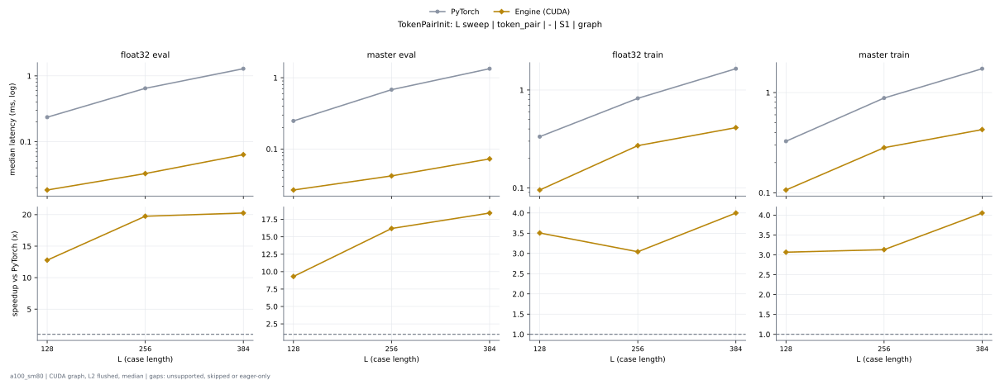

# TokenPairInit on a100_sm80

Generated by `python -m miniworld_engine.measure.plot` from speed tokens `judge/tokens/a100_sm80/`; do not edit.

### L sweep: token_pair | - | S1 | graph

**float32 eval** (median ms; x = speedup vs PyTorch)

| L | PyTorch | Engine (Triton) | Engine (CUDA) |
|---|---|---|---|
| 128 | 0.2355 | 0.02662 (8.85x) | 0.01843 (12.78x) |
| 256 | 0.6472 | 0.04506 (14.36x) | 0.03277 (19.75x) |
| 384 | 1.286 | 0.0727 (17.69x) | 0.06349 (20.26x) |

**master eval** (median ms; x = speedup vs PyTorch)

| L | PyTorch | Engine (Triton) | Engine (CUDA) |
|---|---|---|---|
| 128 | 0.2478 | 0.03482 (7.12x) | 0.02662 (9.31x) |
| 256 | 0.6799 | 0.05325 (12.77x) | 0.04198 (16.20x) |
| 384 | 1.339 | 0.0809 (16.55x) | 0.0727 (18.42x) |

**float32 train** (median ms; x = speedup vs PyTorch)

| L | PyTorch | Engine (Triton) | Engine (CUDA) |
|---|---|---|---|
| 128 | 0.3338 | 0.1085 (3.08x) | 0.09523 (3.51x) |
| 256 | 0.8223 | 0.2796 (2.94x) | 0.2703 (3.04x) |
| 384 | 1.65 | 0.4997 (3.30x) | 0.4127 (4.00x) |

**master train** (median ms; x = speedup vs PyTorch)

| L | PyTorch | Engine (Triton) | Engine (CUDA) |
|---|---|---|---|
| 128 | 0.3267 | 0.1219 (2.68x) | 0.1065 (3.07x) |
| 256 | 0.8817 | 0.2918 (3.02x) | 0.2816 (3.13x) |
| 384 | 1.731 | 0.5079 (3.41x) | 0.427 (4.05x) |

