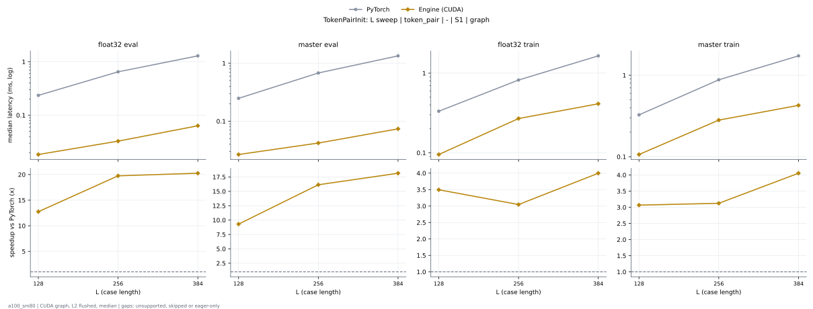

# TokenPairInit on a100_sm80

Generated by `python -m miniworld_engine.measure.plot` from speed tokens `judge/tokens/a100_sm80/`; do not edit.

### L sweep: token_pair | - | S1 | graph

**float32 eval** (median ms; x = speedup vs PyTorch)

| L | PyTorch | Engine (Triton) | Engine (CUDA) |
|---|---|---|---|
| 128 | 0.235 | 0.02662 (8.83x) | 0.01843 (12.75x) |
| 256 | 0.6472 | 0.04403 (14.70x) | 0.03277 (19.75x) |
| 384 | 1.286 | 0.07168 (17.94x) | 0.06349 (20.26x) |

**master eval** (median ms; x = speedup vs PyTorch)

| L | PyTorch | Engine (Triton) | Engine (CUDA) |
|---|---|---|---|
| 128 | 0.2478 | 0.03482 (7.12x) | 0.02662 (9.31x) |
| 256 | 0.6779 | 0.05222 (12.98x) | 0.04198 (16.15x) |
| 384 | 1.338 | 0.0809 (16.54x) | 0.07373 (18.15x) |

**float32 train** (median ms; x = speedup vs PyTorch)

| L | PyTorch | Engine (Triton) | Engine (CUDA) |
|---|---|---|---|
| 128 | 0.3328 | 0.1075 (3.10x) | 0.09523 (3.49x) |
| 256 | 0.8202 | 0.2785 (2.94x) | 0.2693 (3.05x) |
| 384 | 1.65 | 0.4936 (3.34x) | 0.4127 (4.00x) |

**master train** (median ms; x = speedup vs PyTorch)

| L | PyTorch | Engine (Triton) | Engine (CUDA) |
|---|---|---|---|
| 128 | 0.3267 | 0.1198 (2.73x) | 0.1065 (3.07x) |
| 256 | 0.8796 | 0.2898 (3.04x) | 0.2816 (3.12x) |
| 384 | 1.732 | 0.5069 (3.42x) | 0.427 (4.06x) |

