# Transition on a100_sm80

Generated by `python -m miniworld_engine.measure.plot` from speed tokens `judge/tokens/a100_sm80/`; do not edit.

### L sweep: msa_token | d_hidden=128;n=4 | D1024 | S1 | graph

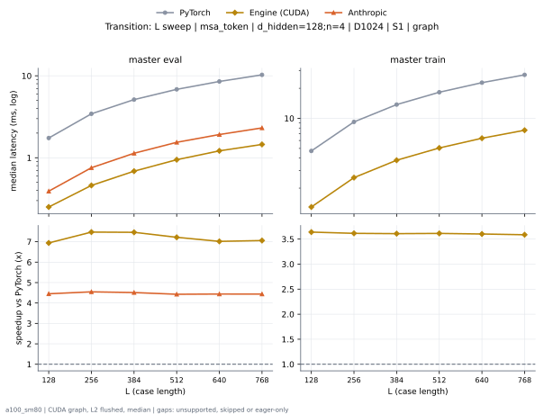

**master eval** (median ms; x = speedup vs PyTorch)

| L | PyTorch | Engine (Triton) | Engine (CUDA) | Anthropic |
|---|---|---|---|---|
| 128 | 1.741 | 0.4311 (4.04x) | 0.2509 (6.94x) | 0.3912 (4.45x) |
| 256 | 3.436 | 0.8509 (4.04x) | 0.4598 (7.47x) | 0.7557 (4.55x) |
| 384 | 5.119 | 1.299 (3.94x) | 0.6861 (7.46x) | 1.135 (4.51x) |
| 512 | 6.833 | 1.776 (3.85x) | 0.9467 (7.22x) | 1.543 (4.43x) |
| 640 | 8.524 | 2.245 (3.80x) | 1.214 (7.02x) | 1.92 (4.44x) |
| 768 | 10.27 | 2.721 (3.77x) | 1.455 (7.06x) | 2.313 (4.44x) |

**master train** (median ms; x = speedup vs PyTorch)

| L | PyTorch | Engine (Triton) | Engine (CUDA) | Anthropic |
|---|---|---|---|---|
| 128 | 4.713 | 1.598 (2.95x) | 1.295 (3.64x) | unsupported |
| 256 | 9.214 | 3.272 (2.82x) | 2.549 (3.62x) | unsupported |
| 384 | 13.73 | 4.795 (2.86x) | 3.806 (3.61x) | unsupported |
| 512 | 18.26 | 6.5 (2.81x) | 5.052 (3.61x) | unsupported |
| 640 | 22.77 | 8.015 (2.84x) | 6.321 (3.60x) | unsupported |
| 768 | 27.26 | 9.614 (2.84x) | 7.601 (3.59x) | unsupported |

### L sweep: msa_token | d_hidden=256;n=4 | D1024 | S1 | graph

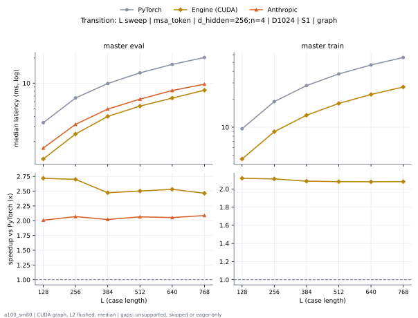

**master eval** (median ms; x = speedup vs PyTorch)

| L | PyTorch | Engine (Triton) | Engine (CUDA) | Anthropic |
|---|---|---|---|---|
| 128 | 3.37 | 1.314 (2.56x) | 1.233 (2.73x) | 1.672 (2.02x) |
| 256 | 6.636 | 2.7 (2.46x) | 2.643 (2.51x) | 3.209 (2.07x) |
| 384 | 9.952 | 4.028 (2.47x) | 3.985 (2.50x) | 4.894 (2.03x) |
| 512 | 13.31 | 5.386 (2.47x) | 5.359 (2.48x) | 6.431 (2.07x) |
| 640 | 16.6 | 6.804 (2.44x) | 6.602 (2.52x) | 8.164 (2.03x) |
| 768 | 19.92 | 8.142 (2.45x) | 7.913 (2.52x) | 9.711 (2.05x) |

**master train** (median ms; x = speedup vs PyTorch)

| L | PyTorch | Engine (Triton) | Engine (CUDA) | Anthropic |
|---|---|---|---|---|
| 128 | 9.618 | 4.737 (2.03x) | 4.558 (2.11x) | unsupported |
| 256 | 18.94 | 9.297 (2.04x) | 8.965 (2.11x) | unsupported |
| 384 | 28.08 | 13.99 (2.01x) | 13.47 (2.09x) | unsupported |
| 512 | 37.38 | 18.66 (2.00x) | 17.97 (2.08x) | unsupported |
| 640 | 46.61 | 23.16 (2.01x) | 22.34 (2.09x) | unsupported |
| 768 | 55.88 | 27.68 (2.02x) | 26.84 (2.08x) | unsupported |

### L sweep: msa_token | d_hidden=64;n=4 | D384 | S1 | graph

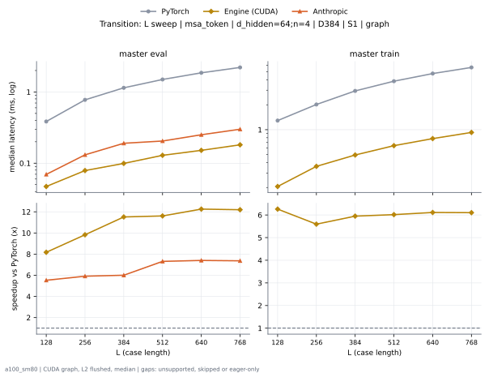

**master eval** (median ms; x = speedup vs PyTorch)

| L | PyTorch | Engine (Triton) | Engine (CUDA) | Anthropic |
|---|---|---|---|---|
| 128 | 0.386 | 0.07475 (5.16x) | 0.0384 (10.05x) | 0.06963 (5.54x) |
| 256 | 0.7731 | 0.1413 (5.47x) | 0.07066 (10.94x) | 0.1311 (5.90x) |
| 384 | 1.139 | 0.2007 (5.67x) | 0.09114 (12.49x) | 0.1905 (5.98x) |
| 512 | 1.501 | 0.2688 (5.58x) | 0.1208 (12.42x) | 0.2048 (7.33x) |
| 640 | 1.859 | 0.3287 (5.65x) | 0.1444 (12.87x) | 0.2509 (7.41x) |
| 768 | 2.214 | 0.385 (5.75x) | 0.1751 (12.64x) | 0.3 (7.38x) |

**master train** (median ms; x = speedup vs PyTorch)

| L | PyTorch | Engine (Triton) | Engine (CUDA) | Anthropic |
|---|---|---|---|---|
| 128 | 1.274 | 0.3333 (3.82x) | 0.2079 (6.13x) | unsupported |
| 256 | 2.015 | 0.599 (3.36x) | 0.3615 (5.58x) | unsupported |
| 384 | 2.941 | 0.8571 (3.43x) | 0.4966 (5.92x) | unsupported |
| 512 | 3.853 | 1.109 (3.47x) | 0.6472 (5.95x) | unsupported |
| 640 | 4.769 | 1.363 (3.50x) | 0.7772 (6.14x) | unsupported |
| 768 | 5.653 | 1.611 (3.51x) | 0.9288 (6.09x) | unsupported |

### L sweep: token_pair | d_hidden=128;n=2 | S1 | graph

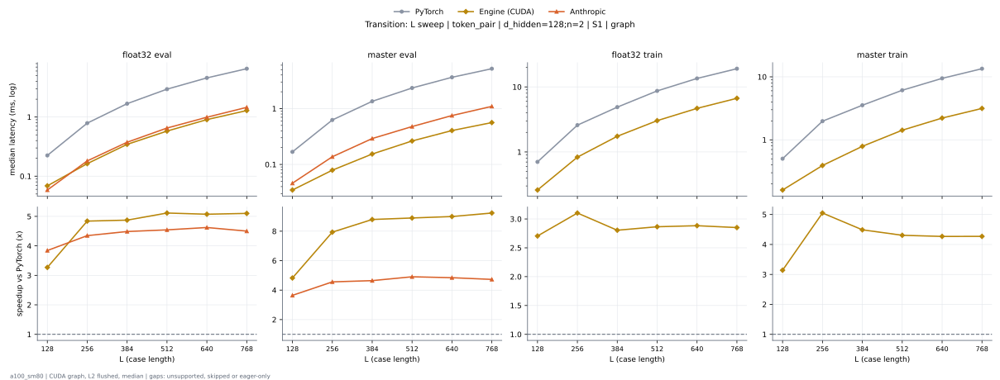

**float32 eval** (median ms; x = speedup vs PyTorch)

| L | PyTorch | Engine (Triton) | Engine (CUDA) | Anthropic |
|---|---|---|---|---|
| 128 | 0.2243 | 0.07782 (2.88x) | 0.06861 (3.27x) | 0.05837 (3.84x) |
| 256 | 0.788 | 0.257 (3.07x) | 0.1628 (4.84x) | 0.1812 (4.35x) |
| 384 | 1.681 | 0.5591 (3.01x) | 0.3451 (4.87x) | 0.3748 (4.49x) |
| 512 | 2.958 | 0.9713 (3.05x) | 0.5786 (5.11x) | 0.6513 (4.54x) |
| 640 | 4.586 | 1.574 (2.91x) | 0.9042 (5.07x) | 0.9923 (4.62x) |
| 768 | 6.563 | 2.192 (2.99x) | 1.287 (5.10x) | 1.458 (4.50x) |

**master eval** (median ms; x = speedup vs PyTorch)

| L | PyTorch | Engine (Triton) | Engine (CUDA) | Anthropic |
|---|---|---|---|---|
| 128 | 0.1679 | 0.05325 (3.15x) | 0.03482 (4.82x) | 0.04608 (3.64x) |
| 256 | 0.6257 | 0.1434 (4.36x) | 0.07885 (7.94x) | 0.1372 (4.56x) |
| 384 | 1.351 | 0.299 (4.52x) | 0.1536 (8.79x) | 0.2908 (4.64x) |
| 512 | 2.341 | 0.5079 (4.61x) | 0.2632 (8.89x) | 0.4772 (4.91x) |
| 640 | 3.638 | 0.8038 (4.53x) | 0.4045 (8.99x) | 0.7511 (4.84x) |
| 768 | 5.19 | 1.134 (4.58x) | 0.5622 (9.23x) | 1.098 (4.73x) |

**float32 train** (median ms; x = speedup vs PyTorch)

| L | PyTorch | Engine (Triton) | Engine (CUDA) | Anthropic |
|---|---|---|---|---|
| 128 | 0.7035 | 0.3277 (2.15x) | 0.2601 (2.70x) | unsupported |
| 256 | 2.582 | 0.9856 (2.62x) | 0.832 (3.10x) | unsupported |
| 384 | 4.883 | 2.096 (2.33x) | 1.741 (2.80x) | unsupported |
| 512 | 8.673 | 3.656 (2.37x) | 3.027 (2.86x) | unsupported |
| 640 | 13.48 | 5.832 (2.31x) | 4.677 (2.88x) | unsupported |
| 768 | 19.04 | 8.126 (2.34x) | 6.678 (2.85x) | unsupported |

**master train** (median ms; x = speedup vs PyTorch)

| L | PyTorch | Engine (Triton) | Engine (CUDA) | Anthropic |
|---|---|---|---|---|
| 128 | 0.5018 | 0.1915 (2.62x) | 0.1597 (3.14x) | unsupported |
| 256 | 1.975 | 0.511 (3.87x) | 0.3912 (5.05x) | unsupported |
| 384 | 3.539 | 1.039 (3.41x) | 0.7885 (4.49x) | unsupported |
| 512 | 6.121 | 1.842 (3.32x) | 1.421 (4.31x) | unsupported |
| 640 | 9.455 | 2.826 (3.35x) | 2.215 (4.27x) | unsupported |
| 768 | 13.46 | 4.053 (3.32x) | 3.152 (4.27x) | unsupported |

### L sweep: token_pair | d_hidden=128;n=4 | S1 | graph

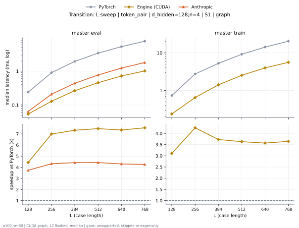

**master eval** (median ms; x = speedup vs PyTorch)

| L | PyTorch | Engine (Triton) | Engine (CUDA) | Anthropic |
|---|---|---|---|---|
| 128 | 0.2406 | 0.06963 (3.46x) | 0.05427 (4.43x) | 0.06451 (3.73x) |
| 256 | 0.9027 | 0.2212 (4.08x) | 0.129 (7.00x) | 0.2089 (4.32x) |
| 384 | 1.946 | 0.4803 (4.05x) | 0.2652 (7.34x) | 0.4403 (4.42x) |
| 512 | 3.416 | 0.8428 (4.05x) | 0.4567 (7.48x) | 0.7721 (4.42x) |
| 640 | 5.311 | 1.343 (3.95x) | 0.7219 (7.36x) | 1.235 (4.30x) |
| 768 | 7.681 | 1.979 (3.88x) | 1.017 (7.55x) | 1.804 (4.26x) |

**master train** (median ms; x = speedup vs PyTorch)

| L | PyTorch | Engine (Triton) | Engine (CUDA) | Anthropic |
|---|---|---|---|---|
| 128 | 0.7352 | 0.2724 (2.70x) | 0.2365 (3.11x) | unsupported |
| 256 | 2.755 | 0.8243 (3.34x) | 0.6482 (4.25x) | unsupported |
| 384 | 5.263 | 1.782 (2.95x) | 1.412 (3.73x) | unsupported |
| 512 | 9.194 | 3.175 (2.90x) | 2.532 (3.63x) | unsupported |
| 640 | 14.25 | 5.017 (2.84x) | 3.992 (3.57x) | unsupported |
| 768 | 20.45 | 7.152 (2.86x) | 5.61 (3.65x) | unsupported |

### L sweep: token_pair | d_hidden=256;n=2 | S1 | graph

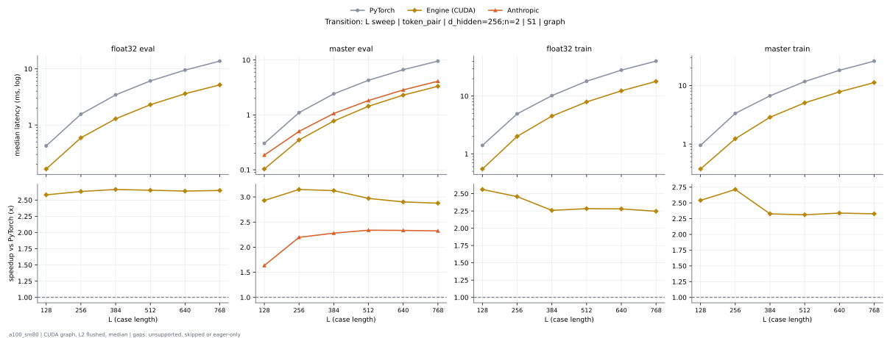

**float32 eval** (median ms; x = speedup vs PyTorch)

| L | PyTorch | Engine (Triton) | Engine (CUDA) | Anthropic |
|---|---|---|---|---|
| 128 | 0.4255 | 0.2202 (1.93x) | 0.1649 (2.58x) | unsupported |
| 256 | 1.558 | 0.7025 (2.22x) | 0.5919 (2.63x) | unsupported |
| 384 | 3.442 | 1.794 (1.92x) | 1.292 (2.66x) | unsupported |
| 512 | 6.1 | 3.257 (1.87x) | 2.3 (2.65x) | unsupported |
| 640 | 9.524 | 4.756 (2.00x) | 3.61 (2.64x) | unsupported |
| 768 | 13.75 | 7.347 (1.87x) | 5.191 (2.65x) | unsupported |

**master eval** (median ms; x = speedup vs PyTorch)

| L | PyTorch | Engine (Triton) | Engine (CUDA) | Anthropic |
|---|---|---|---|---|
| 128 | 0.3031 | 0.1126 (2.69x) | 0.1034 (2.93x) | 0.1853 (1.64x) |
| 256 | 1.1 | 0.3656 (3.01x) | 0.3492 (3.15x) | 0.5007 (2.20x) |
| 384 | 2.421 | 0.7875 (3.07x) | 0.7741 (3.13x) | 1.062 (2.28x) |
| 512 | 4.274 | 1.462 (2.92x) | 1.438 (2.97x) | 1.828 (2.34x) |
| 640 | 6.658 | 2.308 (2.88x) | 2.294 (2.90x) | 2.852 (2.33x) |
| 768 | 9.555 | 3.481 (2.75x) | 3.321 (2.88x) | 4.11 (2.32x) |

**float32 train** (median ms; x = speedup vs PyTorch)

| L | PyTorch | Engine (Triton) | Engine (CUDA) | Anthropic |
|---|---|---|---|---|
| 128 | 1.403 | 0.724 (1.94x) | 0.5478 (2.56x) | unsupported |
| 256 | 4.929 | 2.54 (1.94x) | 2.006 (2.46x) | unsupported |
| 384 | 10.19 | 5.722 (1.78x) | 4.511 (2.26x) | unsupported |
| 512 | 18.08 | 9.945 (1.82x) | 7.92 (2.28x) | unsupported |
| 640 | 28.11 | 15.48 (1.82x) | 12.33 (2.28x) | unsupported |
| 768 | 40.29 | 22.27 (1.81x) | 17.94 (2.25x) | unsupported |

**master train** (median ms; x = speedup vs PyTorch)

| L | PyTorch | Engine (Triton) | Engine (CUDA) | Anthropic |
|---|---|---|---|---|
| 128 | 0.9523 | 0.3932 (2.42x) | 0.3748 (2.54x) | unsupported |
| 256 | 3.346 | 1.282 (2.61x) | 1.233 (2.71x) | unsupported |
| 384 | 6.688 | 2.914 (2.30x) | 2.875 (2.33x) | unsupported |
| 512 | 11.72 | 5.102 (2.30x) | 5.07 (2.31x) | unsupported |
| 640 | 18.26 | 7.994 (2.28x) | 7.81 (2.34x) | unsupported |
| 768 | 26.22 | 11.46 (2.29x) | 11.27 (2.33x) | unsupported |

### L sweep: token_pair | d_hidden=256;n=4 | S1 | graph

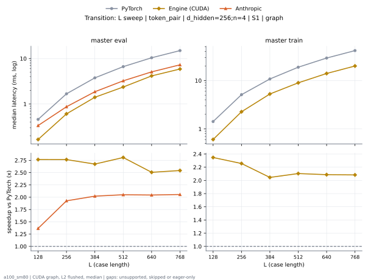

**master eval** (median ms; x = speedup vs PyTorch)

| L | PyTorch | Engine (Triton) | Engine (CUDA) | Anthropic |
|---|---|---|---|---|
| 128 | 0.4588 | 0.1833 (2.50x) | 0.1659 (2.77x) | 0.3359 (1.37x) |
| 256 | 1.676 | 0.6415 (2.61x) | 0.6062 (2.76x) | 0.8699 (1.93x) |
| 384 | 3.759 | 1.45 (2.59x) | 1.406 (2.67x) | 1.86 (2.02x) |
| 512 | 6.637 | 2.7 (2.46x) | 2.364 (2.81x) | 3.237 (2.05x) |
| 640 | 10.4 | 4.2 (2.48x) | 4.151 (2.51x) | 5.089 (2.04x) |
| 768 | 14.96 | 6.004 (2.49x) | 5.885 (2.54x) | 7.282 (2.05x) |

**master train** (median ms; x = speedup vs PyTorch)

| L | PyTorch | Engine (Triton) | Engine (CUDA) | Anthropic |
|---|---|---|---|---|
| 128 | 1.42 | 0.6436 (2.21x) | 0.6052 (2.35x) | unsupported |
| 256 | 5.104 | 2.38 (2.14x) | 2.263 (2.26x) | unsupported |
| 384 | 10.78 | 5.272 (2.04x) | 5.271 (2.05x) | unsupported |
| 512 | 18.89 | 9.248 (2.04x) | 8.978 (2.10x) | unsupported |
| 640 | 29.22 | 14.48 (2.02x) | 14 (2.09x) | unsupported |
| 768 | 41.65 | 20.68 (2.01x) | 19.99 (2.08x) | unsupported |

### L sweep: token_pair | d_hidden=384;n=2 | S1 | graph

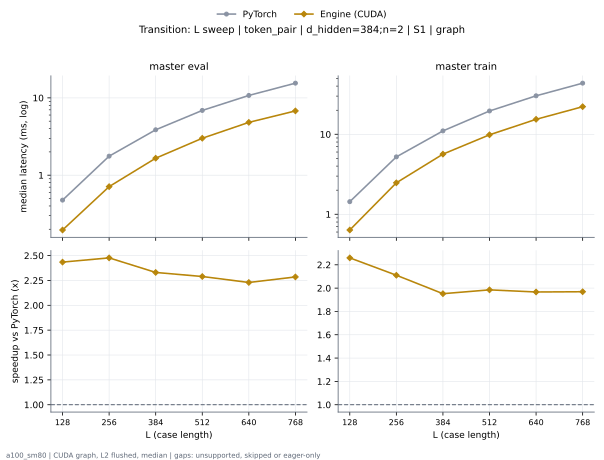

**master eval** (median ms; x = speedup vs PyTorch)

| L | PyTorch | Engine (Triton) | Engine (CUDA) | Anthropic |
|---|---|---|---|---|
| 128 | 0.469 | 0.2038 (2.30x) | 0.1843 (2.54x) | unsupported |
| 256 | 1.727 | 0.7383 (2.34x) | 0.6881 (2.51x) | unsupported |
| 384 | 3.828 | 1.66 (2.31x) | 1.631 (2.35x) | unsupported |
| 512 | 6.779 | 2.991 (2.27x) | 2.945 (2.30x) | unsupported |
| 640 | 10.59 | 4.709 (2.25x) | 4.692 (2.26x) | unsupported |
| 768 | 15.25 | 6.758 (2.26x) | 6.6 (2.31x) | unsupported |

**master train** (median ms; x = speedup vs PyTorch)

| L | PyTorch | Engine (Triton) | Engine (CUDA) | Anthropic |
|---|---|---|---|---|
| 128 | 1.395 | 0.6472 (2.16x) | 0.6124 (2.28x) | unsupported |
| 256 | 5.108 | 2.494 (2.05x) | 2.416 (2.11x) | unsupported |
| 384 | 10.88 | 5.633 (1.93x) | 5.661 (1.92x) | unsupported |
| 512 | 19.24 | 9.782 (1.97x) | 9.748 (1.97x) | unsupported |
| 640 | 29.8 | 15.14 (1.97x) | 15.11 (1.97x) | unsupported |
| 768 | 42.94 | 21.88 (1.96x) | 21.75 (1.97x) | unsupported |

### L sweep: token_pair | d_hidden=384;n=4 | S1 | graph

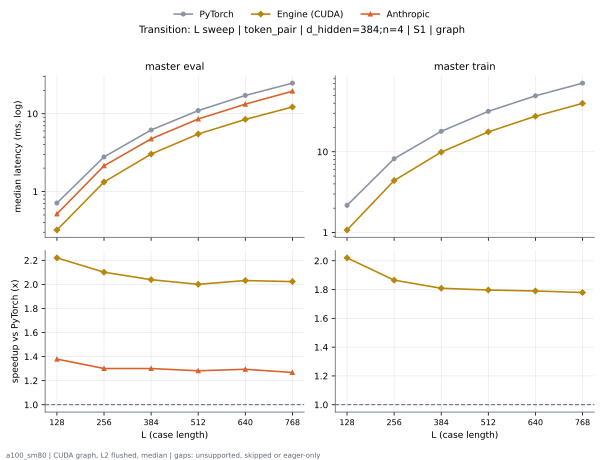

**master eval** (median ms; x = speedup vs PyTorch)

| L | PyTorch | Engine (Triton) | Engine (CUDA) | Anthropic |
|---|---|---|---|---|
| 128 | 0.7117 | 0.3512 (2.03x) | 0.3205 (2.22x) | 0.5161 (1.38x) |
| 256 | 2.786 | 1.385 (2.01x) | 1.326 (2.10x) | 2.142 (1.30x) |
| 384 | 6.179 | 3.121 (1.98x) | 3.03 (2.04x) | 4.75 (1.30x) |
| 512 | 10.97 | 5.55 (1.98x) | 5.482 (2.00x) | 8.555 (1.28x) |
| 640 | 17.18 | 8.685 (1.98x) | 8.452 (2.03x) | 13.27 (1.29x) |
| 768 | 24.69 | 12.52 (1.97x) | 12.21 (2.02x) | 19.48 (1.27x) |

**master train** (median ms; x = speedup vs PyTorch)

| L | PyTorch | Engine (Triton) | Engine (CUDA) | Anthropic |
|---|---|---|---|---|
| 128 | 2.168 | 1.152 (1.88x) | 1.073 (2.02x) | unsupported |
| 256 | 8.204 | 4.631 (1.77x) | 4.399 (1.87x) | unsupported |
| 384 | 17.91 | 10.17 (1.76x) | 9.903 (1.81x) | unsupported |
| 512 | 31.69 | 18.04 (1.76x) | 17.64 (1.80x) | unsupported |
| 640 | 49.32 | 28.11 (1.75x) | 27.55 (1.79x) | unsupported |
| 768 | 70.79 | 40.2 (1.76x) | 39.78 (1.78x) | unsupported |

### L sweep: token_pair | d_hidden=512;n=2 | S1 | graph

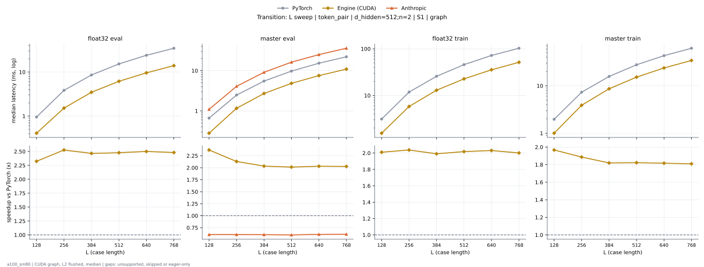

**float32 eval** (median ms; x = speedup vs PyTorch)

| L | PyTorch | Engine (Triton) | Engine (CUDA) | Anthropic |
|---|---|---|---|---|
| 128 | 0.9518 | 0.6625 (1.44x) | 0.4096 (2.32x) | unsupported |
| 256 | 3.838 | 2.53 (1.52x) | 1.519 (2.53x) | unsupported |
| 384 | 8.567 | 6.574 (1.30x) | 3.475 (2.46x) | unsupported |
| 512 | 15.25 | 11.7 (1.30x) | 6.158 (2.48x) | unsupported |
| 640 | 23.95 | 18.39 (1.30x) | 9.58 (2.50x) | unsupported |
| 768 | 34.59 | 26.49 (1.31x) | 13.94 (2.48x) | unsupported |

**master eval** (median ms; x = speedup vs PyTorch)

| L | PyTorch | Engine (Triton) | Engine (CUDA) | Anthropic |
|---|---|---|---|---|
| 128 | 0.6625 | 0.3154 (2.10x) | 0.2796 (2.37x) | 1.093 (0.61x) |
| 256 | 2.474 | 1.227 (2.02x) | 1.161 (2.13x) | 4.078 (0.61x) |
| 384 | 5.505 | 2.846 (1.93x) | 2.706 (2.03x) | 9.102 (0.60x) |
| 512 | 9.747 | 5.016 (1.94x) | 4.841 (2.01x) | 16.25 (0.60x) |
| 640 | 15.31 | 8.397 (1.82x) | 7.538 (2.03x) | 25.06 (0.61x) |
| 768 | 22.11 | 11.22 (1.97x) | 10.91 (2.03x) | 36.02 (0.61x) |

**float32 train** (median ms; x = speedup vs PyTorch)

| L | PyTorch | Engine (Triton) | Engine (CUDA) | Anthropic |
|---|---|---|---|---|
| 128 | 3.117 | 2.2 (1.42x) | 1.551 (2.01x) | unsupported |
| 256 | 11.8 | 8.081 (1.46x) | 5.794 (2.04x) | unsupported |
| 384 | 25.76 | 18.71 (1.38x) | 12.94 (1.99x) | unsupported |
| 512 | 45.77 | 32.94 (1.39x) | 22.69 (2.02x) | unsupported |
| 640 | 72.06 | 52.37 (1.38x) | 35.49 (2.03x) | unsupported |
| 768 | 102.9 | 75.13 (1.37x) | 51.4 (2.00x) | unsupported |

**master train** (median ms; x = speedup vs PyTorch)

| L | PyTorch | Engine (Triton) | Engine (CUDA) | Anthropic |
|---|---|---|---|---|
| 128 | 1.966 | 1.026 (1.92x) | 0.9994 (1.97x) | unsupported |
| 256 | 7.319 | 4.065 (1.80x) | 3.88 (1.89x) | unsupported |
| 384 | 15.73 | 8.882 (1.77x) | 8.645 (1.82x) | unsupported |
| 512 | 27.77 | 15.65 (1.77x) | 15.24 (1.82x) | unsupported |
| 640 | 43.23 | 24.47 (1.77x) | 23.8 (1.82x) | unsupported |
| 768 | 61.99 | 35.28 (1.76x) | 34.26 (1.81x) | unsupported |

### L sweep: token_pair | d_hidden=512;n=4 | S1 | graph

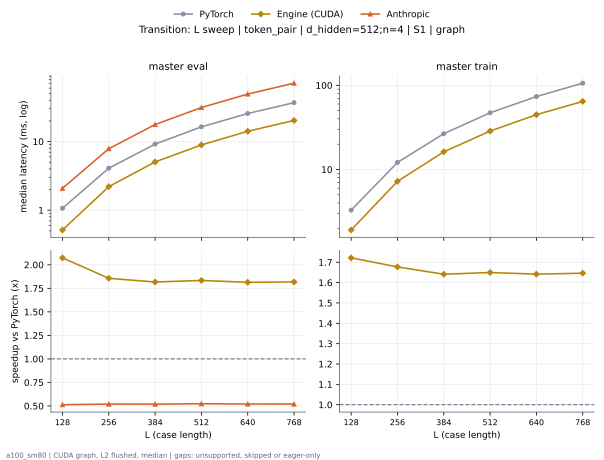

**master eval** (median ms; x = speedup vs PyTorch)

| L | PyTorch | Engine (Triton) | Engine (CUDA) | Anthropic |
|---|---|---|---|---|
| 128 | 1.048 | 0.5734 (1.83x) | 0.51 (2.05x) | 2.081 (0.50x) |
| 256 | 4.099 | 2.367 (1.73x) | 2.228 (1.84x) | 7.874 (0.52x) |
| 384 | 9.176 | 5.28 (1.74x) | 5.103 (1.80x) | 17.69 (0.52x) |
| 512 | 16.35 | 9.351 (1.75x) | 9.028 (1.81x) | 31.31 (0.52x) |
| 640 | 25.54 | 14.71 (1.74x) | 14.08 (1.81x) | 49.19 (0.52x) |
| 768 | 36.81 | 21.13 (1.74x) | 20.27 (1.82x) | 70.86 (0.52x) |

**master train** (median ms; x = speedup vs PyTorch)

| L | PyTorch | Engine (Triton) | Engine (CUDA) | Anthropic |
|---|---|---|---|---|
| 128 | 3.271 | 2.016 (1.62x) | 1.897 (1.72x) | unsupported |
| 256 | 12.11 | 7.519 (1.61x) | 7.265 (1.67x) | unsupported |
| 384 | 26.6 | 16.73 (1.59x) | 16.22 (1.64x) | unsupported |
| 512 | 47.09 | 29.54 (1.59x) | 28.67 (1.64x) | unsupported |
| 640 | 73.23 | 46.26 (1.58x) | 44.91 (1.63x) | unsupported |
| 768 | 105.6 | 66.57 (1.59x) | 64.57 (1.64x) | unsupported |

### L sweep: token_pair | d_hidden=64;n=2 | S1 | graph

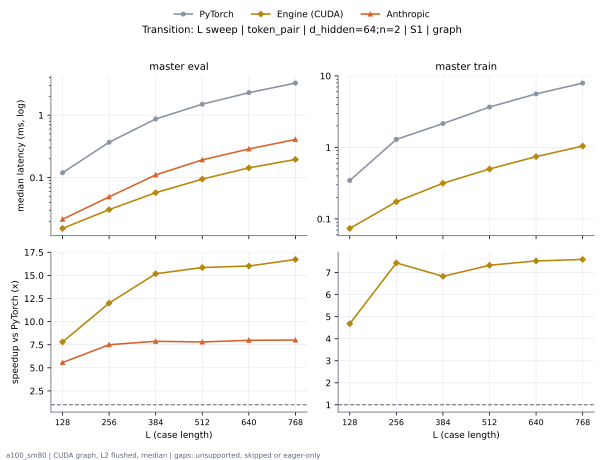

**master eval** (median ms; x = speedup vs PyTorch)

| L | PyTorch | Engine (Triton) | Engine (CUDA) | Anthropic |
|---|---|---|---|---|
| 128 | 0.1198 | 0.03072 (3.90x) | 0.01638 (7.31x) | 0.0215 (5.57x) |
| 256 | 0.3686 | 0.06042 (6.10x) | 0.03072 (12.00x) | 0.04915 (7.50x) |
| 384 | 0.8653 | 0.1321 (6.55x) | 0.05734 (15.09x) | 0.1106 (7.82x) |
| 512 | 1.487 | 0.2263 (6.57x) | 0.09421 (15.78x) | 0.1925 (7.72x) |
| 640 | 2.278 | 0.3359 (6.78x) | 0.1434 (15.89x) | 0.2877 (7.92x) |
| 768 | 3.245 | 0.47 (6.90x) | 0.1956 (16.59x) | 0.4086 (7.94x) |

**master train** (median ms; x = speedup vs PyTorch)

| L | PyTorch | Engine (Triton) | Engine (CUDA) | Anthropic |
|---|---|---|---|---|
| 128 | 0.3461 | 0.1034 (3.35x) | 0.0727 (4.76x) | unsupported |
| 256 | 1.288 | 0.2785 (4.63x) | 0.1731 (7.44x) | unsupported |
| 384 | 2.126 | 0.5437 (3.91x) | 0.3113 (6.83x) | unsupported |
| 512 | 3.615 | 0.8929 (4.05x) | 0.4946 (7.31x) | unsupported |
| 640 | 5.542 | 1.341 (4.13x) | 0.7424 (7.46x) | unsupported |
| 768 | 7.833 | 1.885 (4.16x) | 1.055 (7.43x) | unsupported |

### L sweep: token_pair | d_hidden=64;n=4 | S1 | graph

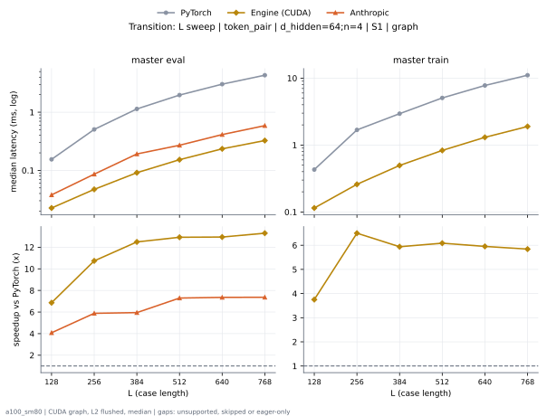

**master eval** (median ms; x = speedup vs PyTorch)

| L | PyTorch | Engine (Triton) | Engine (CUDA) | Anthropic |
|---|---|---|---|---|
| 128 | 0.1546 | 0.03789 (4.08x) | 0.02253 (6.86x) | 0.03789 (4.08x) |
| 256 | 0.5059 | 0.09933 (5.09x) | 0.0471 (10.74x) | 0.08602 (5.88x) |
| 384 | 1.139 | 0.2007 (5.67x) | 0.09114 (12.49x) | 0.1915 (5.95x) |
| 512 | 1.972 | 0.3471 (5.68x) | 0.1526 (12.93x) | 0.2703 (7.30x) |
| 640 | 3.036 | 0.5243 (5.79x) | 0.2345 (12.95x) | 0.4127 (7.36x) |
| 768 | 4.332 | 0.7434 (5.83x) | 0.3256 (13.30x) | 0.5878 (7.37x) |

**master train** (median ms; x = speedup vs PyTorch)

| L | PyTorch | Engine (Triton) | Engine (CUDA) | Anthropic |
|---|---|---|---|---|
| 128 | 0.4301 | 0.1526 (2.82x) | 0.1147 (3.75x) | unsupported |
| 256 | 1.683 | 0.4321 (3.90x) | 0.2591 (6.50x) | unsupported |
| 384 | 2.943 | 0.8561 (3.44x) | 0.4956 (5.94x) | unsupported |
| 512 | 5.06 | 1.441 (3.51x) | 0.8315 (6.08x) | unsupported |
| 640 | 7.765 | 2.198 (3.53x) | 1.305 (5.95x) | unsupported |
| 768 | 11.06 | 3.126 (3.54x) | 1.894 (5.84x) | unsupported |

### L sweep: token_single | d_hidden=384;n=2 | S1 | graph

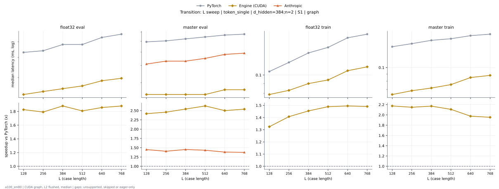

**float32 eval** (median ms; x = speedup vs PyTorch)

| L | PyTorch | Engine (Triton) | Engine (CUDA) | Anthropic |
|---|---|---|---|---|
| 128 | 0.04301 | 0.03686 (1.17x) | 0.02355 (1.83x) | unsupported |
| 256 | 0.04403 | 0.03482 (1.26x) | 0.02458 (1.79x) | unsupported |
| 384 | 0.04813 | 0.03584 (1.34x) | 0.0256 (1.88x) | unsupported |
| 512 | 0.04813 | 0.03686 (1.31x) | 0.02662 (1.81x) | unsupported |
| 640 | 0.05427 | 0.04608 (1.18x) | 0.02867 (1.89x) | unsupported |
| 768 | 0.05632 | 0.0471 (1.20x) | 0.0297 (1.90x) | unsupported |

**master eval** (median ms; x = speedup vs PyTorch)

| L | PyTorch | Engine (Triton) | Engine (CUDA) | Anthropic |
|---|---|---|---|---|
| 128 | 0.05939 | 0.03482 (1.71x) | 0.02458 (2.42x) | 0.04096 (1.45x) |
| 256 | 0.06042 | 0.03482 (1.74x) | 0.02458 (2.46x) | 0.04301 (1.40x) |
| 384 | 0.06246 | 0.03584 (1.74x) | 0.02458 (2.54x) | 0.04301 (1.45x) |
| 512 | 0.06451 | 0.03686 (1.75x) | 0.02458 (2.62x) | 0.04506 (1.43x) |
| 640 | 0.06656 | 0.03891 (1.71x) | 0.02662 (2.50x) | 0.04813 (1.38x) |
| 768 | 0.06861 | 0.03994 (1.72x) | 0.02765 (2.48x) | 0.04915 (1.40x) |

**float32 train** (median ms; x = speedup vs PyTorch)

| L | PyTorch | Engine (Triton) | Engine (CUDA) | Anthropic |
|---|---|---|---|---|
| 128 | 0.1044 | 0.08909 (1.17x) | 0.07885 (1.32x) | unsupported |
| 256 | 0.1167 | 0.0983 (1.19x) | 0.08294 (1.41x) | unsupported |
| 384 | 0.1321 | 0.1055 (1.25x) | 0.08909 (1.48x) | unsupported |
| 512 | 0.1403 | 0.1137 (1.23x) | 0.09523 (1.47x) | unsupported |
| 640 | 0.1587 | 0.1341 (1.18x) | 0.105 (1.51x) | unsupported |
| 768 | 0.1659 | 0.1362 (1.22x) | 0.1106 (1.50x) | unsupported |

**master train** (median ms; x = speedup vs PyTorch)

| L | PyTorch | Engine (Triton) | Engine (CUDA) | Anthropic |
|---|---|---|---|---|
| 128 | 0.1408 | 0.09114 (1.54x) | 0.06451 (2.18x) | unsupported |
| 256 | 0.1475 | 0.09421 (1.57x) | 0.06912 (2.13x) | unsupported |
| 384 | 0.1556 | 0.1004 (1.55x) | 0.0727 (2.14x) | unsupported |
| 512 | 0.1608 | 0.1024 (1.57x) | 0.07578 (2.12x) | unsupported |
| 640 | 0.169 | 0.1085 (1.56x) | 0.08499 (1.99x) | unsupported |
| 768 | 0.1731 | 0.1126 (1.54x) | 0.08909 (1.94x) | unsupported |

### L sweep: token_single | d_hidden=384;n=4 | S1 | graph

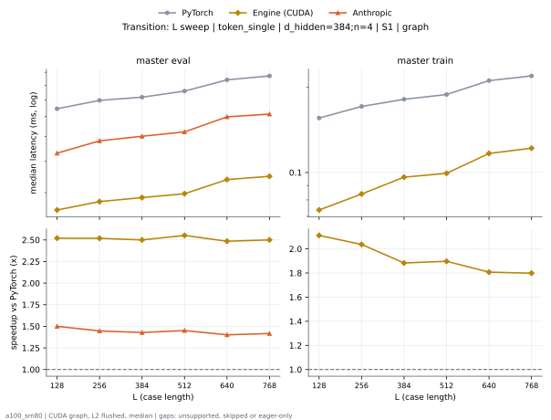

**master eval** (median ms; x = speedup vs PyTorch)

| L | PyTorch | Engine (Triton) | Engine (CUDA) | Anthropic |
|---|---|---|---|---|
| 128 | 0.06451 | 0.03891 (1.66x) | 0.0256 (2.52x) | 0.04301 (1.50x) |
| 256 | 0.06963 | 0.03994 (1.74x) | 0.02765 (2.52x) | 0.04813 (1.45x) |
| 384 | 0.07168 | 0.04301 (1.67x) | 0.02867 (2.50x) | 0.05018 (1.43x) |
| 512 | 0.07578 | 0.04403 (1.72x) | 0.0297 (2.55x) | 0.05222 (1.45x) |
| 640 | 0.08397 | 0.0512 (1.64x) | 0.03379 (2.48x) | 0.0599 (1.40x) |
| 768 | 0.08704 | 0.05222 (1.67x) | 0.03584 (2.43x) | 0.06144 (1.42x) |

**master train** (median ms; x = speedup vs PyTorch)

| L | PyTorch | Engine (Triton) | Engine (CUDA) | Anthropic |
|---|---|---|---|---|
| 128 | 0.1556 | 0.105 (1.48x) | 0.07373 (2.11x) | unsupported |
| 256 | 0.172 | 0.1126 (1.53x) | 0.08397 (2.05x) | unsupported |
| 384 | 0.1802 | 0.1229 (1.47x) | 0.09472 (1.90x) | unsupported |
| 512 | 0.1894 | 0.126 (1.50x) | 0.09933 (1.91x) | unsupported |
| 640 | 0.2109 | 0.1413 (1.49x) | 0.1157 (1.82x) | unsupported |
| 768 | 0.2202 | 0.1464 (1.50x) | 0.1219 (1.81x) | unsupported |

### L sweep: token_single | d_hidden=768;n=2 | S1 | graph

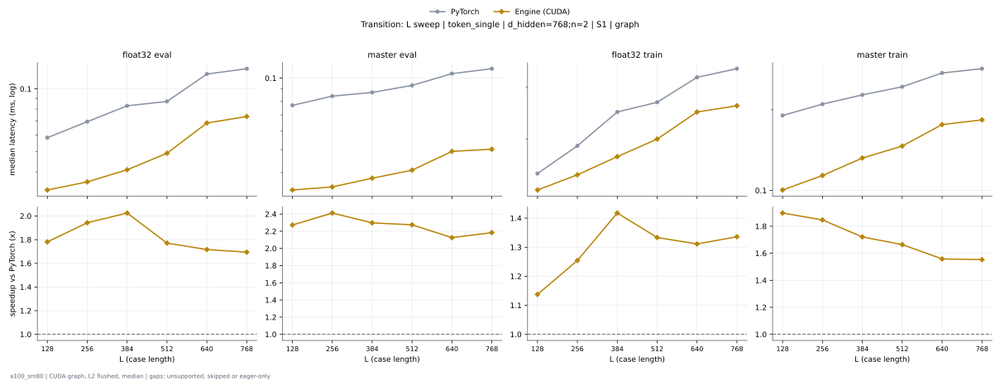

**float32 eval** (median ms; x = speedup vs PyTorch)

| L | PyTorch | Engine (Triton) | Engine (CUDA) | Anthropic |
|---|---|---|---|---|
| 128 | 0.05837 | 0.0471 (1.24x) | 0.03277 (1.78x) | unsupported |
| 256 | 0.06963 | 0.05018 (1.39x) | 0.03584 (1.94x) | unsupported |
| 384 | 0.08294 | 0.06656 (1.25x) | 0.04096 (2.03x) | unsupported |
| 512 | 0.08704 | 0.06758 (1.29x) | 0.04915 (1.77x) | unsupported |
| 640 | 0.1178 | 0.09216 (1.28x) | 0.06861 (1.72x) | unsupported |
| 768 | 0.1249 | 0.09318 (1.34x) | 0.07373 (1.69x) | unsupported |

**master eval** (median ms; x = speedup vs PyTorch)

| L | PyTorch | Engine (Triton) | Engine (CUDA) | Anthropic |
|---|---|---|---|---|
| 128 | 0.0768 | 0.05427 (1.42x) | 0.03379 (2.27x) | unsupported |
| 256 | 0.08397 | 0.05734 (1.46x) | 0.03482 (2.41x) | unsupported |
| 384 | 0.08704 | 0.06656 (1.31x) | 0.03789 (2.30x) | unsupported |
| 512 | 0.09318 | 0.06758 (1.38x) | 0.04096 (2.28x) | unsupported |
| 640 | 0.1044 | 0.07885 (1.32x) | 0.04915 (2.12x) | unsupported |
| 768 | 0.1096 | 0.07885 (1.39x) | 0.05018 (2.18x) | unsupported |

**float32 train** (median ms; x = speedup vs PyTorch)

| L | PyTorch | Engine (Triton) | Engine (CUDA) | Anthropic |
|---|---|---|---|---|
| 128 | 0.1526 | 0.1331 (1.15x) | 0.1341 (1.14x) | unsupported |
| 256 | 0.1894 | 0.1536 (1.23x) | 0.151 (1.25x) | unsupported |
| 384 | 0.2468 | 0.2109 (1.17x) | 0.1741 (1.42x) | unsupported |
| 512 | 0.2662 | 0.2243 (1.19x) | 0.1997 (1.33x) | unsupported |
| 640 | 0.3236 | 0.2744 (1.18x) | 0.2468 (1.31x) | unsupported |
| 768 | 0.3461 | 0.2888 (1.20x) | 0.2591 (1.34x) | unsupported |

**master train** (median ms; x = speedup vs PyTorch)

| L | PyTorch | Engine (Triton) | Engine (CUDA) | Anthropic |
|---|---|---|---|---|
| 128 | 0.1905 | 0.1362 (1.40x) | 0.1004 (1.90x) | unsupported |
| 256 | 0.2099 | 0.1464 (1.43x) | 0.1137 (1.85x) | unsupported |
| 384 | 0.2273 | 0.1669 (1.36x) | 0.1321 (1.72x) | unsupported |
| 512 | 0.2437 | 0.1792 (1.36x) | 0.1464 (1.66x) | unsupported |
| 640 | 0.2744 | 0.2074 (1.32x) | 0.1761 (1.56x) | unsupported |
| 768 | 0.2847 | 0.214 (1.33x) | 0.1833 (1.55x) | unsupported |

### d_hidden sweep at L768: token_pair | n=2 | S1 | graph

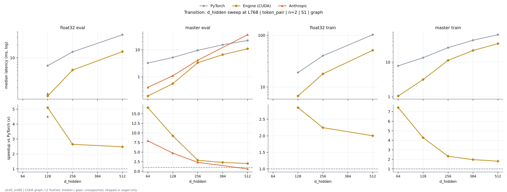

**float32 eval** (median ms; x = speedup vs PyTorch)

| d_hidden | PyTorch | Engine (Triton) | Engine (CUDA) | Anthropic |
|---|---|---|---|---|
| 64 |  |  |  |  |
| 128 | 6.563 | 2.192 (2.99x) | 1.287 (5.10x) | 1.458 (4.50x) |
| 256 | 13.75 | 7.347 (1.87x) | 5.191 (2.65x) | unsupported |
| 384 |  |  |  |  |
| 512 | 34.59 | 26.49 (1.31x) | 13.94 (2.48x) | unsupported |

**master eval** (median ms; x = speedup vs PyTorch)

| d_hidden | PyTorch | Engine (Triton) | Engine (CUDA) | Anthropic |
|---|---|---|---|---|
| 64 | 3.245 | 0.47 (6.90x) | 0.1956 (16.59x) | 0.4086 (7.94x) |
| 128 | 5.19 | 1.134 (4.58x) | 0.5622 (9.23x) | 1.098 (4.73x) |
| 256 | 9.555 | 3.481 (2.75x) | 3.321 (2.88x) | 4.11 (2.32x) |
| 384 | 15.25 | 6.758 (2.26x) | 6.6 (2.31x) | unsupported |
| 512 | 22.11 | 11.22 (1.97x) | 10.91 (2.03x) | 36.02 (0.61x) |

**float32 train** (median ms; x = speedup vs PyTorch)

| d_hidden | PyTorch | Engine (Triton) | Engine (CUDA) | Anthropic |
|---|---|---|---|---|
| 64 |  |  |  |  |
| 128 | 19.04 | 8.126 (2.34x) | 6.678 (2.85x) | unsupported |
| 256 | 40.29 | 22.27 (1.81x) | 17.94 (2.25x) | unsupported |
| 384 |  |  |  |  |
| 512 | 102.9 | 75.13 (1.37x) | 51.4 (2.00x) | unsupported |

**master train** (median ms; x = speedup vs PyTorch)

| d_hidden | PyTorch | Engine (Triton) | Engine (CUDA) | Anthropic |
|---|---|---|---|---|
| 64 | 7.833 | 1.885 (4.16x) | 1.055 (7.43x) | unsupported |
| 128 | 13.46 | 4.053 (3.32x) | 3.152 (4.27x) | unsupported |
| 256 | 26.22 | 11.46 (2.29x) | 11.27 (2.33x) | unsupported |
| 384 | 42.94 | 21.88 (1.96x) | 21.75 (1.97x) | unsupported |
| 512 | 61.99 | 35.28 (1.76x) | 34.26 (1.81x) | unsupported |

### d_hidden sweep at L768: token_pair | n=4 | S1 | graph

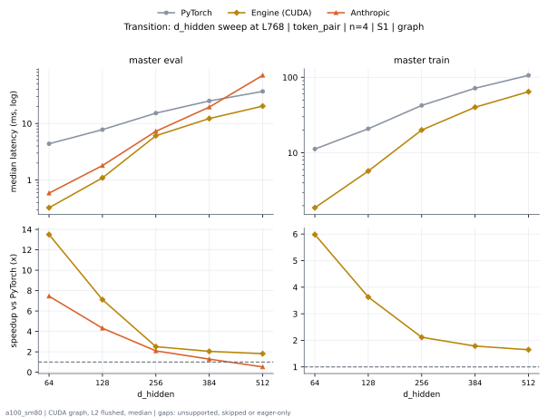

**master eval** (median ms; x = speedup vs PyTorch)

| d_hidden | PyTorch | Engine (Triton) | Engine (CUDA) | Anthropic |
|---|---|---|---|---|
| 64 | 4.332 | 0.7434 (5.83x) | 0.3256 (13.30x) | 0.5878 (7.37x) |
| 128 | 7.681 | 1.979 (3.88x) | 1.017 (7.55x) | 1.804 (4.26x) |
| 256 | 14.96 | 6.004 (2.49x) | 5.885 (2.54x) | 7.282 (2.05x) |
| 384 | 24.69 | 12.52 (1.97x) | 12.21 (2.02x) | 19.48 (1.27x) |
| 512 | 36.81 | 21.13 (1.74x) | 20.27 (1.82x) | 70.86 (0.52x) |

**master train** (median ms; x = speedup vs PyTorch)

| d_hidden | PyTorch | Engine (Triton) | Engine (CUDA) | Anthropic |
|---|---|---|---|---|
| 64 | 11.06 | 3.126 (3.54x) | 1.894 (5.84x) | unsupported |
| 128 | 20.45 | 7.152 (2.86x) | 5.61 (3.65x) | unsupported |
| 256 | 41.65 | 20.68 (2.01x) | 19.99 (2.08x) | unsupported |
| 384 | 70.79 | 40.2 (1.76x) | 39.78 (1.78x) | unsupported |
| 512 | 105.6 | 66.57 (1.59x) | 64.57 (1.64x) | unsupported |

