# Transition on a100_sm80

Generated by `python -m foldjet_engine.measure.plot` from speed tokens `judge/tokens/a100_sm80/`; do not edit.

### L sweep: msa_token | d_hidden=128;n=4 | D1024 | S1 | graph

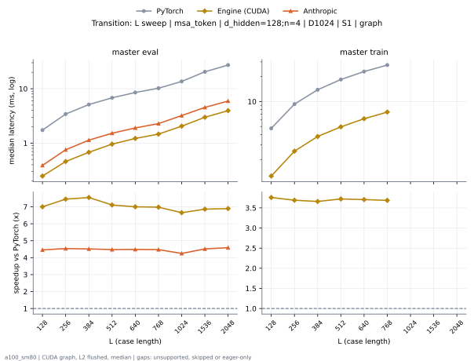

**master eval** (median ms; x = speedup vs PyTorch)

| L | PyTorch | Engine (Triton) | Engine (CUDA) | Anthropic |
|---|---|---|---|---|
| 128 | 1.735 | 0.4301 (4.03x) | 0.2478 (7.00x) | 0.3891 (4.46x) |
| 256 | 3.418 | 0.8653 (3.95x) | 0.4588 (7.45x) | 0.7537 (4.54x) |
| 384 | 5.117 | 1.3 (3.93x) | 0.6779 (7.55x) | 1.134 (4.51x) |
| 512 | 6.804 | 1.764 (3.86x) | 0.9574 (7.11x) | 1.52 (4.48x) |
| 640 | 8.526 | 2.219 (3.84x) | 1.218 (7.00x) | 1.901 (4.48x) |
| 768 | 10.21 | 2.779 (3.68x) | 1.464 (6.98x) | 2.283 (4.47x) |
| 1024 | 13.63 | 3.628 (3.76x) | 2.049 (6.65x) | 3.208 (4.25x) |
| 1536 | 20.49 | 5.412 (3.79x) | 2.986 (6.86x) | 4.537 (4.52x) |
| 2048 | 27.26 | 7.284 (3.74x) | 3.954 (6.89x) | 5.942 (4.59x) |

**master train** (median ms; x = speedup vs PyTorch)

| L | PyTorch | Engine (Triton) | Engine (CUDA) | Anthropic |
|---|---|---|---|---|
| 128 | 4.749 | 1.629 (2.92x) | 1.264 (3.76x) | unsupported |
| 256 | 9.304 | 3.233 (2.88x) | 2.521 (3.69x) | unsupported |
| 384 | 13.86 | 4.771 (2.91x) | 3.788 (3.66x) | unsupported |
| 512 | 18.42 | 6.427 (2.87x) | 4.95 (3.72x) | unsupported |
| 640 | 22.97 | 7.964 (2.88x) | 6.198 (3.71x) | unsupported |
| 768 | 27.51 | 9.534 (2.89x) | 7.462 (3.69x) | unsupported |
| 1024 |  |  |  |  |
| 1536 |  |  |  |  |
| 2048 |  |  |  |  |

### L sweep: msa_token | d_hidden=256;n=4 | D1024 | S1 | graph

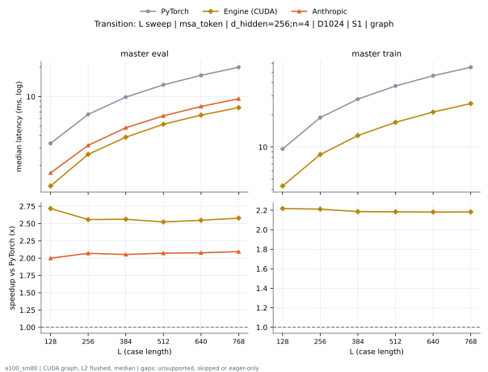

**master eval** (median ms; x = speedup vs PyTorch)

| L | PyTorch | Engine (Triton) | Engine (CUDA) | Anthropic |
|---|---|---|---|---|
| 128 | 3.334 | 1.29 (2.58x) | 1.227 (2.72x) | 1.668 (2.00x) |
| 256 | 6.596 | 2.64 (2.50x) | 2.579 (2.56x) | 3.187 (2.07x) |
| 384 | 9.887 | 3.965 (2.49x) | 3.859 (2.56x) | 4.817 (2.05x) |
| 512 | 13.2 | 5.267 (2.51x) | 5.23 (2.52x) | 6.37 (2.07x) |
| 640 | 16.49 | 6.59 (2.50x) | 6.477 (2.55x) | 7.943 (2.08x) |
| 768 | 19.94 | 7.986 (2.50x) | 7.733 (2.58x) | 9.522 (2.09x) |

**master train** (median ms; x = speedup vs PyTorch)

| L | PyTorch | Engine (Triton) | Engine (CUDA) | Anthropic |
|---|---|---|---|---|
| 128 | 9.591 | 4.613 (2.08x) | 4.325 (2.22x) | unsupported |
| 256 | 18.82 | 9.045 (2.08x) | 8.507 (2.21x) | unsupported |
| 384 | 27.96 | 13.48 (2.07x) | 12.79 (2.19x) | unsupported |
| 512 | 37.13 | 18 (2.06x) | 17 (2.18x) | unsupported |
| 640 | 46.24 | 22.3 (2.07x) | 21.19 (2.18x) | unsupported |
| 768 | 55.51 | 26.79 (2.07x) | 25.43 (2.18x) | unsupported |

### L sweep: msa_token | d_hidden=64;n=4 | D384 | S1 | graph

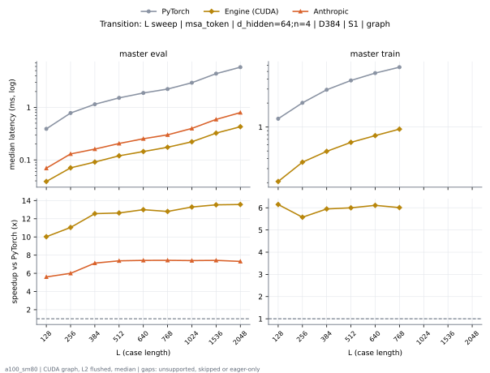

**master eval** (median ms; x = speedup vs PyTorch)

| L | PyTorch | Engine (Triton) | Engine (CUDA) | Anthropic |
|---|---|---|---|---|
| 128 | 0.3901 | 0.07475 (5.22x) | 0.03891 (10.03x) | 0.06963 (5.60x) |
| 256 | 0.7803 | 0.1434 (5.44x) | 0.07066 (11.04x) | 0.13 (6.00x) |
| 384 | 1.145 | 0.2048 (5.59x) | 0.09114 (12.56x) | 0.1608 (7.12x) |
| 512 | 1.514 | 0.2683 (5.64x) | 0.1198 (12.64x) | 0.2053 (7.37x) |
| 640 | 1.877 | 0.3369 (5.57x) | 0.1444 (13.00x) | 0.2529 (7.42x) |
| 768 | 2.229 | 0.3973 (5.61x) | 0.1741 (12.80x) | 0.3 (7.43x) |
| 1024 | 2.94 | 0.5202 (5.65x) | 0.2212 (13.29x) | 0.3973 (7.40x) |
| 1536 | 4.379 | 0.766 (5.72x) | 0.3236 (13.53x) | 0.5898 (7.42x) |
| 2048 | 5.808 | 1.027 (5.66x) | 0.428 (13.57x) | 0.7946 (7.31x) |

**master train** (median ms; x = speedup vs PyTorch)

| L | PyTorch | Engine (Triton) | Engine (CUDA) | Anthropic |
|---|---|---|---|---|
| 128 | 1.272 | 0.3328 (3.82x) | 0.2068 (6.15x) | unsupported |
| 256 | 2.015 | 0.6001 (3.36x) | 0.3615 (5.58x) | unsupported |
| 384 | 2.942 | 0.8581 (3.43x) | 0.4946 (5.95x) | unsupported |
| 512 | 3.851 | 1.106 (3.48x) | 0.642 (6.00x) | unsupported |
| 640 | 4.767 | 1.367 (3.49x) | 0.7803 (6.11x) | unsupported |
| 768 | 5.655 | 1.605 (3.52x) | 0.9411 (6.01x) | unsupported |
| 1024 |  |  |  |  |
| 1536 |  |  |  |  |
| 2048 |  |  |  |  |

### L sweep: token_pair | d_hidden=128;n=2 | S1 | graph

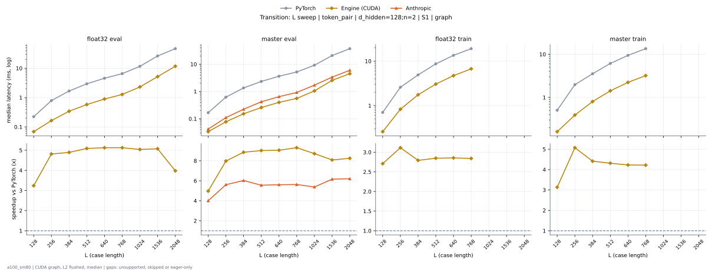

**float32 eval** (median ms; x = speedup vs PyTorch)

| L | PyTorch | Engine (Triton) | Engine (CUDA) | Anthropic |
|---|---|---|---|---|
| 128 | 0.2222 | 0.0768 (2.89x) | 0.06861 (3.24x) | unsupported |
| 256 | 0.7885 | 0.257 (3.07x) | 0.1638 (4.81x) | unsupported |
| 384 | 1.673 | 0.556 (3.01x) | 0.342 (4.89x) | unsupported |
| 512 | 2.944 | 0.9405 (3.13x) | 0.5786 (5.09x) | unsupported |
| 640 | 4.565 | 1.508 (3.03x) | 0.8909 (5.12x) | unsupported |
| 768 | 6.547 | 2.201 (2.98x) | 1.277 (5.13x) | unsupported |
| 1024 | 11.62 | 3.993 (2.91x) | 2.307 (5.04x) | unsupported |
| 1536 | 26.26 | 8.985 (2.92x) | 5.177 (5.07x) | unsupported |
| 2048 | 46.66 | 16.02 (2.91x) | 11.73 (3.98x) | unsupported |

**master eval** (median ms; x = speedup vs PyTorch)

| L | PyTorch | Engine (Triton) | Engine (CUDA) | Anthropic |
|---|---|---|---|---|
| 128 | 0.1679 | 0.05325 (3.15x) | 0.03379 (4.97x) | 0.04198 (4.00x) |
| 256 | 0.6205 | 0.1423 (4.36x) | 0.07782 (7.97x) | 0.1106 (5.61x) |
| 384 | 1.351 | 0.299 (4.52x) | 0.1526 (8.85x) | 0.2243 (6.02x) |
| 512 | 2.338 | 0.5089 (4.59x) | 0.2591 (9.02x) | 0.4209 (5.55x) |
| 640 | 3.621 | 0.7946 (4.56x) | 0.3999 (9.06x) | 0.6461 (5.60x) |
| 768 | 5.185 | 1.125 (4.61x) | 0.5571 (9.31x) | 0.9216 (5.63x) |
| 1024 | 9.179 | 2.128 (4.31x) | 1.053 (8.72x) | 1.707 (5.38x) |
| 1536 | 20.68 | 4.868 (4.25x) | 2.558 (8.08x) | 3.356 (6.16x) |
| 2048 | 37.07 | 8.759 (4.23x) | 4.496 (8.25x) | 5.978 (6.20x) |

**float32 train** (median ms; x = speedup vs PyTorch)

| L | PyTorch | Engine (Triton) | Engine (CUDA) | Anthropic |
|---|---|---|---|---|
| 128 | 0.7045 | 0.3287 (2.14x) | 0.2601 (2.71x) | unsupported |
| 256 | 2.584 | 0.982 (2.63x) | 0.8294 (3.11x) | unsupported |
| 384 | 4.897 | 2.127 (2.30x) | 1.753 (2.79x) | unsupported |
| 512 | 8.673 | 3.672 (2.36x) | 3.046 (2.85x) | unsupported |
| 640 | 13.46 | 5.847 (2.30x) | 4.717 (2.85x) | unsupported |
| 768 | 19.05 | 8.116 (2.35x) | 6.705 (2.84x) | unsupported |
| 1024 |  |  |  |  |
| 1536 |  |  |  |  |
| 2048 |  |  |  |  |

**master train** (median ms; x = speedup vs PyTorch)

| L | PyTorch | Engine (Triton) | Engine (CUDA) | Anthropic |
|---|---|---|---|---|
| 128 | 0.5038 | 0.1915 (2.63x) | 0.1608 (3.13x) | unsupported |
| 256 | 1.979 | 0.511 (3.87x) | 0.3901 (5.07x) | unsupported |
| 384 | 3.538 | 1.03 (3.44x) | 0.8018 (4.41x) | unsupported |
| 512 | 6.134 | 1.828 (3.36x) | 1.422 (4.31x) | unsupported |
| 640 | 9.446 | 2.893 (3.27x) | 2.235 (4.23x) | unsupported |
| 768 | 13.53 | 4.114 (3.29x) | 3.206 (4.22x) | unsupported |
| 1024 |  |  |  |  |
| 1536 |  |  |  |  |
| 2048 |  |  |  |  |

### L sweep: token_pair | d_hidden=128;n=4 | S1 | graph

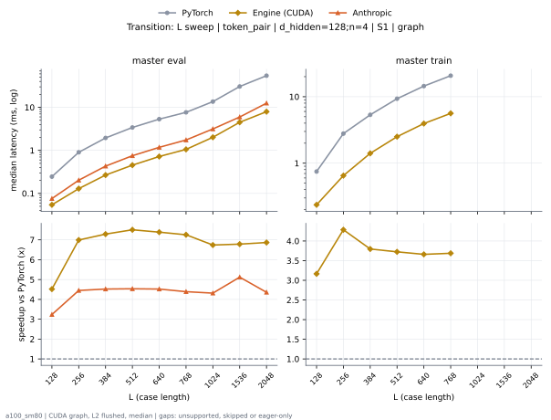

**master eval** (median ms; x = speedup vs PyTorch)

| L | PyTorch | Engine (Triton) | Engine (CUDA) | Anthropic |
|---|---|---|---|---|
| 128 | 0.2452 | 0.07066 (3.47x) | 0.05427 (4.52x) | 0.07578 (3.24x) |
| 256 | 0.9021 | 0.2202 (4.10x) | 0.129 (6.99x) | 0.2028 (4.45x) |
| 384 | 1.945 | 0.4803 (4.05x) | 0.2668 (7.29x) | 0.4301 (4.52x) |
| 512 | 3.406 | 0.8515 (4.00x) | 0.4536 (7.51x) | 0.7511 (4.53x) |
| 640 | 5.319 | 1.334 (3.99x) | 0.7199 (7.39x) | 1.177 (4.52x) |
| 768 | 7.653 | 2 (3.83x) | 1.055 (7.26x) | 1.744 (4.39x) |
| 1024 | 13.58 | 3.592 (3.78x) | 2.015 (6.74x) | 3.148 (4.31x) |
| 1536 | 30.52 | 8.108 (3.76x) | 4.498 (6.78x) | 5.961 (5.12x) |
| 2048 | 54.45 | 14.46 (3.77x) | 7.93 (6.87x) | 12.5 (4.36x) |

**master train** (median ms; x = speedup vs PyTorch)

| L | PyTorch | Engine (Triton) | Engine (CUDA) | Anthropic |
|---|---|---|---|---|
| 128 | 0.7485 | 0.2785 (2.69x) | 0.2365 (3.16x) | unsupported |
| 256 | 2.786 | 0.8556 (3.26x) | 0.6502 (4.29x) | unsupported |
| 384 | 5.339 | 1.843 (2.90x) | 1.406 (3.80x) | unsupported |
| 512 | 9.326 | 3.21 (2.90x) | 2.504 (3.72x) | unsupported |
| 640 | 14.45 | 4.979 (2.90x) | 3.947 (3.66x) | unsupported |
| 768 | 20.72 | 7.143 (2.90x) | 5.618 (3.69x) | unsupported |
| 1024 |  |  |  |  |
| 1536 |  |  |  |  |
| 2048 |  |  |  |  |

### L sweep: token_pair | d_hidden=256;n=2 | S1 | graph

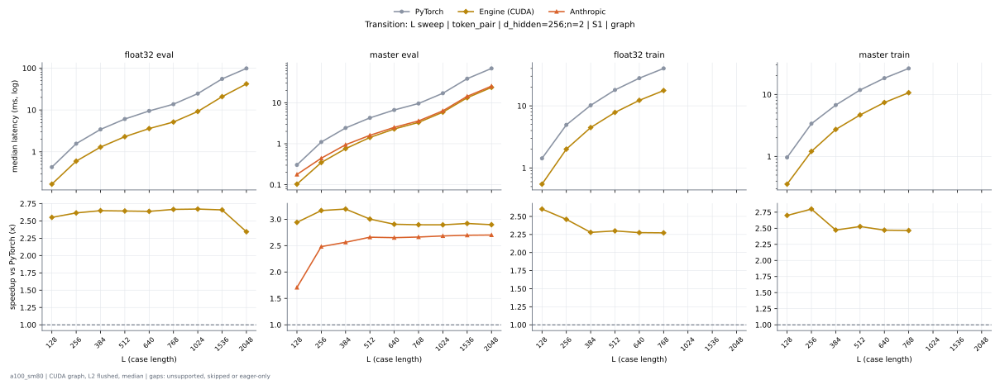

**float32 eval** (median ms; x = speedup vs PyTorch)

| L | PyTorch | Engine (Triton) | Engine (CUDA) | Anthropic |
|---|---|---|---|---|
| 128 | 0.4311 | 0.2191 (1.97x) | 0.169 (2.55x) | unsupported |
| 256 | 1.566 | 0.7035 (2.23x) | 0.5985 (2.62x) | unsupported |
| 384 | 3.434 | 1.812 (1.90x) | 1.297 (2.65x) | unsupported |
| 512 | 6.081 | 3.246 (1.87x) | 2.3 (2.64x) | unsupported |
| 640 | 9.488 | 4.737 (2.00x) | 3.596 (2.64x) | unsupported |
| 768 | 13.75 | 7.271 (1.89x) | 5.155 (2.67x) | unsupported |
| 1024 | 24.63 | 12.97 (1.90x) | 9.219 (2.67x) | unsupported |
| 1536 | 55.35 | 29.3 (1.89x) | 20.81 (2.66x) | unsupported |
| 2048 | 98.47 | 52.56 (1.87x) | 42.01 (2.34x) | unsupported |

**master eval** (median ms; x = speedup vs PyTorch)

| L | PyTorch | Engine (Triton) | Engine (CUDA) | Anthropic |
|---|---|---|---|---|
| 128 | 0.3041 | 0.1126 (2.70x) | 0.1034 (2.94x) | 0.1782 (1.71x) |
| 256 | 1.1 | 0.3645 (3.02x) | 0.3476 (3.16x) | 0.4434 (2.48x) |
| 384 | 2.423 | 0.77 (3.15x) | 0.7588 (3.19x) | 0.9452 (2.56x) |
| 512 | 4.27 | 1.46 (2.92x) | 1.422 (3.00x) | 1.605 (2.66x) |
| 640 | 6.649 | 2.321 (2.86x) | 2.289 (2.91x) | 2.508 (2.65x) |
| 768 | 9.58 | 3.391 (2.82x) | 3.309 (2.90x) | 3.597 (2.66x) |
| 1024 | 17.02 | 5.938 (2.87x) | 5.882 (2.89x) | 6.343 (2.68x) |
| 1536 | 38.57 | 13.46 (2.87x) | 13.21 (2.92x) | 14.3 (2.70x) |
| 2048 | 68.6 | 23.94 (2.87x) | 23.68 (2.90x) | 25.4 (2.70x) |

**float32 train** (median ms; x = speedup vs PyTorch)

| L | PyTorch | Engine (Triton) | Engine (CUDA) | Anthropic |
|---|---|---|---|---|
| 128 | 1.425 | 0.7204 (1.98x) | 0.5478 (2.60x) | unsupported |
| 256 | 4.934 | 2.533 (1.95x) | 2.006 (2.46x) | unsupported |
| 384 | 10.18 | 5.655 (1.80x) | 4.468 (2.28x) | unsupported |
| 512 | 18.02 | 9.928 (1.82x) | 7.838 (2.30x) | unsupported |
| 640 | 27.9 | 15.16 (1.84x) | 12.26 (2.28x) | unsupported |
| 768 | 40.06 | 21.76 (1.84x) | 17.63 (2.27x) | unsupported |
| 1024 |  |  |  |  |
| 1536 |  |  |  |  |
| 2048 |  |  |  |  |

**master train** (median ms; x = speedup vs PyTorch)

| L | PyTorch | Engine (Triton) | Engine (CUDA) | Anthropic |
|---|---|---|---|---|
| 128 | 0.9646 | 0.3896 (2.48x) | 0.3574 (2.70x) | unsupported |
| 256 | 3.374 | 1.274 (2.65x) | 1.206 (2.80x) | unsupported |
| 384 | 6.738 | 2.87 (2.35x) | 2.726 (2.47x) | unsupported |
| 512 | 11.79 | 4.985 (2.36x) | 4.665 (2.53x) | unsupported |
| 640 | 18.31 | 7.768 (2.36x) | 7.409 (2.47x) | unsupported |
| 768 | 26.28 | 11.13 (2.36x) | 10.66 (2.46x) | unsupported |
| 1024 |  |  |  |  |
| 1536 |  |  |  |  |
| 2048 |  |  |  |  |

### L sweep: token_pair | d_hidden=256;n=4 | S1 | graph

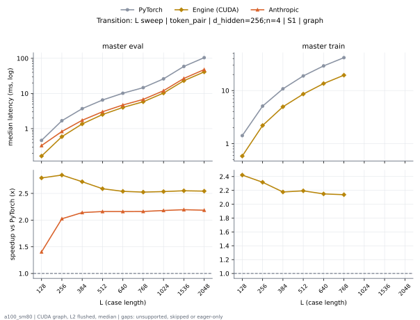

**master eval** (median ms; x = speedup vs PyTorch)

| L | PyTorch | Engine (Triton) | Engine (CUDA) | Anthropic |
|---|---|---|---|---|
| 128 | 0.4628 | 0.1833 (2.53x) | 0.1659 (2.79x) | 0.3297 (1.40x) |
| 256 | 1.677 | 0.6154 (2.73x) | 0.5898 (2.84x) | 0.8284 (2.02x) |
| 384 | 3.703 | 1.396 (2.65x) | 1.362 (2.72x) | 1.73 (2.14x) |
| 512 | 6.523 | 2.579 (2.53x) | 2.521 (2.59x) | 3.019 (2.16x) |
| 640 | 10.17 | 4.018 (2.53x) | 4.004 (2.54x) | 4.706 (2.16x) |
| 768 | 14.65 | 5.795 (2.53x) | 5.803 (2.52x) | 6.777 (2.16x) |
| 1024 | 26.09 | 10.33 (2.52x) | 10.29 (2.53x) | 11.97 (2.18x) |
| 1536 | 58.85 | 23.31 (2.52x) | 23.08 (2.55x) | 26.81 (2.19x) |
| 2048 | 104.5 | 41.96 (2.49x) | 41.1 (2.54x) | 47.83 (2.19x) |

**master train** (median ms; x = speedup vs PyTorch)

| L | PyTorch | Engine (Triton) | Engine (CUDA) | Anthropic |
|---|---|---|---|---|
| 128 | 1.418 | 0.6441 (2.20x) | 0.5857 (2.42x) | unsupported |
| 256 | 5.103 | 2.379 (2.14x) | 2.202 (2.32x) | unsupported |
| 384 | 10.79 | 5.256 (2.05x) | 4.955 (2.18x) | unsupported |
| 512 | 18.86 | 9.191 (2.05x) | 8.596 (2.19x) | unsupported |
| 640 | 29.13 | 14.31 (2.04x) | 13.55 (2.15x) | unsupported |
| 768 | 41.63 | 20.16 (2.06x) | 19.47 (2.14x) | unsupported |
| 1024 |  |  |  |  |
| 1536 |  |  |  |  |
| 2048 |  |  |  |  |

### L sweep: token_pair | d_hidden=384;n=2 | S1 | graph

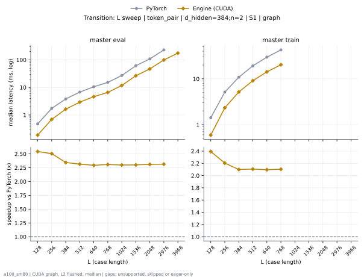

**master eval** (median ms; x = speedup vs PyTorch)

| L | PyTorch | Engine (Triton) | Engine (CUDA) | Anthropic |
|---|---|---|---|---|
| 128 | 0.4741 | 0.2043 (2.32x) | 0.1864 (2.54x) | unsupported |
| 256 | 1.734 | 0.7291 (2.38x) | 0.6917 (2.51x) | unsupported |
| 384 | 3.819 | 1.641 (2.33x) | 1.628 (2.35x) | unsupported |
| 512 | 6.773 | 3.029 (2.24x) | 2.925 (2.32x) | unsupported |
| 640 | 10.58 | 4.697 (2.25x) | 4.61 (2.29x) | unsupported |
| 768 | 15.22 | 6.733 (2.26x) | 6.592 (2.31x) | unsupported |
| 1024 | 27.16 | 12.03 (2.26x) | 11.81 (2.30x) | unsupported |
| 1536 | 61.01 | 27.02 (2.26x) | 26.5 (2.30x) | unsupported |
| 2048 | 108.8 | 48.1 (2.26x) | 47.08 (2.31x) | unsupported |
| 2976 | 230 | 101.8 (2.26x) | 99.35 (2.32x) | unsupported |
| 3968 | skipped | 181 | 176.4 | unsupported |

**master train** (median ms; x = speedup vs PyTorch)

| L | PyTorch | Engine (Triton) | Engine (CUDA) | Anthropic |
|---|---|---|---|---|
| 128 | 1.418 | 0.6461 (2.19x) | 0.5924 (2.39x) | unsupported |
| 256 | 5.135 | 2.464 (2.08x) | 2.33 (2.20x) | unsupported |
| 384 | 10.85 | 5.486 (1.98x) | 5.17 (2.10x) | unsupported |
| 512 | 19.17 | 9.569 (2.00x) | 9.101 (2.11x) | unsupported |
| 640 | 29.73 | 14.79 (2.01x) | 14.18 (2.10x) | unsupported |
| 768 | 42.72 | 21.25 (2.01x) | 20.3 (2.10x) | unsupported |
| 1024 |  |  |  |  |
| 1536 |  |  |  |  |
| 2048 |  |  |  |  |
| 2976 |  |  |  |  |
| 3968 |  |  |  |  |

### L sweep: token_pair | d_hidden=384;n=4 | S1 | graph

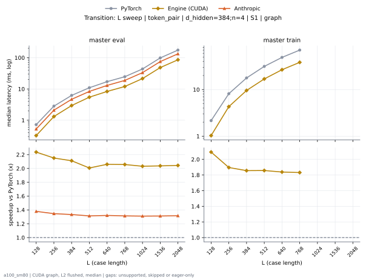

**master eval** (median ms; x = speedup vs PyTorch)

| L | PyTorch | Engine (Triton) | Engine (CUDA) | Anthropic |
|---|---|---|---|---|
| 128 | 0.7214 | 0.3533 (2.04x) | 0.3226 (2.24x) | 0.5233 (1.38x) |
| 256 | 2.823 | 1.398 (2.02x) | 1.313 (2.15x) | 2.097 (1.35x) |
| 384 | 6.228 | 2.942 (2.12x) | 2.95 (2.11x) | 4.671 (1.33x) |
| 512 | 10.96 | 5.514 (1.99x) | 5.46 (2.01x) | 8.342 (1.31x) |
| 640 | 17.14 | 8.69 (1.97x) | 8.321 (2.06x) | 12.98 (1.32x) |
| 768 | 24.67 | 12.41 (1.99x) | 12 (2.06x) | 18.78 (1.31x) |
| 1024 | 43.69 | 22.08 (1.98x) | 21.51 (2.03x) | 33.35 (1.31x) |
| 1536 | 98.56 | 49.67 (1.98x) | 48.38 (2.04x) | 75.12 (1.31x) |
| 2048 | 175.5 | 88.59 (1.98x) | 85.86 (2.04x) | 133.3 (1.32x) |

**master train** (median ms; x = speedup vs PyTorch)

| L | PyTorch | Engine (Triton) | Engine (CUDA) | Anthropic |
|---|---|---|---|---|
| 128 | 2.156 | 1.165 (1.85x) | 1.03 (2.09x) | unsupported |
| 256 | 8.156 | 4.512 (1.81x) | 4.302 (1.90x) | unsupported |
| 384 | 17.75 | 9.935 (1.79x) | 9.565 (1.86x) | unsupported |
| 512 | 31.4 | 17.77 (1.77x) | 16.91 (1.86x) | unsupported |
| 640 | 48.97 | 27.62 (1.77x) | 26.64 (1.84x) | unsupported |
| 768 | 70.26 | 39.79 (1.77x) | 38.36 (1.83x) | unsupported |
| 1024 |  |  |  |  |
| 1536 |  |  |  |  |
| 2048 |  |  |  |  |

### L sweep: token_pair | d_hidden=512;n=2 | S1 | graph

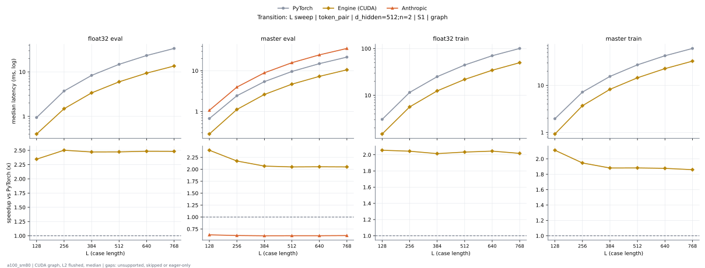

**float32 eval** (median ms; x = speedup vs PyTorch)

| L | PyTorch | Engine (Triton) | Engine (CUDA) | Anthropic |
|---|---|---|---|---|
| 128 | 0.9441 | 0.6482 (1.46x) | 0.4024 (2.35x) | unsupported |
| 256 | 3.727 | 2.499 (1.49x) | 1.489 (2.50x) | unsupported |
| 384 | 8.354 | 6.417 (1.30x) | 3.379 (2.47x) | unsupported |
| 512 | 14.81 | 11.4 (1.30x) | 5.989 (2.47x) | unsupported |
| 640 | 23.36 | 17.94 (1.30x) | 9.401 (2.48x) | unsupported |
| 768 | 33.68 | 25.88 (1.30x) | 13.56 (2.48x) | unsupported |

**master eval** (median ms; x = speedup vs PyTorch)

| L | PyTorch | Engine (Triton) | Engine (CUDA) | Anthropic |
|---|---|---|---|---|
| 128 | 0.6707 | 0.3154 (2.13x) | 0.2796 (2.40x) | 1.069 (0.63x) |
| 256 | 2.433 | 1.205 (2.02x) | 1.119 (2.17x) | 3.965 (0.61x) |
| 384 | 5.405 | 2.767 (1.95x) | 2.614 (2.07x) | 8.897 (0.61x) |
| 512 | 9.596 | 4.838 (1.98x) | 4.681 (2.05x) | 15.76 (0.61x) |
| 640 | 14.95 | 8.298 (1.80x) | 7.279 (2.05x) | 24.55 (0.61x) |
| 768 | 21.61 | 11.07 (1.95x) | 10.54 (2.05x) | 35.29 (0.61x) |

**float32 train** (median ms; x = speedup vs PyTorch)

| L | PyTorch | Engine (Triton) | Engine (CUDA) | Anthropic |
|---|---|---|---|---|
| 128 | 3.06 | 2.131 (1.44x) | 1.489 (2.06x) | unsupported |
| 256 | 11.56 | 7.817 (1.48x) | 5.655 (2.04x) | unsupported |
| 384 | 25.08 | 18.1 (1.39x) | 12.45 (2.01x) | unsupported |
| 512 | 44.53 | 31.79 (1.40x) | 21.91 (2.03x) | unsupported |
| 640 | 70.36 | 50.65 (1.39x) | 34.41 (2.04x) | unsupported |
| 768 | 100.7 | 73 (1.38x) | 49.93 (2.02x) | unsupported |

**master train** (median ms; x = speedup vs PyTorch)

| L | PyTorch | Engine (Triton) | Engine (CUDA) | Anthropic |
|---|---|---|---|---|
| 128 | 1.956 | 1.018 (1.92x) | 0.9257 (2.11x) | unsupported |
| 256 | 7.186 | 3.875 (1.85x) | 3.69 (1.95x) | unsupported |
| 384 | 15.47 | 8.562 (1.81x) | 8.223 (1.88x) | unsupported |
| 512 | 27.26 | 15.09 (1.81x) | 14.48 (1.88x) | unsupported |
| 640 | 42.54 | 23.65 (1.80x) | 22.66 (1.88x) | unsupported |
| 768 | 60.8 | 33.98 (1.79x) | 32.69 (1.86x) | unsupported |

### L sweep: token_pair | d_hidden=512;n=4 | S1 | graph

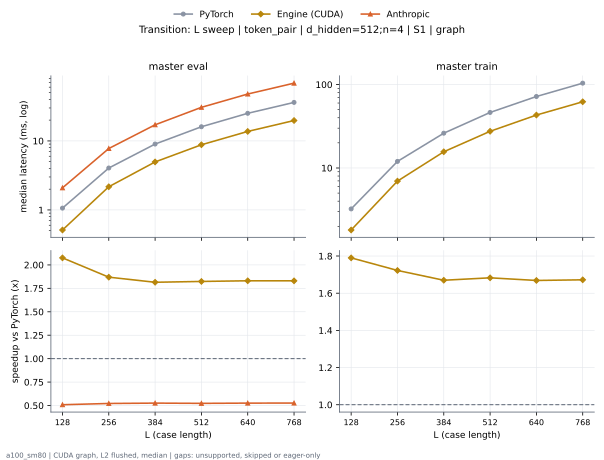

**master eval** (median ms; x = speedup vs PyTorch)

| L | PyTorch | Engine (Triton) | Engine (CUDA) | Anthropic |
|---|---|---|---|---|
| 128 | 1.062 | 0.5683 (1.87x) | 0.512 (2.07x) | 2.089 (0.51x) |
| 256 | 4.05 | 2.319 (1.75x) | 2.167 (1.87x) | 7.759 (0.52x) |
| 384 | 9.002 | 5.177 (1.74x) | 4.96 (1.81x) | 17.12 (0.53x) |
| 512 | 16.04 | 9.206 (1.74x) | 8.795 (1.82x) | 30.65 (0.52x) |
| 640 | 25.12 | 14.35 (1.75x) | 13.72 (1.83x) | 47.79 (0.53x) |
| 768 | 36.14 | 20.63 (1.75x) | 19.75 (1.83x) | 68.68 (0.53x) |

**master train** (median ms; x = speedup vs PyTorch)

| L | PyTorch | Engine (Triton) | Engine (CUDA) | Anthropic |
|---|---|---|---|---|
| 128 | 3.231 | 1.966 (1.64x) | 1.805 (1.79x) | unsupported |
| 256 | 11.99 | 7.302 (1.64x) | 6.96 (1.72x) | unsupported |
| 384 | 26.12 | 16.24 (1.61x) | 15.65 (1.67x) | unsupported |
| 512 | 46.32 | 28.73 (1.61x) | 27.53 (1.68x) | unsupported |
| 640 | 71.93 | 44.69 (1.61x) | 43.11 (1.67x) | unsupported |
| 768 | 104 | 64.44 (1.61x) | 62.18 (1.67x) | unsupported |

### L sweep: token_pair | d_hidden=64;n=2 | S1 | graph

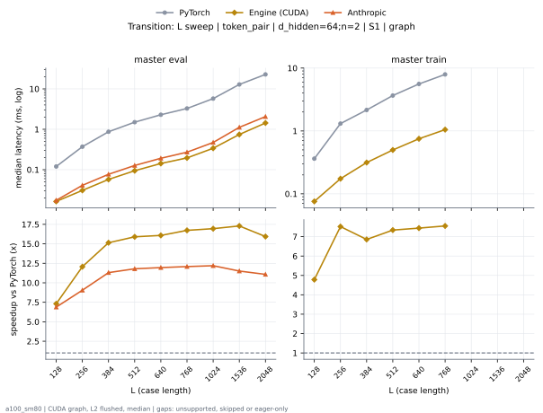

**master eval** (median ms; x = speedup vs PyTorch)

| L | PyTorch | Engine (Triton) | Engine (CUDA) | Anthropic |
|---|---|---|---|---|
| 128 | 0.1198 | 0.03072 (3.90x) | 0.01638 (7.31x) | 0.01741 (6.88x) |
| 256 | 0.3707 | 0.06042 (6.14x) | 0.03072 (12.07x) | 0.04096 (9.05x) |
| 384 | 0.8684 | 0.1362 (6.38x) | 0.05734 (15.14x) | 0.0768 (11.31x) |
| 512 | 1.498 | 0.2335 (6.42x) | 0.09421 (15.90x) | 0.127 (11.80x) |
| 640 | 2.289 | 0.3471 (6.59x) | 0.1423 (16.08x) | 0.1915 (11.95x) |
| 768 | 3.272 | 0.4854 (6.74x) | 0.1956 (16.73x) | 0.2708 (12.08x) |
| 1024 | 5.744 | 0.8381 (6.85x) | 0.3389 (16.95x) | 0.471 (12.19x) |
| 1536 | 12.86 | 1.891 (6.80x) | 0.7434 (17.30x) | 1.117 (11.51x) |
| 2048 | 22.8 | 3.346 (6.81x) | 1.431 (15.94x) | 2.057 (11.08x) |

**master train** (median ms; x = speedup vs PyTorch)

| L | PyTorch | Engine (Triton) | Engine (CUDA) | Anthropic |
|---|---|---|---|---|
| 128 | 0.3625 | 0.1034 (3.50x) | 0.07578 (4.78x) | unsupported |
| 256 | 1.309 | 0.2867 (4.57x) | 0.1741 (7.52x) | unsupported |
| 384 | 2.156 | 0.5668 (3.80x) | 0.3144 (6.86x) | unsupported |
| 512 | 3.657 | 0.9359 (3.91x) | 0.4982 (7.34x) | unsupported |
| 640 | 5.59 | 1.403 (3.98x) | 0.7511 (7.44x) | unsupported |
| 768 | 7.928 | 1.977 (4.01x) | 1.05 (7.55x) | unsupported |
| 1024 |  |  |  |  |
| 1536 |  |  |  |  |
| 2048 |  |  |  |  |

### L sweep: token_pair | d_hidden=64;n=4 | S1 | graph

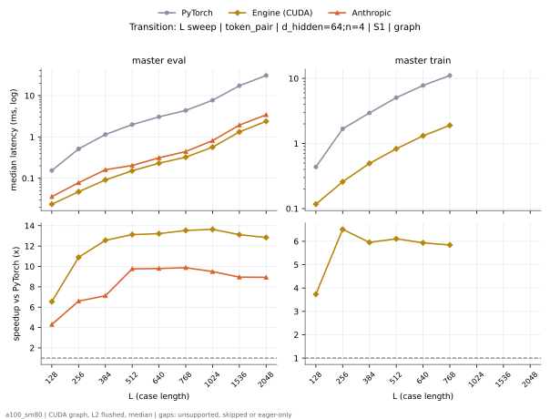

**master eval** (median ms; x = speedup vs PyTorch)

| L | PyTorch | Engine (Triton) | Engine (CUDA) | Anthropic |
|---|---|---|---|---|
| 128 | 0.1541 | 0.03994 (3.86x) | 0.02355 (6.54x) | 0.03584 (4.30x) |
| 256 | 0.513 | 0.09933 (5.16x) | 0.0471 (10.89x) | 0.07782 (6.59x) |
| 384 | 1.145 | 0.2053 (5.58x) | 0.09114 (12.56x) | 0.1608 (7.12x) |
| 512 | 1.989 | 0.3564 (5.58x) | 0.1516 (13.12x) | 0.2038 (9.76x) |
| 640 | 3.058 | 0.5371 (5.69x) | 0.2314 (13.21x) | 0.3123 (9.79x) |
| 768 | 4.379 | 0.7598 (5.76x) | 0.3236 (13.53x) | 0.4434 (9.88x) |
| 1024 | 7.722 | 1.359 (5.68x) | 0.5663 (13.64x) | 0.8136 (9.49x) |
| 1536 | 17.3 | 3.067 (5.64x) | 1.319 (13.12x) | 1.933 (8.95x) |
| 2048 | 30.68 | 5.508 (5.57x) | 2.39 (12.84x) | 3.436 (8.93x) |

**master train** (median ms; x = speedup vs PyTorch)

| L | PyTorch | Engine (Triton) | Engine (CUDA) | Anthropic |
|---|---|---|---|---|
| 128 | 0.4357 | 0.1516 (2.87x) | 0.1167 (3.73x) | unsupported |
| 256 | 1.68 | 0.4316 (3.89x) | 0.258 (6.51x) | unsupported |
| 384 | 2.942 | 0.8571 (3.43x) | 0.4941 (5.95x) | unsupported |
| 512 | 5.057 | 1.448 (3.49x) | 0.8279 (6.11x) | unsupported |
| 640 | 7.778 | 2.204 (3.53x) | 1.311 (5.93x) | unsupported |
| 768 | 11.08 | 3.139 (3.53x) | 1.896 (5.84x) | unsupported |
| 1024 |  |  |  |  |
| 1536 |  |  |  |  |
| 2048 |  |  |  |  |

### L sweep: token_single | d_hidden=384;n=2 | S1 | graph

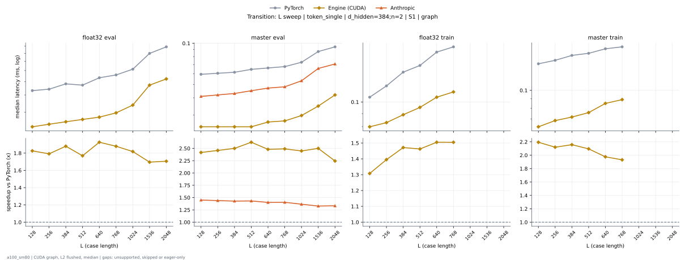

**float32 eval** (median ms; x = speedup vs PyTorch)

| L | PyTorch | Engine (Triton) | Engine (CUDA) | Anthropic |
|---|---|---|---|---|
| 128 | 0.04301 | 0.03584 (1.20x) | 0.02355 (1.83x) | unsupported |
| 256 | 0.04403 | 0.03482 (1.26x) | 0.02458 (1.79x) | unsupported |
| 384 | 0.04813 | 0.03584 (1.34x) | 0.0256 (1.88x) | unsupported |
| 512 | 0.0471 | 0.03584 (1.31x) | 0.02662 (1.77x) | unsupported |
| 640 | 0.05325 | 0.04608 (1.16x) | 0.02765 (1.93x) | unsupported |
| 768 | 0.05581 | 0.0471 (1.18x) | 0.0297 (1.88x) | unsupported |
| 1024 | 0.06144 | 0.05325 (1.15x) | 0.03379 (1.82x) | unsupported |
| 1536 | 0.07987 | 0.07373 (1.08x) | 0.0471 (1.70x) | unsupported |
| 2048 | 0.08909 | 0.07373 (1.21x) | 0.05222 (1.71x) | unsupported |

**master eval** (median ms; x = speedup vs PyTorch)

| L | PyTorch | Engine (Triton) | Engine (CUDA) | Anthropic |
|---|---|---|---|---|
| 128 | 0.05939 | 0.03482 (1.71x) | 0.02458 (2.42x) | 0.04096 (1.45x) |
| 256 | 0.06042 | 0.03482 (1.74x) | 0.02458 (2.46x) | 0.04198 (1.44x) |
| 384 | 0.06144 | 0.03584 (1.71x) | 0.02458 (2.50x) | 0.04301 (1.43x) |
| 512 | 0.06451 | 0.03635 (1.77x) | 0.02458 (2.62x) | 0.04506 (1.43x) |
| 640 | 0.06605 | 0.03891 (1.70x) | 0.02662 (2.48x) | 0.0471 (1.40x) |
| 768 | 0.06758 | 0.04096 (1.65x) | 0.02714 (2.49x) | 0.04813 (1.40x) |
| 1024 | 0.0727 | 0.04915 (1.48x) | 0.0297 (2.45x) | 0.05325 (1.37x) |
| 1536 | 0.08704 | 0.05837 (1.49x) | 0.03482 (2.50x) | 0.06554 (1.33x) |
| 2048 | 0.09421 | 0.05734 (1.64x) | 0.04198 (2.24x) | 0.07066 (1.33x) |

**float32 train** (median ms; x = speedup vs PyTorch)

| L | PyTorch | Engine (Triton) | Engine (CUDA) | Anthropic |
|---|---|---|---|---|
| 128 | 0.1044 | 0.08909 (1.17x) | 0.07987 (1.31x) | unsupported |
| 256 | 0.1157 | 0.09728 (1.19x) | 0.08294 (1.40x) | unsupported |
| 384 | 0.1311 | 0.1044 (1.25x) | 0.08909 (1.47x) | unsupported |
| 512 | 0.1393 | 0.1137 (1.23x) | 0.09523 (1.46x) | unsupported |
| 640 | 0.1572 | 0.1331 (1.18x) | 0.1044 (1.50x) | unsupported |
| 768 | 0.1649 | 0.1372 (1.20x) | 0.1096 (1.50x) | unsupported |
| 1024 |  |  |  |  |
| 1536 |  |  |  |  |
| 2048 |  |  |  |  |

**master train** (median ms; x = speedup vs PyTorch)

| L | PyTorch | Engine (Triton) | Engine (CUDA) | Anthropic |
|---|---|---|---|---|
| 128 | 0.1393 | 0.09114 (1.53x) | 0.06349 (2.19x) | unsupported |
| 256 | 0.1454 | 0.09626 (1.51x) | 0.06861 (2.12x) | unsupported |
| 384 | 0.1546 | 0.1004 (1.54x) | 0.07168 (2.16x) | unsupported |
| 512 | 0.1587 | 0.1014 (1.57x) | 0.07578 (2.09x) | unsupported |
| 640 | 0.1679 | 0.1091 (1.54x) | 0.08499 (1.98x) | unsupported |
| 768 | 0.172 | 0.1116 (1.54x) | 0.08909 (1.93x) | unsupported |
| 1024 |  |  |  |  |
| 1536 |  |  |  |  |
| 2048 |  |  |  |  |

### L sweep: token_single | d_hidden=384;n=4 | S1 | graph

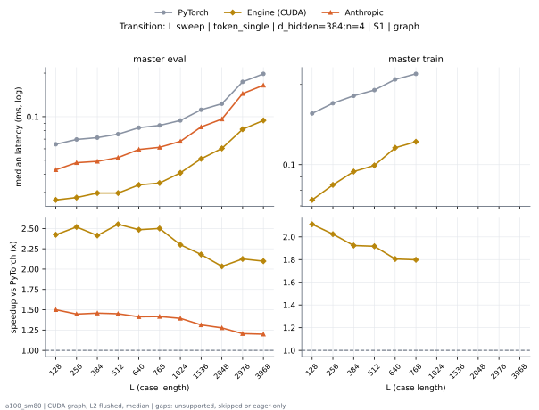

**master eval** (median ms; x = speedup vs PyTorch)

| L | PyTorch | Engine (Triton) | Engine (CUDA) | Anthropic |
|---|---|---|---|---|
| 128 | 0.06451 | 0.03994 (1.62x) | 0.02662 (2.42x) | 0.04301 (1.50x) |
| 256 | 0.06963 | 0.03994 (1.74x) | 0.02765 (2.52x) | 0.04813 (1.45x) |
| 384 | 0.07168 | 0.04301 (1.67x) | 0.0297 (2.41x) | 0.04915 (1.46x) |
| 512 | 0.07578 | 0.04506 (1.68x) | 0.0297 (2.55x) | 0.05222 (1.45x) |
| 640 | 0.08397 | 0.05222 (1.61x) | 0.03379 (2.48x) | 0.05939 (1.41x) |
| 768 | 0.08704 | 0.05325 (1.63x) | 0.03482 (2.50x) | 0.06144 (1.42x) |
| 1024 | 0.09421 | 0.08294 (1.14x) | 0.04096 (2.30x) | 0.06758 (1.39x) |
| 1536 | 0.1116 | 0.1096 (1.02x) | 0.0512 (2.18x) | 0.08499 (1.31x) |
| 2048 | 0.1229 | 0.1157 (1.06x) | 0.06042 (2.03x) | 0.09626 (1.28x) |
| 2976 | 0.1741 | 0.13 (1.34x) | 0.08192 (2.13x) | 0.1444 (1.21x) |
| 3968 | 0.1976 | 0.1403 (1.41x) | 0.09421 (2.10x) | 0.1649 (1.20x) |

**master train** (median ms; x = speedup vs PyTorch)

| L | PyTorch | Engine (Triton) | Engine (CUDA) | Anthropic |
|---|---|---|---|---|
| 128 | 0.1556 | 0.1044 (1.49x) | 0.07373 (2.11x) | unsupported |
| 256 | 0.17 | 0.1126 (1.51x) | 0.08397 (2.02x) | unsupported |
| 384 | 0.1812 | 0.1229 (1.47x) | 0.09421 (1.92x) | unsupported |
| 512 | 0.1905 | 0.126 (1.51x) | 0.09933 (1.92x) | unsupported |
| 640 | 0.2089 | 0.1423 (1.47x) | 0.1157 (1.81x) | unsupported |
| 768 | 0.2191 | 0.1475 (1.49x) | 0.1219 (1.80x) | unsupported |
| 1024 |  |  |  |  |
| 1536 |  |  |  |  |
| 2048 |  |  |  |  |
| 2976 |  |  |  |  |
| 3968 |  |  |  |  |

### L sweep: token_single | d_hidden=768;n=2 | S1 | graph

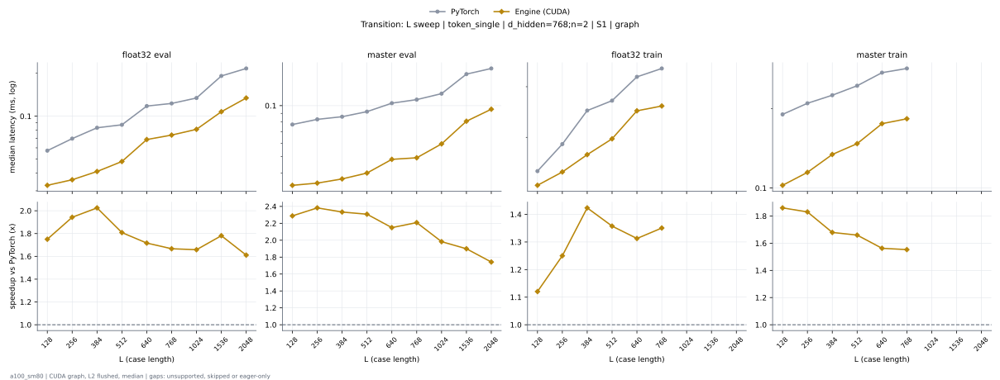

**float32 eval** (median ms; x = speedup vs PyTorch)

| L | PyTorch | Engine (Triton) | Engine (CUDA) | Anthropic |
|---|---|---|---|---|
| 128 | 0.05734 | 0.04813 (1.19x) | 0.03277 (1.75x) | unsupported |
| 256 | 0.06963 | 0.05018 (1.39x) | 0.03584 (1.94x) | unsupported |
| 384 | 0.08294 | 0.06554 (1.27x) | 0.04096 (2.03x) | unsupported |
| 512 | 0.08704 | 0.06758 (1.29x) | 0.04813 (1.81x) | unsupported |
| 640 | 0.1178 | 0.09216 (1.28x) | 0.06861 (1.72x) | unsupported |
| 768 | 0.1229 | 0.09318 (1.32x) | 0.07373 (1.67x) | unsupported |
| 1024 | 0.1341 | 0.1362 (0.98x) | 0.0809 (1.66x) | unsupported |
| 1536 | 0.1915 | 0.17 (1.13x) | 0.1075 (1.78x) | unsupported |
| 2048 | 0.2161 | 0.2048 (1.06x) | 0.1341 (1.61x) | unsupported |

**master eval** (median ms; x = speedup vs PyTorch)

| L | PyTorch | Engine (Triton) | Engine (CUDA) | Anthropic |
|---|---|---|---|---|
| 128 | 0.07731 | 0.0553 (1.40x) | 0.03379 (2.29x) | unsupported |
| 256 | 0.08294 | 0.05837 (1.42x) | 0.03482 (2.38x) | unsupported |
| 384 | 0.08602 | 0.06758 (1.27x) | 0.03686 (2.33x) | unsupported |
| 512 | 0.09216 | 0.06758 (1.36x) | 0.03994 (2.31x) | unsupported |
| 640 | 0.1034 | 0.07782 (1.33x) | 0.04813 (2.15x) | unsupported |
| 768 | 0.1085 | 0.07885 (1.38x) | 0.04915 (2.21x) | unsupported |
| 1024 | 0.1178 | 0.1183 (1.00x) | 0.05939 (1.98x) | unsupported |
| 1536 | 0.1536 | 0.1321 (1.16x) | 0.0809 (1.90x) | unsupported |
| 2048 | 0.1659 | 0.1464 (1.13x) | 0.09523 (1.74x) | unsupported |

**float32 train** (median ms; x = speedup vs PyTorch)

| L | PyTorch | Engine (Triton) | Engine (CUDA) | Anthropic |
|---|---|---|---|---|
| 128 | 0.1526 | 0.1341 (1.14x) | 0.1362 (1.12x) | unsupported |
| 256 | 0.1894 | 0.1526 (1.24x) | 0.1516 (1.25x) | unsupported |
| 384 | 0.2478 | 0.2109 (1.17x) | 0.1741 (1.42x) | unsupported |
| 512 | 0.2683 | 0.2243 (1.20x) | 0.1976 (1.36x) | unsupported |
| 640 | 0.3246 | 0.2734 (1.19x) | 0.2473 (1.31x) | unsupported |
| 768 | 0.3471 | 0.2898 (1.20x) | 0.257 (1.35x) | unsupported |
| 1024 |  |  |  |  |
| 1536 |  |  |  |  |
| 2048 |  |  |  |  |

**master train** (median ms; x = speedup vs PyTorch)

| L | PyTorch | Engine (Triton) | Engine (CUDA) | Anthropic |
|---|---|---|---|---|
| 128 | 0.1905 | 0.1362 (1.40x) | 0.1024 (1.86x) | unsupported |
| 256 | 0.2099 | 0.1475 (1.42x) | 0.1147 (1.83x) | unsupported |
| 384 | 0.2253 | 0.1659 (1.36x) | 0.1341 (1.68x) | unsupported |
| 512 | 0.2447 | 0.1802 (1.36x) | 0.1475 (1.66x) | unsupported |
| 640 | 0.2744 | 0.2068 (1.33x) | 0.1756 (1.56x) | unsupported |
| 768 | 0.2847 | 0.214 (1.33x) | 0.1833 (1.55x) | unsupported |
| 1024 |  |  |  |  |
| 1536 |  |  |  |  |
| 2048 |  |  |  |  |

### d_hidden sweep at L768: token_pair | n=2 | S1 | graph

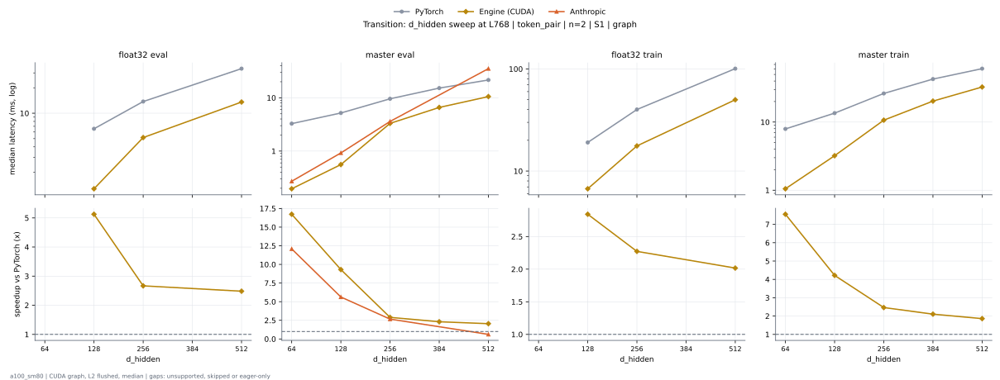

**float32 eval** (median ms; x = speedup vs PyTorch)

| d_hidden | PyTorch | Engine (Triton) | Engine (CUDA) | Anthropic |
|---|---|---|---|---|
| 64 |  |  |  |  |
| 128 | 6.547 | 2.201 (2.98x) | 1.277 (5.13x) | unsupported |
| 256 | 13.75 | 7.271 (1.89x) | 5.155 (2.67x) | unsupported |
| 384 |  |  |  |  |
| 512 | 33.68 | 25.88 (1.30x) | 13.56 (2.48x) | unsupported |

**master eval** (median ms; x = speedup vs PyTorch)

| d_hidden | PyTorch | Engine (Triton) | Engine (CUDA) | Anthropic |
|---|---|---|---|---|
| 64 | 3.272 | 0.4854 (6.74x) | 0.1956 (16.73x) | 0.2708 (12.08x) |
| 128 | 5.185 | 1.125 (4.61x) | 0.5571 (9.31x) | 0.9216 (5.63x) |
| 256 | 9.58 | 3.391 (2.82x) | 3.309 (2.90x) | 3.597 (2.66x) |
| 384 | 15.22 | 6.733 (2.26x) | 6.592 (2.31x) | unsupported |
| 512 | 21.61 | 11.07 (1.95x) | 10.54 (2.05x) | 35.29 (0.61x) |

**float32 train** (median ms; x = speedup vs PyTorch)

| d_hidden | PyTorch | Engine (Triton) | Engine (CUDA) | Anthropic |
|---|---|---|---|---|
| 64 |  |  |  |  |
| 128 | 19.05 | 8.116 (2.35x) | 6.705 (2.84x) | unsupported |
| 256 | 40.06 | 21.76 (1.84x) | 17.63 (2.27x) | unsupported |
| 384 |  |  |  |  |
| 512 | 100.7 | 73 (1.38x) | 49.93 (2.02x) | unsupported |

**master train** (median ms; x = speedup vs PyTorch)

| d_hidden | PyTorch | Engine (Triton) | Engine (CUDA) | Anthropic |
|---|---|---|---|---|
| 64 | 7.928 | 1.977 (4.01x) | 1.05 (7.55x) | unsupported |
| 128 | 13.53 | 4.114 (3.29x) | 3.206 (4.22x) | unsupported |
| 256 | 26.28 | 11.13 (2.36x) | 10.66 (2.46x) | unsupported |
| 384 | 42.72 | 21.25 (2.01x) | 20.3 (2.10x) | unsupported |
| 512 | 60.8 | 33.98 (1.79x) | 32.69 (1.86x) | unsupported |

### d_hidden sweep at L768: token_pair | n=4 | S1 | graph

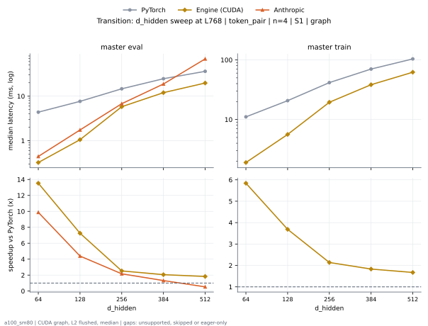

**master eval** (median ms; x = speedup vs PyTorch)

| d_hidden | PyTorch | Engine (Triton) | Engine (CUDA) | Anthropic |
|---|---|---|---|---|
| 64 | 4.379 | 0.7598 (5.76x) | 0.3236 (13.53x) | 0.4434 (9.88x) |
| 128 | 7.653 | 2 (3.83x) | 1.055 (7.26x) | 1.744 (4.39x) |
| 256 | 14.65 | 5.795 (2.53x) | 5.803 (2.52x) | 6.777 (2.16x) |
| 384 | 24.67 | 12.41 (1.99x) | 12 (2.06x) | 18.78 (1.31x) |
| 512 | 36.14 | 20.63 (1.75x) | 19.75 (1.83x) | 68.68 (0.53x) |

**master train** (median ms; x = speedup vs PyTorch)

| d_hidden | PyTorch | Engine (Triton) | Engine (CUDA) | Anthropic |
|---|---|---|---|---|
| 64 | 11.08 | 3.139 (3.53x) | 1.896 (5.84x) | unsupported |
| 128 | 20.72 | 7.143 (2.90x) | 5.618 (3.69x) | unsupported |
| 256 | 41.63 | 20.16 (2.06x) | 19.47 (2.14x) | unsupported |
| 384 | 70.26 | 39.79 (1.77x) | 38.36 (1.83x) | unsupported |
| 512 | 104 | 64.44 (1.61x) | 62.18 (1.67x) | unsupported |

