# TriangleAttention on a100_sm80

Generated by `python -m miniworld_engine.measure.plot` from speed tokens `judge/tokens/a100_sm80/`; do not edit.

### L sweep: token_pair | d_pair=128;n_head=4;p_drop=0.25;starting=False;use_self_attention=False | S1 | graph

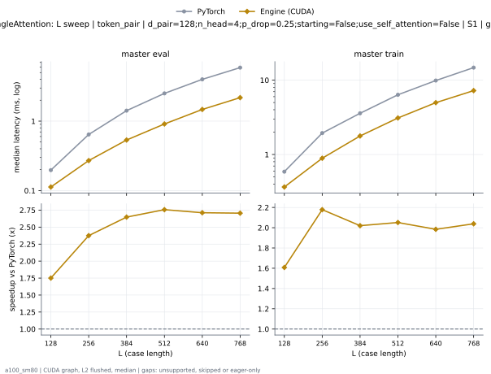

**master eval** (median ms; x = speedup vs PyTorch)

| L | PyTorch | Engine (Triton) | Engine (CUDA) | Anthropic | cuEquivariance |
|---|---|---|---|---|---|
| 128 | 0.1987 | 0.1382 (1.44x) | 0.1137 (1.75x) | unsupported | unsupported |
| 256 | 0.6441 | 0.4127 (1.56x) | 0.2703 (2.38x) | unsupported | unsupported |
| 384 | 1.41 | 0.8827 (1.60x) | 0.5315 (2.65x) | unsupported | unsupported |
| 512 | 2.485 | 1.588 (1.56x) | 0.8955 (2.78x) | unsupported | unsupported |
| 640 | 3.934 | 2.587 (1.52x) | 1.446 (2.72x) | unsupported | unsupported |
| 768 | 5.832 | 3.938 (1.48x) | 2.149 (2.71x) | unsupported | unsupported |

**master train** (median ms; x = speedup vs PyTorch)

| L | PyTorch | Engine (Triton) | Engine (CUDA) | Anthropic | cuEquivariance |
|---|---|---|---|---|---|
| 128 | 0.5919 | 0.4209 (1.41x) | 0.3666 (1.61x) | unsupported | unsupported |
| 256 | 1.946 | 1.214 (1.60x) | 0.8909 (2.18x) | unsupported | unsupported |
| 384 | 3.545 | 2.634 (1.35x) | 1.76 (2.01x) | unsupported | unsupported |
| 512 | 6.302 | 5.085 (1.24x) | 3.084 (2.04x) | unsupported | unsupported |
| 640 | 9.827 | 8.013 (1.23x) | 4.916 (2.00x) | unsupported | unsupported |
| 768 | 14.58 | 11.47 (1.27x) | 7.178 (2.03x) | unsupported | unsupported |

### L sweep: token_pair | d_pair=128;n_head=4;p_drop=0.25;starting=True;use_self_attention=False | S1 | graph

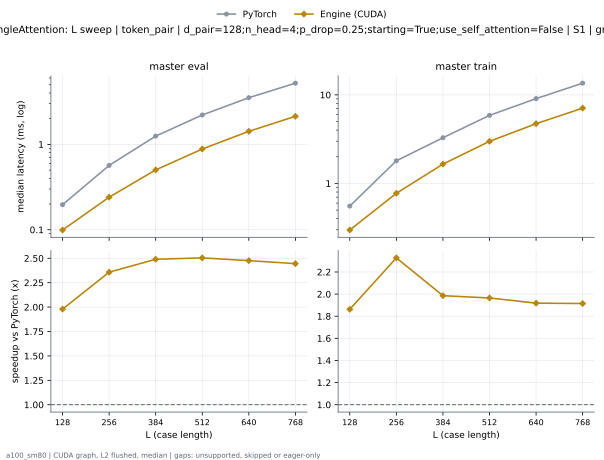

**master eval** (median ms; x = speedup vs PyTorch)

| L | PyTorch | Engine (Triton) | Engine (CUDA) | Anthropic | cuEquivariance |
|---|---|---|---|---|---|
| 128 | 0.1935 | 0.1188 (1.63x) | 0.0983 (1.97x) | unsupported | unsupported |
| 256 | 0.5668 | 0.3379 (1.68x) | 0.2417 (2.35x) | unsupported | unsupported |
| 384 | 1.245 | 0.7127 (1.75x) | 0.5007 (2.49x) | unsupported | unsupported |
| 512 | 2.192 | 1.287 (1.70x) | 0.8745 (2.51x) | unsupported | unsupported |
| 640 | 3.489 | 2.132 (1.64x) | 1.405 (2.48x) | unsupported | unsupported |
| 768 | 5.192 | 3.289 (1.58x) | 2.12 (2.45x) | unsupported | unsupported |

**master train** (median ms; x = speedup vs PyTorch)

| L | PyTorch | Engine (Triton) | Engine (CUDA) | Anthropic | cuEquivariance |
|---|---|---|---|---|---|
| 128 | 0.5591 | 0.384 (1.46x) | 0.2939 (1.90x) | unsupported | unsupported |
| 256 | 1.807 | 1.081 (1.67x) | 0.7711 (2.34x) | unsupported | unsupported |
| 384 | 3.252 | 2.335 (1.39x) | 1.633 (1.99x) | unsupported | unsupported |
| 512 | 5.819 | 4.57 (1.27x) | 2.955 (1.97x) | unsupported | unsupported |
| 640 | 9.052 | 7.212 (1.26x) | 4.708 (1.92x) | unsupported | unsupported |
| 768 | 13.44 | 10.28 (1.31x) | 6.957 (1.93x) | unsupported | unsupported |

### L sweep: boltz2|openfold3_preview2|protenix | token_pair | d_pair=128;n_head=4;p_drop=0.25;starting=False | S1 | graph

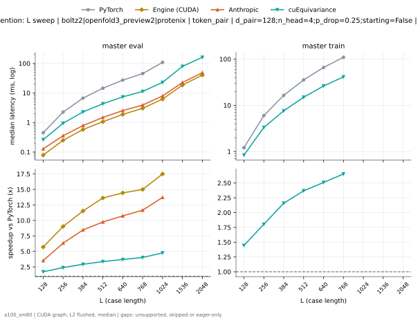

**master eval** (median ms; x = speedup vs PyTorch)

| L | PyTorch | Engine (Triton) | Engine (CUDA) | Anthropic | cuEquivariance |
|---|---|---|---|---|---|
| 128 | 0.45 | 0.1966 (2.29x) | 0.07885 (5.71x) | 0.128 (3.52x) | 0.2621 (1.72x) |
| 256 | 2.256 | 0.7117 (3.17x) | 0.2499 (9.03x) | 0.3564 (6.33x) | 0.9441 (2.39x) |
| 384 | 6.658 | 1.694 (3.93x) | 0.5775 (11.53x) | 0.7864 (8.47x) | 2.276 (2.92x) |
| 512 | 14.48 | 3.187 (4.54x) | 1.062 (13.63x) | 1.484 (9.76x) | 4.307 (3.36x) |
| 640 | 27.18 | 5.272 (5.16x) | 1.881 (14.45x) | 2.532 (10.74x) | 7.366 (3.69x) |
| 768 | 45.42 | 8.09 (5.61x) | 3.026 (15.01x) | 3.895 (11.66x) | 11.29 (4.02x) |
| 1024 | 108.7 | 16.08 (6.76x) | 6.21 (17.50x) | 7.923 (13.72x) | 22.82 (4.76x) |
| 1536 | skipped | 45.06 | 18.52 | 22.58 | 79.49 |
| 2048 | skipped | 97.16 | 40.42 | 48.67 | 161.3 |

**master train** (median ms; x = speedup vs PyTorch)

| L | PyTorch | Engine (Triton) | Engine (CUDA) | Anthropic | cuEquivariance |
|---|---|---|---|---|---|
| 128 | 1.211 | 0.6943 (1.74x) | failed | unsupported | 0.8387 (1.44x) |
| 256 | 5.997 | 2.642 (2.27x) | failed | unsupported | 3.325 (1.80x) |
| 384 | 16.44 | 5.702 (2.88x) | failed | unsupported | 7.615 (2.16x) |
| 512 | 35.41 | 10.92 (3.24x) | failed | unsupported | 14.95 (2.37x) |
| 640 | 65.7 | 18.72 (3.51x) | failed | unsupported | 26.18 (2.51x) |
| 768 | 109.3 | 29.6 (3.69x) | failed | unsupported | 41.22 (2.65x) |
| 1024 |  |  |  |  |  |
| 1536 |  |  |  |  |  |
| 2048 |  |  |  |  |  |

### L sweep: boltz2|openfold3_preview2|protenix | token_pair | d_pair=128;n_head=4;p_drop=0.25;starting=True | S1 | graph

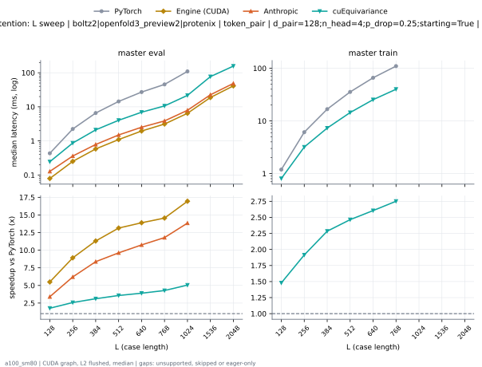

**master eval** (median ms; x = speedup vs PyTorch)

| L | PyTorch | Engine (Triton) | Engine (CUDA) | Anthropic | cuEquivariance |
|---|---|---|---|---|---|
| 128 | 0.4311 | 0.1823 (2.37x) | 0.07885 (5.47x) | 0.1275 (3.38x) | 0.2447 (1.76x) |
| 256 | 2.212 | 0.641 (3.45x) | 0.2468 (8.96x) | 0.3604 (6.14x) | 0.8673 (2.55x) |
| 384 | 6.491 | 1.527 (4.25x) | 0.5652 (11.48x) | 0.7854 (8.26x) | 2.109 (3.08x) |
| 512 | 14.22 | 2.906 (4.90x) | 1.061 (13.41x) | 1.497 (9.50x) | 4.028 (3.53x) |
| 640 | 26.71 | 4.808 (5.56x) | 1.867 (14.31x) | 2.523 (10.59x) | 6.954 (3.84x) |
| 768 | 44.74 | 7.415 (6.03x) | 3.014 (14.84x) | 3.858 (11.60x) | 10.63 (4.21x) |
| 1024 | 107.5 | 14.88 (7.22x) | 6.162 (17.45x) | 7.911 (13.59x) | 21.68 (4.96x) |
| 1536 | skipped | 42.45 | 18.42 | 22.54 | 76.96 |
| 2048 | skipped | 92.47 | 39.87 | 48.62 | 156.6 |

**master train** (median ms; x = speedup vs PyTorch)

| L | PyTorch | Engine (Triton) | Engine (CUDA) | Anthropic | cuEquivariance |
|---|---|---|---|---|---|
| 128 | 1.187 | 0.6564 (1.81x) | failed | unsupported | 0.8059 (1.47x) |
| 256 | 5.991 | 2.513 (2.38x) | failed | unsupported | 3.191 (1.88x) |
| 384 | 16.31 | 5.406 (3.02x) | failed | unsupported | 7.325 (2.23x) |
| 512 | 34.91 | 10.4 (3.36x) | failed | unsupported | 14.44 (2.42x) |
| 640 | 64.99 | 17.88 (3.64x) | failed | unsupported | 25.36 (2.56x) |
| 768 | 108.2 | 28.45 (3.80x) | failed | unsupported | 40.02 (2.70x) |
| 1024 |  |  |  |  |  |
| 1536 |  |  |  |  |  |
| 2048 |  |  |  |  |  |

### L sweep: boltz2|protenix | token_pair | d_hidden=128;d_pair=64;n_head=4;p_drop=0.25;starting=False | S1 | graph

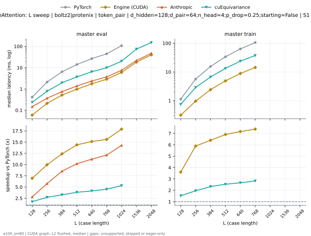

**master eval** (median ms; x = speedup vs PyTorch)

| L | PyTorch | Engine (Triton) | Engine (CUDA) | Anthropic | cuEquivariance |
|---|---|---|---|---|---|
| 128 | 0.4127 | 0.1761 (2.34x) | 0.05939 (6.95x) | 0.1475 (2.80x) | 0.2376 (1.74x) |
| 256 | 2.113 | 0.554 (3.81x) | 0.212 (9.97x) | 0.3666 (5.76x) | 0.7782 (2.71x) |
| 384 | 6.395 | 1.38 (4.63x) | 0.5166 (12.38x) | 0.7506 (8.52x) | 1.961 (3.26x) |
| 512 | 14.04 | 2.585 (5.43x) | 0.9754 (14.40x) | 1.378 (10.19x) | 3.672 (3.82x) |
| 640 | 26.53 | 4.332 (6.13x) | 1.753 (15.14x) | 2.367 (11.21x) | 6.425 (4.13x) |
| 768 | 44.63 | 6.711 (6.65x) | 2.861 (15.60x) | 3.684 (12.12x) | 9.906 (4.51x) |
| 1024 | 107.4 | 13.53 (7.94x) | 6 (17.90x) | 7.518 (14.29x) | 20.19 (5.32x) |
| 1536 | skipped | 39.35 | 18.16 | 21.69 | 74.69 |
| 2048 | skipped | 86.38 | 40.01 | 47.29 | 151.4 |

**master train** (median ms; x = speedup vs PyTorch)

| L | PyTorch | Engine (Triton) | Engine (CUDA) | Anthropic | cuEquivariance |
|---|---|---|---|---|---|
| 128 | 1.133 | 0.6042 (1.87x) | 0.3144 (3.60x) | unsupported | 0.7455 (1.52x) |
| 256 | 5.656 | 2.203 (2.57x) | 0.9595 (5.89x) | unsupported | 2.889 (1.96x) |
| 384 | 15.48 | 4.707 (3.29x) | 2.418 (6.40x) | unsupported | 6.648 (2.33x) |
| 512 | 33.74 | 9.311 (3.62x) | 4.883 (6.91x) | unsupported | 13.33 (2.53x) |
| 640 | 63.16 | 16.26 (3.88x) | 8.817 (7.16x) | unsupported | 23.75 (2.66x) |
| 768 | 105.6 | 25.79 (4.10x) | 14.31 (7.38x) | unsupported | 37.4 (2.82x) |
| 1024 |  |  |  |  |  |
| 1536 |  |  |  |  |  |
| 2048 |  |  |  |  |  |

### L sweep: boltz2|protenix | token_pair | d_hidden=128;d_pair=64;n_head=4;p_drop=0.25;starting=True | S1 | graph

**master eval** (median ms; x = speedup vs PyTorch)

| L | PyTorch | Engine (Triton) | Engine (CUDA) | Anthropic | cuEquivariance |
|---|---|---|---|---|---|
| 128 | 0.4137 | 0.1659 (2.49x) | 0.06042 (6.85x) | 0.1475 (2.81x) | 0.2294 (1.80x) |
| 256 | 2.097 | 0.5248 (4.00x) | 0.2074 (10.11x) | 0.3564 (5.89x) | 0.7485 (2.80x) |
| 384 | 6.355 | 1.289 (4.93x) | 0.5048 (12.59x) | 0.7598 (8.36x) | 1.872 (3.39x) |
| 512 | 13.94 | 2.428 (5.74x) | 0.9503 (14.67x) | 1.415 (9.85x) | 3.55 (3.93x) |
| 640 | 26.31 | 4.087 (6.44x) | 1.706 (15.42x) | 2.373 (11.09x) | 6.181 (4.26x) |
| 768 | 44.38 | 6.361 (6.98x) | 2.64 (16.81x) | 3.688 (12.03x) | 9.515 (4.66x) |
| 1024 | 107.1 | 13.02 (8.22x) | 5.907 (18.13x) | 7.592 (14.10x) | 19.73 (5.43x) |
| 1536 | skipped | 38.1 | 17.76 | 21.74 | 73.53 |
| 2048 | skipped | 84.15 | 39.53 | 47.34 | 149.1 |

**master train** (median ms; x = speedup vs PyTorch)

| L | PyTorch | Engine (Triton) | Engine (CUDA) | Anthropic | cuEquivariance |
|---|---|---|---|---|---|
| 128 | 1.108 | 0.5786 (1.92x) | 0.3123 (3.55x) | unsupported | 0.7209 (1.54x) |
| 256 | 5.524 | 2.142 (2.58x) | 0.9492 (5.82x) | unsupported | 2.839 (1.95x) |
| 384 | 15.37 | 4.536 (3.39x) | 2.409 (6.38x) | unsupported | 6.489 (2.37x) |
| 512 | 33.47 | 9.026 (3.71x) | 4.842 (6.91x) | unsupported | 13.02 (2.57x) |
| 640 | 62.8 | 15.83 (3.97x) | 8.765 (7.17x) | unsupported | 23.3 (2.70x) |
| 768 | 105.1 | 25.18 (4.17x) | 14.19 (7.41x) | unsupported | 36.84 (2.85x) |
| 1024 |  |  |  |  |  |
| 1536 |  |  |  |  |  |
| 2048 |  |  |  |  |  |

### L sweep: opendde | token_pair | d_pair=384;n_head=12;p_drop=0.25;starting=False | S1 | graph

**master eval** (median ms; x = speedup vs PyTorch)

| L | PyTorch | Engine (Triton) | Engine (CUDA) | Anthropic | cuEquivariance |
|---|---|---|---|---|---|
| 128 | 1.145 | 0.4844 (2.36x) | 0.2673 (4.28x) | 0.7188 (1.59x) | 0.6298 (1.82x) |
| 256 | 6.557 | 1.959 (3.35x) | 1.1 (5.96x) | 2.81 (2.33x) | 2.645 (2.48x) |
| 384 | 19.46 | 4.683 (4.16x) | 2.67 (7.29x) | 6.434 (3.02x) | 6.43 (3.03x) |
| 512 | 42.55 | 8.942 (4.76x) | 4.694 (9.07x) | 11.79 (3.61x) | 12.31 (3.46x) |
| 640 | 80.16 | 14.91 (5.38x) | 7.991 (10.03x) | 19.12 (4.19x) | 21.85 (3.67x) |
| 768 | 134.2 | 23.2 (5.78x) | 13.67 (9.82x) | 28.49 (4.71x) | 35.96 (3.73x) |
| 1024 | skipped | 48.37 | 25.03 | 53.55 | 75.86 |
| 1536 | skipped | 142.9 | 79.68 | 137.8 | 237.4 |
| 2048 | skipped | 308.9 | 148.4 | 272.4 | 476.7 |
| 2976 | skipped | 966 | 500.8 | skipped | 1486 |
| 3968 | skipped | 1978 | 1108 | skipped | skipped |

**master train** (median ms; x = speedup vs PyTorch)

| L | PyTorch | Engine (Triton) | Engine (CUDA) | Anthropic | cuEquivariance |
|---|---|---|---|---|---|
| 128 | 3.181 | 1.683 (1.89x) | 1.043 (3.05x) | unsupported | 2.054 (1.55x) |
| 256 | 17.16 | 7.006 (2.45x) | 4.21 (4.08x) | unsupported | 8.915 (1.93x) |
| 384 | 48.79 | 16.76 (2.91x) | 10.38 (4.70x) | unsupported | 22.32 (2.19x) |
| 512 | 106 | 33.06 (3.21x) | 20.19 (5.25x) | unsupported | 45.26 (2.34x) |
| 640 | 198.1 | 56.92 (3.48x) | 35.62 (5.56x) | unsupported | 84.12 (2.36x) |
| 768 | skipped | 89.73 | 55.75 | unsupported | 136.2 |
| 1024 |  |  |  |  |  |
| 1536 |  |  |  |  |  |
| 2048 |  |  |  |  |  |
| 2976 |  |  |  |  |  |
| 3968 |  |  |  |  |  |

### L sweep: opendde | token_pair | d_pair=384;n_head=12;p_drop=0.25;starting=True | S1 | graph

**master eval** (median ms; x = speedup vs PyTorch)

| L | PyTorch | Engine (Triton) | Engine (CUDA) | Anthropic | cuEquivariance |
|---|---|---|---|---|---|
| 128 | 1.114 | 0.4352 (2.56x) | 0.2749 (4.05x) | 0.6666 (1.67x) | 0.5796 (1.92x) |
| 256 | 6.505 | 1.744 (3.73x) | 1.126 (5.78x) | 2.636 (2.47x) | 2.408 (2.70x) |
| 384 | 19.53 | 4.225 (4.62x) | 2.721 (7.18x) | 5.972 (3.27x) | 5.962 (3.28x) |
| 512 | 42.47 | 8.238 (5.16x) | 4.838 (8.78x) | 11.07 (3.84x) | 11.66 (3.64x) |
| 640 | 80.28 | 13.88 (5.78x) | 8.2 (9.79x) | 17.94 (4.48x) | 20.8 (3.86x) |
| 768 | 134.5 | 21.29 (6.32x) | 13.96 (9.63x) | 26.7 (5.04x) | 34.1 (3.94x) |
| 1024 | skipped | 45.31 | 25.5 | 50.3 | 72.49 |
| 1536 | skipped | 135.7 | 81.09 | 130.7 | 230.8 |
| 2048 | skipped | 295.8 | 151.9 | 260.2 | 465.5 |
| 2976 | skipped | 922.8 | 504.9 | skipped | 1457 |
| 3968 | skipped | 1905 | 1023 | skipped | skipped |

**master train** (median ms; x = speedup vs PyTorch)

| L | PyTorch | Engine (Triton) | Engine (CUDA) | Anthropic | cuEquivariance |
|---|---|---|---|---|---|
| 128 | 3.077 | 1.582 (1.94x) | 1.028 (2.99x) | unsupported | 1.963 (1.57x) |
| 256 | 16.76 | 6.58 (2.55x) | 4.21 (3.98x) | unsupported | 8.53 (1.97x) |
| 384 | 48.03 | 15.81 (3.04x) | 10.44 (4.60x) | unsupported | 21.38 (2.25x) |
| 512 | 104.7 | 31.4 (3.33x) | 20.38 (5.14x) | unsupported | 43.52 (2.41x) |
| 640 | 196.5 | 54.54 (3.60x) | 35.83 (5.49x) | unsupported | 81.54 (2.41x) |
| 768 | skipped | 86.36 | 55.98 | unsupported | 132.8 |
| 1024 |  |  |  |  |  |
| 1536 |  |  |  |  |  |
| 2048 |  |  |  |  |  |
| 2976 |  |  |  |  |  |
| 3968 |  |  |  |  |  |

### L sweep: opendde|protenix | token_pair | d_pair=64;n_head=2;p_drop=0.25;starting=False | S1 | graph

**master eval** (median ms; x = speedup vs PyTorch)

| L | PyTorch | Engine (Triton) | Engine (CUDA) | Anthropic | cuEquivariance |
|---|---|---|---|---|---|
| 128 | 0.255 | 0.1464 (1.74x) | 0.04198 (6.07x) | 0.1976 (1.29x) | 0.1823 (1.40x) |
| 256 | 1.258 | 0.4454 (2.83x) | 0.1208 (10.42x) | 0.5484 (2.30x) | 0.5632 (2.23x) |
| 384 | 3.687 | 1.048 (3.52x) | 0.2877 (12.81x) | 1.206 (3.06x) | 1.336 (2.76x) |
| 512 | 7.545 | 1.902 (3.97x) | 0.5079 (14.85x) | 2.102 (3.59x) | 2.449 (3.08x) |
| 640 | 14.03 | 3.071 (4.57x) | 0.876 (16.01x) | 3.305 (4.24x) | 4.116 (3.41x) |
| 768 | 23.34 | 4.582 (5.09x) | 1.419 (16.45x) | 4.796 (4.87x) | 6.137 (3.80x) |
| 1024 | 55.28 | 8.945 (6.18x) | 3.006 (18.39x) | 8.952 (6.18x) | 12.12 (4.56x) |
| 1536 | skipped | 23.84 | 8.955 | 22.39 | 34.18 |
| 2048 | skipped | 50.28 | 19.58 | 44.06 | 76.41 |

**master train** (median ms; x = speedup vs PyTorch)

| L | PyTorch | Engine (Triton) | Engine (CUDA) | Anthropic | cuEquivariance |
|---|---|---|---|---|---|
| 128 | 0.7506 | 0.5007 (1.50x) | 0.2232 (3.36x) | unsupported | 0.5821 (1.29x) |
| 256 | 3.524 | 1.698 (2.08x) | 0.598 (5.89x) | unsupported | 2.055 (1.71x) |
| 384 | 9.156 | 3.196 (2.86x) | 1.365 (6.71x) | unsupported | 4.186 (2.19x) |
| 512 | 18.45 | 5.972 (3.09x) | 2.671 (6.91x) | unsupported | 8.069 (2.29x) |
| 640 | 34 | 10.08 (3.37x) | 4.77 (7.13x) | unsupported | 13.95 (2.44x) |
| 768 | 56.22 | 15.79 (3.56x) | 7.578 (7.42x) | unsupported | 21.68 (2.59x) |
| 1024 |  |  |  |  |  |
| 1536 |  |  |  |  |  |
| 2048 |  |  |  |  |  |

### L sweep: opendde|protenix | token_pair | d_pair=64;n_head=2;p_drop=0.25;starting=True | S1 | graph

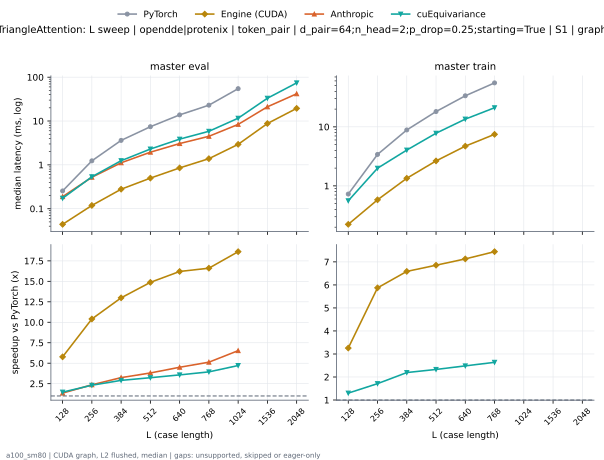

**master eval** (median ms; x = speedup vs PyTorch)

| L | PyTorch | Engine (Triton) | Engine (CUDA) | Anthropic | cuEquivariance |
|---|---|---|---|---|---|
| 128 | 0.2545 | 0.1362 (1.87x) | 0.04403 (5.78x) | 0.1884 (1.35x) | 0.1731 (1.47x) |
| 256 | 1.236 | 0.4168 (2.97x) | 0.1188 (10.41x) | 0.5222 (2.37x) | 0.5345 (2.31x) |
| 384 | 3.618 | 0.9585 (3.77x) | 0.2785 (12.99x) | 1.116 (3.24x) | 1.245 (2.91x) |
| 512 | 7.42 | 1.749 (4.24x) | 0.4987 (14.88x) | 1.947 (3.81x) | 2.297 (3.23x) |
| 640 | 13.81 | 2.833 (4.87x) | 0.852 (16.21x) | 3.064 (4.51x) | 3.863 (3.57x) |
| 768 | 23 | 4.243 (5.42x) | 1.385 (16.61x) | 4.485 (5.13x) | 5.833 (3.94x) |
| 1024 | 54.74 | 8.345 (6.56x) | 2.939 (18.63x) | 8.376 (6.54x) | 11.6 (4.72x) |
| 1536 | skipped | 22.67 | 8.772 | 21.1 | 33.11 |
| 2048 | skipped | 47.97 | 19.45 | 41.83 | 74.16 |

**master train** (median ms; x = speedup vs PyTorch)

| L | PyTorch | Engine (Triton) | Engine (CUDA) | Anthropic | cuEquivariance |
|---|---|---|---|---|---|
| 128 | 0.727 | 0.4751 (1.53x) | 0.2232 (3.26x) | unsupported | 0.5591 (1.30x) |
| 256 | 3.41 | 1.627 (2.10x) | 0.5806 (5.87x) | unsupported | 1.992 (1.71x) |
| 384 | 8.863 | 3.046 (2.91x) | 1.346 (6.59x) | unsupported | 4.042 (2.19x) |
| 512 | 18.16 | 5.7 (3.19x) | 2.649 (6.86x) | unsupported | 7.802 (2.33x) |
| 640 | 33.6 | 9.647 (3.48x) | 4.712 (7.13x) | unsupported | 13.53 (2.48x) |
| 768 | 55.59 | 15.22 (3.65x) | 7.468 (7.44x) | unsupported | 21.08 (2.64x) |
| 1024 |  |  |  |  |  |
| 1536 |  |  |  |  |  |
| 2048 |  |  |  |  |  |

### L sweep: openfold3_preview2 | token_pair | d_pair=64;n_head=4;p_drop=0.25;starting=False | S1 | graph

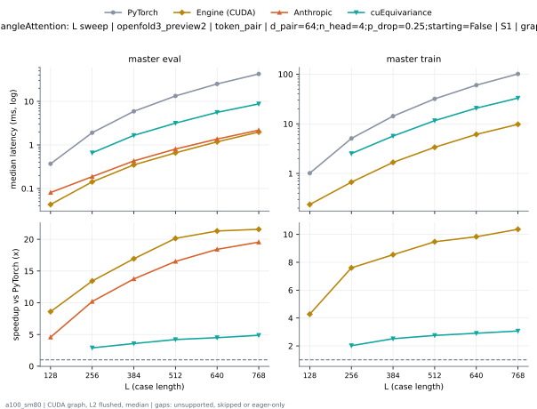

**master eval** (median ms; x = speedup vs PyTorch)

| L | PyTorch | Engine (Triton) | Engine (CUDA) | Anthropic | cuEquivariance |
|---|---|---|---|---|---|
| 128 | 0.3707 | 0.1526 (2.43x) | 0.04301 (8.62x) | 0.0809 (4.58x) | unsupported |
| 256 | 1.905 | 0.4823 (3.95x) | 0.1423 (13.38x) | 0.1874 (10.17x) | 0.6595 (2.89x) |
| 384 | 5.838 | 1.157 (5.05x) | 0.3594 (16.24x) | 0.4301 (13.57x) | 1.658 (3.52x) |
| 512 | 13.16 | 2.176 (6.05x) | 0.6881 (19.12x) | 0.8059 (16.32x) | 3.166 (4.15x) |
| 640 | 24.97 | 3.593 (6.95x) | 1.245 (20.06x) | 1.366 (18.28x) | 5.597 (4.46x) |
| 768 | 42.16 | 5.541 (7.61x) | 2.047 (20.60x) | 2.182 (19.32x) | 8.759 (4.81x) |

**master train** (median ms; x = speedup vs PyTorch)

| L | PyTorch | Engine (Triton) | Engine (CUDA) | Anthropic | cuEquivariance |
|---|---|---|---|---|---|
| 128 | 1.015 | 0.5294 (1.92x) | 0.2376 (4.27x) | unsupported | unsupported |
| 256 | 5.079 | 1.858 (2.73x) | 0.6687 (7.60x) | unsupported | 2.515 (2.02x) |
| 384 | 14.21 | 3.683 (3.86x) | 1.651 (8.61x) | unsupported | 5.673 (2.50x) |
| 512 | 31.67 | 7.301 (4.34x) | 3.279 (9.66x) | unsupported | 11.59 (2.73x) |
| 640 | 59.76 | 12.51 (4.78x) | 5.985 (9.99x) | unsupported | 20.7 (2.89x) |
| 768 | 100.7 | 19.84 (5.07x) | 9.635 (10.45x) | unsupported | 33 (3.05x) |

### L sweep: openfold3_preview2 | token_pair | d_pair=64;n_head=4;p_drop=0.25;starting=True | S1 | graph

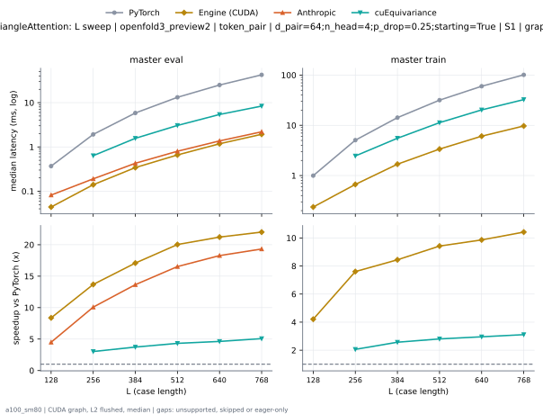

**master eval** (median ms; x = speedup vs PyTorch)

| L | PyTorch | Engine (Triton) | Engine (CUDA) | Anthropic | cuEquivariance |
|---|---|---|---|---|---|
| 128 | 0.3707 | 0.1423 (2.60x) | 0.04403 (8.42x) | 0.08192 (4.53x) | unsupported |
| 256 | 1.903 | 0.4516 (4.21x) | 0.1423 (13.37x) | 0.1905 (9.99x) | 0.6349 (3.00x) |
| 384 | 5.798 | 1.07 (5.42x) | 0.3543 (16.36x) | 0.428 (13.55x) | 1.566 (3.70x) |
| 512 | 13.05 | 2.023 (6.45x) | 0.6769 (19.28x) | 0.7992 (16.33x) | 3.056 (4.27x) |
| 640 | 24.84 | 3.368 (7.38x) | 1.215 (20.44x) | 1.37 (18.14x) | 5.409 (4.59x) |
| 768 | 42 | 5.24 (8.02x) | 2.006 (20.94x) | 2.199 (19.11x) | 8.372 (5.02x) |

**master train** (median ms; x = speedup vs PyTorch)

| L | PyTorch | Engine (Triton) | Engine (CUDA) | Anthropic | cuEquivariance |
|---|---|---|---|---|---|
| 128 | 1 | 0.5059 (1.98x) | 0.2386 (4.19x) | unsupported | unsupported |
| 256 | 5.021 | 1.786 (2.81x) | 0.6625 (7.58x) | unsupported | 2.456 (2.04x) |
| 384 | 14.09 | 3.554 (3.97x) | 1.649 (8.55x) | unsupported | 5.529 (2.55x) |
| 512 | 31.47 | 7.036 (4.47x) | 3.315 (9.49x) | unsupported | 11.3 (2.79x) |
| 640 | 59.5 | 12.15 (4.90x) | 5.936 (10.02x) | unsupported | 20.26 (2.94x) |
| 768 | 100.3 | 19.37 (5.18x) | 9.631 (10.42x) | unsupported | 32.49 (3.09x) |

### L sweep: protenix | token_pair | d_pair=256;n_head=8;p_drop=0.25;starting=False | S1 | graph

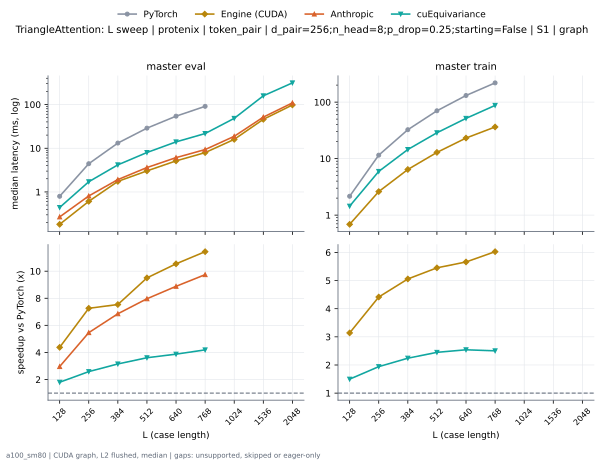

**master eval** (median ms; x = speedup vs PyTorch)

| L | PyTorch | Engine (Triton) | Engine (CUDA) | Anthropic | cuEquivariance |
|---|---|---|---|---|---|
| 128 | 0.7956 | 0.342 (2.33x) | 0.1818 (4.38x) | 0.2688 (2.96x) | 0.4413 (1.80x) |
| 256 | 4.427 | 1.263 (3.51x) | 0.6098 (7.26x) | 0.8105 (5.46x) | 1.712 (2.59x) |
| 384 | 13.15 | 3.033 (4.33x) | 1.744 (7.54x) | 1.917 (6.86x) | 4.17 (3.15x) |
| 512 | 28.84 | 5.743 (5.02x) | 3.034 (9.51x) | 3.621 (7.96x) | 7.988 (3.61x) |
| 640 | 54.2 | 9.576 (5.66x) | 5.14 (10.54x) | 6.102 (8.88x) | 13.98 (3.88x) |
| 768 | 91.01 | 14.72 (6.18x) | 7.955 (11.44x) | 9.339 (9.74x) | 21.71 (4.19x) |
| 1024 | skipped | 30.11 | 15.96 | 18.76 | 48.34 |
| 1536 | skipped | 87.42 | 45.88 | 51.6 | 158.4 |
| 2048 | skipped | 196.7 | 97.86 | 109.1 | 313 |

**master train** (median ms; x = speedup vs PyTorch)

| L | PyTorch | Engine (Triton) | Engine (CUDA) | Anthropic | cuEquivariance |
|---|---|---|---|---|---|
| 128 | 2.157 | 1.193 (1.81x) | 0.6871 (3.14x) | unsupported | 1.442 (1.50x) |
| 256 | 11.52 | 4.559 (2.53x) | 2.608 (4.42x) | unsupported | 5.934 (1.94x) |
| 384 | 32.48 | 10.65 (3.05x) | 6.422 (5.06x) | unsupported | 14.49 (2.24x) |
| 512 | 70.23 | 20.77 (3.38x) | 12.88 (5.45x) | unsupported | 28.68 (2.45x) |
| 640 | 131 | 35.86 (3.65x) | 23.14 (5.66x) | unsupported | 51.57 (2.54x) |
| 768 | 219 | 57.7 (3.80x) | 36.34 (6.03x) | unsupported | 87.52 (2.50x) |
| 1024 |  |  |  |  |  |
| 1536 |  |  |  |  |  |
| 2048 |  |  |  |  |  |

### L sweep: protenix | token_pair | d_pair=256;n_head=8;p_drop=0.25;starting=True | S1 | graph

**master eval** (median ms; x = speedup vs PyTorch)

| L | PyTorch | Engine (Triton) | Engine (CUDA) | Anthropic | cuEquivariance |
|---|---|---|---|---|---|
| 128 | 0.77 | 0.3123 (2.47x) | 0.1782 (4.32x) | 0.2714 (2.84x) | 0.4137 (1.86x) |
| 256 | 4.342 | 1.116 (3.89x) | 0.5939 (7.31x) | 0.8202 (5.29x) | 1.559 (2.79x) |
| 384 | 12.85 | 2.708 (4.74x) | 1.687 (7.62x) | 1.938 (6.63x) | 3.884 (3.31x) |
| 512 | 28.22 | 5.176 (5.45x) | 2.991 (9.44x) | 3.645 (7.74x) | 7.388 (3.82x) |
| 640 | 53.31 | 8.711 (6.12x) | 4.989 (10.69x) | 6.115 (8.72x) | 13.18 (4.05x) |
| 768 | 89.66 | 13.49 (6.64x) | 7.814 (11.47x) | 9.353 (9.59x) | 20.41 (4.39x) |
| 1024 | skipped | 27.83 | 15.83 | 18.66 | 46.26 |
| 1536 | skipped | 82.47 | 45.36 | 51.7 | 153.6 |
| 2048 | skipped | 187.3 | 96.7 | 109.3 | 303.5 |

**master train** (median ms; x = speedup vs PyTorch)

| L | PyTorch | Engine (Triton) | Engine (CUDA) | Anthropic | cuEquivariance |
|---|---|---|---|---|---|
| 128 | 2.114 | 1.127 (1.87x) | 0.682 (3.10x) | unsupported | 1.378 (1.53x) |
| 256 | 11.23 | 4.304 (2.61x) | 2.593 (4.33x) | unsupported | 5.691 (1.97x) |
| 384 | 31.77 | 10.08 (3.15x) | 6.41 (4.96x) | unsupported | 14.03 (2.26x) |
| 512 | 69.13 | 19.74 (3.50x) | 12.88 (5.37x) | unsupported | 27.75 (2.49x) |
| 640 | 129.3 | 34.4 (3.76x) | 23.04 (5.61x) | unsupported | 50.24 (2.57x) |
| 768 | skipped | 55.43 | 36.01 | unsupported | 85.26 |
| 1024 |  |  |  |  |  |
| 1536 |  |  |  |  |  |
| 2048 |  |  |  |  |  |

### d_pair sweep at L2048: token_pair | p_drop=0.25;starting=False | S1 | graph

**master eval** (median ms; x = speedup vs PyTorch)

| d_pair | PyTorch | Engine (Triton) | Engine (CUDA) | Anthropic | cuEquivariance |
|---|---|---|---|---|---|
| 64 d_hidden=128 n_head=4 | skipped | 86.38 | 40.01 | 47.29 | 151.4 |
| 128 n_head=4 | skipped | 97.16 | 40.42 | 48.67 | 161.3 |
| 256 n_head=8 | skipped | 196.7 | 97.86 | 109.1 | 313 |
| 384 n_head=12 | skipped | 308.9 | 148.4 | 272.4 | 476.7 |

### d_pair sweep at L2048: token_pair | p_drop=0.25;starting=True | S1 | graph

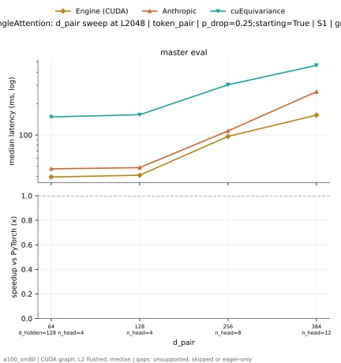

**master eval** (median ms; x = speedup vs PyTorch)

| d_pair | PyTorch | Engine (Triton) | Engine (CUDA) | Anthropic | cuEquivariance |
|---|---|---|---|---|---|
| 64 d_hidden=128 n_head=4 | skipped | 84.15 | 39.53 | 47.34 | 149.1 |
| 128 n_head=4 | skipped | 92.47 | 39.87 | 48.62 | 156.6 |
| 256 n_head=8 | skipped | 187.3 | 96.7 | 109.3 | 303.5 |
| 384 n_head=12 | skipped | 295.8 | 151.9 | 260.2 | 465.5 |

### n_head sweep at L2048: token_pair | p_drop=0.25;starting=False | S1 | graph

**master eval** (median ms; x = speedup vs PyTorch)

| n_head | PyTorch | Engine (Triton) | Engine (CUDA) | Anthropic | cuEquivariance |
|---|---|---|---|---|---|
| 2 d_pair=64 | skipped | 50.28 | 19.58 | 44.06 | 76.41 |
| 4 d_pair=128 | skipped | 97.16 | 40.42 | 48.67 | 161.3 |
| 8 d_pair=256 | skipped | 196.7 | 97.86 | 109.1 | 313 |
| 12 d_pair=384 | skipped | 308.9 | 148.4 | 272.4 | 476.7 |

### n_head sweep at L2048: token_pair | p_drop=0.25;starting=True | S1 | graph

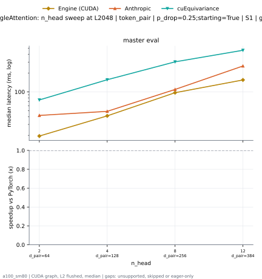

**master eval** (median ms; x = speedup vs PyTorch)

| n_head | PyTorch | Engine (Triton) | Engine (CUDA) | Anthropic | cuEquivariance |
|---|---|---|---|---|---|
| 2 d_pair=64 | skipped | 47.97 | 19.45 | 41.83 | 74.16 |
| 4 d_pair=128 | skipped | 92.47 | 39.87 | 48.62 | 156.6 |
| 8 d_pair=256 | skipped | 187.3 | 96.7 | 109.3 | 303.5 |
| 12 d_pair=384 | skipped | 295.8 | 151.9 | 260.2 | 465.5 |

