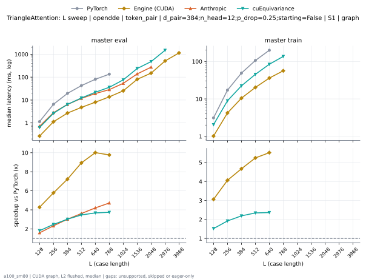
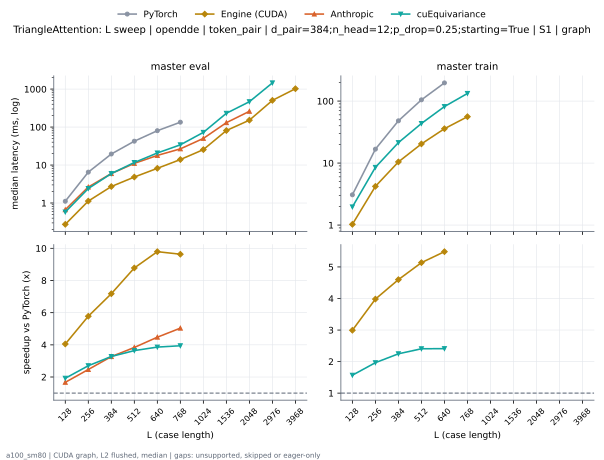
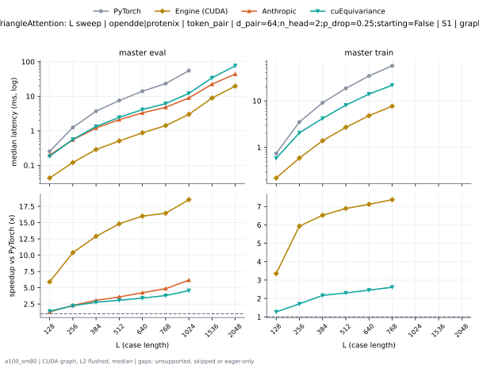
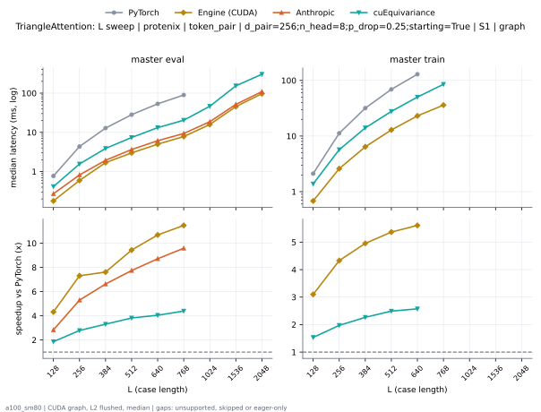

# TriangleAttention on a100_sm80

Generated by `python -m miniworld_engine.measure.plot` from speed tokens `judge/tokens/a100_sm80/`; do not edit.

### L sweep: token_pair | d_pair=128;n_head=4;p_drop=0.25;starting=False;use_self_attention=False | S1 | graph

**master eval** (median ms; x = speedup vs PyTorch)

| L | PyTorch | Engine (Triton) | Engine (CUDA) | Anthropic | cuEquivariance |
|---|---|---|---|---|---|
| 128 | 0.1971 | 0.1382 (1.43x) | 0.1126 (1.75x) | unsupported | unsupported |
| 256 | 0.642 | 0.4127 (1.56x) | 0.2703 (2.37x) | unsupported | unsupported |
| 384 | 1.415 | 0.8827 (1.60x) | 0.5345 (2.65x) | unsupported | unsupported |
| 512 | 2.508 | 1.588 (1.58x) | 0.9098 (2.76x) | unsupported | unsupported |
| 640 | 3.995 | 2.587 (1.54x) | 1.473 (2.71x) | unsupported | unsupported |
| 768 | 5.895 | 3.938 (1.50x) | 2.179 (2.71x) | unsupported | unsupported |

**master train** (median ms; x = speedup vs PyTorch)

| L | PyTorch | Engine (Triton) | Engine (CUDA) | Anthropic | cuEquivariance |
|---|---|---|---|---|---|
| 128 | 0.5878 | 0.4209 (1.40x) | 0.3656 (1.61x) | unsupported | unsupported |
| 256 | 1.94 | 1.214 (1.60x) | 0.8909 (2.18x) | unsupported | unsupported |
| 384 | 3.585 | 2.634 (1.36x) | 1.775 (2.02x) | unsupported | unsupported |
| 512 | 6.361 | 5.085 (1.25x) | 3.101 (2.05x) | unsupported | unsupported |
| 640 | 9.883 | 8.013 (1.23x) | 4.981 (1.98x) | unsupported | unsupported |
| 768 | 14.75 | 11.47 (1.29x) | 7.235 (2.04x) | unsupported | unsupported |

### L sweep: token_pair | d_pair=128;n_head=4;p_drop=0.25;starting=True;use_self_attention=False | S1 | graph

**master eval** (median ms; x = speedup vs PyTorch)

| L | PyTorch | Engine (Triton) | Engine (CUDA) | Anthropic | cuEquivariance |
|---|---|---|---|---|---|
| 128 | 0.1966 | 0.1188 (1.66x) | 0.09933 (1.98x) | unsupported | unsupported |
| 256 | 0.5673 | 0.3379 (1.68x) | 0.2406 (2.36x) | unsupported | unsupported |
| 384 | 1.252 | 0.7127 (1.76x) | 0.5028 (2.49x) | unsupported | unsupported |
| 512 | 2.213 | 1.287 (1.72x) | 0.8837 (2.50x) | unsupported | unsupported |
| 640 | 3.527 | 2.132 (1.65x) | 1.424 (2.48x) | unsupported | unsupported |
| 768 | 5.222 | 3.289 (1.59x) | 2.136 (2.44x) | unsupported | unsupported |

**master train** (median ms; x = speedup vs PyTorch)

| L | PyTorch | Engine (Triton) | Engine (CUDA) | Anthropic | cuEquivariance |
|---|---|---|---|---|---|
| 128 | 0.555 | 0.384 (1.45x) | 0.298 (1.86x) | unsupported | unsupported |
| 256 | 1.802 | 1.081 (1.67x) | 0.7741 (2.33x) | unsupported | unsupported |
| 384 | 3.282 | 2.335 (1.41x) | 1.653 (1.99x) | unsupported | unsupported |
| 512 | 5.873 | 4.57 (1.29x) | 2.989 (1.96x) | unsupported | unsupported |
| 640 | 9.075 | 7.212 (1.26x) | 4.731 (1.92x) | unsupported | unsupported |
| 768 | 13.57 | 10.28 (1.32x) | 7.085 (1.91x) | unsupported | unsupported |

### L sweep: boltz2|openfold3_preview2|protenix | token_pair | d_pair=128;n_head=4;p_drop=0.25;starting=False | S1 | graph

**master eval** (median ms; x = speedup vs PyTorch)

| L | PyTorch | Engine (Triton) | Engine (CUDA) | Anthropic | cuEquivariance |
|---|---|---|---|---|---|
| 128 | 0.4352 | 0.1966 (2.21x) | 0.07782 (5.59x) | 0.128 (3.40x) | 0.2621 (1.66x) |
| 256 | 2.292 | 0.7117 (3.22x) | 0.2529 (9.06x) | 0.3564 (6.43x) | 0.9441 (2.43x) |
| 384 | 6.754 | 1.694 (3.99x) | 0.578 (11.68x) | 0.7864 (8.59x) | 2.276 (2.97x) |
| 512 | 14.65 | 3.187 (4.60x) | 1.08 (13.56x) | 1.484 (9.87x) | 4.307 (3.40x) |
| 640 | 27.52 | 5.272 (5.22x) | 1.933 (14.23x) | 2.532 (10.87x) | 7.366 (3.74x) |
| 768 | 46.01 | 8.09 (5.69x) | 3.106 (14.82x) | 3.895 (11.81x) | 11.29 (4.07x) |
| 1024 | 110.4 | 16.08 (6.87x) | 6.379 (17.31x) | 7.923 (13.94x) | 22.82 (4.84x) |
| 1536 | skipped | 45.06 | 19.03 | 22.58 | 79.49 |
| 2048 | skipped | 97.16 | 41.57 | 48.67 | 161.3 |

**master train** (median ms; x = speedup vs PyTorch)

| L | PyTorch | Engine (Triton) | Engine (CUDA) | Anthropic | cuEquivariance |
|---|---|---|---|---|---|
| 128 | 1.224 | 0.6943 (1.76x) | failed | unsupported | 0.8387 (1.46x) |
| 256 | 6.149 | 2.642 (2.33x) | failed | unsupported | 3.325 (1.85x) |
| 384 | 16.77 | 5.702 (2.94x) | failed | unsupported | 7.615 (2.20x) |
| 512 | 36.07 | 10.92 (3.30x) | failed | unsupported | 14.95 (2.41x) |
| 640 | 66.87 | 18.72 (3.57x) | failed | unsupported | 26.18 (2.55x) |
| 768 | 111.2 | 29.6 (3.76x) | failed | unsupported | 41.22 (2.70x) |
| 1024 |  |  |  |  |  |
| 1536 |  |  |  |  |  |
| 2048 |  |  |  |  |  |

### L sweep: boltz2|openfold3_preview2|protenix | token_pair | d_pair=128;n_head=4;p_drop=0.25;starting=True | S1 | graph

**master eval** (median ms; x = speedup vs PyTorch)

| L | PyTorch | Engine (Triton) | Engine (CUDA) | Anthropic | cuEquivariance |
|---|---|---|---|---|---|
| 128 | 0.4332 | 0.1823 (2.38x) | 0.07885 (5.49x) | 0.1275 (3.40x) | 0.2447 (1.77x) |
| 256 | 2.237 | 0.641 (3.49x) | 0.2509 (8.92x) | 0.3604 (6.21x) | 0.8673 (2.58x) |
| 384 | 6.576 | 1.527 (4.31x) | 0.5816 (11.31x) | 0.7854 (8.37x) | 2.109 (3.12x) |
| 512 | 14.4 | 2.906 (4.96x) | 1.096 (13.14x) | 1.497 (9.62x) | 4.028 (3.58x) |
| 640 | 27.12 | 4.808 (5.64x) | 1.952 (13.89x) | 2.523 (10.75x) | 6.954 (3.90x) |
| 768 | 45.49 | 7.415 (6.13x) | 3.125 (14.56x) | 3.858 (11.79x) | 10.63 (4.28x) |
| 1024 | 109.5 | 14.88 (7.36x) | 6.464 (16.94x) | 7.911 (13.84x) | 21.68 (5.05x) |
| 1536 | skipped | 42.45 | 18.76 | 22.54 | 76.96 |
| 2048 | skipped | 92.47 | 41.13 | 48.62 | 156.6 |

**master train** (median ms; x = speedup vs PyTorch)

| L | PyTorch | Engine (Triton) | Engine (CUDA) | Anthropic | cuEquivariance |
|---|---|---|---|---|---|
| 128 | 1.192 | 0.6564 (1.82x) | failed | unsupported | 0.8059 (1.48x) |
| 256 | 6.109 | 2.513 (2.43x) | failed | unsupported | 3.191 (1.91x) |
| 384 | 16.74 | 5.406 (3.10x) | failed | unsupported | 7.325 (2.28x) |
| 512 | 35.59 | 10.4 (3.42x) | failed | unsupported | 14.44 (2.46x) |
| 640 | 66.08 | 17.88 (3.70x) | failed | unsupported | 25.36 (2.61x) |
| 768 | 110.1 | 28.45 (3.87x) | failed | unsupported | 40.02 (2.75x) |
| 1024 |  |  |  |  |  |
| 1536 |  |  |  |  |  |
| 2048 |  |  |  |  |  |

### L sweep: boltz2|protenix | token_pair | d_hidden=128;d_pair=64;n_head=4;p_drop=0.25;starting=False | S1 | graph

**master eval** (median ms; x = speedup vs PyTorch)

| L | PyTorch | Engine (Triton) | Engine (CUDA) | Anthropic | cuEquivariance |
|---|---|---|---|---|---|
| 128 | 0.4127 | 0.1761 (2.34x) | 0.05939 (6.95x) | 0.1475 (2.80x) | 0.2376 (1.74x) |
| 256 | 2.123 | 0.554 (3.83x) | 0.213 (9.97x) | 0.3666 (5.79x) | 0.7782 (2.73x) |
| 384 | 6.449 | 1.38 (4.67x) | 0.5176 (12.46x) | 0.7506 (8.59x) | 1.961 (3.29x) |
| 512 | 14.11 | 2.585 (5.46x) | 0.9605 (14.69x) | 1.378 (10.24x) | 3.672 (3.84x) |
| 640 | 26.67 | 4.332 (6.16x) | 1.777 (15.01x) | 2.367 (11.26x) | 6.425 (4.15x) |
| 768 | 44.84 | 6.711 (6.68x) | 2.86 (15.68x) | 3.684 (12.17x) | 9.906 (4.53x) |
| 1024 | 108 | 13.53 (7.98x) | 6.07 (17.80x) | 7.518 (14.37x) | 20.19 (5.35x) |
| 1536 | skipped | 39.35 | 18.15 | 21.69 | 74.69 |
| 2048 | skipped | 86.38 | 40.36 | 47.29 | 151.4 |

**master train** (median ms; x = speedup vs PyTorch)

| L | PyTorch | Engine (Triton) | Engine (CUDA) | Anthropic | cuEquivariance |
|---|---|---|---|---|---|
| 128 | 1.112 | 0.6042 (1.84x) | 0.3103 (3.58x) | unsupported | 0.7455 (1.49x) |
| 256 | 5.649 | 2.203 (2.56x) | 0.9615 (5.87x) | unsupported | 2.889 (1.96x) |
| 384 | 15.68 | 4.707 (3.33x) | 2.5 (6.27x) | unsupported | 6.648 (2.36x) |
| 512 | 34.17 | 9.311 (3.67x) | 4.988 (6.85x) | unsupported | 13.33 (2.56x) |
| 640 | 64.04 | 16.26 (3.94x) | 9.098 (7.04x) | unsupported | 23.75 (2.70x) |
| 768 | 107 | 25.79 (4.15x) | 14.77 (7.25x) | unsupported | 37.4 (2.86x) |
| 1024 |  |  |  |  |  |
| 1536 |  |  |  |  |  |
| 2048 |  |  |  |  |  |

### L sweep: boltz2|protenix | token_pair | d_hidden=128;d_pair=64;n_head=4;p_drop=0.25;starting=True | S1 | graph

**master eval** (median ms; x = speedup vs PyTorch)

| L | PyTorch | Engine (Triton) | Engine (CUDA) | Anthropic | cuEquivariance |
|---|---|---|---|---|---|
| 128 | 0.4168 | 0.1659 (2.51x) | 0.06042 (6.90x) | 0.1475 (2.83x) | 0.2294 (1.82x) |
| 256 | 2.105 | 0.5248 (4.01x) | 0.2079 (10.13x) | 0.3564 (5.91x) | 0.7485 (2.81x) |
| 384 | 6.365 | 1.289 (4.94x) | 0.5048 (12.61x) | 0.7598 (8.38x) | 1.872 (3.40x) |
| 512 | 14.01 | 2.428 (5.77x) | 0.9364 (14.96x) | 1.415 (9.91x) | 3.55 (3.95x) |
| 640 | 26.44 | 4.087 (6.47x) | 1.739 (15.20x) | 2.373 (11.14x) | 6.181 (4.28x) |
| 768 | 44.64 | 6.361 (7.02x) | 2.786 (16.02x) | 3.688 (12.10x) | 9.515 (4.69x) |
| 1024 | 107.8 | 13.02 (8.28x) | 5.927 (18.19x) | 7.592 (14.20x) | 19.73 (5.46x) |
| 1536 | skipped | 38.1 | 17.9 | 21.74 | 73.53 |
| 2048 | skipped | 84.15 | 39.52 | 47.34 | 149.1 |

**master train** (median ms; x = speedup vs PyTorch)

| L | PyTorch | Engine (Triton) | Engine (CUDA) | Anthropic | cuEquivariance |
|---|---|---|---|---|---|
| 128 | 1.106 | 0.5786 (1.91x) | 0.3133 (3.53x) | unsupported | 0.7209 (1.53x) |
| 256 | 5.61 | 2.142 (2.62x) | 0.9482 (5.92x) | unsupported | 2.839 (1.98x) |
| 384 | 15.56 | 4.536 (3.43x) | 2.488 (6.25x) | unsupported | 6.489 (2.40x) |
| 512 | 33.95 | 9.026 (3.76x) | 4.99 (6.80x) | unsupported | 13.02 (2.61x) |
| 640 | 63.67 | 15.83 (4.02x) | 9.057 (7.03x) | unsupported | 23.3 (2.73x) |
| 768 | 106.5 | 25.18 (4.23x) | 14.66 (7.27x) | unsupported | 36.84 (2.89x) |
| 1024 |  |  |  |  |  |
| 1536 |  |  |  |  |  |
| 2048 |  |  |  |  |  |

### L sweep: opendde | token_pair | d_pair=384;n_head=12;p_drop=0.25;starting=False | S1 | graph

**master eval** (median ms; x = speedup vs PyTorch)

| L | PyTorch | Engine (Triton) | Engine (CUDA) | Anthropic | cuEquivariance |
|---|---|---|---|---|---|
| 128 | 1.143 | 0.4844 (2.36x) | 0.2673 (4.28x) | 0.7188 (1.59x) | 0.6298 (1.81x) |
| 256 | 6.541 | 1.959 (3.34x) | 1.13 (5.79x) | 2.81 (2.33x) | 2.645 (2.47x) |
| 384 | 19.42 | 4.683 (4.15x) | 2.69 (7.22x) | 6.434 (3.02x) | 6.43 (3.02x) |
| 512 | 42.65 | 8.942 (4.77x) | 4.774 (8.93x) | 11.79 (3.62x) | 12.31 (3.46x) |
| 640 | 80.43 | 14.91 (5.40x) | 8.036 (10.01x) | 19.12 (4.21x) | 21.85 (3.68x) |
| 768 | 134.5 | 23.2 (5.80x) | 13.77 (9.77x) | 28.49 (4.72x) | 35.96 (3.74x) |
| 1024 | skipped | 48.37 | 25.23 | 53.55 | 75.86 |
| 1536 | skipped | 142.9 | 80.12 | 137.8 | 237.4 |
| 2048 | skipped | 308.9 | 150 | 272.4 | 476.7 |
| 2976 | skipped | 966 | 507.5 | skipped | 1486 |
| 3968 | skipped | 1978 | 1138 | skipped | skipped |

**master train** (median ms; x = speedup vs PyTorch)

| L | PyTorch | Engine (Triton) | Engine (CUDA) | Anthropic | cuEquivariance |
|---|---|---|---|---|---|
| 128 | 3.12 | 1.683 (1.85x) | 1.019 (3.06x) | unsupported | 2.054 (1.52x) |
| 256 | 17.13 | 7.006 (2.45x) | 4.218 (4.06x) | unsupported | 8.915 (1.92x) |
| 384 | 48.83 | 16.76 (2.91x) | 10.46 (4.67x) | unsupported | 22.32 (2.19x) |
| 512 | 106.1 | 33.06 (3.21x) | 20.24 (5.24x) | unsupported | 45.26 (2.34x) |
| 640 | 198.7 | 56.92 (3.49x) | 36.01 (5.52x) | unsupported | 84.12 (2.36x) |
| 768 | skipped | 89.73 | 56.3 | unsupported | 136.2 |
| 1024 |  |  |  |  |  |
| 1536 |  |  |  |  |  |
| 2048 |  |  |  |  |  |
| 2976 |  |  |  |  |  |
| 3968 |  |  |  |  |  |

### L sweep: opendde | token_pair | d_pair=384;n_head=12;p_drop=0.25;starting=True | S1 | graph

**master eval** (median ms; x = speedup vs PyTorch)

| L | PyTorch | Engine (Triton) | Engine (CUDA) | Anthropic | cuEquivariance |
|---|---|---|---|---|---|
| 128 | 1.114 | 0.4352 (2.56x) | 0.2765 (4.03x) | 0.6666 (1.67x) | 0.5796 (1.92x) |
| 256 | 6.61 | 1.744 (3.79x) | 1.147 (5.76x) | 2.636 (2.51x) | 2.408 (2.75x) |
| 384 | 19.73 | 4.225 (4.67x) | 2.829 (6.97x) | 5.972 (3.30x) | 5.962 (3.31x) |
| 512 | 43.01 | 8.238 (5.22x) | 4.988 (8.62x) | 11.07 (3.89x) | 11.66 (3.69x) |
| 640 | 81.18 | 13.88 (5.85x) | 8.451 (9.61x) | 17.94 (4.53x) | 20.8 (3.90x) |
| 768 | 136.2 | 21.29 (6.40x) | 14.4 (9.46x) | 26.7 (5.10x) | 34.1 (3.99x) |
| 1024 | skipped | 45.31 | 26.21 | 50.3 | 72.49 |
| 1536 | skipped | 135.7 | 83.03 | 130.7 | 230.8 |
| 2048 | skipped | 295.8 | 155.3 | 260.2 | 465.5 |
| 2976 | skipped | 922.8 | 518.1 | skipped | 1457 |
| 3968 | skipped | 1905 | 1035 | skipped | skipped |

**master train** (median ms; x = speedup vs PyTorch)

| L | PyTorch | Engine (Triton) | Engine (CUDA) | Anthropic | cuEquivariance |
|---|---|---|---|---|---|
| 128 | 3.096 | 1.582 (1.96x) | 1.029 (3.01x) | unsupported | 1.963 (1.58x) |
| 256 | 16.86 | 6.58 (2.56x) | 4.233 (3.98x) | unsupported | 8.53 (1.98x) |
| 384 | 48.21 | 15.81 (3.05x) | 10.53 (4.58x) | unsupported | 21.38 (2.25x) |
| 512 | 105.1 | 31.4 (3.35x) | 20.69 (5.08x) | unsupported | 43.52 (2.41x) |
| 640 | 197.1 | 54.54 (3.61x) | 36.15 (5.45x) | unsupported | 81.54 (2.42x) |
| 768 | skipped | 86.36 | 56.74 | unsupported | 132.8 |
| 1024 |  |  |  |  |  |
| 1536 |  |  |  |  |  |
| 2048 |  |  |  |  |  |
| 2976 |  |  |  |  |  |
| 3968 |  |  |  |  |  |

### L sweep: opendde|protenix | token_pair | d_pair=64;n_head=2;p_drop=0.25;starting=False | S1 | graph

**master eval** (median ms; x = speedup vs PyTorch)

| L | PyTorch | Engine (Triton) | Engine (CUDA) | Anthropic | cuEquivariance |
|---|---|---|---|---|---|
| 128 | 0.254 | 0.1464 (1.73x) | 0.04301 (5.90x) | 0.1976 (1.28x) | 0.1823 (1.39x) |
| 256 | 1.255 | 0.4454 (2.82x) | 0.1208 (10.39x) | 0.5484 (2.29x) | 0.5632 (2.23x) |
| 384 | 3.698 | 1.048 (3.53x) | 0.2867 (12.90x) | 1.206 (3.07x) | 1.336 (2.77x) |
| 512 | 7.54 | 1.902 (3.96x) | 0.5089 (14.81x) | 2.102 (3.59x) | 2.449 (3.08x) |
| 640 | 14.01 | 3.071 (4.56x) | 0.8755 (16.00x) | 3.305 (4.24x) | 4.116 (3.40x) |
| 768 | 23.3 | 4.582 (5.09x) | 1.417 (16.44x) | 4.796 (4.86x) | 6.137 (3.80x) |
| 1024 | 55.22 | 8.945 (6.17x) | 2.981 (18.52x) | 8.952 (6.17x) | 12.12 (4.56x) |
| 1536 | skipped | 23.84 | 8.915 | 22.39 | 34.18 |
| 2048 | skipped | 50.28 | 19.67 | 44.06 | 76.41 |

**master train** (median ms; x = speedup vs PyTorch)

| L | PyTorch | Engine (Triton) | Engine (CUDA) | Anthropic | cuEquivariance |
|---|---|---|---|---|---|
| 128 | 0.7383 | 0.5007 (1.47x) | 0.2202 (3.35x) | unsupported | 0.5821 (1.27x) |
| 256 | 3.505 | 1.698 (2.06x) | 0.5908 (5.93x) | unsupported | 2.055 (1.71x) |
| 384 | 9.074 | 3.196 (2.84x) | 1.391 (6.53x) | unsupported | 4.186 (2.17x) |
| 512 | 18.55 | 5.972 (3.11x) | 2.692 (6.89x) | unsupported | 8.069 (2.30x) |
| 640 | 34.2 | 10.08 (3.39x) | 4.803 (7.12x) | unsupported | 13.95 (2.45x) |
| 768 | 56.59 | 15.79 (3.58x) | 7.678 (7.37x) | unsupported | 21.68 (2.61x) |
| 1024 |  |  |  |  |  |
| 1536 |  |  |  |  |  |
| 2048 |  |  |  |  |  |

### L sweep: opendde|protenix | token_pair | d_pair=64;n_head=2;p_drop=0.25;starting=True | S1 | graph

**master eval** (median ms; x = speedup vs PyTorch)

| L | PyTorch | Engine (Triton) | Engine (CUDA) | Anthropic | cuEquivariance |
|---|---|---|---|---|---|
| 128 | 0.254 | 0.1362 (1.86x) | 0.04403 (5.77x) | 0.1884 (1.35x) | 0.1731 (1.47x) |
| 256 | 1.234 | 0.4168 (2.96x) | 0.1198 (10.30x) | 0.5222 (2.36x) | 0.5345 (2.31x) |
| 384 | 3.608 | 0.9585 (3.76x) | 0.2785 (12.95x) | 1.116 (3.23x) | 1.245 (2.90x) |
| 512 | 7.416 | 1.749 (4.24x) | 0.4972 (14.92x) | 1.947 (3.81x) | 2.297 (3.23x) |
| 640 | 13.83 | 2.833 (4.88x) | 0.8458 (16.35x) | 3.064 (4.51x) | 3.863 (3.58x) |
| 768 | 22.98 | 4.243 (5.42x) | 1.375 (16.71x) | 4.485 (5.12x) | 5.833 (3.94x) |
| 1024 | 54.79 | 8.345 (6.57x) | 2.943 (18.61x) | 8.376 (6.54x) | 11.6 (4.72x) |
| 1536 | skipped | 22.67 | 8.808 | 21.1 | 33.11 |
| 2048 | skipped | 47.97 | 19.5 | 41.83 | 74.16 |

**master train** (median ms; x = speedup vs PyTorch)

| L | PyTorch | Engine (Triton) | Engine (CUDA) | Anthropic | cuEquivariance |
|---|---|---|---|---|---|
| 128 | 0.7332 | 0.4751 (1.54x) | 0.2232 (3.28x) | unsupported | 0.5591 (1.31x) |
| 256 | 3.454 | 1.627 (2.12x) | 0.5837 (5.92x) | unsupported | 1.992 (1.73x) |
| 384 | 8.908 | 3.046 (2.92x) | 1.367 (6.52x) | unsupported | 4.042 (2.20x) |
| 512 | 18.34 | 5.7 (3.22x) | 2.673 (6.86x) | unsupported | 7.802 (2.35x) |
| 640 | 33.8 | 9.647 (3.50x) | 4.801 (7.04x) | unsupported | 13.53 (2.50x) |
| 768 | 56.01 | 15.22 (3.68x) | 7.66 (7.31x) | unsupported | 21.08 (2.66x) |
| 1024 |  |  |  |  |  |
| 1536 |  |  |  |  |  |
| 2048 |  |  |  |  |  |

### L sweep: openfold3_preview2 | token_pair | d_pair=64;n_head=4;p_drop=0.25;starting=False | S1 | graph

**master eval** (median ms; x = speedup vs PyTorch)

| L | PyTorch | Engine (Triton) | Engine (CUDA) | Anthropic | cuEquivariance |
|---|---|---|---|---|---|
| 128 | 0.3697 | 0.1526 (2.42x) | 0.04301 (8.60x) | 0.0809 (4.57x) | unsupported |
| 256 | 1.911 | 0.4823 (3.96x) | 0.1423 (13.42x) | 0.1874 (10.20x) | 0.6595 (2.90x) |
| 384 | 5.914 | 1.157 (5.11x) | 0.3492 (16.94x) | 0.4301 (13.75x) | 1.658 (3.57x) |
| 512 | 13.31 | 2.176 (6.11x) | 0.6605 (20.14x) | 0.8059 (16.51x) | 3.166 (4.20x) |
| 640 | 25.16 | 3.593 (7.00x) | 1.181 (21.31x) | 1.366 (18.42x) | 5.597 (4.49x) |
| 768 | 42.65 | 5.541 (7.70x) | 1.977 (21.58x) | 2.182 (19.55x) | 8.759 (4.87x) |

**master train** (median ms; x = speedup vs PyTorch)

| L | PyTorch | Engine (Triton) | Engine (CUDA) | Anthropic | cuEquivariance |
|---|---|---|---|---|---|
| 128 | 1.012 | 0.5294 (1.91x) | 0.2365 (4.28x) | unsupported | unsupported |
| 256 | 5.075 | 1.858 (2.73x) | 0.6676 (7.60x) | unsupported | 2.515 (2.02x) |
| 384 | 14.28 | 3.683 (3.88x) | 1.672 (8.54x) | unsupported | 5.673 (2.52x) |
| 512 | 31.89 | 7.301 (4.37x) | 3.366 (9.47x) | unsupported | 11.59 (2.75x) |
| 640 | 60.2 | 12.51 (4.81x) | 6.122 (9.83x) | unsupported | 20.7 (2.91x) |
| 768 | 101.3 | 19.84 (5.11x) | 9.772 (10.37x) | unsupported | 33 (3.07x) |

### L sweep: openfold3_preview2 | token_pair | d_pair=64;n_head=4;p_drop=0.25;starting=True | S1 | graph

**master eval** (median ms; x = speedup vs PyTorch)

| L | PyTorch | Engine (Triton) | Engine (CUDA) | Anthropic | cuEquivariance |
|---|---|---|---|---|---|
| 128 | 0.3686 | 0.1423 (2.59x) | 0.04403 (8.37x) | 0.08192 (4.50x) | unsupported |
| 256 | 1.92 | 0.4516 (4.25x) | 0.1403 (13.69x) | 0.1905 (10.08x) | 0.6349 (3.02x) |
| 384 | 5.843 | 1.07 (5.46x) | 0.342 (17.08x) | 0.428 (13.65x) | 1.566 (3.73x) |
| 512 | 13.21 | 2.023 (6.53x) | 0.6595 (20.03x) | 0.7992 (16.53x) | 3.056 (4.32x) |
| 640 | 25.02 | 3.368 (7.43x) | 1.18 (21.21x) | 1.37 (18.27x) | 5.409 (4.63x) |
| 768 | 42.48 | 5.24 (8.11x) | 1.93 (22.01x) | 2.199 (19.32x) | 8.372 (5.07x) |

**master train** (median ms; x = speedup vs PyTorch)

| L | PyTorch | Engine (Triton) | Engine (CUDA) | Anthropic | cuEquivariance |
|---|---|---|---|---|---|
| 128 | 0.9958 | 0.5059 (1.97x) | 0.2365 (4.21x) | unsupported | unsupported |
| 256 | 5.061 | 1.786 (2.83x) | 0.6656 (7.60x) | unsupported | 2.456 (2.06x) |
| 384 | 14.21 | 3.554 (4.00x) | 1.683 (8.44x) | unsupported | 5.529 (2.57x) |
| 512 | 31.68 | 7.036 (4.50x) | 3.363 (9.42x) | unsupported | 11.3 (2.80x) |
| 640 | 59.9 | 12.15 (4.93x) | 6.075 (9.86x) | unsupported | 20.26 (2.96x) |
| 768 | 101 | 19.37 (5.22x) | 9.699 (10.42x) | unsupported | 32.49 (3.11x) |

### L sweep: protenix | token_pair | d_pair=256;n_head=8;p_drop=0.25;starting=False | S1 | graph

**master eval** (median ms; x = speedup vs PyTorch)

| L | PyTorch | Engine (Triton) | Engine (CUDA) | Anthropic | cuEquivariance |
|---|---|---|---|---|---|
| 128 | 0.7803 | 0.342 (2.28x) | 0.1782 (4.38x) | 0.2688 (2.90x) | 0.4413 (1.77x) |
| 256 | 4.444 | 1.263 (3.52x) | 0.6154 (7.22x) | 0.8105 (5.48x) | 1.712 (2.60x) |
| 384 | 13.21 | 3.033 (4.36x) | 1.708 (7.74x) | 1.917 (6.89x) | 4.17 (3.17x) |
| 512 | 28.88 | 5.743 (5.03x) | 3.076 (9.39x) | 3.621 (7.98x) | 7.988 (3.62x) |
| 640 | 54.39 | 9.576 (5.68x) | 5.151 (10.56x) | 6.102 (8.91x) | 13.98 (3.89x) |
| 768 | 91.1 | 14.72 (6.19x) | 8.035 (11.34x) | 9.339 (9.76x) | 21.71 (4.20x) |
| 1024 | skipped | 30.11 | 16.15 | 18.76 | 48.34 |
| 1536 | skipped | 87.42 | 46.02 | 51.6 | 158.4 |
| 2048 | skipped | 196.7 | 97.97 | 109.1 | 313 |

**master train** (median ms; x = speedup vs PyTorch)

| L | PyTorch | Engine (Triton) | Engine (CUDA) | Anthropic | cuEquivariance |
|---|---|---|---|---|---|
| 128 | 2.194 | 1.193 (1.84x) | 0.6932 (3.16x) | unsupported | 1.442 (1.52x) |
| 256 | 11.64 | 4.559 (2.55x) | 2.652 (4.39x) | unsupported | 5.934 (1.96x) |
| 384 | 32.74 | 10.65 (3.07x) | 6.538 (5.01x) | unsupported | 14.49 (2.26x) |
| 512 | 70.8 | 20.77 (3.41x) | 13.18 (5.37x) | unsupported | 28.68 (2.47x) |
| 640 | 132.2 | 35.86 (3.69x) | 23.64 (5.59x) | unsupported | 51.57 (2.56x) |
| 768 | 221.3 | 57.7 (3.83x) | 37.27 (5.94x) | unsupported | 87.52 (2.53x) |
| 1024 |  |  |  |  |  |
| 1536 |  |  |  |  |  |
| 2048 |  |  |  |  |  |

### L sweep: protenix | token_pair | d_pair=256;n_head=8;p_drop=0.25;starting=True | S1 | graph

**master eval** (median ms; x = speedup vs PyTorch)

| L | PyTorch | Engine (Triton) | Engine (CUDA) | Anthropic | cuEquivariance |
|---|---|---|---|---|---|
| 128 | 0.7644 | 0.3123 (2.45x) | 0.1782 (4.29x) | 0.2714 (2.82x) | 0.4137 (1.85x) |
| 256 | 4.353 | 1.116 (3.90x) | 0.5955 (7.31x) | 0.8202 (5.31x) | 1.559 (2.79x) |
| 384 | 12.86 | 2.708 (4.75x) | 1.7 (7.56x) | 1.938 (6.64x) | 3.884 (3.31x) |
| 512 | 28.27 | 5.176 (5.46x) | 3.064 (9.23x) | 3.645 (7.76x) | 7.388 (3.83x) |
| 640 | 53.45 | 8.711 (6.14x) | 4.993 (10.71x) | 6.115 (8.74x) | 13.18 (4.06x) |
| 768 | 89.92 | 13.49 (6.66x) | 7.848 (11.46x) | 9.353 (9.61x) | 20.41 (4.41x) |
| 1024 | skipped | 27.83 | 15.85 | 18.66 | 46.26 |
| 1536 | skipped | 82.47 | 45.61 | 51.7 | 153.6 |
| 2048 | skipped | 187.3 | 96.93 | 109.3 | 303.5 |

**master train** (median ms; x = speedup vs PyTorch)

| L | PyTorch | Engine (Triton) | Engine (CUDA) | Anthropic | cuEquivariance |
|---|---|---|---|---|---|
| 128 | 2.142 | 1.127 (1.90x) | 0.6861 (3.12x) | unsupported | 1.378 (1.55x) |
| 256 | 11.36 | 4.304 (2.64x) | 2.722 (4.17x) | unsupported | 5.691 (2.00x) |
| 384 | 32.21 | 10.08 (3.20x) | 6.544 (4.92x) | unsupported | 14.03 (2.30x) |
| 512 | 69.92 | 19.74 (3.54x) | 13.16 (5.31x) | unsupported | 27.75 (2.52x) |
| 640 | 130.8 | 34.4 (3.80x) | 23.59 (5.54x) | unsupported | 50.24 (2.60x) |
| 768 | skipped | 55.43 | 37.1 | unsupported | 85.26 |
| 1024 |  |  |  |  |  |
| 1536 |  |  |  |  |  |
| 2048 |  |  |  |  |  |

### d_pair sweep at L2048: token_pair | p_drop=0.25;starting=False | S1 | graph

**master eval** (median ms; x = speedup vs PyTorch)

| d_pair | PyTorch | Engine (Triton) | Engine (CUDA) | Anthropic | cuEquivariance |
|---|---|---|---|---|---|
| 64 d_hidden=128 n_head=4 | skipped | 86.38 | 40.36 | 47.29 | 151.4 |
| 128 n_head=4 | skipped | 97.16 | 41.57 | 48.67 | 161.3 |
| 256 n_head=8 | skipped | 196.7 | 97.97 | 109.1 | 313 |
| 384 n_head=12 | skipped | 308.9 | 150 | 272.4 | 476.7 |

### d_pair sweep at L2048: token_pair | p_drop=0.25;starting=True | S1 | graph

**master eval** (median ms; x = speedup vs PyTorch)

| d_pair | PyTorch | Engine (Triton) | Engine (CUDA) | Anthropic | cuEquivariance |
|---|---|---|---|---|---|
| 64 d_hidden=128 n_head=4 | skipped | 84.15 | 39.52 | 47.34 | 149.1 |
| 128 n_head=4 | skipped | 92.47 | 41.13 | 48.62 | 156.6 |
| 256 n_head=8 | skipped | 187.3 | 96.93 | 109.3 | 303.5 |
| 384 n_head=12 | skipped | 295.8 | 155.3 | 260.2 | 465.5 |

### n_head sweep at L2048: token_pair | p_drop=0.25;starting=False | S1 | graph

**master eval** (median ms; x = speedup vs PyTorch)

| n_head | PyTorch | Engine (Triton) | Engine (CUDA) | Anthropic | cuEquivariance |
|---|---|---|---|---|---|
| 2 d_pair=64 | skipped | 50.28 | 19.67 | 44.06 | 76.41 |
| 4 d_pair=128 | skipped | 97.16 | 41.57 | 48.67 | 161.3 |
| 8 d_pair=256 | skipped | 196.7 | 97.97 | 109.1 | 313 |
| 12 d_pair=384 | skipped | 308.9 | 150 | 272.4 | 476.7 |

### n_head sweep at L2048: token_pair | p_drop=0.25;starting=True | S1 | graph

**master eval** (median ms; x = speedup vs PyTorch)

| n_head | PyTorch | Engine (Triton) | Engine (CUDA) | Anthropic | cuEquivariance |
|---|---|---|---|---|---|
| 2 d_pair=64 | skipped | 47.97 | 19.5 | 41.83 | 74.16 |
| 4 d_pair=128 | skipped | 92.47 | 41.13 | 48.62 | 156.6 |
| 8 d_pair=256 | skipped | 187.3 | 96.93 | 109.3 | 303.5 |
| 12 d_pair=384 | skipped | 295.8 | 155.3 | 260.2 | 465.5 |

