# TriangleAttention on a100_sm80

Generated by `python -m miniworld_engine.measure.plot` from speed tokens `judge/tokens/a100_sm80/`; do not edit.

### L sweep: boltz2|openfold3_preview2|protenix | token_pair | d_pair=128;n_head=4;p_drop=0.25;starting=False | S1 | graph

**master eval** (median ms; x = speedup vs PyTorch)

| L | PyTorch | Engine (Triton) | Engine (CUDA) | Anthropic | cuEquivariance |
|---|---|---|---|---|---|
| 128 | 0.4424 | 0.2007 (2.20x) | 0.08806 (5.02x) | 0.09933 (4.45x) | 0.256 (1.73x) |
| 256 | 2.26 | 0.7188 (3.14x) | 0.2642 (8.55x) | 0.3768 (6.00x) | 0.939 (2.41x) |
| 384 | 6.664 | 1.715 (3.89x) | 0.5837 (11.42x) | 0.8417 (7.92x) | 2.257 (2.95x) |
| 512 | 14.54 | 3.205 (4.54x) | 1.171 (12.42x) | 1.74 (8.36x) | 4.272 (3.40x) |
| 640 | 27.14 | 5.365 (5.06x) | 2.076 (13.08x) | 3.043 (8.92x) | 7.317 (3.71x) |
| 768 | 45.43 | 8.211 (5.53x) | 3.294 (13.79x) | 4.932 (9.21x) | 11.15 (4.07x) |

**master train** (median ms; x = speedup vs PyTorch)

| L | PyTorch | Engine (Triton) | Engine (CUDA) | Anthropic | cuEquivariance |
|---|---|---|---|---|---|
| 128 | 1.203 | 0.6984 (1.72x) | 0.3645 (3.30x) | unsupported | 0.8392 (1.43x) |
| 256 | 6.058 | 2.641 (2.29x) | 1.06 (5.72x) | unsupported | 3.336 (1.82x) |
| 384 | 16.55 | 5.771 (2.87x) | 2.605 (6.35x) | unsupported | 7.645 (2.16x) |
| 512 | 35.65 | 11.09 (3.22x) | 5.221 (6.83x) | unsupported | 14.99 (2.38x) |
| 640 | 66.14 | 18.99 (3.48x) | 9.198 (7.19x) | unsupported | 26.14 (2.53x) |
| 768 | 109.9 | 30.14 (3.65x) | 14.75 (7.46x) | unsupported | 41.21 (2.67x) |

### L sweep: boltz2|openfold3_preview2|protenix | token_pair | d_pair=128;n_head=4;p_drop=0.25;starting=True | S1 | graph

**master eval** (median ms; x = speedup vs PyTorch)

| L | PyTorch | Engine (Triton) | Engine (CUDA) | Anthropic | cuEquivariance |
|---|---|---|---|---|---|
| 128 | 0.428 | 0.1833 (2.34x) | 0.08806 (4.86x) | 0.0983 (4.35x) | 0.2396 (1.79x) |
| 256 | 2.185 | 0.6369 (3.43x) | 0.2621 (8.33x) | 0.3768 (5.80x) | 0.8612 (2.54x) |
| 384 | 6.498 | 1.544 (4.21x) | 0.5786 (11.23x) | 0.8453 (7.69x) | 2.088 (3.11x) |
| 512 | 14.25 | 2.935 (4.85x) | 1.129 (12.62x) | 1.74 (8.19x) | 3.976 (3.58x) |
| 640 | 26.68 | 4.86 (5.49x) | 2.053 (12.99x) | 3.064 (8.71x) | 6.851 (3.89x) |
| 768 | 44.77 | 7.519 (5.95x) | 3.314 (13.51x) | 4.922 (9.10x) | 10.46 (4.28x) |

**master train** (median ms; x = speedup vs PyTorch)

| L | PyTorch | Engine (Triton) | Engine (CUDA) | Anthropic | cuEquivariance |
|---|---|---|---|---|---|
| 128 | 1.172 | 0.6605 (1.77x) | 0.3635 (3.22x) | unsupported | 0.809 (1.45x) |
| 256 | 5.924 | 2.505 (2.36x) | 1.053 (5.63x) | unsupported | 3.201 (1.85x) |
| 384 | 16.26 | 5.47 (2.97x) | 2.608 (6.24x) | unsupported | 7.334 (2.22x) |
| 512 | 35.17 | 10.55 (3.33x) | 5.174 (6.80x) | unsupported | 14.48 (2.43x) |
| 640 | 65.37 | 18.05 (3.62x) | 9.099 (7.18x) | unsupported | 25.35 (2.58x) |
| 768 | 108.8 | 28.71 (3.79x) | 14.61 (7.45x) | unsupported | 40.36 (2.70x) |

### L sweep: boltz2|protenix | token_pair | d_hidden=128;d_pair=64;n_head=4;p_drop=0.25;starting=False | S1 | graph

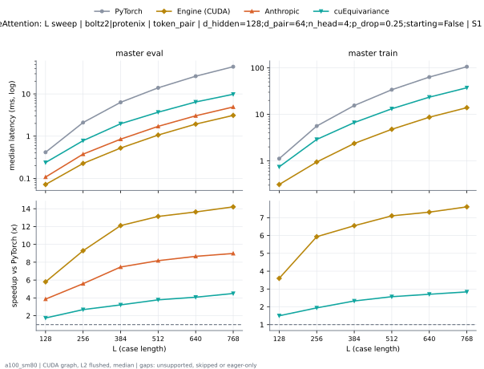

**master eval** (median ms; x = speedup vs PyTorch)

| L | PyTorch | Engine (Triton) | Engine (CUDA) | Anthropic | cuEquivariance |
|---|---|---|---|---|---|
| 128 | 0.4157 | 0.1782 (2.33x) | 0.07168 (5.80x) | 0.1075 (3.87x) | 0.2376 (1.75x) |
| 256 | 2.102 | 0.5612 (3.75x) | 0.2263 (9.29x) | 0.3758 (5.59x) | 0.7823 (2.69x) |
| 384 | 6.337 | 1.384 (4.58x) | 0.5233 (12.11x) | 0.8489 (7.46x) | 1.969 (3.22x) |
| 512 | 13.96 | 2.634 (5.30x) | 1.063 (13.14x) | 1.708 (8.18x) | 3.691 (3.78x) |
| 640 | 26.31 | 4.415 (5.96x) | 1.929 (13.64x) | 3.038 (8.66x) | 6.449 (4.08x) |
| 768 | 44.15 | 6.827 (6.47x) | 3.107 (14.21x) | 4.915 (8.98x) | 9.822 (4.49x) |

**master train** (median ms; x = speedup vs PyTorch)

| L | PyTorch | Engine (Triton) | Engine (CUDA) | Anthropic | cuEquivariance |
|---|---|---|---|---|---|
| 128 | 1.116 | 0.6042 (1.85x) | 0.3103 (3.60x) | unsupported | 0.7444 (1.50x) |
| 256 | 5.615 | 2.205 (2.55x) | 0.9462 (5.93x) | unsupported | 2.892 (1.94x) |
| 384 | 15.54 | 4.741 (3.28x) | 2.373 (6.55x) | unsupported | 6.671 (2.33x) |
| 512 | 33.95 | 9.27 (3.66x) | 4.779 (7.10x) | unsupported | 13.22 (2.57x) |
| 640 | 63.53 | 16.29 (3.90x) | 8.689 (7.31x) | unsupported | 23.48 (2.71x) |
| 768 | 106.2 | 26.05 (4.08x) | 13.96 (7.61x) | unsupported | 37.41 (2.84x) |

### L sweep: boltz2|protenix | token_pair | d_hidden=128;d_pair=64;n_head=4;p_drop=0.25;starting=True | S1 | graph

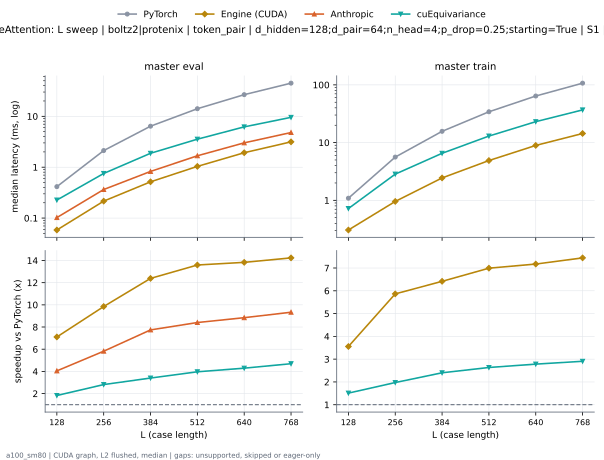

**master eval** (median ms; x = speedup vs PyTorch)

| L | PyTorch | Engine (Triton) | Engine (CUDA) | Anthropic | cuEquivariance |
|---|---|---|---|---|---|
| 128 | 0.4086 | 0.1679 (2.43x) | 0.07066 (5.78x) | 0.1024 (3.99x) | 0.2263 (1.81x) |
| 256 | 2.075 | 0.5325 (3.90x) | 0.2232 (9.29x) | 0.3645 (5.69x) | 0.7537 (2.75x) |
| 384 | 6.274 | 1.31 (4.79x) | 0.514 (12.21x) | 0.8264 (7.59x) | 1.879 (3.34x) |
| 512 | 13.8 | 2.511 (5.50x) | 1.039 (13.28x) | 1.678 (8.23x) | 3.555 (3.88x) |
| 640 | 26.08 | 4.211 (6.19x) | 1.864 (13.99x) | 3.013 (8.66x) | 6.204 (4.20x) |
| 768 | 43.85 | 6.537 (6.71x) | 3.075 (14.26x) | 4.805 (9.13x) | 9.549 (4.59x) |

**master train** (median ms; x = speedup vs PyTorch)

| L | PyTorch | Engine (Triton) | Engine (CUDA) | Anthropic | cuEquivariance |
|---|---|---|---|---|---|
| 128 | 1.09 | 0.5796 (1.88x) | 0.3092 (3.52x) | unsupported | 0.7209 (1.51x) |
| 256 | 5.551 | 2.145 (2.59x) | 0.9421 (5.89x) | unsupported | 2.844 (1.95x) |
| 384 | 15.43 | 4.595 (3.36x) | 2.355 (6.55x) | unsupported | 6.528 (2.36x) |
| 512 | 33.69 | 9.034 (3.73x) | 4.756 (7.08x) | unsupported | 12.98 (2.60x) |
| 640 | 63.14 | 15.9 (3.97x) | 8.626 (7.32x) | unsupported | 23.04 (2.74x) |
| 768 | 105.7 | 25.61 (4.13x) | 13.94 (7.58x) | unsupported | 36.84 (2.87x) |

### L sweep: opendde | token_pair | d_pair=384;n_head=12;p_drop=0.25;starting=False | S1 | graph

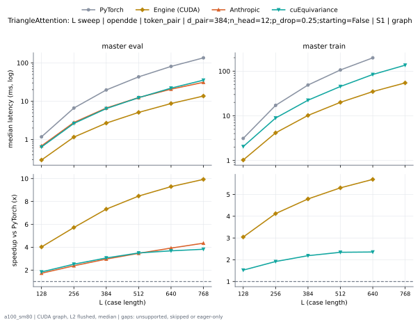

**master eval** (median ms; x = speedup vs PyTorch)

| L | PyTorch | Engine (Triton) | Engine (CUDA) | Anthropic | cuEquivariance |
|---|---|---|---|---|---|
| 128 | 1.175 | 0.4864 (2.41x) | 0.2918 (4.02x) | 0.6799 (1.73x) | 0.638 (1.84x) |
| 256 | 6.621 | 1.988 (3.33x) | 1.157 (5.72x) | 2.784 (2.38x) | 2.629 (2.52x) |
| 384 | 19.64 | 4.809 (4.08x) | 2.679 (7.33x) | 6.628 (2.96x) | 6.411 (3.06x) |
| 512 | 43.18 | 9.268 (4.66x) | 5.096 (8.47x) | 12.45 (3.47x) | 12.34 (3.50x) |
| 640 | 80.81 | 15.58 (5.19x) | 8.69 (9.30x) | 20.59 (3.93x) | 21.92 (3.69x) |
| 768 | 135.2 | 24.05 (5.62x) | 13.62 (9.93x) | 31.06 (4.35x) | 35.36 (3.82x) |

**master train** (median ms; x = speedup vs PyTorch)

| L | PyTorch | Engine (Triton) | Engine (CUDA) | Anthropic | cuEquivariance |
|---|---|---|---|---|---|
| 128 | 3.125 | 1.695 (1.84x) | 1.026 (3.05x) | unsupported | 2.049 (1.53x) |
| 256 | 17.16 | 7.082 (2.42x) | 4.163 (4.12x) | unsupported | 8.936 (1.92x) |
| 384 | 48.97 | 17 (2.88x) | 10.21 (4.79x) | unsupported | 22.38 (2.19x) |
| 512 | 106.4 | 33.69 (3.16x) | 20.06 (5.30x) | unsupported | 45.38 (2.34x) |
| 640 | 198.7 | 58.11 (3.42x) | 34.9 (5.69x) | unsupported | 84.27 (2.36x) |
| 768 | skipped | 92.3 | 54.67 | unsupported | 136.2 |

### L sweep: opendde | token_pair | d_pair=384;n_head=12;p_drop=0.25;starting=True | S1 | graph

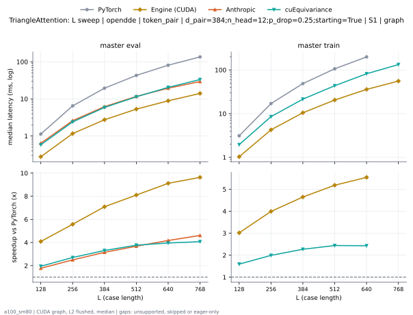

**master eval** (median ms; x = speedup vs PyTorch)

| L | PyTorch | Engine (Triton) | Engine (CUDA) | Anthropic | cuEquivariance |
|---|---|---|---|---|---|
| 128 | 1.122 | 0.4413 (2.54x) | 0.2929 (3.83x) | 0.638 (1.76x) | 0.5806 (1.93x) |
| 256 | 6.389 | 1.762 (3.63x) | 1.148 (5.57x) | 2.598 (2.46x) | 2.399 (2.66x) |
| 384 | 19.09 | 4.326 (4.41x) | 2.672 (7.15x) | 6.186 (3.09x) | 5.888 (3.24x) |
| 512 | 42.2 | 8.409 (5.02x) | 5.067 (8.33x) | 11.68 (3.61x) | 11.41 (3.70x) |
| 640 | 79.33 | 14.2 (5.59x) | 8.56 (9.27x) | 19.4 (4.09x) | 20.46 (3.88x) |
| 768 | 133 | 22.02 (6.04x) | 13.58 (9.79x) | 29.39 (4.53x) | 33.28 (4.00x) |

**master train** (median ms; x = speedup vs PyTorch)

| L | PyTorch | Engine (Triton) | Engine (CUDA) | Anthropic | cuEquivariance |
|---|---|---|---|---|---|
| 128 | 3.014 | 1.591 (1.89x) | 1.024 (2.94x) | unsupported | 1.953 (1.54x) |
| 256 | 16.75 | 6.699 (2.50x) | 4.131 (4.06x) | unsupported | 8.536 (1.96x) |
| 384 | 48.03 | 16.2 (2.97x) | 10.15 (4.73x) | unsupported | 21.44 (2.24x) |
| 512 | 104.8 | 32.17 (3.26x) | 19.98 (5.24x) | unsupported | 43.53 (2.41x) |
| 640 | 195.9 | 55.56 (3.53x) | 34.62 (5.66x) | unsupported | 81.69 (2.40x) |
| 768 | skipped | 88.86 | 54.13 | unsupported | 132.7 |

### L sweep: opendde|protenix | token_pair | d_pair=64;n_head=2;p_drop=0.25;starting=False | S1 | graph

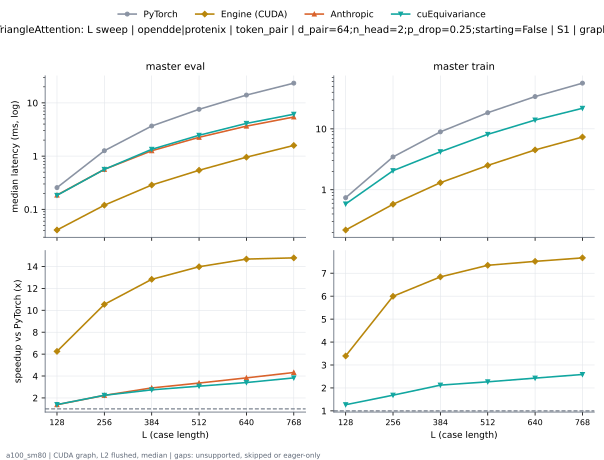

**master eval** (median ms; x = speedup vs PyTorch)

| L | PyTorch | Engine (Triton) | Engine (CUDA) | Anthropic | cuEquivariance |
|---|---|---|---|---|---|
| 128 | 0.256 | 0.1475 (1.74x) | 0.05325 (4.81x) | 0.1853 (1.38x) | 0.1833 (1.40x) |
| 256 | 1.258 | 0.4485 (2.81x) | 0.1976 (eager) | 0.5642 (2.23x) | 0.5632 (2.23x) |
| 384 | 3.678 | 1.051 (3.50x) | 0.2929 (12.56x) | 1.262 (2.92x) | 1.342 (2.74x) |
| 512 | 7.576 | 1.917 (3.95x) | 0.5509 (13.75x) | 2.256 (3.36x) | 2.464 (3.07x) |
| 640 | 14.02 | 3.081 (4.55x) | 0.9467 (14.81x) | 3.658 (3.83x) | 4.118 (3.40x) |
| 768 | 23.2 | 4.642 (5.00x) | 1.554 (14.93x) | 5.43 (4.27x) | 6.127 (3.79x) |

**master train** (median ms; x = speedup vs PyTorch)

| L | PyTorch | Engine (Triton) | Engine (CUDA) | Anthropic | cuEquivariance |
|---|---|---|---|---|---|
| 128 | 0.7414 | 0.5028 (1.47x) | 0.2191 (3.38x) | unsupported | 0.5837 (1.27x) |
| 256 | 3.473 | 1.702 (2.04x) | 0.5786 (6.00x) | unsupported | 2.055 (1.69x) |
| 384 | 8.933 | 3.205 (2.79x) | 1.309 (6.82x) | unsupported | 4.207 (2.12x) |
| 512 | 18.42 | 5.984 (3.08x) | 2.523 (7.30x) | unsupported | 8.125 (2.27x) |
| 640 | 33.86 | 10.07 (3.36x) | 4.491 (7.54x) | unsupported | 13.96 (2.42x) |
| 768 | 55.94 | 15.76 (3.55x) | 7.161 (7.81x) | unsupported | 21.78 (2.57x) |

### L sweep: opendde|protenix | token_pair | d_pair=64;n_head=2;p_drop=0.25;starting=True | S1 | graph

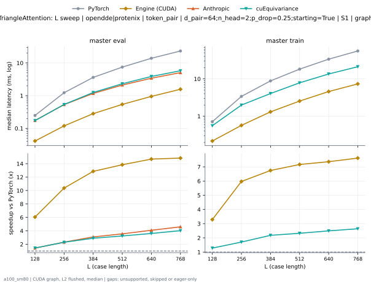

**master eval** (median ms; x = speedup vs PyTorch)

| L | PyTorch | Engine (Triton) | Engine (CUDA) | Anthropic | cuEquivariance |
|---|---|---|---|---|---|
| 128 | 0.2458 | 0.1372 (1.79x) | 0.05325 (4.62x) | 0.1741 (1.41x) | 0.172 (1.43x) |
| 256 | 1.232 | 0.4168 (2.96x) | 0.1311 (9.40x) | 0.5325 (2.31x) | 0.5366 (2.30x) |
| 384 | 3.589 | 0.9615 (3.73x) | 0.2877 (12.47x) | 1.171 (3.06x) | 1.251 (2.87x) |
| 512 | 7.428 | 1.767 (4.20x) | 0.5437 (13.66x) | 2.109 (3.52x) | 2.314 (3.21x) |
| 640 | 13.72 | 2.855 (4.81x) | 0.9196 (14.92x) | 3.416 (4.02x) | 3.868 (3.55x) |
| 768 | 22.93 | 4.303 (5.33x) | 1.527 (15.01x) | 5.074 (4.52x) | 5.791 (3.96x) |

**master train** (median ms; x = speedup vs PyTorch)

| L | PyTorch | Engine (Triton) | Engine (CUDA) | Anthropic | cuEquivariance |
|---|---|---|---|---|---|
| 128 | 0.7168 | 0.4762 (1.51x) | 0.2171 (3.30x) | unsupported | 0.5581 (1.28x) |
| 256 | 3.416 | 1.633 (2.09x) | 0.5714 (5.98x) | unsupported | 1.993 (1.71x) |
| 384 | 8.778 | 3.04 (2.89x) | 1.291 (6.80x) | unsupported | 4.056 (2.16x) |
| 512 | 18.16 | 5.732 (3.17x) | 2.49 (7.29x) | unsupported | 7.857 (2.31x) |
| 640 | 33.41 | 9.693 (3.45x) | 4.447 (7.51x) | unsupported | 13.54 (2.47x) |
| 768 | 55.41 | 15.2 (3.64x) | 7.126 (7.78x) | unsupported | 21.18 (2.62x) |

### L sweep: openfold3_preview2 | token_pair | d_pair=64;n_head=4;p_drop=0.25;starting=False | S1 | graph

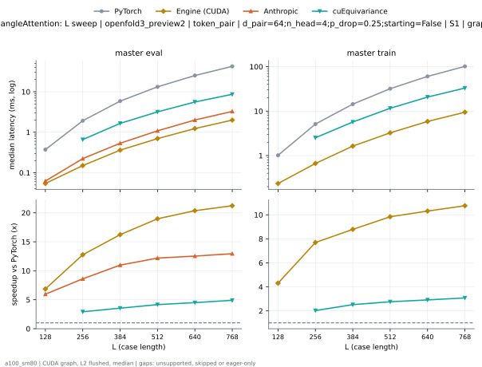

**master eval** (median ms; x = speedup vs PyTorch)

| L | PyTorch | Engine (Triton) | Engine (CUDA) | Anthropic | cuEquivariance |
|---|---|---|---|---|---|
| 128 | 0.3722 | 0.1526 (2.44x) | 0.05427 (6.86x) | 0.06246 (5.96x) | unsupported |
| 256 | 1.921 | 0.4844 (3.97x) | 0.1505 (12.76x) | 0.2232 (8.61x) | 0.6584 (2.92x) |
| 384 | 5.868 | 1.16 (5.06x) | 0.3615 (16.23x) | 0.5345 (10.98x) | 1.656 (3.54x) |
| 512 | 13.21 | 2.212 (5.97x) | 0.6963 (18.97x) | 1.084 (12.19x) | 3.178 (4.16x) |
| 640 | 25.12 | 3.634 (6.91x) | 1.233 (20.37x) | 2.004 (12.53x) | 5.584 (4.50x) |
| 768 | 42.33 | 5.607 (7.55x) | 1.995 (21.22x) | 3.27 (12.95x) | 8.637 (4.90x) |

**master train** (median ms; x = speedup vs PyTorch)

| L | PyTorch | Engine (Triton) | Engine (CUDA) | Anthropic | cuEquivariance |
|---|---|---|---|---|---|
| 128 | 1.015 | 0.5315 (1.91x) | 0.2355 (4.31x) | unsupported | unsupported |
| 256 | 5.114 | 1.858 (2.75x) | 0.6646 (7.69x) | unsupported | 2.52 (2.03x) |
| 384 | 14.37 | 3.74 (3.84x) | 1.635 (8.79x) | unsupported | 5.697 (2.52x) |
| 512 | 31.98 | 7.337 (4.36x) | 3.25 (9.84x) | unsupported | 11.59 (2.76x) |
| 640 | 60.37 | 12.62 (4.78x) | 5.854 (10.31x) | unsupported | 20.72 (2.91x) |
| 768 | 101.7 | 19.9 (5.11x) | 9.456 (10.76x) | unsupported | 33.03 (3.08x) |

### L sweep: openfold3_preview2 | token_pair | d_pair=64;n_head=4;p_drop=0.25;starting=True | S1 | graph

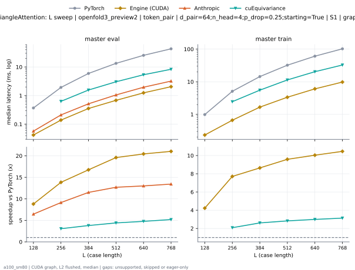

**master eval** (median ms; x = speedup vs PyTorch)

| L | PyTorch | Engine (Triton) | Engine (CUDA) | Anthropic | cuEquivariance |
|---|---|---|---|---|---|
| 128 | 0.3604 | 0.1434 (2.51x) | 0.05427 (6.64x) | 0.05734 (6.29x) | unsupported |
| 256 | 1.892 | 0.4567 (4.14x) | 0.1475 (12.83x) | 0.2109 (8.97x) | 0.6298 (3.00x) |
| 384 | 5.798 | 1.078 (5.38x) | 0.3564 (16.27x) | 0.5161 (11.24x) | 1.565 (3.71x) |
| 512 | 13.1 | 2.041 (6.42x) | 0.684 (19.15x) | 1.054 (12.43x) | 3.037 (4.31x) |
| 640 | 24.89 | 3.407 (7.31x) | 1.21 (20.57x) | 1.96 (12.70x) | 5.345 (4.66x) |
| 768 | 42.07 | 5.275 (7.98x) | 1.979 (21.26x) | 3.209 (13.11x) | 8.311 (5.06x) |

**master train** (median ms; x = speedup vs PyTorch)

| L | PyTorch | Engine (Triton) | Engine (CUDA) | Anthropic | cuEquivariance |
|---|---|---|---|---|---|
| 128 | 0.9912 | 0.5048 (1.96x) | 0.2345 (4.23x) | unsupported | unsupported |
| 256 | 5.061 | 1.793 (2.82x) | 0.6584 (7.69x) | unsupported | 2.451 (2.06x) |
| 384 | 14.21 | 3.564 (3.99x) | 1.623 (8.76x) | unsupported | 5.532 (2.57x) |
| 512 | 31.71 | 7.064 (4.49x) | 3.227 (9.83x) | unsupported | 11.38 (2.79x) |
| 640 | 59.98 | 12.28 (4.88x) | 5.855 (10.24x) | unsupported | 20.35 (2.95x) |
| 768 | 101.1 | 19.68 (5.14x) | 9.445 (10.71x) | unsupported | 32.66 (3.10x) |

### L sweep: protenix | token_pair | d_pair=256;n_head=8;p_drop=0.25;starting=False | S1 | graph

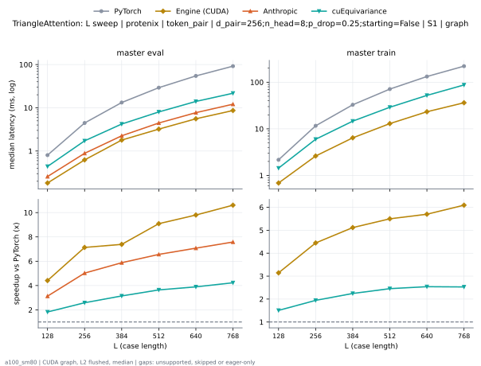

**master eval** (median ms; x = speedup vs PyTorch)

| L | PyTorch | Engine (Triton) | Engine (CUDA) | Anthropic | cuEquivariance |
|---|---|---|---|---|---|
| 128 | 0.8008 | 0.3446 (2.32x) | 0.1946 (4.12x) | 0.257 (3.12x) | 0.4403 (1.82x) |
| 256 | 4.361 | 1.286 (3.39x) | 0.6175 (7.06x) | 0.8858 (4.92x) | 1.721 (2.53x) |
| 384 | 13.01 | 3.098 (4.20x) | 1.662 (7.83x) | 2.252 (5.78x) | 4.21 (3.09x) |
| 512 | 28.55 | 5.938 (4.81x) | 3.113 (9.17x) | 4.449 (6.42x) | 8.017 (3.56x) |
| 640 | 53.51 | 9.986 (5.36x) | 5.425 (9.86x) | 7.714 (6.94x) | 14.02 (3.82x) |
| 768 | 89.96 | 15.3 (5.88x) | 8.499 (10.58x) | 12.11 (7.43x) | 21.7 (4.15x) |

**master train** (median ms; x = speedup vs PyTorch)

| L | PyTorch | Engine (Triton) | Engine (CUDA) | Anthropic | cuEquivariance |
|---|---|---|---|---|---|
| 128 | 2.146 | 1.192 (1.80x) | 0.6779 (3.17x) | unsupported | 1.438 (1.49x) |
| 256 | 11.45 | 4.633 (2.47x) | 2.544 (4.50x) | unsupported | 5.98 (1.91x) |
| 384 | 32.35 | 10.78 (3.00x) | 6.277 (5.15x) | unsupported | 14.62 (2.21x) |
| 512 | 70.29 | 21.31 (3.30x) | 12.61 (5.58x) | unsupported | 29.03 (2.42x) |
| 640 | 131 | 36.84 (3.55x) | 22.58 (5.80x) | unsupported | 52.17 (2.51x) |
| 768 | 219 | 58.38 (3.75x) | 35.33 (6.20x) | unsupported | 87.37 (2.51x) |

### L sweep: protenix | token_pair | d_pair=256;n_head=8;p_drop=0.25;starting=True | S1 | graph

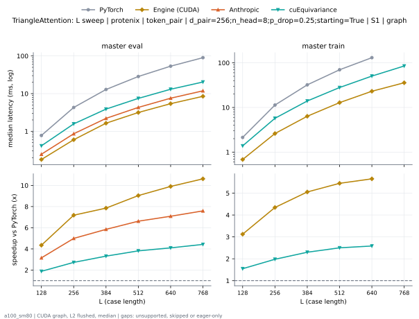

**master eval** (median ms; x = speedup vs PyTorch)

| L | PyTorch | Engine (Triton) | Engine (CUDA) | Anthropic | cuEquivariance |
|---|---|---|---|---|---|
| 128 | 0.7711 | 0.3123 (2.47x) | 0.1925 (4.01x) | 0.2458 (3.14x) | 0.4111 (1.88x) |
| 256 | 4.238 | 1.126 (3.76x) | 0.6031 (7.03x) | 0.8591 (4.93x) | 1.573 (2.69x) |
| 384 | 12.67 | 2.76 (4.59x) | 1.546 (8.19x) | 2.203 (5.75x) | 3.882 (3.26x) |
| 512 | 27.97 | 5.353 (5.23x) | 3.042 (9.19x) | 4.307 (6.49x) | 7.471 (3.74x) |
| 640 | 52.67 | 8.977 (5.87x) | 5.226 (10.08x) | 7.561 (6.97x) | 13.07 (4.03x) |
| 768 | 88.63 | 13.97 (6.35x) | 8.342 (10.62x) | 11.87 (7.47x) | 20.36 (4.35x) |

**master train** (median ms; x = speedup vs PyTorch)

| L | PyTorch | Engine (Triton) | Engine (CUDA) | Anthropic | cuEquivariance |
|---|---|---|---|---|---|
| 128 | 2.088 | 1.126 (1.85x) | 0.6748 (3.09x) | unsupported | 1.379 (1.51x) |
| 256 | 11.2 | 4.378 (2.56x) | 2.532 (4.42x) | unsupported | 5.729 (1.95x) |
| 384 | 31.76 | 10.29 (3.09x) | 6.244 (5.09x) | unsupported | 13.99 (2.27x) |
| 512 | 69.26 | 20.2 (3.43x) | 12.55 (5.52x) | unsupported | 28.01 (2.47x) |
| 640 | 129.3 | 35.27 (3.67x) | 22.35 (5.79x) | unsupported | 50.59 (2.56x) |
| 768 | skipped | 55.98 | 35.2 | unsupported | 85.1 |

### d_pair sweep at L768: token_pair | p_drop=0.25;starting=False | S1 | graph

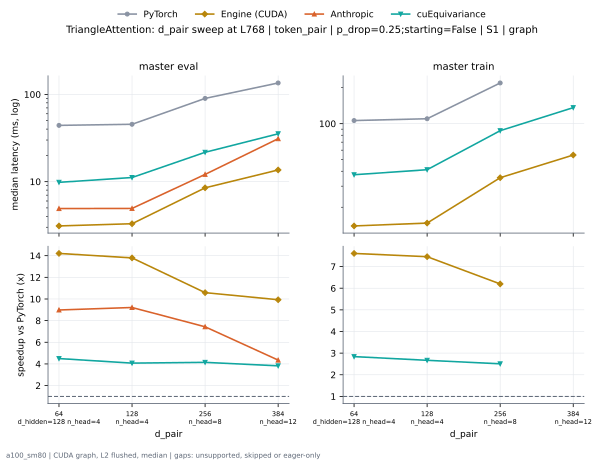

**master eval** (median ms; x = speedup vs PyTorch)

| d_pair | PyTorch | Engine (Triton) | Engine (CUDA) | Anthropic | cuEquivariance |
|---|---|---|---|---|---|
| 64 d_hidden=128 n_head=4 | 44.15 | 6.827 (6.47x) | 3.107 (14.21x) | 4.915 (8.98x) | 9.822 (4.49x) |
| 128 n_head=4 | 45.43 | 8.211 (5.53x) | 3.294 (13.79x) | 4.932 (9.21x) | 11.15 (4.07x) |
| 256 n_head=8 | 89.96 | 15.3 (5.88x) | 8.499 (10.58x) | 12.11 (7.43x) | 21.7 (4.15x) |
| 384 n_head=12 | 135.2 | 24.05 (5.62x) | 13.62 (9.93x) | 31.06 (4.35x) | 35.36 (3.82x) |

**master train** (median ms; x = speedup vs PyTorch)

| d_pair | PyTorch | Engine (Triton) | Engine (CUDA) | Anthropic | cuEquivariance |
|---|---|---|---|---|---|
| 64 d_hidden=128 n_head=4 | 106.2 | 26.05 (4.08x) | 13.96 (7.61x) | unsupported | 37.41 (2.84x) |
| 128 n_head=4 | 109.9 | 30.14 (3.65x) | 14.75 (7.46x) | unsupported | 41.21 (2.67x) |
| 256 n_head=8 | 219 | 58.38 (3.75x) | 35.33 (6.20x) | unsupported | 87.37 (2.51x) |
| 384 n_head=12 | skipped | 92.3 | 54.67 | unsupported | 136.2 |

### d_pair sweep at L768: token_pair | p_drop=0.25;starting=True | S1 | graph

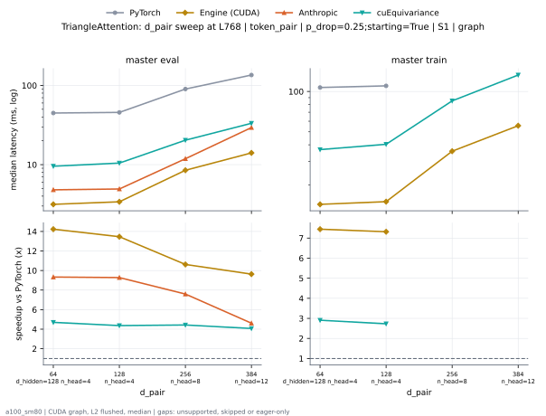

**master eval** (median ms; x = speedup vs PyTorch)

| d_pair | PyTorch | Engine (Triton) | Engine (CUDA) | Anthropic | cuEquivariance |
|---|---|---|---|---|---|
| 64 d_hidden=128 n_head=4 | 43.85 | 6.537 (6.71x) | 3.075 (14.26x) | 4.805 (9.13x) | 9.549 (4.59x) |
| 128 n_head=4 | 44.77 | 7.519 (5.95x) | 3.314 (13.51x) | 4.922 (9.10x) | 10.46 (4.28x) |
| 256 n_head=8 | 88.63 | 13.97 (6.35x) | 8.342 (10.62x) | 11.87 (7.47x) | 20.36 (4.35x) |
| 384 n_head=12 | 133 | 22.02 (6.04x) | 13.58 (9.79x) | 29.39 (4.53x) | 33.28 (4.00x) |

**master train** (median ms; x = speedup vs PyTorch)

| d_pair | PyTorch | Engine (Triton) | Engine (CUDA) | Anthropic | cuEquivariance |
|---|---|---|---|---|---|
| 64 d_hidden=128 n_head=4 | 105.7 | 25.61 (4.13x) | 13.94 (7.58x) | unsupported | 36.84 (2.87x) |
| 128 n_head=4 | 108.8 | 28.71 (3.79x) | 14.61 (7.45x) | unsupported | 40.36 (2.70x) |
| 256 n_head=8 | skipped | 55.98 | 35.2 | unsupported | 85.1 |
| 384 n_head=12 | skipped | 88.86 | 54.13 | unsupported | 132.7 |

### n_head sweep at L768: token_pair | p_drop=0.25;starting=False | S1 | graph

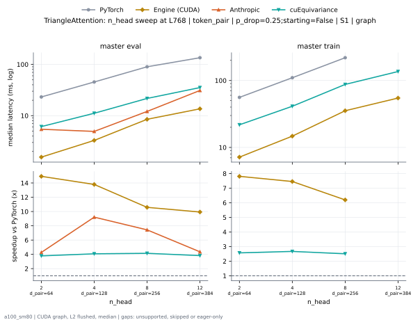

**master eval** (median ms; x = speedup vs PyTorch)

| n_head | PyTorch | Engine (Triton) | Engine (CUDA) | Anthropic | cuEquivariance |
|---|---|---|---|---|---|
| 2 d_pair=64 | 23.2 | 4.642 (5.00x) | 1.554 (14.93x) | 5.43 (4.27x) | 6.127 (3.79x) |
| 4 d_pair=128 | 45.43 | 8.211 (5.53x) | 3.294 (13.79x) | 4.932 (9.21x) | 11.15 (4.07x) |
| 8 d_pair=256 | 89.96 | 15.3 (5.88x) | 8.499 (10.58x) | 12.11 (7.43x) | 21.7 (4.15x) |
| 12 d_pair=384 | 135.2 | 24.05 (5.62x) | 13.62 (9.93x) | 31.06 (4.35x) | 35.36 (3.82x) |

**master train** (median ms; x = speedup vs PyTorch)

| n_head | PyTorch | Engine (Triton) | Engine (CUDA) | Anthropic | cuEquivariance |
|---|---|---|---|---|---|
| 2 d_pair=64 | 55.94 | 15.76 (3.55x) | 7.161 (7.81x) | unsupported | 21.78 (2.57x) |
| 4 d_pair=128 | 109.9 | 30.14 (3.65x) | 14.75 (7.46x) | unsupported | 41.21 (2.67x) |
| 8 d_pair=256 | 219 | 58.38 (3.75x) | 35.33 (6.20x) | unsupported | 87.37 (2.51x) |
| 12 d_pair=384 | skipped | 92.3 | 54.67 | unsupported | 136.2 |

### n_head sweep at L768: token_pair | p_drop=0.25;starting=True | S1 | graph

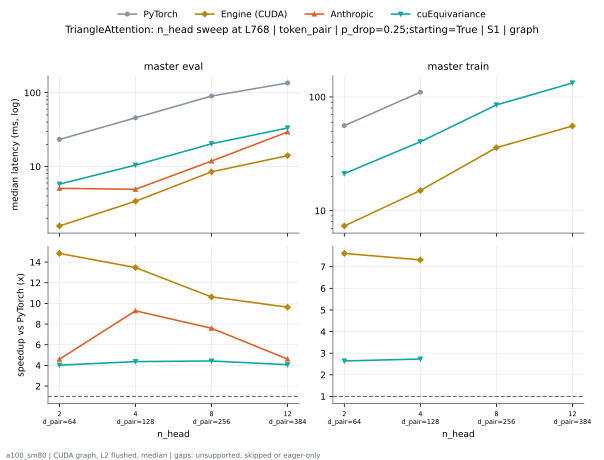

**master eval** (median ms; x = speedup vs PyTorch)

| n_head | PyTorch | Engine (Triton) | Engine (CUDA) | Anthropic | cuEquivariance |
|---|---|---|---|---|---|
| 2 d_pair=64 | 22.93 | 4.303 (5.33x) | 1.527 (15.01x) | 5.074 (4.52x) | 5.791 (3.96x) |
| 4 d_pair=128 | 44.77 | 7.519 (5.95x) | 3.314 (13.51x) | 4.922 (9.10x) | 10.46 (4.28x) |
| 8 d_pair=256 | 88.63 | 13.97 (6.35x) | 8.342 (10.62x) | 11.87 (7.47x) | 20.36 (4.35x) |
| 12 d_pair=384 | 133 | 22.02 (6.04x) | 13.58 (9.79x) | 29.39 (4.53x) | 33.28 (4.00x) |

**master train** (median ms; x = speedup vs PyTorch)

| n_head | PyTorch | Engine (Triton) | Engine (CUDA) | Anthropic | cuEquivariance |
|---|---|---|---|---|---|
| 2 d_pair=64 | 55.41 | 15.2 (3.64x) | 7.126 (7.78x) | unsupported | 21.18 (2.62x) |
| 4 d_pair=128 | 108.8 | 28.71 (3.79x) | 14.61 (7.45x) | unsupported | 40.36 (2.70x) |
| 8 d_pair=256 | skipped | 55.98 | 35.2 | unsupported | 85.1 |
| 12 d_pair=384 | skipped | 88.86 | 54.13 | unsupported | 132.7 |

