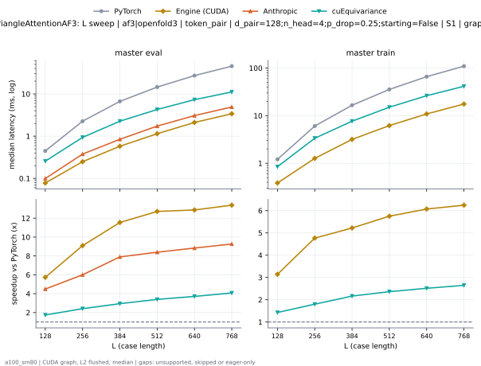
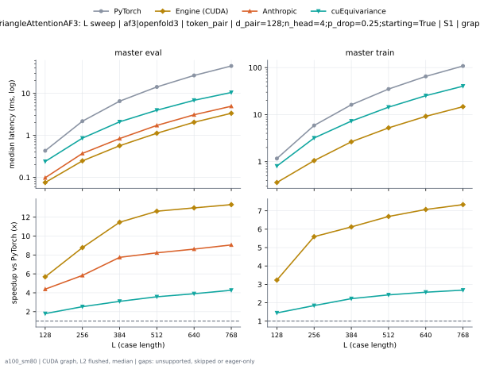
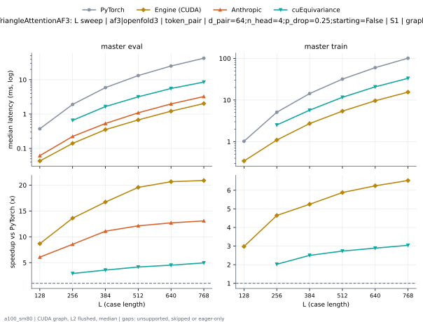
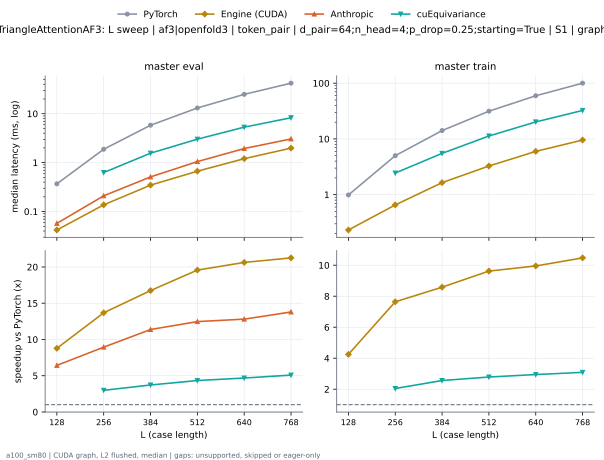
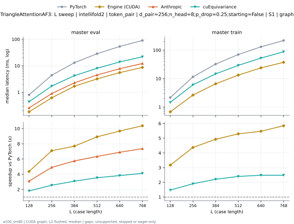
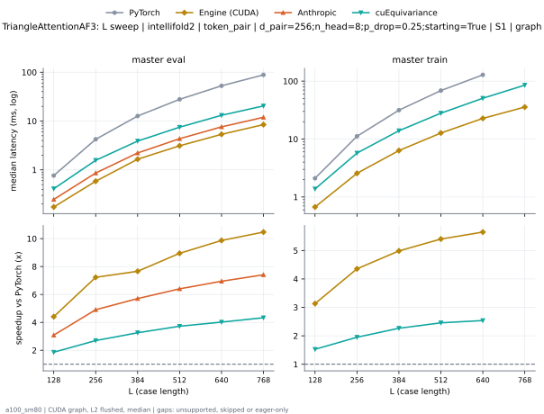
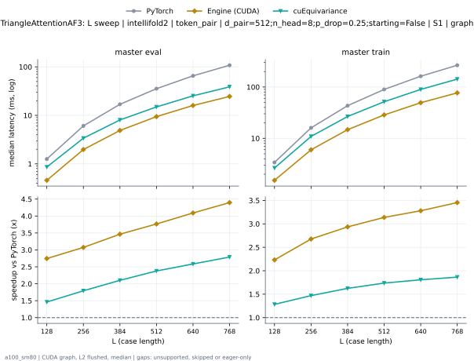
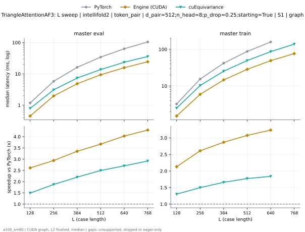
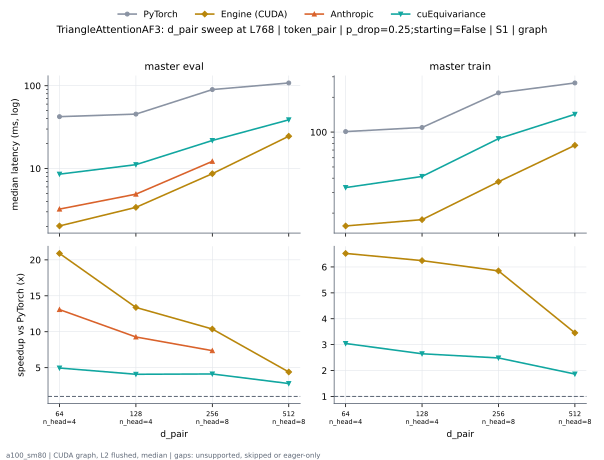
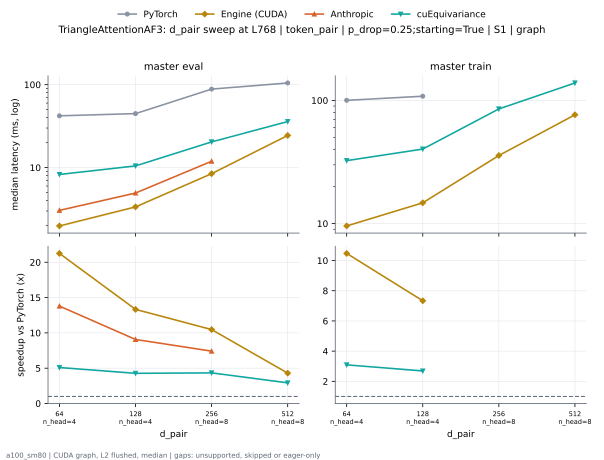

# TriangleAttentionAF3 on a100_sm80

Generated by `python -m miniworld_engine.measure.plot` from speed tokens `judge/tokens/a100_sm80/`; do not edit.

### L sweep: af3|openfold3 | token_pair | d_pair=128;n_head=4;p_drop=0.25;starting=False | S1 | graph

**master eval** (median ms; x = speedup vs PyTorch)

| L | PyTorch | Engine (Triton) | Engine (CUDA) | Anthropic | cuEquivariance |
|---|---|---|---|---|---|
| 128 | 0.4372 | 0.1997 (2.19x) | 0.1219 (3.59x) | 0.09933 (4.40x) | 0.256 (1.71x) |
| 256 | 2.247 | 0.7178 (3.13x) | 0.4014 (5.60x) | 0.3768 (5.96x) | 0.9359 (2.40x) |
| 384 | 6.631 | 1.714 (3.87x) | 0.9738 (6.81x) | 0.8433 (7.86x) | 2.263 (2.93x) |
| 512 | 14.41 | 3.245 (4.44x) | 1.92 (7.51x) | 1.732 (8.32x) | 4.279 (3.37x) |
| 640 | 26.97 | 5.357 (5.03x) | 3.364 (8.02x) | 3.073 (8.78x) | 7.316 (3.69x) |
| 768 | 45.25 | 8.213 (5.51x) | 5.254 (8.61x) | 4.901 (9.23x) | 11.13 (4.07x) |

**master train** (median ms; x = speedup vs PyTorch)

| L | PyTorch | Engine (Triton) | Engine (CUDA) | Anthropic | cuEquivariance |
|---|---|---|---|---|---|
| 128 | 1.212 | 0.7035 (1.72x) | 0.3912 (3.10x) | unsupported | 0.8468 (1.43x) |
| 256 | 6.014 | 2.665 (2.26x) | 1.245 (4.83x) | unsupported | 3.357 (1.79x) |
| 384 | 16.5 | 5.808 (2.84x) | 3.106 (5.31x) | unsupported | 7.648 (2.16x) |
| 512 | 35.43 | 11.22 (3.16x) | 6.122 (5.79x) | unsupported | 15.06 (2.35x) |
| 640 | 65.74 | 19.34 (3.40x) | 10.76 (6.11x) | unsupported | 26.25 (2.50x) |
| 768 | 109.3 | 30.57 (3.57x) | 17.17 (6.37x) | unsupported | 41.41 (2.64x) |

### L sweep: af3|openfold3 | token_pair | d_pair=128;n_head=4;p_drop=0.25;starting=True | S1 | graph

**master eval** (median ms; x = speedup vs PyTorch)

| L | PyTorch | Engine (Triton) | Engine (CUDA) | Anthropic | cuEquivariance |
|---|---|---|---|---|---|
| 128 | 0.427 | 0.1802 (2.37x) | 0.08806 (4.85x) | 0.0983 (4.34x) | 0.2396 (1.78x) |
| 256 | 2.167 | 0.641 (3.38x) | 0.2591 (8.36x) | 0.3727 (5.81x) | 0.8602 (2.52x) |
| 384 | 6.482 | 1.544 (4.20x) | 0.5765 (11.24x) | 0.8407 (7.71x) | 2.105 (3.08x) |
| 512 | 14.16 | 2.933 (4.83x) | 1.148 (12.34x) | 1.728 (8.19x) | 3.973 (3.56x) |
| 640 | 26.6 | 4.925 (5.40x) | 2.041 (13.03x) | 3.094 (8.60x) | 6.838 (3.89x) |
| 768 | 44.63 | 7.562 (5.90x) | 3.31 (13.48x) | 4.94 (9.03x) | 10.49 (4.26x) |

**master train** (median ms; x = speedup vs PyTorch)

| L | PyTorch | Engine (Triton) | Engine (CUDA) | Anthropic | cuEquivariance |
|---|---|---|---|---|---|
| 128 | 1.167 | 0.6564 (1.78x) | 0.3615 (3.23x) | unsupported | 0.8049 (1.45x) |
| 256 | 5.872 | 2.5 (2.35x) | 1.047 (5.61x) | unsupported | 3.184 (1.84x) |
| 384 | 16.13 | 5.463 (2.95x) | 2.597 (6.21x) | unsupported | 7.285 (2.21x) |
| 512 | 34.86 | 10.59 (3.29x) | 5.17 (6.74x) | unsupported | 14.4 (2.42x) |
| 640 | 64.82 | 18.22 (3.56x) | 9.102 (7.12x) | unsupported | 25.26 (2.57x) |
| 768 | 107.9 | 29.02 (3.72x) | 14.62 (7.38x) | unsupported | 40.28 (2.68x) |

### L sweep: af3|openfold3 | token_pair | d_pair=64;n_head=4;p_drop=0.25;starting=False | S1 | graph

**master eval** (median ms; x = speedup vs PyTorch)

| L | PyTorch | Engine (Triton) | Engine (CUDA) | Anthropic | cuEquivariance |
|---|---|---|---|---|---|
| 128 | 0.3727 | 0.1516 (2.46x) | 0.1085 (3.43x) | 0.06144 (6.07x) | unsupported |
| 256 | 1.905 | 0.4854 (3.92x) | 0.3318 (5.74x) | 0.2232 (8.53x) | 0.6574 (2.90x) |
| 384 | 5.834 | 1.181 (4.94x) | 0.812 (7.18x) | 0.5315 (10.98x) | 1.654 (3.53x) |
| 512 | 13.15 | 2.201 (5.97x) | 1.604 (8.20x) | 1.09 (12.07x) | 3.178 (4.14x) |
| 640 | 24.84 | 3.626 (6.85x) | 2.796 (8.89x) | 1.975 (12.58x) | 5.561 (4.47x) |
| 768 | 41.94 | 5.616 (7.47x) | 4.402 (9.53x) | 3.235 (12.97x) | 8.55 (4.91x) |

**master train** (median ms; x = speedup vs PyTorch)

| L | PyTorch | Engine (Triton) | Engine (CUDA) | Anthropic | cuEquivariance |
|---|---|---|---|---|---|
| 128 | 1.02 | 0.5366 (1.90x) | 0.3471 (2.94x) | unsupported | unsupported |
| 256 | 5.079 | 1.871 (2.71x) | 1.096 (4.64x) | unsupported | 2.514 (2.02x) |
| 384 | 14.22 | 3.759 (3.78x) | 2.698 (5.27x) | unsupported | 5.708 (2.49x) |
| 512 | 31.64 | 7.414 (4.27x) | 5.311 (5.96x) | unsupported | 11.64 (2.72x) |
| 640 | 59.57 | 12.8 (4.65x) | 9.444 (6.31x) | unsupported | 20.75 (2.87x) |
| 768 | 100.5 | 20.18 (4.98x) | 15.2 (6.61x) | unsupported | 33.21 (3.03x) |

### L sweep: af3|openfold3 | token_pair | d_pair=64;n_head=4;p_drop=0.25;starting=True | S1 | graph

**master eval** (median ms; x = speedup vs PyTorch)

| L | PyTorch | Engine (Triton) | Engine (CUDA) | Anthropic | cuEquivariance |
|---|---|---|---|---|---|
| 128 | 0.3615 | 0.1393 (2.60x) | 0.05427 (6.66x) | 0.05734 (6.30x) | unsupported |
| 256 | 1.873 | 0.4536 (4.13x) | 0.1475 (12.70x) | 0.2099 (8.92x) | 0.6277 (2.98x) |
| 384 | 5.736 | 1.075 (5.34x) | 0.3523 (16.28x) | 0.511 (11.23x) | 1.561 (3.68x) |
| 512 | 12.99 | 2.049 (6.34x) | 0.682 (19.04x) | 1.05 (12.37x) | 3.019 (4.30x) |
| 640 | 24.69 | 3.418 (7.22x) | 1.214 (20.33x) | 1.942 (12.71x) | 5.31 (4.65x) |
| 768 | 41.78 | 5.29 (7.90x) | 1.97 (21.21x) | 3.053 (13.69x) | 8.276 (5.05x) |

**master train** (median ms; x = speedup vs PyTorch)

| L | PyTorch | Engine (Triton) | Engine (CUDA) | Anthropic | cuEquivariance |
|---|---|---|---|---|---|
| 128 | 0.9871 | 0.5028 (1.96x) | 0.2335 (4.23x) | unsupported | unsupported |
| 256 | 5.001 | 1.785 (2.80x) | 0.6543 (7.64x) | unsupported | 2.445 (2.05x) |
| 384 | 14.03 | 3.56 (3.94x) | 1.626 (8.63x) | unsupported | 5.515 (2.54x) |
| 512 | 31.36 | 7.06 (4.44x) | 3.227 (9.72x) | unsupported | 11.29 (2.78x) |
| 640 | 59.28 | 12.25 (4.84x) | 5.873 (10.09x) | unsupported | 20.21 (2.93x) |
| 768 | 99.93 | 19.62 (5.09x) | 9.457 (10.57x) | unsupported | 32.44 (3.08x) |

### L sweep: intellifold2 | token_pair | d_pair=256;n_head=8;p_drop=0.25;starting=False | S1 | graph

**master eval** (median ms; x = speedup vs PyTorch)

| L | PyTorch | Engine (Triton) | Engine (CUDA) | Anthropic | cuEquivariance |
|---|---|---|---|---|---|
| 128 | 0.7987 | 0.343 (2.33x) | 0.2048 (3.90x) | 0.258 (3.10x) | 0.4413 (1.81x) |
| 256 | 4.365 | 1.268 (3.44x) | 0.7608 (5.74x) | 0.895 (4.88x) | 1.716 (2.54x) |
| 384 | 13 | 3.058 (4.25x) | 2.006 (6.48x) | 2.269 (5.73x) | 4.219 (3.08x) |
| 512 | 28.46 | 5.816 (4.89x) | 3.906 (7.29x) | 4.495 (6.33x) | 8.042 (3.54x) |
| 640 | 53.6 | 9.766 (5.49x) | 6.805 (7.88x) | 7.768 (6.90x) | 13.98 (3.83x) |
| 768 | 89.54 | 15.12 (5.92x) | 10.61 (8.44x) | 12.21 (7.34x) | 21.81 (4.11x) |

**master train** (median ms; x = speedup vs PyTorch)

| L | PyTorch | Engine (Triton) | Engine (CUDA) | Anthropic | cuEquivariance |
|---|---|---|---|---|---|
| 128 | 2.152 | 1.213 (1.77x) | 0.6861 (3.14x) | unsupported | 1.459 (1.48x) |
| 256 | 11.44 | 4.612 (2.48x) | 2.605 (4.39x) | unsupported | 6.039 (1.90x) |
| 384 | 32.25 | 10.73 (3.00x) | 6.511 (4.95x) | unsupported | 14.6 (2.21x) |
| 512 | 69.89 | 21.18 (3.30x) | 13.07 (5.35x) | unsupported | 29.14 (2.40x) |
| 640 | 130.2 | 36.86 (3.53x) | 23.54 (5.53x) | unsupported | 52.5 (2.48x) |
| 768 | 217.7 | 58.35 (3.73x) | 36.99 (5.89x) | unsupported | 87.75 (2.48x) |

### L sweep: intellifold2 | token_pair | d_pair=256;n_head=8;p_drop=0.25;starting=True | S1 | graph

**master eval** (median ms; x = speedup vs PyTorch)

| L | PyTorch | Engine (Triton) | Engine (CUDA) | Anthropic | cuEquivariance |
|---|---|---|---|---|---|
| 128 | 0.7654 | 0.3092 (2.48x) | 0.1884 (4.06x) | 0.2478 (3.09x) | 0.4106 (1.86x) |
| 256 | 4.211 | 1.117 (3.77x) | 0.5924 (7.11x) | 0.8622 (4.88x) | 1.569 (2.68x) |
| 384 | 12.65 | 2.743 (4.61x) | 1.574 (8.04x) | 2.222 (5.69x) | 3.892 (3.25x) |
| 512 | 27.85 | 5.306 (5.25x) | 2.998 (9.29x) | 4.351 (6.40x) | 7.483 (3.72x) |
| 640 | 52.61 | 8.904 (5.91x) | 5.245 (10.03x) | 7.6 (6.92x) | 13.13 (4.01x) |
| 768 | 88.29 | 13.88 (6.36x) | 8.36 (10.56x) | 11.94 (7.39x) | 20.42 (4.32x) |

**master train** (median ms; x = speedup vs PyTorch)

| L | PyTorch | Engine (Triton) | Engine (CUDA) | Anthropic | cuEquivariance |
|---|---|---|---|---|---|
| 128 | 2.075 | 1.123 (1.85x) | 0.6738 (3.08x) | unsupported | 1.378 (1.51x) |
| 256 | 11.13 | 4.344 (2.56x) | 2.54 (4.38x) | unsupported | 5.727 (1.94x) |
| 384 | 31.56 | 10.13 (3.11x) | 6.319 (4.99x) | unsupported | 13.93 (2.27x) |
| 512 | 68.74 | 20.12 (3.42x) | 12.66 (5.43x) | unsupported | 27.97 (2.46x) |
| 640 | 128.3 | 35.05 (3.66x) | 22.56 (5.69x) | unsupported | 50.66 (2.53x) |
| 768 | skipped | 55.84 | 35.42 | unsupported | 85.27 |

### L sweep: intellifold2 | token_pair | d_pair=512;n_head=8;p_drop=0.25;starting=False | S1 | graph

**master eval** (median ms; x = speedup vs PyTorch)

| L | PyTorch | Engine (Triton) | Engine (CUDA) | Anthropic | cuEquivariance |
|---|---|---|---|---|---|
| 128 | 1.256 | 0.6989 (1.80x) | 0.4833 (2.60x) | unsupported | 0.8602 (1.46x) |
| 256 | 6.06 | 2.772 (2.19x) | 2.006 (3.02x) | unsupported | 3.383 (1.79x) |
| 384 | 16.8 | 6.581 (2.55x) | 4.87 (3.45x) | unsupported | 8.046 (2.09x) |
| 512 | 35.41 | 12.49 (2.83x) | 9.385 (3.77x) | unsupported | 14.93 (2.37x) |
| 640 | 65.16 | 21 (3.10x) | 15.9 (4.10x) | unsupported | 25.28 (2.58x) |
| 768 | 107.2 | 32.4 (3.31x) | 24.32 (4.41x) | unsupported | 38.73 (2.77x) |

**master train** (median ms; x = speedup vs PyTorch)

| L | PyTorch | Engine (Triton) | Engine (CUDA) | Anthropic | cuEquivariance |
|---|---|---|---|---|---|
| 128 | 3.389 | 2.267 (1.50x) | 1.543 (2.20x) | unsupported | 2.642 (1.28x) |
| 256 | 15.97 | 9.155 (1.74x) | 5.908 (2.70x) | unsupported | 10.89 (1.47x) |
| 384 | 43.19 | 22.29 (1.94x) | 14.56 (2.97x) | unsupported | 26.64 (1.62x) |
| 512 | 89.52 | 42.96 (2.08x) | 28.25 (3.17x) | unsupported | 51.65 (1.73x) |
| 640 | 162.1 | 73.93 (2.19x) | 49.23 (3.29x) | unsupported | 89.76 (1.81x) |
| 768 | 265.2 | 115.6 (2.29x) | 76.16 (3.48x) | unsupported | 142.5 (1.86x) |

### L sweep: intellifold2 | token_pair | d_pair=512;n_head=8;p_drop=0.25;starting=True | S1 | graph

**master eval** (median ms; x = speedup vs PyTorch)

| L | PyTorch | Engine (Triton) | Engine (CUDA) | Anthropic | cuEquivariance |
|---|---|---|---|---|---|
| 128 | 1.171 | 0.6231 (1.88x) | 0.4772 (2.45x) | unsupported | 0.7905 (1.48x) |
| 256 | 5.75 | 2.514 (2.29x) | 1.987 (2.89x) | unsupported | 3.091 (1.86x) |
| 384 | 16.16 | 5.955 (2.71x) | 4.861 (3.32x) | unsupported | 7.381 (2.19x) |
| 512 | 34.15 | 11.33 (3.02x) | 9.285 (3.68x) | unsupported | 13.77 (2.48x) |
| 640 | 63.29 | 19.24 (3.29x) | 15.63 (4.05x) | unsupported | 23.51 (2.69x) |
| 768 | 104.4 | 30.1 (3.47x) | 24.19 (4.32x) | unsupported | 35.94 (2.91x) |

**master train** (median ms; x = speedup vs PyTorch)

| L | PyTorch | Engine (Triton) | Engine (CUDA) | Anthropic | cuEquivariance |
|---|---|---|---|---|---|
| 128 | 3.235 | 2.116 (1.53x) | 1.52 (2.13x) | unsupported | 2.487 (1.30x) |
| 256 | 15.44 | 8.658 (1.78x) | 5.868 (2.63x) | unsupported | 10.32 (1.50x) |
| 384 | 41.95 | 21.33 (1.97x) | 14.47 (2.90x) | unsupported | 25.33 (1.66x) |
| 512 | 87.42 | 40.97 (2.13x) | 28.15 (3.11x) | unsupported | 49.39 (1.77x) |
| 640 | 158.7 | 70.66 (2.25x) | 48.79 (3.25x) | unsupported | 86.66 (1.83x) |
| 768 | skipped | 111 | 75.86 | unsupported | 138.6 |

### d_pair sweep at L768: token_pair | p_drop=0.25;starting=False | S1 | graph

**master eval** (median ms; x = speedup vs PyTorch)

| d_pair | PyTorch | Engine (Triton) | Engine (CUDA) | Anthropic | cuEquivariance |
|---|---|---|---|---|---|
| 64 n_head=4 | 41.94 | 5.616 (7.47x) | 4.402 (9.53x) | 3.235 (12.97x) | 8.55 (4.91x) |
| 128 n_head=4 | 45.25 | 8.213 (5.51x) | 5.254 (8.61x) | 4.901 (9.23x) | 11.13 (4.07x) |
| 256 n_head=8 | 89.54 | 15.12 (5.92x) | 10.61 (8.44x) | 12.21 (7.34x) | 21.81 (4.11x) |
| 512 n_head=8 | 107.2 | 32.4 (3.31x) | 24.32 (4.41x) | unsupported | 38.73 (2.77x) |

**master train** (median ms; x = speedup vs PyTorch)

| d_pair | PyTorch | Engine (Triton) | Engine (CUDA) | Anthropic | cuEquivariance |
|---|---|---|---|---|---|
| 64 n_head=4 | 100.5 | 20.18 (4.98x) | 15.2 (6.61x) | unsupported | 33.21 (3.03x) |
| 128 n_head=4 | 109.3 | 30.57 (3.57x) | 17.17 (6.37x) | unsupported | 41.41 (2.64x) |
| 256 n_head=8 | 217.7 | 58.35 (3.73x) | 36.99 (5.89x) | unsupported | 87.75 (2.48x) |
| 512 n_head=8 | 265.2 | 115.6 (2.29x) | 76.16 (3.48x) | unsupported | 142.5 (1.86x) |

### d_pair sweep at L768: token_pair | p_drop=0.25;starting=True | S1 | graph

**master eval** (median ms; x = speedup vs PyTorch)

| d_pair | PyTorch | Engine (Triton) | Engine (CUDA) | Anthropic | cuEquivariance |
|---|---|---|---|---|---|
| 64 n_head=4 | 41.78 | 5.29 (7.90x) | 1.97 (21.21x) | 3.053 (13.69x) | 8.276 (5.05x) |
| 128 n_head=4 | 44.63 | 7.562 (5.90x) | 3.31 (13.48x) | 4.94 (9.03x) | 10.49 (4.26x) |
| 256 n_head=8 | 88.29 | 13.88 (6.36x) | 8.36 (10.56x) | 11.94 (7.39x) | 20.42 (4.32x) |
| 512 n_head=8 | 104.4 | 30.1 (3.47x) | 24.19 (4.32x) | unsupported | 35.94 (2.91x) |

**master train** (median ms; x = speedup vs PyTorch)

| d_pair | PyTorch | Engine (Triton) | Engine (CUDA) | Anthropic | cuEquivariance |
|---|---|---|---|---|---|
| 64 n_head=4 | 99.93 | 19.62 (5.09x) | 9.457 (10.57x) | unsupported | 32.44 (3.08x) |
| 128 n_head=4 | 107.9 | 29.02 (3.72x) | 14.62 (7.38x) | unsupported | 40.28 (2.68x) |
| 256 n_head=8 | skipped | 55.84 | 35.42 | unsupported | 85.27 |
| 512 n_head=8 | skipped | 111 | 75.86 | unsupported | 138.6 |

