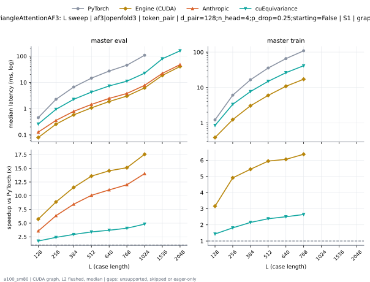
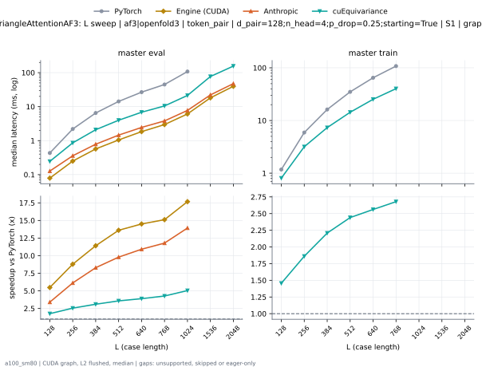
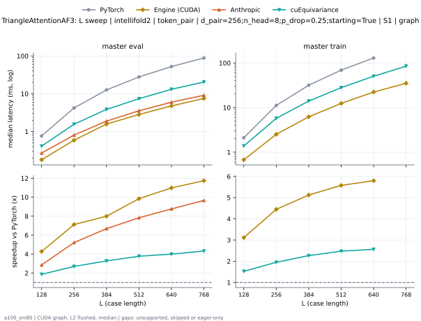
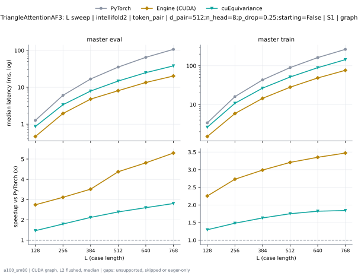
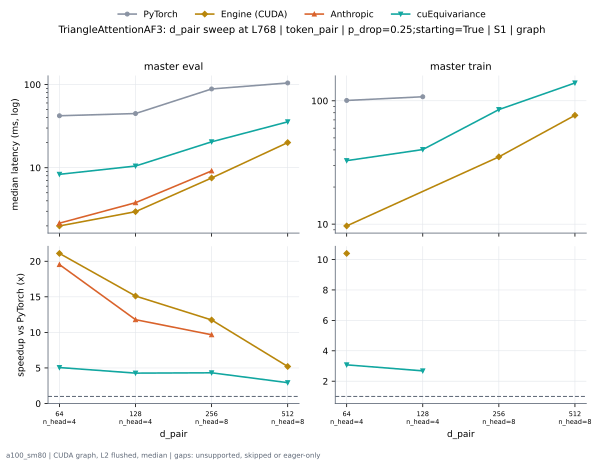

# TriangleAttentionAF3 on a100_sm80

Generated by `python -m miniworld_engine.measure.plot` from speed tokens `judge/tokens/a100_sm80/`; do not edit.

### L sweep: af3|openfold3 | token_pair | d_pair=128;n_head=4;p_drop=0.25;starting=False | S1 | graph

**master eval** (median ms; x = speedup vs PyTorch)

| L | PyTorch | Engine (Triton) | Engine (CUDA) | Anthropic | cuEquivariance |
|---|---|---|---|---|---|
| 128 | 0.4526 | 0.1956 (2.31x) | 0.07885 (5.74x) | 0.127 (3.56x) | 0.2591 (1.75x) |
| 256 | 2.261 | 0.7137 (3.17x) | 0.255 (8.87x) | 0.3553 (6.36x) | 0.94 (2.41x) |
| 384 | 6.669 | 1.688 (3.95x) | 0.5786 (11.53x) | 0.7885 (8.46x) | 2.266 (2.94x) |
| 512 | 14.55 | 3.141 (4.63x) | 1.071 (13.58x) | 1.444 (10.08x) | 4.28 (3.40x) |
| 640 | 27.16 | 5.202 (5.22x) | 1.867 (14.55x) | 2.455 (11.06x) | 7.325 (3.71x) |
| 768 | 45.44 | 7.962 (5.71x) | 3.007 (15.11x) | 3.785 (12.01x) | 11.15 (4.08x) |
| 1024 | 108.7 | 15.89 (6.84x) | 6.188 (17.56x) | 7.742 (14.04x) | 22.53 (4.82x) |
| 1536 | skipped | 44.48 | 18.52 | 22.13 | 79.77 |
| 2048 | skipped | 95.61 | 40.45 | 47.6 | 160.7 |

**master train** (median ms; x = speedup vs PyTorch)

| L | PyTorch | Engine (Triton) | Engine (CUDA) | Anthropic | cuEquivariance |
|---|---|---|---|---|---|
| 128 | 1.215 | 0.7055 (1.72x) | 0.385 (3.16x) | unsupported | 0.8479 (1.43x) |
| 256 | 6.076 | 2.67 (2.28x) | 1.238 (4.91x) | unsupported | 3.349 (1.81x) |
| 384 | 16.56 | 5.714 (2.90x) | 3.042 (5.44x) | unsupported | 7.701 (2.15x) |
| 512 | 35.61 | 10.9 (3.27x) | 5.986 (5.95x) | unsupported | 14.97 (2.38x) |
| 640 | 65.61 | 18.81 (3.49x) | 10.83 (6.06x) | unsupported | 26.23 (2.50x) |
| 768 | 109.1 | 29.78 (3.66x) | 17.13 (6.37x) | unsupported | 41.31 (2.64x) |
| 1024 |  |  |  |  |  |
| 1536 |  |  |  |  |  |
| 2048 |  |  |  |  |  |

### L sweep: af3|openfold3 | token_pair | d_pair=128;n_head=4;p_drop=0.25;starting=True | S1 | graph

**master eval** (median ms; x = speedup vs PyTorch)

| L | PyTorch | Engine (Triton) | Engine (CUDA) | Anthropic | cuEquivariance |
|---|---|---|---|---|---|
| 128 | 0.4321 | 0.1812 (2.38x) | 0.07885 (5.48x) | 0.127 (3.40x) | 0.2447 (1.77x) |
| 256 | 2.196 | 0.6349 (3.46x) | 0.2499 (8.79x) | 0.3584 (6.13x) | 0.8602 (2.55x) |
| 384 | 6.496 | 1.514 (4.29x) | 0.5693 (11.41x) | 0.7834 (8.29x) | 2.092 (3.11x) |
| 512 | 14.24 | 2.85 (5.00x) | 1.047 (13.61x) | 1.454 (9.80x) | 3.976 (3.58x) |
| 640 | 26.68 | 4.75 (5.62x) | 1.84 (14.50x) | 2.444 (10.91x) | 6.849 (3.90x) |
| 768 | 44.8 | 7.319 (6.12x) | 2.965 (15.11x) | 3.801 (11.79x) | 10.48 (4.27x) |
| 1024 | 107.7 | 14.68 (7.34x) | 6.096 (17.67x) | 7.735 (13.93x) | 21.35 (5.05x) |
| 1536 | skipped | 41.85 | 18.14 | 22.12 | 76.97 |
| 2048 | skipped | 91 | 39.64 | 47.56 | 156 |

**master train** (median ms; x = speedup vs PyTorch)

| L | PyTorch | Engine (Triton) | Engine (CUDA) | Anthropic | cuEquivariance |
|---|---|---|---|---|---|
| 128 | 1.175 | 0.6605 (1.78x) | failed | unsupported | 0.8069 (1.46x) |
| 256 | 5.914 | 2.514 (2.35x) | failed | unsupported | 3.178 (1.86x) |
| 384 | 16.19 | 5.35 (3.03x) | failed | unsupported | 7.333 (2.21x) |
| 512 | 34.98 | 10.31 (3.39x) | failed | unsupported | 14.33 (2.44x) |
| 640 | 64.73 | 17.85 (3.63x) | failed | unsupported | 25.27 (2.56x) |
| 768 | 107.8 | 28.4 (3.80x) | failed | unsupported | 40.24 (2.68x) |
| 1024 |  |  |  |  |  |
| 1536 |  |  |  |  |  |
| 2048 |  |  |  |  |  |

### L sweep: af3|openfold3 | token_pair | d_pair=64;n_head=4;p_drop=0.25;starting=False | S1 | graph

**master eval** (median ms; x = speedup vs PyTorch)

| L | PyTorch | Engine (Triton) | Engine (CUDA) | Anthropic | cuEquivariance |
|---|---|---|---|---|---|
| 128 | 0.3717 | 0.1526 (2.44x) | 0.04506 (8.25x) | 0.0809 (4.59x) | unsupported |
| 256 | 1.925 | 0.4813 (4.00x) | 0.1439 (13.38x) | 0.1874 (10.27x) | 0.6584 (2.92x) |
| 384 | 5.87 | 1.162 (5.05x) | 0.3604 (16.28x) | 0.425 (13.81x) | 1.655 (3.55x) |
| 512 | 13.21 | 2.18 (6.06x) | 0.683 (19.33x) | 0.7967 (16.58x) | 3.184 (4.15x) |
| 640 | 25.05 | 3.58 (7.00x) | 1.235 (20.28x) | 1.359 (18.44x) | 5.614 (4.46x) |
| 768 | 42.33 | 5.514 (7.68x) | 2.025 (20.90x) | 2.16 (19.60x) | 8.623 (4.91x) |
| 1024 | 102.8 | 11.12 (9.24x) | 4.146 (24.79x) | 4.508 (22.80x) | 18.11 (5.68x) |
| 1536 | skipped | 31.58 | 12.62 | 13.46 | 68.13 |
| 2048 | skipped | 72.66 | 28.48 | 30 | 140 |

**master train** (median ms; x = speedup vs PyTorch)

| L | PyTorch | Engine (Triton) | Engine (CUDA) | Anthropic | cuEquivariance |
|---|---|---|---|---|---|
| 128 | 1.022 | 0.5376 (1.90x) | 0.3441 (2.97x) | unsupported | unsupported |
| 256 | 5.126 | 1.868 (2.74x) | 1.101 (4.66x) | unsupported | 2.526 (2.03x) |
| 384 | 14.39 | 3.751 (3.84x) | 2.676 (5.38x) | unsupported | 5.73 (2.51x) |
| 512 | 32 | 7.284 (4.39x) | 5.228 (6.12x) | unsupported | 11.64 (2.75x) |
| 640 | 59.71 | 12.54 (4.76x) | 9.448 (6.32x) | unsupported | 20.72 (2.88x) |
| 768 | 101.3 | 19.88 (5.10x) | 15.65 (6.47x) | unsupported | 33.41 (3.03x) |
| 1024 |  |  |  |  |  |
| 1536 |  |  |  |  |  |
| 2048 |  |  |  |  |  |

### L sweep: af3|openfold3 | token_pair | d_pair=64;n_head=4;p_drop=0.25;starting=True | S1 | graph

**master eval** (median ms; x = speedup vs PyTorch)

| L | PyTorch | Engine (Triton) | Engine (CUDA) | Anthropic | cuEquivariance |
|---|---|---|---|---|---|
| 128 | 0.3707 | 0.1423 (2.60x) | 0.04403 (8.42x) | 0.08192 (4.53x) | unsupported |
| 256 | 1.893 | 0.4506 (4.20x) | 0.1403 (13.50x) | 0.1884 (10.05x) | 0.6287 (3.01x) |
| 384 | 5.797 | 1.066 (5.44x) | 0.3548 (16.34x) | 0.4229 (13.71x) | 1.562 (3.71x) |
| 512 | 13.09 | 2.016 (6.49x) | 0.6799 (19.26x) | 0.7905 (16.56x) | 3.025 (4.33x) |
| 640 | 24.91 | 3.355 (7.43x) | 1.208 (20.62x) | 1.357 (18.36x) | 5.363 (4.65x) |
| 768 | 42.14 | 5.178 (8.14x) | 1.997 (21.10x) | 2.158 (19.53x) | 8.336 (5.06x) |
| 1024 | 102.5 | 10.56 (9.70x) | 4.062 (25.22x) | 4.536 (22.59x) | 17.48 (5.86x) |
| 1536 | skipped | 30.35 | 12.47 | 13.45 | 66.98 |
| 2048 | skipped | 70.52 | 28.11 | 30.21 | 137.6 |

**master train** (median ms; x = speedup vs PyTorch)

| L | PyTorch | Engine (Triton) | Engine (CUDA) | Anthropic | cuEquivariance |
|---|---|---|---|---|---|
| 128 | 0.9902 | 0.5048 (1.96x) | 0.2355 (4.20x) | unsupported | unsupported |
| 256 | 5.045 | 1.784 (2.83x) | 0.6615 (7.63x) | unsupported | 2.448 (2.06x) |
| 384 | 14.21 | 3.558 (3.99x) | 1.62 (8.77x) | unsupported | 5.546 (2.56x) |
| 512 | 31.67 | 6.949 (4.56x) | 3.216 (9.85x) | unsupported | 11.31 (2.80x) |
| 640 | 59.17 | 11.98 (4.94x) | 5.818 (10.17x) | unsupported | 20.21 (2.93x) |
| 768 | 100.6 | 19.53 (5.15x) | 9.674 (10.40x) | unsupported | 32.73 (3.07x) |
| 1024 |  |  |  |  |  |
| 1536 |  |  |  |  |  |
| 2048 |  |  |  |  |  |

### L sweep: intellifold2 | token_pair | d_pair=256;n_head=8;p_drop=0.25;starting=False | S1 | graph

**master eval** (median ms; x = speedup vs PyTorch)

| L | PyTorch | Engine (Triton) | Engine (CUDA) | Anthropic | cuEquivariance |
|---|---|---|---|---|---|
| 128 | 0.8054 | 0.342 (2.35x) | 0.1864 (4.32x) | 0.2693 (2.99x) | 0.4434 (1.82x) |
| 256 | 4.373 | 1.274 (3.43x) | 0.6267 (6.98x) | 0.81 (5.40x) | 1.727 (2.53x) |
| 384 | 13.04 | 3.083 (4.23x) | 1.674 (7.79x) | 1.903 (6.85x) | 4.23 (3.08x) |
| 512 | 28.54 | 5.782 (4.94x) | 2.96 (9.64x) | 3.537 (8.07x) | 8.028 (3.55x) |
| 640 | 53.53 | 9.719 (5.51x) | 5.01 (10.68x) | 5.972 (8.96x) | 14.03 (3.82x) |
| 768 | 89.94 | 14.93 (6.02x) | 7.802 (11.53x) | 9.143 (9.84x) | 21.88 (4.11x) |

**master train** (median ms; x = speedup vs PyTorch)

| L | PyTorch | Engine (Triton) | Engine (CUDA) | Anthropic | cuEquivariance |
|---|---|---|---|---|---|
| 128 | 2.166 | 1.212 (1.79x) | 0.684 (3.17x) | unsupported | 1.457 (1.49x) |
| 256 | 11.51 | 4.67 (2.46x) | 2.586 (4.45x) | unsupported | 6.043 (1.90x) |
| 384 | 32.51 | 10.87 (2.99x) | 6.504 (5.00x) | unsupported | 14.76 (2.20x) |
| 512 | 70.45 | 21.1 (3.34x) | 13.07 (5.39x) | unsupported | 29.18 (2.41x) |
| 640 | 131.4 | 36.58 (3.59x) | 23.42 (5.61x) | unsupported | 52.51 (2.50x) |
| 768 | 219.4 | 57.95 (3.79x) | 36.44 (6.02x) | unsupported | 87.44 (2.51x) |

### L sweep: intellifold2 | token_pair | d_pair=256;n_head=8;p_drop=0.25;starting=True | S1 | graph

**master eval** (median ms; x = speedup vs PyTorch)

| L | PyTorch | Engine (Triton) | Engine (CUDA) | Anthropic | cuEquivariance |
|---|---|---|---|---|---|
| 128 | 0.7695 | 0.3133 (2.46x) | 0.1802 (4.27x) | 0.2703 (2.85x) | 0.4137 (1.86x) |
| 256 | 4.227 | 1.117 (3.78x) | 0.5939 (7.12x) | 0.811 (5.21x) | 1.571 (2.69x) |
| 384 | 12.66 | 2.713 (4.67x) | 1.584 (7.99x) | 1.896 (6.68x) | 3.869 (3.27x) |
| 512 | 27.93 | 5.188 (5.38x) | 2.836 (9.85x) | 3.566 (7.83x) | 7.412 (3.77x) |
| 640 | 52.57 | 8.72 (6.03x) | 4.787 (10.98x) | 5.999 (8.76x) | 13.17 (3.99x) |
| 768 | 88.5 | 13.51 (6.55x) | 7.536 (11.74x) | 9.159 (9.66x) | 20.5 (4.32x) |

**master train** (median ms; x = speedup vs PyTorch)

| L | PyTorch | Engine (Triton) | Engine (CUDA) | Anthropic | cuEquivariance |
|---|---|---|---|---|---|
| 128 | 2.102 | 1.124 (1.87x) | 0.6748 (3.11x) | unsupported | 1.378 (1.52x) |
| 256 | 11.19 | 4.359 (2.57x) | 2.515 (4.45x) | unsupported | 5.733 (1.95x) |
| 384 | 31.77 | 10.16 (3.13x) | 6.202 (5.12x) | unsupported | 14.02 (2.27x) |
| 512 | 69.25 | 19.97 (3.47x) | 12.41 (5.58x) | unsupported | 27.97 (2.48x) |
| 640 | 129.5 | 34.69 (3.73x) | 22.33 (5.80x) | unsupported | 50.52 (2.56x) |
| 768 | skipped | 55.37 | 35.11 | unsupported | 84.85 |

### L sweep: intellifold2 | token_pair | d_pair=512;n_head=8;p_drop=0.25;starting=False | S1 | graph

**master eval** (median ms; x = speedup vs PyTorch)

| L | PyTorch | Engine (Triton) | Engine (CUDA) | Anthropic | cuEquivariance |
|---|---|---|---|---|---|
| 128 | 1.268 | 0.6871 (1.85x) | 0.4618 (2.75x) | unsupported | 0.8622 (1.47x) |
| 256 | 6.055 | 2.701 (2.24x) | 1.944 (3.11x) | unsupported | 3.368 (1.80x) |
| 384 | 16.8 | 6.435 (2.61x) | 4.78 (3.52x) | unsupported | 7.912 (2.12x) |
| 512 | 35.41 | 12.1 (2.93x) | 8.094 (4.38x) | unsupported | 14.79 (2.39x) |
| 640 | 65.03 | 20.27 (3.21x) | 13.51 (4.81x) | unsupported | 24.98 (2.60x) |
| 768 | 107.2 | 31.16 (3.44x) | 20.24 (5.30x) | unsupported | 38.17 (2.81x) |

**master train** (median ms; x = speedup vs PyTorch)

| L | PyTorch | Engine (Triton) | Engine (CUDA) | Anthropic | cuEquivariance |
|---|---|---|---|---|---|
| 128 | 3.386 | 2.218 (1.53x) | 1.502 (2.25x) | unsupported | 2.612 (1.30x) |
| 256 | 16.02 | 9.004 (1.78x) | 5.869 (2.73x) | unsupported | 10.81 (1.48x) |
| 384 | 43.23 | 21.92 (1.97x) | 14.47 (2.99x) | unsupported | 26.51 (1.63x) |
| 512 | 89.91 | 41.95 (2.14x) | 28.04 (3.21x) | unsupported | 51.34 (1.75x) |
| 640 | 162.8 | 71.92 (2.26x) | 48.58 (3.35x) | unsupported | 89.35 (1.82x) |
| 768 | 265.1 | 113.9 (2.33x) | 76.36 (3.47x) | unsupported | 143.9 (1.84x) |

### L sweep: intellifold2 | token_pair | d_pair=512;n_head=8;p_drop=0.25;starting=True | S1 | graph

**master eval** (median ms; x = speedup vs PyTorch)

| L | PyTorch | Engine (Triton) | Engine (CUDA) | Anthropic | cuEquivariance |
|---|---|---|---|---|---|
| 128 | 1.188 | 0.6185 (1.92x) | 0.4588 (2.59x) | unsupported | 0.7905 (1.50x) |
| 256 | 5.745 | 2.406 (2.39x) | 1.936 (2.97x) | unsupported | 3.059 (1.88x) |
| 384 | 16.13 | 5.736 (2.81x) | 4.743 (3.40x) | unsupported | 7.28 (2.22x) |
| 512 | 34.29 | 10.92 (3.14x) | 8.034 (4.27x) | unsupported | 13.58 (2.52x) |
| 640 | 63.2 | 18.44 (3.43x) | 13.28 (4.76x) | unsupported | 23.16 (2.73x) |
| 768 | 104.5 | 28.63 (3.65x) | 20.07 (5.21x) | unsupported | 35.64 (2.93x) |

**master train** (median ms; x = speedup vs PyTorch)

| L | PyTorch | Engine (Triton) | Engine (CUDA) | Anthropic | cuEquivariance |
|---|---|---|---|---|---|
| 128 | 3.241 | 2.071 (1.57x) | 1.494 (2.17x) | unsupported | 2.477 (1.31x) |
| 256 | 15.47 | 8.469 (1.83x) | 5.829 (2.65x) | unsupported | 10.32 (1.50x) |
| 384 | 42.02 | 20.64 (2.04x) | 14.38 (2.92x) | unsupported | 25.3 (1.66x) |
| 512 | 87.94 | 40.05 (2.20x) | 27.92 (3.15x) | unsupported | 49.23 (1.79x) |
| 640 | 159.6 | 68.53 (2.33x) | 48.36 (3.30x) | unsupported | 86.09 (1.85x) |
| 768 | skipped | 108.8 | 76.26 | unsupported | 139.5 |

### d_pair sweep at L768: token_pair | p_drop=0.25;starting=False | S1 | graph

**master eval** (median ms; x = speedup vs PyTorch)

| d_pair | PyTorch | Engine (Triton) | Engine (CUDA) | Anthropic | cuEquivariance |
|---|---|---|---|---|---|
| 64 n_head=4 | 42.33 | 5.514 (7.68x) | 2.025 (20.90x) | 2.16 (19.60x) | 8.623 (4.91x) |
| 128 n_head=4 | 45.44 | 7.962 (5.71x) | 3.007 (15.11x) | 3.785 (12.01x) | 11.15 (4.08x) |
| 256 n_head=8 | 89.94 | 14.93 (6.02x) | 7.802 (11.53x) | 9.143 (9.84x) | 21.88 (4.11x) |
| 512 n_head=8 | 107.2 | 31.16 (3.44x) | 20.24 (5.30x) | unsupported | 38.17 (2.81x) |

**master train** (median ms; x = speedup vs PyTorch)

| d_pair | PyTorch | Engine (Triton) | Engine (CUDA) | Anthropic | cuEquivariance |
|---|---|---|---|---|---|
| 64 n_head=4 | 101.3 | 19.88 (5.10x) | 15.65 (6.47x) | unsupported | 33.41 (3.03x) |
| 128 n_head=4 | 109.1 | 29.78 (3.66x) | 17.13 (6.37x) | unsupported | 41.31 (2.64x) |
| 256 n_head=8 | 219.4 | 57.95 (3.79x) | 36.44 (6.02x) | unsupported | 87.44 (2.51x) |
| 512 n_head=8 | 265.1 | 113.9 (2.33x) | 76.36 (3.47x) | unsupported | 143.9 (1.84x) |

### d_pair sweep at L768: token_pair | p_drop=0.25;starting=True | S1 | graph

**master eval** (median ms; x = speedup vs PyTorch)

| d_pair | PyTorch | Engine (Triton) | Engine (CUDA) | Anthropic | cuEquivariance |
|---|---|---|---|---|---|
| 64 n_head=4 | 42.14 | 5.178 (8.14x) | 1.997 (21.10x) | 2.158 (19.53x) | 8.336 (5.06x) |
| 128 n_head=4 | 44.8 | 7.319 (6.12x) | 2.965 (15.11x) | 3.801 (11.79x) | 10.48 (4.27x) |
| 256 n_head=8 | 88.5 | 13.51 (6.55x) | 7.536 (11.74x) | 9.159 (9.66x) | 20.5 (4.32x) |
| 512 n_head=8 | 104.5 | 28.63 (3.65x) | 20.07 (5.21x) | unsupported | 35.64 (2.93x) |

**master train** (median ms; x = speedup vs PyTorch)

| d_pair | PyTorch | Engine (Triton) | Engine (CUDA) | Anthropic | cuEquivariance |
|---|---|---|---|---|---|
| 64 n_head=4 | 100.6 | 19.53 (5.15x) | 9.674 (10.40x) | unsupported | 32.73 (3.07x) |
| 128 n_head=4 | 107.8 | 28.4 (3.80x) | failed | unsupported | 40.24 (2.68x) |
| 256 n_head=8 | skipped | 55.37 | 35.11 | unsupported | 84.85 |
| 512 n_head=8 | skipped | 108.8 | 76.26 | unsupported | 139.5 |

