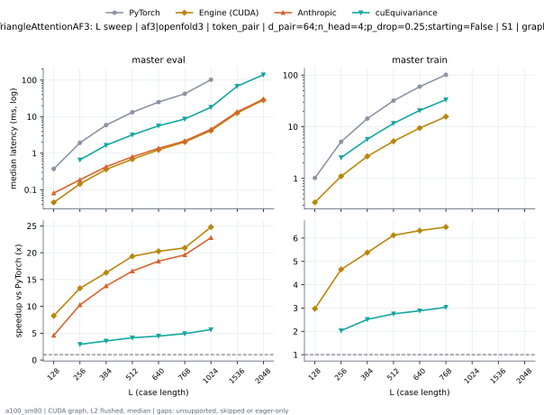
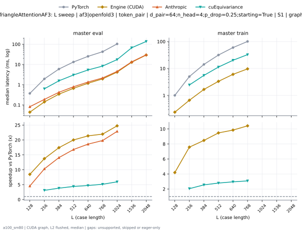
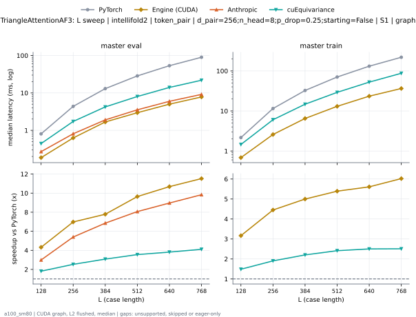
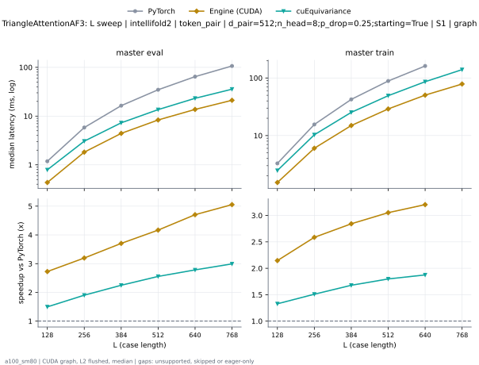
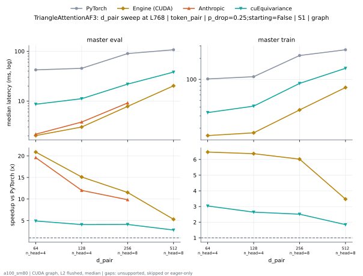

# TriangleAttentionAF3 on a100_sm80

Generated by `python -m foldjet_engine.measure.plot` from speed tokens `judge/tokens/a100_sm80/`; do not edit.

### L sweep: af3|openfold3 | token_pair | d_pair=128;n_head=4;p_drop=0.25;starting=False | S1 | graph

**master eval** (median ms; x = speedup vs PyTorch)

| L | PyTorch | Engine (Triton) | Engine (CUDA) | Anthropic | cuEquivariance |
|---|---|---|---|---|---|
| 128 | 0.4362 | 0.1956 (2.23x) | 0.07885 (5.53x) | 0.127 (3.44x) | 0.2591 (1.68x) |
| 256 | 2.282 | 0.7137 (3.20x) | 0.2519 (9.06x) | 0.3553 (6.42x) | 0.94 (2.43x) |
| 384 | 6.728 | 1.688 (3.99x) | 0.5821 (11.56x) | 0.7885 (8.53x) | 2.266 (2.97x) |
| 512 | 14.59 | 3.141 (4.65x) | 1.051 (13.89x) | 1.444 (10.10x) | 4.28 (3.41x) |
| 640 | 27.4 | 5.202 (5.27x) | 1.918 (14.28x) | 2.455 (11.16x) | 7.325 (3.74x) |
| 768 | 45.84 | 7.962 (5.76x) | 3.079 (14.89x) | 3.785 (12.11x) | 11.15 (4.11x) |
| 1024 | 109.8 | 15.89 (6.91x) | 6.338 (17.32x) | 7.742 (14.18x) | 22.53 (4.87x) |
| 1536 | skipped | 44.48 | 18.95 | 22.13 | 79.77 |
| 2048 | skipped | 95.61 | 41.48 | 47.6 | 160.7 |

**master train** (median ms; x = speedup vs PyTorch)

| L | PyTorch | Engine (Triton) | Engine (CUDA) | Anthropic | cuEquivariance |
|---|---|---|---|---|---|
| 128 | 1.237 | 0.7055 (1.75x) | 0.3912 (3.16x) | unsupported | 0.8479 (1.46x) |
| 256 | 6.199 | 2.67 (2.32x) | 1.263 (4.91x) | unsupported | 3.349 (1.85x) |
| 384 | 16.7 | 5.714 (2.92x) | 3.202 (5.21x) | unsupported | 7.701 (2.17x) |
| 512 | 35.82 | 10.9 (3.29x) | 6.296 (5.69x) | unsupported | 14.97 (2.39x) |
| 640 | 66.43 | 18.81 (3.53x) | 11.05 (6.01x) | unsupported | 26.23 (2.53x) |
| 768 | 110.4 | 29.78 (3.71x) | 17.67 (6.25x) | unsupported | 41.31 (2.67x) |
| 1024 |  |  |  |  |  |
| 1536 |  |  |  |  |  |
| 2048 |  |  |  |  |  |

### L sweep: af3|openfold3 | token_pair | d_pair=128;n_head=4;p_drop=0.25;starting=True | S1 | graph

**master eval** (median ms; x = speedup vs PyTorch)

| L | PyTorch | Engine (Triton) | Engine (CUDA) | Anthropic | cuEquivariance |
|---|---|---|---|---|---|
| 128 | 0.4352 | 0.1812 (2.40x) | 0.07885 (5.52x) | 0.127 (3.43x) | 0.2447 (1.78x) |
| 256 | 2.251 | 0.6349 (3.55x) | 0.2499 (9.01x) | 0.3584 (6.28x) | 0.8602 (2.62x) |
| 384 | 6.576 | 1.514 (4.34x) | 0.5704 (11.53x) | 0.7834 (8.39x) | 2.092 (3.14x) |
| 512 | 14.34 | 2.85 (5.03x) | 1.04 (13.78x) | 1.454 (9.86x) | 3.976 (3.61x) |
| 640 | 27.04 | 4.75 (5.69x) | 1.901 (14.23x) | 2.444 (11.06x) | 6.849 (3.95x) |
| 768 | 45.3 | 7.319 (6.19x) | 3.076 (14.73x) | 3.801 (11.92x) | 10.48 (4.32x) |
| 1024 | 108.9 | 14.68 (7.42x) | 6.321 (17.23x) | 7.735 (14.08x) | 21.35 (5.10x) |
| 1536 | skipped | 41.85 | 18.74 | 22.12 | 76.97 |
| 2048 | skipped | 91 | 41.12 | 47.56 | 156 |

**master train** (median ms; x = speedup vs PyTorch)

| L | PyTorch | Engine (Triton) | Engine (CUDA) | Anthropic | cuEquivariance |
|---|---|---|---|---|---|
| 128 | 1.193 | 0.6605 (1.81x) | failed | unsupported | 0.8069 (1.48x) |
| 256 | 5.925 | 2.514 (2.36x) | failed | unsupported | 3.178 (1.86x) |
| 384 | 16.34 | 5.35 (3.05x) | failed | unsupported | 7.333 (2.23x) |
| 512 | 35.22 | 10.31 (3.41x) | failed | unsupported | 14.33 (2.46x) |
| 640 | 65.48 | 17.85 (3.67x) | failed | unsupported | 25.27 (2.59x) |
| 768 | 109 | 28.4 (3.84x) | failed | unsupported | 40.24 (2.71x) |
| 1024 |  |  |  |  |  |
| 1536 |  |  |  |  |  |
| 2048 |  |  |  |  |  |

### L sweep: af3|openfold3 | token_pair | d_pair=64;n_head=4;p_drop=0.25;starting=False | S1 | graph

**master eval** (median ms; x = speedup vs PyTorch)

| L | PyTorch | Engine (Triton) | Engine (CUDA) | Anthropic | cuEquivariance |
|---|---|---|---|---|---|
| 128 | 0.3712 | 0.1526 (2.43x) | 0.04506 (8.24x) | 0.0809 (4.59x) | unsupported |
| 256 | 1.936 | 0.4813 (4.02x) | 0.1434 (13.51x) | 0.1874 (10.33x) | 0.6584 (2.94x) |
| 384 | 5.971 | 1.162 (5.14x) | 0.3512 (17.00x) | 0.425 (14.05x) | 1.655 (3.61x) |
| 512 | 13.44 | 2.18 (6.17x) | 0.6682 (20.12x) | 0.7967 (16.87x) | 3.184 (4.22x) |
| 640 | 25.45 | 3.58 (7.11x) | 1.215 (20.95x) | 1.359 (18.73x) | 5.614 (4.53x) |
| 768 | 43.02 | 5.514 (7.80x) | 1.999 (21.52x) | 2.16 (19.92x) | 8.623 (4.99x) |
| 1024 | 104.4 | 11.12 (9.39x) | 4.28 (24.40x) | 4.508 (23.16x) | 18.11 (5.76x) |
| 1536 | skipped | 31.58 | 13.18 | 13.46 | 68.13 |
| 2048 | skipped | 72.66 | 29.96 | 30 | 140 |

**master train** (median ms; x = speedup vs PyTorch)

| L | PyTorch | Engine (Triton) | Engine (CUDA) | Anthropic | cuEquivariance |
|---|---|---|---|---|---|
| 128 | 1.018 | 0.5376 (1.89x) | 0.343 (2.97x) | unsupported | unsupported |
| 256 | 5.107 | 1.868 (2.73x) | 1.101 (4.64x) | unsupported | 2.526 (2.02x) |
| 384 | 14.32 | 3.751 (3.82x) | 2.744 (5.22x) | unsupported | 5.73 (2.50x) |
| 512 | 31.92 | 7.284 (4.38x) | 5.456 (5.85x) | unsupported | 11.64 (2.74x) |
| 640 | 60.28 | 12.54 (4.81x) | 9.698 (6.22x) | unsupported | 20.72 (2.91x) |
| 768 | 101.4 | 19.88 (5.10x) | 15.6 (6.50x) | unsupported | 33.41 (3.03x) |
| 1024 |  |  |  |  |  |
| 1536 |  |  |  |  |  |
| 2048 |  |  |  |  |  |

### L sweep: af3|openfold3 | token_pair | d_pair=64;n_head=4;p_drop=0.25;starting=True | S1 | graph

**master eval** (median ms; x = speedup vs PyTorch)

| L | PyTorch | Engine (Triton) | Engine (CUDA) | Anthropic | cuEquivariance |
|---|---|---|---|---|---|
| 128 | 0.3722 | 0.1423 (2.62x) | 0.04403 (8.45x) | 0.08192 (4.54x) | unsupported |
| 256 | 1.941 | 0.4506 (4.31x) | 0.1413 (13.74x) | 0.1884 (10.30x) | 0.6287 (3.09x) |
| 384 | 5.956 | 1.066 (5.59x) | 0.342 (17.41x) | 0.4229 (14.08x) | 1.562 (3.81x) |
| 512 | 13.28 | 2.016 (6.59x) | 0.6636 (20.01x) | 0.7905 (16.80x) | 3.025 (4.39x) |
| 640 | 25.24 | 3.355 (7.53x) | 1.181 (21.38x) | 1.357 (18.61x) | 5.363 (4.71x) |
| 768 | 42.75 | 5.178 (8.26x) | 1.946 (21.97x) | 2.158 (19.81x) | 8.336 (5.13x) |
| 1024 | 103.8 | 10.56 (9.83x) | 4.195 (24.75x) | 4.536 (22.89x) | 17.48 (5.94x) |
| 1536 | skipped | 30.35 | 12.94 | 13.45 | 66.98 |
| 2048 | skipped | 70.52 | 29.37 | 30.21 | 137.6 |

**master train** (median ms; x = speedup vs PyTorch)

| L | PyTorch | Engine (Triton) | Engine (CUDA) | Anthropic | cuEquivariance |
|---|---|---|---|---|---|
| 128 | 1.006 | 0.5048 (1.99x) | 0.2396 (4.20x) | unsupported | unsupported |
| 256 | 5.025 | 1.784 (2.82x) | 0.663 (7.58x) | unsupported | 2.448 (2.05x) |
| 384 | 14.16 | 3.558 (3.98x) | 1.672 (8.47x) | unsupported | 5.546 (2.55x) |
| 512 | 31.62 | 6.949 (4.55x) | 3.338 (9.47x) | unsupported | 11.31 (2.80x) |
| 640 | 59.75 | 11.98 (4.99x) | 6.067 (9.85x) | unsupported | 20.21 (2.96x) |
| 768 | 100.9 | 19.53 (5.17x) | 9.691 (10.41x) | unsupported | 32.73 (3.08x) |
| 1024 |  |  |  |  |  |
| 1536 |  |  |  |  |  |
| 2048 |  |  |  |  |  |

### L sweep: intellifold2 | token_pair | d_pair=256;n_head=8;p_drop=0.25;starting=False | S1 | graph

**master eval** (median ms; x = speedup vs PyTorch)

| L | PyTorch | Engine (Triton) | Engine (CUDA) | Anthropic | cuEquivariance |
|---|---|---|---|---|---|
| 128 | 0.7834 | 0.342 (2.29x) | 0.1823 (4.30x) | 0.2693 (2.91x) | 0.4434 (1.77x) |
| 256 | 4.428 | 1.274 (3.48x) | 0.6359 (6.96x) | 0.81 (5.47x) | 1.727 (2.56x) |
| 384 | 13.16 | 3.083 (4.27x) | 1.838 (7.16x) | 1.903 (6.92x) | 4.23 (3.11x) |
| 512 | 28.92 | 5.782 (5.00x) | 3.088 (9.36x) | 3.537 (8.18x) | 8.028 (3.60x) |
| 640 | 54.42 | 9.719 (5.60x) | 5.283 (10.30x) | 5.972 (9.11x) | 14.03 (3.88x) |
| 768 | 91.48 | 14.93 (6.13x) | 8.249 (11.09x) | 9.143 (10.00x) | 21.88 (4.18x) |

**master train** (median ms; x = speedup vs PyTorch)

| L | PyTorch | Engine (Triton) | Engine (CUDA) | Anthropic | cuEquivariance |
|---|---|---|---|---|---|
| 128 | 2.159 | 1.212 (1.78x) | 0.6851 (3.15x) | unsupported | 1.457 (1.48x) |
| 256 | 11.6 | 4.67 (2.48x) | 2.679 (4.33x) | unsupported | 6.043 (1.92x) |
| 384 | 32.67 | 10.87 (3.01x) | 6.714 (4.87x) | unsupported | 14.76 (2.21x) |
| 512 | 70.77 | 21.1 (3.35x) | 13.55 (5.22x) | unsupported | 29.18 (2.42x) |
| 640 | 132 | 36.58 (3.61x) | 24.38 (5.41x) | unsupported | 52.51 (2.51x) |
| 768 | 221 | 57.95 (3.81x) | 38.6 (5.73x) | unsupported | 87.44 (2.53x) |

### L sweep: intellifold2 | token_pair | d_pair=256;n_head=8;p_drop=0.25;starting=True | S1 | graph

**master eval** (median ms; x = speedup vs PyTorch)

| L | PyTorch | Engine (Triton) | Engine (CUDA) | Anthropic | cuEquivariance |
|---|---|---|---|---|---|
| 128 | 0.769 | 0.3133 (2.45x) | 0.1792 (4.29x) | 0.2703 (2.84x) | 0.4137 (1.86x) |
| 256 | 4.314 | 1.117 (3.86x) | 0.5939 (7.26x) | 0.811 (5.32x) | 1.571 (2.75x) |
| 384 | 12.91 | 2.713 (4.76x) | 1.691 (7.64x) | 1.896 (6.81x) | 3.869 (3.34x) |
| 512 | 28.42 | 5.188 (5.48x) | 3.028 (9.39x) | 3.566 (7.97x) | 7.412 (3.83x) |
| 640 | 53.67 | 8.72 (6.15x) | 5.048 (10.63x) | 5.999 (8.95x) | 13.17 (4.08x) |
| 768 | 90.41 | 13.51 (6.69x) | 7.901 (11.44x) | 9.159 (9.87x) | 20.5 (4.41x) |

**master train** (median ms; x = speedup vs PyTorch)

| L | PyTorch | Engine (Triton) | Engine (CUDA) | Anthropic | cuEquivariance |
|---|---|---|---|---|---|
| 128 | 2.103 | 1.124 (1.87x) | 0.6825 (3.08x) | unsupported | 1.378 (1.53x) |
| 256 | 11.36 | 4.359 (2.61x) | 2.638 (4.30x) | unsupported | 5.733 (1.98x) |
| 384 | 32.04 | 10.16 (3.15x) | 6.526 (4.91x) | unsupported | 14.02 (2.29x) |
| 512 | 69.7 | 19.97 (3.49x) | 12.99 (5.36x) | unsupported | 27.97 (2.49x) |
| 640 | 130.4 | 34.69 (3.76x) | 23.49 (5.55x) | unsupported | 50.52 (2.58x) |
| 768 | skipped | 55.37 | 36.7 | unsupported | 84.85 |

### L sweep: intellifold2 | token_pair | d_pair=512;n_head=8;p_drop=0.25;starting=False | S1 | graph

**master eval** (median ms; x = speedup vs PyTorch)

| L | PyTorch | Engine (Triton) | Engine (CUDA) | Anthropic | cuEquivariance |
|---|---|---|---|---|---|
| 128 | 1.234 | 0.6871 (1.80x) | 0.4321 (2.86x) | unsupported | 0.8622 (1.43x) |
| 256 | 6.135 | 2.701 (2.27x) | 1.82 (3.37x) | unsupported | 3.368 (1.82x) |
| 384 | 17.02 | 6.435 (2.65x) | 4.457 (3.82x) | unsupported | 7.912 (2.15x) |
| 512 | 35.77 | 12.1 (2.96x) | 8.375 (4.27x) | unsupported | 14.79 (2.42x) |
| 640 | 65.81 | 20.27 (3.25x) | 13.87 (4.74x) | unsupported | 24.98 (2.64x) |
| 768 | 108.3 | 31.16 (3.48x) | 20.77 (5.21x) | unsupported | 38.17 (2.84x) |

**master train** (median ms; x = speedup vs PyTorch)

| L | PyTorch | Engine (Triton) | Engine (CUDA) | Anthropic | cuEquivariance |
|---|---|---|---|---|---|
| 128 | 3.432 | 2.218 (1.55x) | 1.548 (2.22x) | unsupported | 2.612 (1.31x) |
| 256 | 16.18 | 9.004 (1.80x) | 6.028 (2.68x) | unsupported | 10.81 (1.50x) |
| 384 | 43.6 | 21.92 (1.99x) | 14.88 (2.93x) | unsupported | 26.51 (1.65x) |
| 512 | 90.47 | 41.95 (2.16x) | 28.85 (3.14x) | unsupported | 51.34 (1.76x) |
| 640 | 163.3 | 71.92 (2.27x) | 50.06 (3.26x) | unsupported | 89.35 (1.83x) |
| 768 | 267.3 | 113.9 (2.35x) | 77.73 (3.44x) | unsupported | 143.9 (1.86x) |

### L sweep: intellifold2 | token_pair | d_pair=512;n_head=8;p_drop=0.25;starting=True | S1 | graph

**master eval** (median ms; x = speedup vs PyTorch)

| L | PyTorch | Engine (Triton) | Engine (CUDA) | Anthropic | cuEquivariance |
|---|---|---|---|---|---|
| 128 | 1.183 | 0.6185 (1.91x) | 0.4342 (2.73x) | unsupported | 0.7905 (1.50x) |
| 256 | 5.821 | 2.406 (2.42x) | 1.821 (3.20x) | unsupported | 3.059 (1.90x) |
| 384 | 16.37 | 5.736 (2.85x) | 4.418 (3.71x) | unsupported | 7.28 (2.25x) |
| 512 | 34.71 | 10.92 (3.18x) | 8.329 (4.17x) | unsupported | 13.58 (2.56x) |
| 640 | 64.46 | 18.44 (3.50x) | 13.7 (4.70x) | unsupported | 23.16 (2.78x) |
| 768 | 106.6 | 28.63 (3.72x) | 21.1 (5.05x) | unsupported | 35.64 (2.99x) |

**master train** (median ms; x = speedup vs PyTorch)

| L | PyTorch | Engine (Triton) | Engine (CUDA) | Anthropic | cuEquivariance |
|---|---|---|---|---|---|
| 128 | 3.291 | 2.071 (1.59x) | 1.533 (2.15x) | unsupported | 2.477 (1.33x) |
| 256 | 15.59 | 8.469 (1.84x) | 6.027 (2.59x) | unsupported | 10.32 (1.51x) |
| 384 | 42.48 | 20.64 (2.06x) | 14.94 (2.84x) | unsupported | 25.3 (1.68x) |
| 512 | 88.54 | 40.05 (2.21x) | 29 (3.05x) | unsupported | 49.23 (1.80x) |
| 640 | 161.4 | 68.53 (2.36x) | 50.36 (3.21x) | unsupported | 86.09 (1.87x) |
| 768 | skipped | 108.8 | 78.52 | unsupported | 139.5 |

### d_pair sweep at L768: token_pair | p_drop=0.25;starting=False | S1 | graph

**master eval** (median ms; x = speedup vs PyTorch)

| d_pair | PyTorch | Engine (Triton) | Engine (CUDA) | Anthropic | cuEquivariance |
|---|---|---|---|---|---|
| 64 n_head=4 | 43.02 | 5.514 (7.80x) | 1.999 (21.52x) | 2.16 (19.92x) | 8.623 (4.99x) |
| 128 n_head=4 | 45.84 | 7.962 (5.76x) | 3.079 (14.89x) | 3.785 (12.11x) | 11.15 (4.11x) |
| 256 n_head=8 | 91.48 | 14.93 (6.13x) | 8.249 (11.09x) | 9.143 (10.00x) | 21.88 (4.18x) |
| 512 n_head=8 | 108.3 | 31.16 (3.48x) | 20.77 (5.21x) | unsupported | 38.17 (2.84x) |

**master train** (median ms; x = speedup vs PyTorch)

| d_pair | PyTorch | Engine (Triton) | Engine (CUDA) | Anthropic | cuEquivariance |
|---|---|---|---|---|---|
| 64 n_head=4 | 101.4 | 19.88 (5.10x) | 15.6 (6.50x) | unsupported | 33.41 (3.03x) |
| 128 n_head=4 | 110.4 | 29.78 (3.71x) | 17.67 (6.25x) | unsupported | 41.31 (2.67x) |
| 256 n_head=8 | 221 | 57.95 (3.81x) | 38.6 (5.73x) | unsupported | 87.44 (2.53x) |
| 512 n_head=8 | 267.3 | 113.9 (2.35x) | 77.73 (3.44x) | unsupported | 143.9 (1.86x) |

### d_pair sweep at L768: token_pair | p_drop=0.25;starting=True | S1 | graph

**master eval** (median ms; x = speedup vs PyTorch)

| d_pair | PyTorch | Engine (Triton) | Engine (CUDA) | Anthropic | cuEquivariance |
|---|---|---|---|---|---|
| 64 n_head=4 | 42.75 | 5.178 (8.26x) | 1.946 (21.97x) | 2.158 (19.81x) | 8.336 (5.13x) |
| 128 n_head=4 | 45.3 | 7.319 (6.19x) | 3.076 (14.73x) | 3.801 (11.92x) | 10.48 (4.32x) |
| 256 n_head=8 | 90.41 | 13.51 (6.69x) | 7.901 (11.44x) | 9.159 (9.87x) | 20.5 (4.41x) |
| 512 n_head=8 | 106.6 | 28.63 (3.72x) | 21.1 (5.05x) | unsupported | 35.64 (2.99x) |

**master train** (median ms; x = speedup vs PyTorch)

| d_pair | PyTorch | Engine (Triton) | Engine (CUDA) | Anthropic | cuEquivariance |
|---|---|---|---|---|---|
| 64 n_head=4 | 100.9 | 19.53 (5.17x) | 9.691 (10.41x) | unsupported | 32.73 (3.08x) |
| 128 n_head=4 | 109 | 28.4 (3.84x) | failed | unsupported | 40.24 (2.71x) |
| 256 n_head=8 | skipped | 55.37 | 36.7 | unsupported | 84.85 |
| 512 n_head=8 | skipped | 108.8 | 78.52 | unsupported | 139.5 |

