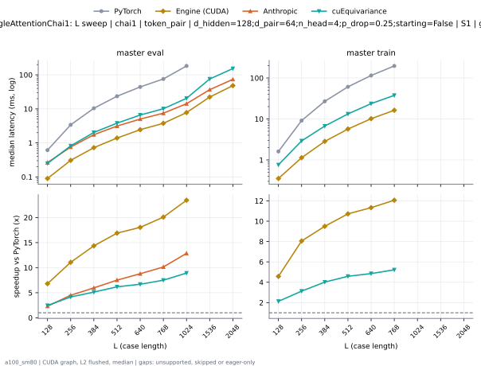
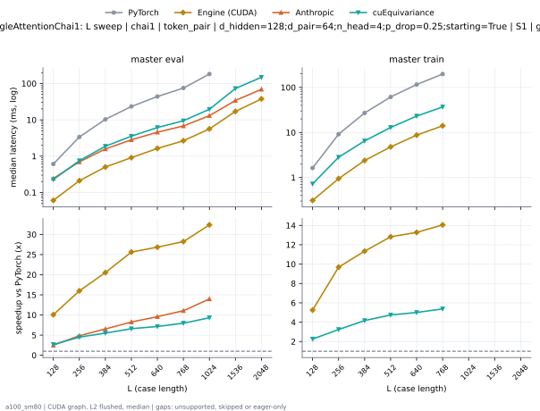

# TriangleAttentionChai1 on a100_sm80

Generated by `python -m miniworld_engine.measure.plot` from speed tokens `judge/tokens/a100_sm80/`; do not edit.

### L sweep: chai1 | token_pair | d_hidden=128;d_pair=64;n_head=4;p_drop=0.25;starting=False | S1 | graph

**master eval** (median ms; x = speedup vs PyTorch)

| L | PyTorch | Engine (Triton) | Engine (CUDA) | Anthropic | cuEquivariance |
|---|---|---|---|---|---|
| 128 | 0.6134 | 0.1905 (3.22x) | 0.09011 (6.81x) | 0.2642 (2.32x) | 0.2499 (2.45x) |
| 256 | 3.402 | 0.5949 (5.72x) | 0.3072 (11.07x) | 0.7567 (4.50x) | 0.8182 (4.16x) |
| 384 | 10.42 | 1.466 (7.11x) | 0.726 (14.36x) | 1.746 (5.97x) | 2.033 (5.13x) |
| 512 | 23.51 | 2.718 (8.65x) | 1.391 (16.90x) | 3.125 (7.52x) | 3.803 (6.18x) |
| 640 | 44.16 | 4.5 (9.81x) | 2.447 (18.05x) | 5.021 (8.80x) | 6.598 (6.69x) |
| 768 | 75.71 | 6.93 (10.92x) | 3.768 (20.09x) | 7.466 (10.14x) | 10.09 (7.50x) |
| 1024 | 182.6 | 14.01 (13.03x) | 7.78 (23.46x) | 14.19 (12.87x) | 20.44 (8.93x) |
| 1536 | skipped | 40.24 | 22.27 | 36.63 | 75.6 |
| 2048 | skipped | 88.31 | 48.25 | 73.68 | 153 |

**master train** (median ms; x = speedup vs PyTorch)

| L | PyTorch | Engine (Triton) | Engine (CUDA) | Anthropic | cuEquivariance |
|---|---|---|---|---|---|
| 128 | 1.612 | 0.6185 (2.61x) | 0.3523 (4.58x) | unsupported | 0.7588 (2.12x) |
| 256 | 9.116 | 2.218 (4.11x) | 1.132 (8.06x) | unsupported | 2.915 (3.13x) |
| 384 | 26.92 | 4.752 (5.66x) | 2.834 (9.50x) | unsupported | 6.705 (4.02x) |
| 512 | 60.8 | 9.299 (6.54x) | 5.671 (10.72x) | unsupported | 13.26 (4.59x) |
| 640 | 114.9 | 16.25 (7.07x) | 10.14 (11.33x) | unsupported | 23.67 (4.85x) |
| 768 | 196.3 | 25.98 (7.56x) | 16.28 (12.06x) | unsupported | 37.59 (5.22x) |
| 1024 |  |  |  |  |  |
| 1536 |  |  |  |  |  |
| 2048 |  |  |  |  |  |

### L sweep: chai1 | token_pair | d_hidden=128;d_pair=64;n_head=4;p_drop=0.25;starting=True | S1 | graph

**master eval** (median ms; x = speedup vs PyTorch)

| L | PyTorch | Engine (Triton) | Engine (CUDA) | Anthropic | cuEquivariance |
|---|---|---|---|---|---|
| 128 | 0.6036 | 0.1659 (3.64x) | 0.06042 (9.99x) | 0.2437 (2.48x) | 0.2273 (2.66x) |
| 256 | 3.378 | 0.5253 (6.43x) | 0.2089 (16.17x) | 0.6953 (4.86x) | 0.7485 (4.51x) |
| 384 | 10.29 | 1.286 (8.00x) | 0.4997 (20.59x) | 1.578 (6.52x) | 1.872 (5.49x) |
| 512 | 23.3 | 2.409 (9.67x) | 0.9196 (25.34x) | 2.824 (8.25x) | 3.539 (6.58x) |
| 640 | 43.82 | 4.05 (10.82x) | 1.708 (25.66x) | 4.567 (9.60x) | 6.13 (7.15x) |
| 768 | 75.3 | 6.304 (11.95x) | 2.756 (27.32x) | 6.786 (11.10x) | 9.422 (7.99x) |
| 1024 | 182.1 | 12.89 (14.13x) | 5.853 (31.12x) | 13.02 (13.99x) | 19.55 (9.32x) |
| 1536 | skipped | 37.79 | 17.65 | 34.12 | 72.87 |
| 2048 | skipped | 83.66 | 39.11 | 69.19 | 148.5 |

**master train** (median ms; x = speedup vs PyTorch)

| L | PyTorch | Engine (Triton) | Engine (CUDA) | Anthropic | cuEquivariance |
|---|---|---|---|---|---|
| 128 | 1.613 | 0.5786 (2.79x) | 0.3133 (5.15x) | unsupported | 0.7209 (2.24x) |
| 256 | 9.066 | 2.127 (4.26x) | 0.9472 (9.57x) | unsupported | 2.822 (3.21x) |
| 384 | 26.84 | 4.542 (5.91x) | 2.435 (11.02x) | unsupported | 6.496 (4.13x) |
| 512 | 60.75 | 8.969 (6.77x) | 4.905 (12.38x) | unsupported | 12.92 (4.70x) |
| 640 | 114.8 | 15.68 (7.32x) | 8.88 (12.92x) | unsupported | 23.13 (4.96x) |
| 768 | 196.2 | 25.22 (7.78x) | 14.35 (13.68x) | unsupported | 36.81 (5.33x) |
| 1024 |  |  |  |  |  |
| 1536 |  |  |  |  |  |
| 2048 |  |  |  |  |  |

### L sweep: chai1 | token_pair | d_pair=256;n_head=4;p_drop=0.25;starting=False | S1 | graph

**master eval** (median ms; x = speedup vs PyTorch)

| L | PyTorch | Engine (Triton) | Engine (CUDA) | Anthropic | cuEquivariance |
|---|---|---|---|---|---|
| 128 | 0.8991 | 0.3758 (2.39x) | 0.1874 (4.80x) | 0.4772 (1.88x) | 0.4659 (1.93x) |
| 256 | 4.625 | 1.403 (3.30x) | 0.6948 (6.66x) | 1.678 (2.76x) | 1.726 (2.68x) |
| 384 | 13.05 | 3.26 (4.00x) | 1.76 (7.42x) | 3.821 (3.42x) | 4.039 (3.23x) |
| 512 | 28.39 | 6.09 (4.66x) | 3.393 (8.37x) | 6.913 (4.11x) | 7.445 (3.81x) |
| 640 | 51.97 | 10.12 (5.13x) | 5.732 (9.07x) | 11.14 (4.67x) | 12.45 (4.18x) |
| 768 | 87.39 | 15.39 (5.68x) | 8.77 (9.97x) | 16.52 (5.29x) | 18.83 (4.64x) |
| 1024 | 197.8 | 30.57 (6.47x) | 17.57 (11.26x) | 31.16 (6.35x) | 36.48 (5.42x) |
| 1536 | skipped | 84.78 | 48.4 | 78.04 | 112.9 |
| 2048 | skipped | 179.7 | 102.1 | 154.4 | 217.6 |

**master train** (median ms; x = speedup vs PyTorch)

| L | PyTorch | Engine (Triton) | Engine (CUDA) | Anthropic | cuEquivariance |
|---|---|---|---|---|---|
| 128 | 2.372 | 1.175 (2.02x) | 0.7424 (3.20x) | unsupported | 1.379 (1.72x) |
| 256 | 11.91 | 4.46 (2.67x) | 2.711 (4.39x) | unsupported | 5.372 (2.22x) |
| 384 | 33.1 | 10.15 (3.26x) | 6.577 (5.03x) | unsupported | 12.41 (2.67x) |
| 512 | 71.88 | 19.54 (3.68x) | 13.01 (5.53x) | unsupported | 24.03 (2.99x) |
| 640 | 132.6 | 33.44 (3.96x) | 23.08 (5.74x) | unsupported | 41.15 (3.22x) |
| 768 | 222.6 | 52.36 (4.25x) | 36.19 (6.15x) | unsupported | 64.81 (3.43x) |
| 1024 |  |  |  |  |  |
| 1536 |  |  |  |  |  |
| 2048 |  |  |  |  |  |

### L sweep: chai1 | token_pair | d_pair=256;n_head=4;p_drop=0.25;starting=True | S1 | graph

**master eval** (median ms; x = speedup vs PyTorch)

| L | PyTorch | Engine (Triton) | Engine (CUDA) | Anthropic | cuEquivariance |
|---|---|---|---|---|---|
| 128 | 0.8489 | 0.3133 (2.71x) | 0.1894 (4.48x) | 0.4096 (2.07x) | 0.4014 (2.11x) |
| 256 | 4.396 | 1.104 (3.98x) | 0.6968 (6.31x) | 1.388 (3.17x) | 1.442 (3.05x) |
| 384 | 12.38 | 2.625 (4.72x) | 1.824 (6.78x) | 3.138 (3.94x) | 3.415 (3.62x) |
| 512 | 27.19 | 4.968 (5.47x) | 3.401 (8.00x) | 5.758 (4.72x) | 6.354 (4.28x) |
| 640 | 50.22 | 8.374 (6.00x) | 5.687 (8.83x) | 9.32 (5.39x) | 10.73 (4.68x) |
| 768 | 84.85 | 12.87 (6.59x) | 8.721 (9.73x) | 13.91 (6.10x) | 16.36 (5.19x) |
| 1024 | 193.2 | 26.08 (7.41x) | 17.46 (11.07x) | 26.63 (7.25x) | 32.22 (6.00x) |
| 1536 | skipped | 74.87 | 48.09 | 67.62 | 102.5 |
| 2048 | skipped | 161.5 | 101.4 | 136.3 | 199.2 |

**master train** (median ms; x = speedup vs PyTorch)

| L | PyTorch | Engine (Triton) | Engine (CUDA) | Anthropic | cuEquivariance |
|---|---|---|---|---|---|
| 128 | 2.292 | 1.081 (2.12x) | 0.6989 (3.28x) | unsupported | 1.287 (1.78x) |
| 256 | 11.53 | 4.129 (2.79x) | 2.561 (4.50x) | unsupported | 5.055 (2.28x) |
| 384 | 32.36 | 9.433 (3.43x) | 6.236 (5.19x) | unsupported | 11.73 (2.76x) |
| 512 | 70.57 | 18.18 (3.88x) | 12.5 (5.64x) | unsupported | 22.68 (3.11x) |
| 640 | 130.5 | 31.26 (4.18x) | 22.29 (5.86x) | unsupported | 39.26 (3.32x) |
| 768 | 219.9 | 49.38 (4.45x) | 35.07 (6.27x) | unsupported | 61.66 (3.57x) |
| 1024 |  |  |  |  |  |
| 1536 |  |  |  |  |  |
| 2048 |  |  |  |  |  |

