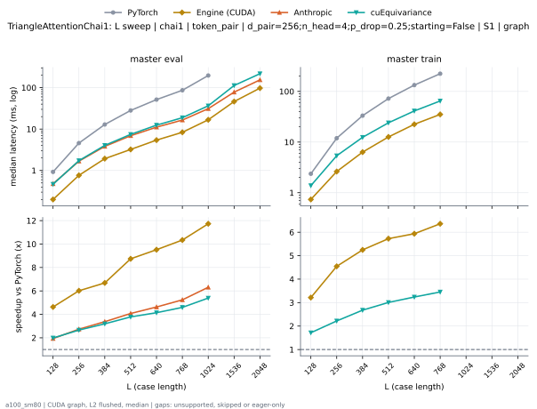
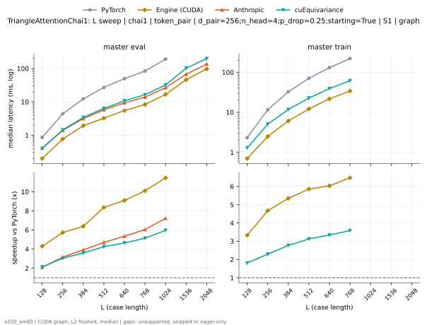

# TriangleAttentionChai1 on a100_sm80

Generated by `python -m miniworld_engine.measure.plot` from speed tokens `judge/tokens/a100_sm80/`; do not edit.

### L sweep: chai1 | token_pair | d_hidden=128;d_pair=64;n_head=4;p_drop=0.25;starting=False | S1 | graph

**master eval** (median ms; x = speedup vs PyTorch)

| L | PyTorch | Engine (Triton) | Engine (CUDA) | Anthropic | cuEquivariance |
|---|---|---|---|---|---|
| 128 | 0.62 | 0.1905 (3.26x) | 0.09011 (6.88x) | 0.2642 (2.35x) | 0.2499 (2.48x) |
| 256 | 3.439 | 0.5949 (5.78x) | 0.3215 (10.70x) | 0.7567 (4.54x) | 0.8182 (4.20x) |
| 384 | 10.48 | 1.466 (7.15x) | 0.8136 (12.88x) | 1.746 (6.00x) | 2.033 (5.15x) |
| 512 | 23.64 | 2.718 (8.70x) | 1.361 (17.37x) | 3.125 (7.56x) | 3.803 (6.22x) |
| 640 | 44.22 | 4.5 (9.83x) | 2.343 (18.88x) | 5.021 (8.81x) | 6.598 (6.70x) |
| 768 | 75.63 | 6.93 (10.91x) | 3.649 (20.73x) | 7.466 (10.13x) | 10.09 (7.50x) |
| 1024 | 182.7 | 14.01 (13.04x) | 7.485 (24.41x) | 14.19 (12.88x) | 20.44 (8.94x) |
| 1536 | skipped | 40.24 | 21.44 | 36.63 | 75.6 |
| 2048 | skipped | 88.31 | 46.34 | 73.68 | 153 |

**master train** (median ms; x = speedup vs PyTorch)

| L | PyTorch | Engine (Triton) | Engine (CUDA) | Anthropic | cuEquivariance |
|---|---|---|---|---|---|
| 128 | 1.656 | 0.6185 (2.68x) | 0.3543 (4.67x) | unsupported | 0.7588 (2.18x) |
| 256 | 9.249 | 2.218 (4.17x) | 1.128 (8.20x) | unsupported | 2.915 (3.17x) |
| 384 | 27.29 | 4.752 (5.74x) | 2.825 (9.66x) | unsupported | 6.705 (4.07x) |
| 512 | 61.66 | 9.299 (6.63x) | 5.565 (11.08x) | unsupported | 13.26 (4.65x) |
| 640 | 116.3 | 16.25 (7.16x) | 9.95 (11.69x) | unsupported | 23.67 (4.91x) |
| 768 | 198.6 | 25.98 (7.64x) | 15.93 (12.47x) | unsupported | 37.59 (5.28x) |
| 1024 |  |  |  |  |  |
| 1536 |  |  |  |  |  |
| 2048 |  |  |  |  |  |

### L sweep: chai1 | token_pair | d_hidden=128;d_pair=64;n_head=4;p_drop=0.25;starting=True | S1 | graph

**master eval** (median ms; x = speedup vs PyTorch)

| L | PyTorch | Engine (Triton) | Engine (CUDA) | Anthropic | cuEquivariance |
|---|---|---|---|---|---|
| 128 | 0.6083 | 0.1659 (3.67x) | 0.06042 (10.07x) | 0.2437 (2.50x) | 0.2273 (2.68x) |
| 256 | 3.372 | 0.5253 (6.42x) | 0.2109 (15.99x) | 0.6953 (4.85x) | 0.7485 (4.50x) |
| 384 | 10.31 | 1.286 (8.01x) | 0.5023 (20.52x) | 1.578 (6.53x) | 1.872 (5.50x) |
| 512 | 23.33 | 2.409 (9.68x) | 0.9103 (25.63x) | 2.824 (8.26x) | 3.539 (6.59x) |
| 640 | 43.77 | 4.05 (10.81x) | 1.631 (26.84x) | 4.567 (9.58x) | 6.13 (7.14x) |
| 768 | 75.01 | 6.304 (11.90x) | 2.658 (28.22x) | 6.786 (11.05x) | 9.422 (7.96x) |
| 1024 | 182 | 12.89 (14.11x) | 5.62 (32.38x) | 13.02 (13.98x) | 19.55 (9.31x) |
| 1536 | skipped | 37.79 | 17.05 | 34.12 | 72.87 |
| 2048 | skipped | 83.66 | 37.61 | 69.19 | 148.5 |

**master train** (median ms; x = speedup vs PyTorch)

| L | PyTorch | Engine (Triton) | Engine (CUDA) | Anthropic | cuEquivariance |
|---|---|---|---|---|---|
| 128 | 1.629 | 0.5786 (2.82x) | 0.3103 (5.25x) | unsupported | 0.7209 (2.26x) |
| 256 | 9.156 | 2.127 (4.31x) | 0.9452 (9.69x) | unsupported | 2.822 (3.24x) |
| 384 | 27.09 | 4.542 (5.96x) | 2.389 (11.34x) | unsupported | 6.496 (4.17x) |
| 512 | 61.32 | 8.969 (6.84x) | 4.781 (12.83x) | unsupported | 12.92 (4.75x) |
| 640 | 115.7 | 15.68 (7.38x) | 8.715 (13.28x) | unsupported | 23.13 (5.00x) |
| 768 | 197.8 | 25.22 (7.84x) | 14.07 (14.06x) | unsupported | 36.81 (5.37x) |
| 1024 |  |  |  |  |  |
| 1536 |  |  |  |  |  |
| 2048 |  |  |  |  |  |

### L sweep: chai1 | token_pair | d_pair=256;n_head=4;p_drop=0.25;starting=False | S1 | graph

**master eval** (median ms; x = speedup vs PyTorch)

| L | PyTorch | Engine (Triton) | Engine (CUDA) | Anthropic | cuEquivariance |
|---|---|---|---|---|---|
| 128 | 0.9247 | 0.3758 (2.46x) | 0.1997 (4.63x) | 0.4772 (1.94x) | 0.4659 (1.98x) |
| 256 | 4.591 | 1.403 (3.27x) | 0.7634 (6.01x) | 1.678 (2.74x) | 1.726 (2.66x) |
| 384 | 12.9 | 3.26 (3.96x) | 1.931 (6.68x) | 3.821 (3.38x) | 4.039 (3.19x) |
| 512 | 28.17 | 6.09 (4.62x) | 3.223 (8.74x) | 6.913 (4.07x) | 7.445 (3.78x) |
| 640 | 51.54 | 10.12 (5.09x) | 5.415 (9.52x) | 11.14 (4.63x) | 12.45 (4.14x) |
| 768 | 86.54 | 15.39 (5.62x) | 8.368 (10.34x) | 16.52 (5.24x) | 18.83 (4.60x) |
| 1024 | 196.7 | 30.57 (6.43x) | 16.77 (11.73x) | 31.16 (6.31x) | 36.48 (5.39x) |
| 1536 | skipped | 84.78 | 46.24 | 78.04 | 112.9 |
| 2048 | skipped | 179.7 | 97.56 | 154.4 | 217.6 |

**master train** (median ms; x = speedup vs PyTorch)

| L | PyTorch | Engine (Triton) | Engine (CUDA) | Anthropic | cuEquivariance |
|---|---|---|---|---|---|
| 128 | 2.366 | 1.175 (2.01x) | 0.7363 (3.21x) | unsupported | 1.379 (1.72x) |
| 256 | 11.92 | 4.46 (2.67x) | 2.621 (4.55x) | unsupported | 5.372 (2.22x) |
| 384 | 33.23 | 10.15 (3.27x) | 6.333 (5.25x) | unsupported | 12.41 (2.68x) |
| 512 | 72.25 | 19.54 (3.70x) | 12.62 (5.73x) | unsupported | 24.03 (3.01x) |
| 640 | 133.2 | 33.44 (3.98x) | 22.45 (5.94x) | unsupported | 41.15 (3.24x) |
| 768 | 223.8 | 52.36 (4.27x) | 35.18 (6.36x) | unsupported | 64.81 (3.45x) |
| 1024 |  |  |  |  |  |
| 1536 |  |  |  |  |  |
| 2048 |  |  |  |  |  |

### L sweep: chai1 | token_pair | d_pair=256;n_head=4;p_drop=0.25;starting=True | S1 | graph

**master eval** (median ms; x = speedup vs PyTorch)

| L | PyTorch | Engine (Triton) | Engine (CUDA) | Anthropic | cuEquivariance |
|---|---|---|---|---|---|
| 128 | 0.8591 | 0.3133 (2.74x) | 0.1997 (4.30x) | 0.4096 (2.10x) | 0.4014 (2.14x) |
| 256 | 4.387 | 1.104 (3.97x) | 0.766 (5.73x) | 1.388 (3.16x) | 1.442 (3.04x) |
| 384 | 12.28 | 2.625 (4.68x) | 1.923 (6.39x) | 3.138 (3.91x) | 3.415 (3.60x) |
| 512 | 27.03 | 4.968 (5.44x) | 3.235 (8.36x) | 5.758 (4.70x) | 6.354 (4.25x) |
| 640 | 49.87 | 8.374 (5.95x) | 5.482 (9.10x) | 9.32 (5.35x) | 10.73 (4.65x) |
| 768 | 84.07 | 12.87 (6.53x) | 8.324 (10.10x) | 13.91 (6.04x) | 16.36 (5.14x) |
| 1024 | 192.2 | 26.08 (7.37x) | 16.77 (11.46x) | 26.63 (7.22x) | 32.22 (5.97x) |
| 1536 | skipped | 74.87 | 46.3 | 67.62 | 102.5 |
| 2048 | skipped | 161.5 | 97.42 | 136.3 | 199.2 |

**master train** (median ms; x = speedup vs PyTorch)

| L | PyTorch | Engine (Triton) | Engine (CUDA) | Anthropic | cuEquivariance |
|---|---|---|---|---|---|
| 128 | 2.323 | 1.081 (2.15x) | 0.6984 (3.33x) | unsupported | 1.287 (1.81x) |
| 256 | 11.59 | 4.129 (2.81x) | 2.479 (4.67x) | unsupported | 5.055 (2.29x) |
| 384 | 32.5 | 9.433 (3.44x) | 6.071 (5.35x) | unsupported | 11.73 (2.77x) |
| 512 | 70.93 | 18.18 (3.90x) | 12.11 (5.86x) | unsupported | 22.68 (3.13x) |
| 640 | 131.2 | 31.26 (4.20x) | 21.73 (6.04x) | unsupported | 39.26 (3.34x) |
| 768 | 220.9 | 49.38 (4.47x) | 34.11 (6.48x) | unsupported | 61.66 (3.58x) |
| 1024 |  |  |  |  |  |
| 1536 |  |  |  |  |  |
| 2048 |  |  |  |  |  |

