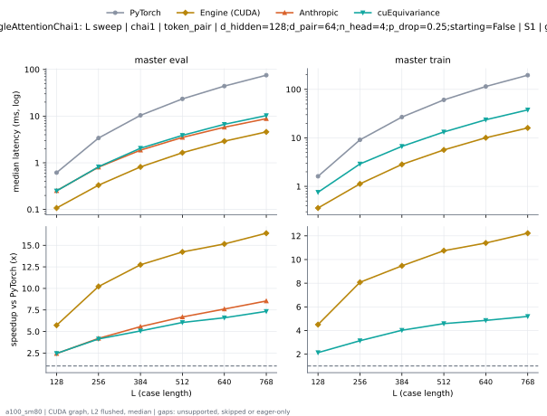
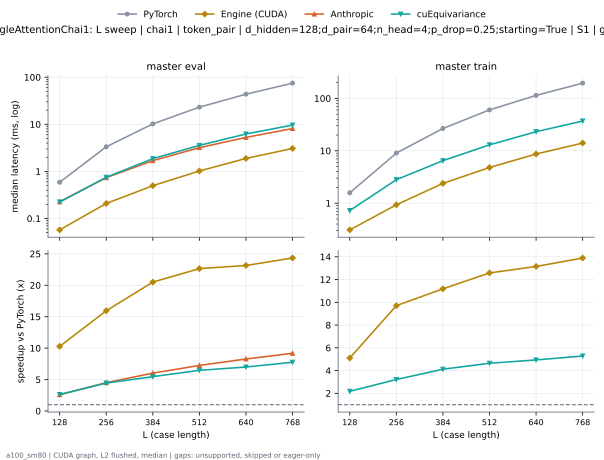
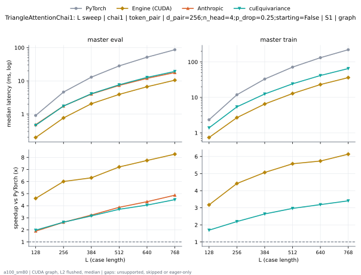
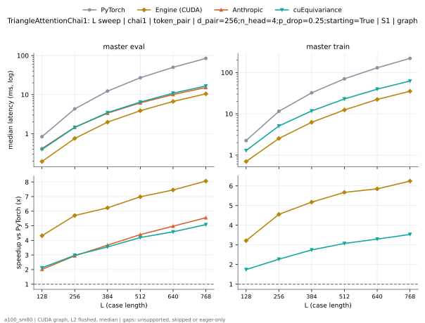

# TriangleAttentionChai1 on a100_sm80

Generated by `python -m miniworld_engine.measure.plot` from speed tokens `judge/tokens/a100_sm80/`; do not edit.

### L sweep: chai1 | token_pair | d_hidden=128;d_pair=64;n_head=4;p_drop=0.25;starting=False | S1 | graph

**master eval** (median ms; x = speedup vs PyTorch)

| L | PyTorch | Engine (Triton) | Engine (CUDA) | Anthropic | cuEquivariance |
|---|---|---|---|---|---|
| 128 | 0.6144 | 0.1905 (3.23x) | 0.08806 (6.98x) | 0.2519 (2.44x) | 0.2499 (2.46x) |
| 256 | 3.39 | 0.5949 (5.70x) | 0.3154 (10.75x) | 0.8069 (4.20x) | 0.8202 (4.13x) |
| 384 | 10.33 | 1.469 (7.03x) | 0.8044 (12.85x) | 1.868 (5.53x) | 2.051 (5.04x) |
| 512 | 23.29 | 2.747 (8.48x) | 1.613 (14.44x) | 3.498 (6.66x) | 3.869 (6.02x) |
| 640 | 43.73 | 4.589 (9.53x) | 2.863 (15.27x) | 5.786 (7.56x) | 6.672 (6.55x) |
| 768 | 75.05 | 7.031 (10.68x) | 4.559 (16.46x) | 8.82 (8.51x) | 10.26 (7.31x) |

**master train** (median ms; x = speedup vs PyTorch)

| L | PyTorch | Engine (Triton) | Engine (CUDA) | Anthropic | cuEquivariance |
|---|---|---|---|---|---|
| 128 | 1.612 | 0.6164 (2.61x) | 0.3523 (4.58x) | unsupported | 0.7567 (2.13x) |
| 256 | 9.113 | 2.223 (4.10x) | 1.12 (8.14x) | unsupported | 2.902 (3.14x) |
| 384 | 26.74 | 4.679 (5.72x) | 2.809 (9.52x) | unsupported | 6.679 (4.00x) |
| 512 | 60.43 | 9.173 (6.59x) | 5.567 (10.86x) | unsupported | 13.24 (4.57x) |
| 640 | 114.2 | 16.12 (7.08x) | 9.956 (11.47x) | unsupported | 23.61 (4.84x) |
| 768 | 195.3 | 25.96 (7.52x) | 15.84 (12.33x) | unsupported | 37.71 (5.18x) |

### L sweep: chai1 | token_pair | d_hidden=128;d_pair=64;n_head=4;p_drop=0.25;starting=True | S1 | graph

**master eval** (median ms; x = speedup vs PyTorch)

| L | PyTorch | Engine (Triton) | Engine (CUDA) | Anthropic | cuEquivariance |
|---|---|---|---|---|---|
| 128 | 0.5898 | 0.1649 (3.58x) | 0.05734 (10.29x) | 0.2273 (2.59x) | 0.2243 (2.63x) |
| 256 | 3.332 | 0.5243 (6.36x) | 0.2089 (15.95x) | 0.7383 (4.51x) | 0.7496 (4.45x) |
| 384 | 10.22 | 1.293 (7.90x) | 0.4982 (20.51x) | 1.695 (6.03x) | 1.869 (5.47x) |
| 512 | 23.15 | 2.484 (9.32x) | 1.022 (22.65x) | 3.193 (7.25x) | 3.575 (6.47x) |
| 640 | 43.65 | 4.168 (10.47x) | 1.886 (23.15x) | 5.274 (8.28x) | 6.238 (7.00x) |
| 768 | 74.85 | 6.423 (11.65x) | 3.075 (24.34x) | 8.144 (9.19x) | 9.643 (7.76x) |

**master train** (median ms; x = speedup vs PyTorch)

| L | PyTorch | Engine (Triton) | Engine (CUDA) | Anthropic | cuEquivariance |
|---|---|---|---|---|---|
| 128 | 1.579 | 0.5786 (2.73x) | 0.3092 (5.11x) | unsupported | 0.724 (2.18x) |
| 256 | 9.04 | 2.13 (4.24x) | 0.9313 (9.71x) | unsupported | 2.811 (3.22x) |
| 384 | 26.7 | 4.532 (5.89x) | 2.387 (11.19x) | unsupported | 6.477 (4.12x) |
| 512 | 60.38 | 8.954 (6.74x) | 4.799 (12.58x) | unsupported | 13 (4.64x) |
| 640 | 114.2 | 15.74 (7.25x) | 8.683 (13.15x) | unsupported | 23.13 (4.94x) |
| 768 | 195.4 | 25.43 (7.68x) | 14.06 (13.89x) | unsupported | 36.98 (5.28x) |

### L sweep: chai1 | token_pair | d_pair=256;n_head=4;p_drop=0.25;starting=False | S1 | graph

**master eval** (median ms; x = speedup vs PyTorch)

| L | PyTorch | Engine (Triton) | Engine (CUDA) | Anthropic | cuEquivariance |
|---|---|---|---|---|---|
| 128 | 0.9103 | 0.3758 (2.42x) | 0.1976 (4.61x) | 0.4803 (1.90x) | 0.4608 (1.98x) |
| 256 | 4.606 | 1.417 (3.25x) | 0.767 (6.01x) | 1.752 (2.63x) | 1.747 (2.64x) |
| 384 | 12.96 | 3.354 (3.86x) | 2.053 (6.31x) | 4.017 (3.22x) | 4.104 (3.16x) |
| 512 | 28.27 | 6.269 (4.51x) | 3.921 (7.21x) | 7.31 (3.87x) | 7.632 (3.70x) |
| 640 | 51.63 | 10.47 (4.93x) | 6.667 (7.74x) | 11.92 (4.33x) | 12.74 (4.05x) |
| 768 | 86.81 | 15.87 (5.47x) | 10.5 (8.27x) | 17.82 (4.87x) | 19.28 (4.50x) |

**master train** (median ms; x = speedup vs PyTorch)

| L | PyTorch | Engine (Triton) | Engine (CUDA) | Anthropic | cuEquivariance |
|---|---|---|---|---|---|
| 128 | 2.335 | 1.175 (1.99x) | 0.7363 (3.17x) | unsupported | 1.381 (1.69x) |
| 256 | 11.86 | 4.488 (2.64x) | 2.682 (4.42x) | unsupported | 5.405 (2.19x) |
| 384 | 32.99 | 10.27 (3.21x) | 6.511 (5.07x) | unsupported | 12.5 (2.64x) |
| 512 | 71.73 | 19.77 (3.63x) | 12.86 (5.58x) | unsupported | 24.2 (2.96x) |
| 640 | 132.3 | 33.85 (3.91x) | 23.07 (5.74x) | unsupported | 41.53 (3.19x) |
| 768 | 222.3 | 53.19 (4.18x) | 36.22 (6.14x) | unsupported | 65.25 (3.41x) |

### L sweep: chai1 | token_pair | d_pair=256;n_head=4;p_drop=0.25;starting=True | S1 | graph

**master eval** (median ms; x = speedup vs PyTorch)

| L | PyTorch | Engine (Triton) | Engine (CUDA) | Anthropic | cuEquivariance |
|---|---|---|---|---|---|
| 128 | 0.8407 | 0.3072 (2.74x) | 0.1946 (4.32x) | 0.4178 (2.01x) | 0.3958 (2.12x) |
| 256 | 4.316 | 1.111 (3.88x) | 0.7567 (5.70x) | 1.466 (2.94x) | 1.449 (2.98x) |
| 384 | 12.32 | 2.694 (4.57x) | 1.977 (6.23x) | 3.354 (3.67x) | 3.468 (3.55x) |
| 512 | 27.07 | 5.112 (5.30x) | 3.875 (6.99x) | 6.157 (4.40x) | 6.451 (4.20x) |
| 640 | 49.92 | 8.649 (5.77x) | 6.697 (7.45x) | 10.04 (4.97x) | 10.89 (4.58x) |
| 768 | 84.6 | 13.4 (6.31x) | 10.49 (8.06x) | 15.24 (5.55x) | 16.66 (5.08x) |

**master train** (median ms; x = speedup vs PyTorch)

| L | PyTorch | Engine (Triton) | Engine (CUDA) | Anthropic | cuEquivariance |
|---|---|---|---|---|---|
| 128 | 2.248 | 1.082 (2.08x) | 0.6994 (3.21x) | unsupported | 1.289 (1.74x) |
| 256 | 11.51 | 4.148 (2.78x) | 2.529 (4.55x) | unsupported | 5.072 (2.27x) |
| 384 | 32.24 | 9.505 (3.39x) | 6.231 (5.17x) | unsupported | 11.75 (2.74x) |
| 512 | 70.41 | 18.4 (3.83x) | 12.41 (5.67x) | unsupported | 22.91 (3.07x) |
| 640 | 130.4 | 31.89 (4.09x) | 22.3 (5.85x) | unsupported | 39.59 (3.29x) |
| 768 | 220.1 | 50.46 (4.36x) | 35.25 (6.24x) | unsupported | 62.32 (3.53x) |

