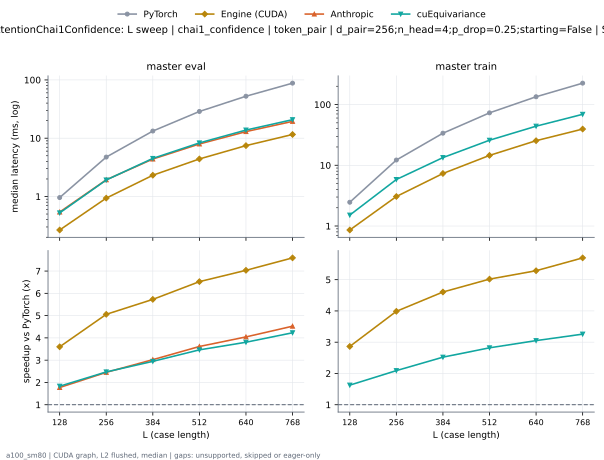
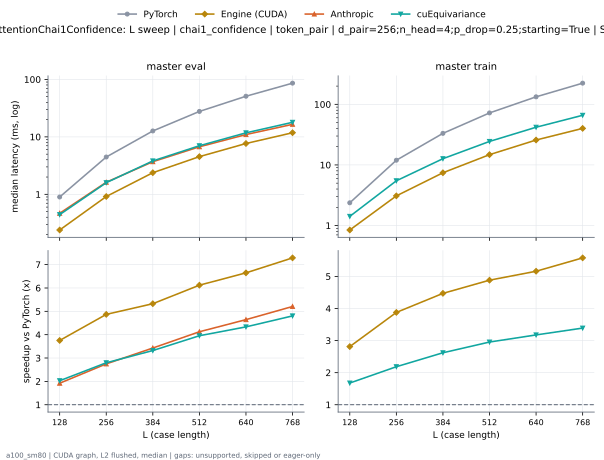

# TriangleAttentionChai1Confidence on a100_sm80

Generated by `python -m miniworld_engine.measure.plot` from speed tokens `judge/tokens/a100_sm80/`; do not edit.

### L sweep: chai1_confidence | token_pair | d_pair=256;n_head=4;p_drop=0.25;starting=False | S1 | graph

**master eval** (median ms; x = speedup vs PyTorch)

| L | PyTorch | Engine (Triton) | Engine (CUDA) | Anthropic | cuEquivariance |
|---|---|---|---|---|---|
| 128 | 0.9585 | 0.4372 (2.19x) | 0.2662 (3.60x) | 0.5407 (1.77x) | 0.5233 (1.83x) |
| 256 | 4.744 | 1.599 (2.97x) | 0.938 (5.06x) | 1.934 (2.45x) | 1.919 (2.47x) |
| 384 | 13.27 | 3.725 (3.56x) | 2.316 (5.73x) | 4.389 (3.02x) | 4.503 (2.95x) |
| 512 | 28.76 | 6.963 (4.13x) | 4.407 (6.53x) | 7.956 (3.61x) | 8.304 (3.46x) |
| 640 | 52.49 | 11.55 (4.54x) | 7.462 (7.03x) | 12.98 (4.04x) | 13.8 (3.80x) |
| 768 | 87.98 | 17.58 (5.00x) | 11.59 (7.59x) | 19.44 (4.53x) | 20.79 (4.23x) |

**master train** (median ms; x = speedup vs PyTorch)

| L | PyTorch | Engine (Triton) | Engine (CUDA) | Anthropic | cuEquivariance |
|---|---|---|---|---|---|
| 128 | 2.464 | 1.309 (1.88x) | 0.8602 (2.86x) | unsupported | 1.514 (1.63x) |
| 256 | 12.21 | 4.898 (2.49x) | 3.061 (3.99x) | unsupported | 5.836 (2.09x) |
| 384 | 33.74 | 11.11 (3.04x) | 7.327 (4.61x) | unsupported | 13.38 (2.52x) |
| 512 | 72.96 | 21.33 (3.42x) | 14.54 (5.02x) | unsupported | 25.87 (2.82x) |
| 640 | 134.3 | 36.34 (3.70x) | 25.4 (5.29x) | unsupported | 44.02 (3.05x) |
| 768 | 224.9 | 56.84 (3.96x) | 39.48 (5.70x) | unsupported | 69.04 (3.26x) |

### L sweep: chai1_confidence | token_pair | d_pair=256;n_head=4;p_drop=0.25;starting=True | S1 | graph

**master eval** (median ms; x = speedup vs PyTorch)

| L | PyTorch | Engine (Triton) | Engine (CUDA) | Anthropic | cuEquivariance |
|---|---|---|---|---|---|
| 128 | 0.895 | 0.3584 (2.50x) | 0.258 (3.47x) | 0.468 (1.91x) | 0.4434 (2.02x) |
| 256 | 4.445 | 1.264 (3.52x) | 0.9144 (4.86x) | 1.623 (2.74x) | 1.595 (2.79x) |
| 384 | 12.59 | 3.06 (4.11x) | 2.306 (5.46x) | 3.699 (3.40x) | 3.819 (3.30x) |
| 512 | 27.54 | 5.756 (4.78x) | 4.399 (6.26x) | 6.723 (4.10x) | 7.013 (3.93x) |
| 640 | 50.53 | 9.656 (5.23x) | 7.54 (6.70x) | 10.98 (4.60x) | 11.76 (4.30x) |
| 768 | 85.17 | 14.78 (5.76x) | 11.53 (7.39x) | 16.53 (5.15x) | 17.92 (4.75x) |

**master train** (median ms; x = speedup vs PyTorch)

| L | PyTorch | Engine (Triton) | Engine (CUDA) | Anthropic | cuEquivariance |
|---|---|---|---|---|---|
| 128 | 2.371 | 1.205 (1.97x) | 0.8407 (2.82x) | unsupported | 1.415 (1.68x) |
| 256 | 11.89 | 4.563 (2.60x) | 3.052 (3.89x) | unsupported | 5.476 (2.17x) |
| 384 | 33.01 | 10.42 (3.17x) | 7.284 (4.53x) | unsupported | 12.68 (2.60x) |
| 512 | 71.67 | 19.96 (3.59x) | 14.54 (4.93x) | unsupported | 24.42 (2.93x) |
| 640 | 132.2 | 34.41 (3.84x) | 25.27 (5.23x) | unsupported | 41.89 (3.15x) |
| 768 | 221.9 | 53.86 (4.12x) | 39.1 (5.68x) | unsupported | 66 (3.36x) |

