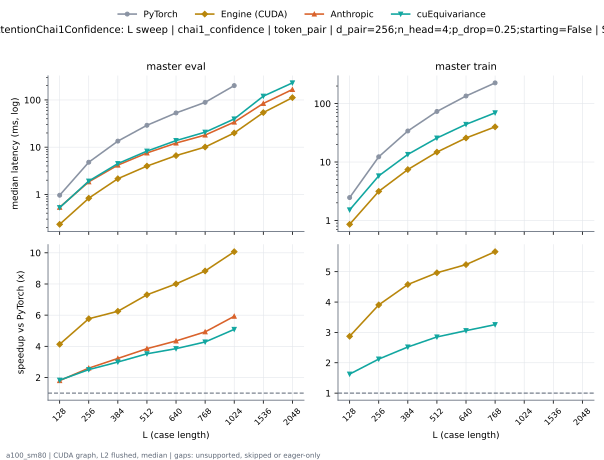
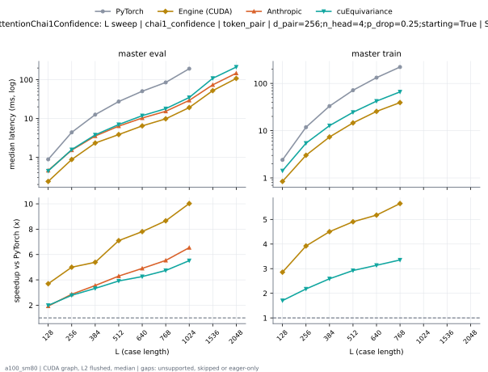

# TriangleAttentionChai1Confidence on a100_sm80

Generated by `python -m miniworld_engine.measure.plot` from speed tokens `judge/tokens/a100_sm80/`; do not edit.

### L sweep: chai1_confidence | token_pair | d_pair=256;n_head=4;p_drop=0.25;starting=False | S1 | graph

**master eval** (median ms; x = speedup vs PyTorch)

| L | PyTorch | Engine (Triton) | Engine (CUDA) | Anthropic | cuEquivariance |
|---|---|---|---|---|---|
| 128 | 0.9605 | 0.4372 (2.20x) | 0.2406 (3.99x) | 0.5335 (1.80x) | 0.5243 (1.83x) |
| 256 | 4.716 | 1.573 (3.00x) | 0.8914 (5.29x) | 1.845 (2.56x) | 1.915 (2.46x) |
| 384 | 13.26 | 3.726 (3.56x) | 2.291 (5.79x) | 4.169 (3.18x) | 4.489 (2.95x) |
| 512 | 28.66 | 6.861 (4.18x) | 3.834 (7.47x) | 7.546 (3.80x) | 8.252 (3.47x) |
| 640 | 52.43 | 11.44 (4.58x) | 6.513 (8.05x) | 12.22 (4.29x) | 13.78 (3.80x) |
| 768 | 87.88 | 17.3 (5.08x) | 9.891 (8.89x) | 18.06 (4.87x) | 20.78 (4.23x) |
| 1024 | 196.9 | 33.49 (5.88x) | 19.15 (10.28x) | 33.97 (5.80x) | 39.57 (4.98x) |
| 1536 | skipped | 92.57 | 52.25 | 84.4 | 120.3 |
| 2048 | skipped | 192 | 106.8 | 166.4 | 229.8 |

**master train** (median ms; x = speedup vs PyTorch)

| L | PyTorch | Engine (Triton) | Engine (CUDA) | Anthropic | cuEquivariance |
|---|---|---|---|---|---|
| 128 | 2.463 | 1.311 (1.88x) | 0.8561 (2.88x) | unsupported | 1.514 (1.63x) |
| 256 | 12.21 | 4.86 (2.51x) | 3.06 (3.99x) | unsupported | 5.792 (2.11x) |
| 384 | 33.89 | 11.15 (3.04x) | 7.352 (4.61x) | unsupported | 13.5 (2.51x) |
| 512 | 72.92 | 21.21 (3.44x) | 14.59 (5.00x) | unsupported | 25.77 (2.83x) |
| 640 | 134.4 | 36.26 (3.71x) | 25.58 (5.26x) | unsupported | 44.19 (3.04x) |
| 768 | 225.5 | 56.72 (3.98x) | 39.92 (5.65x) | unsupported | 69.59 (3.24x) |
| 1024 |  |  |  |  |  |
| 1536 |  |  |  |  |  |
| 2048 |  |  |  |  |  |

### L sweep: chai1_confidence | token_pair | d_pair=256;n_head=4;p_drop=0.25;starting=True | S1 | graph

**master eval** (median ms; x = speedup vs PyTorch)

| L | PyTorch | Engine (Triton) | Engine (CUDA) | Anthropic | cuEquivariance |
|---|---|---|---|---|---|
| 128 | 0.8858 | 0.3553 (2.49x) | 0.2396 (3.70x) | 0.4588 (1.93x) | 0.4454 (1.99x) |
| 256 | 4.398 | 1.249 (3.52x) | 0.8796 (5.00x) | 1.534 (2.87x) | 1.58 (2.78x) |
| 384 | 12.59 | 3.012 (4.18x) | 2.337 (5.39x) | 3.542 (3.56x) | 3.783 (3.33x) |
| 512 | 27.41 | 5.591 (4.90x) | 3.862 (7.10x) | 6.374 (4.30x) | 7.001 (3.92x) |
| 640 | 50.5 | 9.468 (5.33x) | 6.468 (7.81x) | 10.3 (4.90x) | 11.85 (4.26x) |
| 768 | 85.08 | 14.46 (5.88x) | 9.825 (8.66x) | 15.37 (5.54x) | 17.94 (4.74x) |
| 1024 | 192.2 | 28.55 (6.73x) | 19.18 (10.02x) | 29.38 (6.54x) | 34.83 (5.52x) |
| 1536 | skipped | 81.19 | 52.26 | 73.74 | 108.7 |
| 2048 | skipped | 173.9 | 107.9 | 147.2 | 212.2 |

**master train** (median ms; x = speedup vs PyTorch)

| L | PyTorch | Engine (Triton) | Engine (CUDA) | Anthropic | cuEquivariance |
|---|---|---|---|---|---|
| 128 | 2.413 | 1.207 (2.00x) | 0.8443 (2.86x) | unsupported | 1.416 (1.70x) |
| 256 | 11.84 | 4.512 (2.62x) | 3.019 (3.92x) | unsupported | 5.438 (2.18x) |
| 384 | 33.1 | 10.39 (3.19x) | 7.35 (4.50x) | unsupported | 12.78 (2.59x) |
| 512 | 71.69 | 19.83 (3.62x) | 14.62 (4.91x) | unsupported | 24.51 (2.93x) |
| 640 | 132.5 | 34.2 (3.87x) | 25.6 (5.18x) | unsupported | 42.23 (3.14x) |
| 768 | 222.2 | 53.29 (4.17x) | 39.36 (5.65x) | unsupported | 66.25 (3.35x) |
| 1024 |  |  |  |  |  |
| 1536 |  |  |  |  |  |
| 2048 |  |  |  |  |  |

