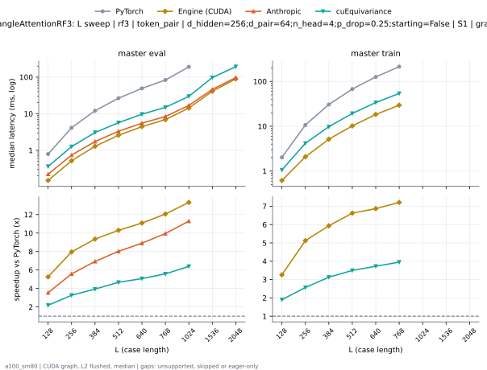

# TriangleAttentionRF3 on a100_sm80

Generated by `python -m foldjet_engine.measure.plot` from speed tokens `judge/tokens/a100_sm80/`; do not edit.

### L sweep: rf3 | token_pair | d_hidden=256;d_pair=64;n_head=4;p_drop=0.25;starting=False | S1 | graph

**master eval** (median ms; x = speedup vs PyTorch)

| L | PyTorch | Engine (Triton) | Engine (CUDA) | Anthropic | cuEquivariance |
|---|---|---|---|---|---|
| 128 | 0.7916 | 0.2744 (2.88x) | 0.1505 (5.26x) | 0.2232 (3.55x) | 0.3635 (2.18x) |
| 256 | 4.132 | 0.939 (4.40x) | 0.5192 (7.96x) | 0.7404 (5.58x) | 1.263 (3.27x) |
| 384 | 12.05 | 2.301 (5.23x) | 1.288 (9.35x) | 1.739 (6.93x) | 3.063 (3.93x) |
| 512 | 26.56 | 4.37 (6.08x) | 2.578 (10.30x) | 3.31 (8.02x) | 5.691 (4.67x) |
| 640 | 49.23 | 7.405 (6.65x) | 4.442 (11.08x) | 5.527 (8.91x) | 9.708 (5.07x) |
| 768 | 83.23 | 11.5 (7.24x) | 6.9 (12.06x) | 8.365 (9.95x) | 14.91 (5.58x) |
| 1024 | 190.4 | 23.61 (8.07x) | 14.3 (13.32x) | 16.86 (11.29x) | 29.79 (6.39x) |
| 1536 | skipped | 69.46 | 41.1 | 46.05 | 97.08 |
| 2048 | skipped | 152.1 | 89.24 | 97.08 | 192.7 |

**master train** (median ms; x = speedup vs PyTorch)

| L | PyTorch | Engine (Triton) | Engine (CUDA) | Anthropic | cuEquivariance |
|---|---|---|---|---|---|
| 128 | 2.019 | 0.8581 (2.35x) | 0.6195 (3.26x) | unsupported | 1.062 (1.90x) |
| 256 | 10.69 | 3.23 (3.31x) | 2.086 (5.12x) | unsupported | 4.164 (2.57x) |
| 384 | 30.53 | 7.481 (4.08x) | 5.146 (5.93x) | unsupported | 9.761 (3.13x) |
| 512 | 67.44 | 14.75 (4.57x) | 10.18 (6.62x) | unsupported | 19.29 (3.50x) |
| 640 | 125.8 | 26 (4.84x) | 18.31 (6.87x) | unsupported | 33.75 (3.73x) |
| 768 | 212.9 | 41.47 (5.13x) | 29.53 (7.21x) | unsupported | 53.88 (3.95x) |
| 1024 |  |  |  |  |  |
| 1536 |  |  |  |  |  |
| 2048 |  |  |  |  |  |

### L sweep: rf3 | token_pair | d_hidden=256;d_pair=64;n_head=4;p_drop=0.25;starting=True | S1 | graph

**master eval** (median ms; x = speedup vs PyTorch)

| L | PyTorch | Engine (Triton) | Engine (CUDA) | Anthropic | cuEquivariance |
|---|---|---|---|---|---|
| 128 | 0.768 | 0.2319 (3.31x) | 0.151 (5.08x) | 0.2232 (3.44x) | 0.3195 (2.40x) |
| 256 | 4.053 | 0.7844 (5.17x) | 0.5156 (7.86x) | 0.7424 (5.46x) | 1.115 (3.63x) |
| 384 | 11.73 | 1.953 (6.00x) | 1.274 (9.20x) | 1.747 (6.71x) | 2.722 (4.31x) |
| 512 | 26.11 | 3.789 (6.89x) | 2.582 (10.11x) | 3.301 (7.91x) | 5.159 (5.06x) |
| 640 | 48.47 | 6.472 (7.49x) | 4.462 (10.86x) | 5.533 (8.76x) | 8.866 (5.47x) |
| 768 | 82.17 | 10.18 (8.07x) | 6.939 (11.84x) | 8.403 (9.78x) | 13.66 (6.02x) |
| 1024 | 188.6 | 21.29 (8.86x) | 14.36 (13.13x) | 16.93 (11.14x) | 27.61 (6.83x) |
| 1536 | skipped | 64.16 | 41.02 | 46.11 | 92.14 |
| 2048 | skipped | 143 | 89.02 | 97.47 | 183.6 |

**master train** (median ms; x = speedup vs PyTorch)

| L | PyTorch | Engine (Triton) | Engine (CUDA) | Anthropic | cuEquivariance |
|---|---|---|---|---|---|
| 128 | 2.006 | 0.7992 (2.51x) | 0.6124 (3.28x) | unsupported | 1.007 (1.99x) |
| 256 | 10.55 | 3.046 (3.46x) | 2.082 (5.06x) | unsupported | 3.993 (2.64x) |
| 384 | 30.18 | 7.039 (4.29x) | 5.171 (5.84x) | unsupported | 9.339 (3.23x) |
| 512 | 66.94 | 13.98 (4.79x) | 10.24 (6.54x) | unsupported | 18.48 (3.62x) |
| 640 | 125 | 24.82 (5.04x) | 18.46 (6.77x) | unsupported | 32.61 (3.83x) |
| 768 | 212 | 39.79 (5.33x) | 29.61 (7.16x) | unsupported | 52.21 (4.06x) |
| 1024 |  |  |  |  |  |
| 1536 |  |  |  |  |  |
| 2048 |  |  |  |  |  |

### L sweep: rf3 | token_pair | d_pair=128;n_head=4;p_drop=0.25;starting=False | S1 | graph

**master eval** (median ms; x = speedup vs PyTorch)

| L | PyTorch | Engine (Triton) | Engine (CUDA) | Anthropic | cuEquivariance |
|---|---|---|---|---|---|
| 128 | 0.6651 | 0.2427 (2.74x) | 0.1106 (6.01x) | 0.1853 (3.59x) | 0.3011 (2.21x) |
| 256 | 3.683 | 0.8468 (4.35x) | 0.3932 (9.37x) | 0.5125 (7.19x) | 1.078 (3.42x) |
| 384 | 11.02 | 1.989 (5.54x) | 0.9062 (12.16x) | 1.143 (9.64x) | 2.575 (4.28x) |
| 512 | 24.53 | 3.715 (6.60x) | 1.778 (13.80x) | 2.119 (11.58x) | 4.81 (5.10x) |
| 640 | 45.78 | 6.056 (7.56x) | 2.978 (15.37x) | 3.502 (13.07x) | 8.183 (5.59x) |
| 768 | 78.13 | 9.222 (8.47x) | 4.591 (17.02x) | 5.268 (14.83x) | 12.42 (6.29x) |
| 1024 | 187.5 | 18.12 (10.35x) | 9.266 (20.24x) | 10.38 (18.06x) | 24.82 (7.55x) |
| 1536 | skipped | 49.59 | 25.62 | 28.04 | 84.28 |
| 2048 | skipped | 105.1 | 54.19 | 58.33 | 169 |

**master train** (median ms; x = speedup vs PyTorch)

| L | PyTorch | Engine (Triton) | Engine (CUDA) | Anthropic | cuEquivariance |
|---|---|---|---|---|---|
| 128 | 1.838 | 0.8018 (2.29x) | 0.469 (3.92x) | unsupported | 0.9441 (1.95x) |
| 256 | 9.981 | 2.927 (3.41x) | 1.464 (6.82x) | unsupported | 3.626 (2.75x) |
| 384 | 28.81 | 6.273 (4.59x) | 3.569 (8.07x) | unsupported | 8.21 (3.51x) |
| 512 | 64.19 | 11.87 (5.41x) | 6.839 (9.39x) | unsupported | 15.89 (4.04x) |
| 640 | 120 | 19.99 (6.00x) | 11.92 (10.07x) | unsupported | 27.53 (4.36x) |
| 768 | 204.2 | 31.45 (6.49x) | 18.63 (10.96x) | unsupported | 43.02 (4.75x) |
| 1024 |  |  |  |  |  |
| 1536 |  |  |  |  |  |
| 2048 |  |  |  |  |  |

### L sweep: rf3 | token_pair | d_pair=128;n_head=4;p_drop=0.25;starting=True | S1 | graph

**master eval** (median ms; x = speedup vs PyTorch)

| L | PyTorch | Engine (Triton) | Engine (CUDA) | Anthropic | cuEquivariance |
|---|---|---|---|---|---|
| 128 | 0.6277 | 0.1874 (3.35x) | 0.1096 (5.73x) | 0.1823 (3.44x) | 0.2499 (2.51x) |
| 256 | 3.544 | 0.6461 (5.48x) | 0.384 (9.23x) | 0.511 (6.94x) | 0.8806 (4.02x) |
| 384 | 10.59 | 1.53 (6.92x) | 0.9068 (11.68x) | 1.137 (9.32x) | 2.122 (4.99x) |
| 512 | 23.82 | 2.905 (8.20x) | 1.771 (13.45x) | 2.118 (11.25x) | 4.046 (5.89x) |
| 640 | 44.74 | 4.831 (9.26x) | 2.967 (15.08x) | 3.508 (12.75x) | 6.993 (6.40x) |
| 768 | 76.58 | 7.463 (10.26x) | 4.575 (16.74x) | 5.279 (14.51x) | 10.66 (7.18x) |
| 1024 | 185 | 14.95 (12.37x) | 9.206 (20.09x) | 10.38 (17.82x) | 21.78 (8.49x) |
| 1536 | skipped | 42.42 | 25.62 | 28.01 | 77.09 |
| 2048 | skipped | 92.5 | 54.05 | 58.36 | 156.3 |

**master train** (median ms; x = speedup vs PyTorch)

| L | PyTorch | Engine (Triton) | Engine (CUDA) | Anthropic | cuEquivariance |
|---|---|---|---|---|---|
| 128 | 1.771 | 0.7199 (2.46x) | 0.4659 (3.80x) | unsupported | 0.8663 (2.04x) |
| 256 | 9.743 | 2.664 (3.66x) | 1.468 (6.64x) | unsupported | 3.354 (2.90x) |
| 384 | 28.29 | 5.692 (4.97x) | 3.54 (7.99x) | unsupported | 7.661 (3.69x) |
| 512 | 63.31 | 10.85 (5.84x) | 6.821 (9.28x) | unsupported | 14.92 (4.24x) |
| 640 | 118.5 | 18.49 (6.41x) | 11.83 (10.02x) | unsupported | 25.97 (4.56x) |
| 768 | 202.1 | 29.11 (6.94x) | 18.48 (10.94x) | unsupported | 40.8 (4.95x) |
| 1024 |  |  |  |  |  |
| 1536 |  |  |  |  |  |
| 2048 |  |  |  |  |  |

