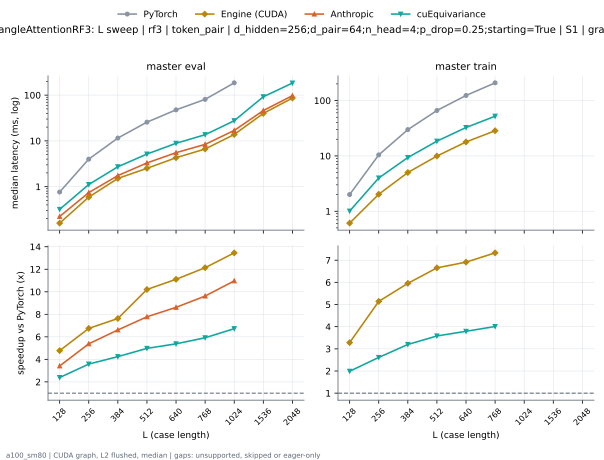
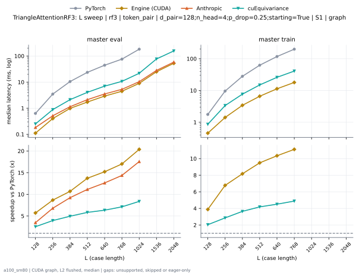

# TriangleAttentionRF3 on a100_sm80

Generated by `python -m miniworld_engine.measure.plot` from speed tokens `judge/tokens/a100_sm80/`; do not edit.

### L sweep: rf3 | token_pair | d_hidden=256;d_pair=64;n_head=4;p_drop=0.25;starting=False | S1 | graph

**master eval** (median ms; x = speedup vs PyTorch)

| L | PyTorch | Engine (Triton) | Engine (CUDA) | Anthropic | cuEquivariance |
|---|---|---|---|---|---|
| 128 | 0.7905 | 0.2744 (2.88x) | 0.1587 (4.98x) | 0.2232 (3.54x) | 0.3635 (2.17x) |
| 256 | 4.087 | 0.939 (4.35x) | 0.5919 (6.90x) | 0.7404 (5.52x) | 1.263 (3.24x) |
| 384 | 11.83 | 2.301 (5.14x) | 1.496 (7.91x) | 1.739 (6.80x) | 3.063 (3.86x) |
| 512 | 26.15 | 4.37 (5.98x) | 2.445 (10.69x) | 3.31 (7.90x) | 5.691 (4.59x) |
| 640 | 48.3 | 7.405 (6.52x) | 4.246 (11.38x) | 5.527 (8.74x) | 9.708 (4.98x) |
| 768 | 81.56 | 11.5 (7.09x) | 6.642 (12.28x) | 8.365 (9.75x) | 14.91 (5.47x) |
| 1024 | 187.1 | 23.61 (7.93x) | 13.74 (13.62x) | 16.86 (11.10x) | 29.79 (6.28x) |
| 1536 | skipped | 69.46 | 39.58 | 46.05 | 97.08 |
| 2048 | skipped | 152.1 | 85.73 | 97.08 | 192.7 |

**master train** (median ms; x = speedup vs PyTorch)

| L | PyTorch | Engine (Triton) | Engine (CUDA) | Anthropic | cuEquivariance |
|---|---|---|---|---|---|
| 128 | 2.049 | 0.8581 (2.39x) | 0.6164 (3.32x) | unsupported | 1.062 (1.93x) |
| 256 | 10.61 | 3.23 (3.29x) | 2.053 (5.17x) | unsupported | 4.164 (2.55x) |
| 384 | 30.29 | 7.481 (4.05x) | 5.076 (5.97x) | unsupported | 9.761 (3.10x) |
| 512 | 66.95 | 14.75 (4.54x) | 10.01 (6.69x) | unsupported | 19.29 (3.47x) |
| 640 | 124.8 | 26 (4.80x) | 17.97 (6.95x) | unsupported | 33.75 (3.70x) |
| 768 | 211 | 41.47 (5.09x) | 28.65 (7.36x) | unsupported | 53.88 (3.92x) |
| 1024 |  |  |  |  |  |
| 1536 |  |  |  |  |  |
| 2048 |  |  |  |  |  |

### L sweep: rf3 | token_pair | d_hidden=256;d_pair=64;n_head=4;p_drop=0.25;starting=True | S1 | graph

**master eval** (median ms; x = speedup vs PyTorch)

| L | PyTorch | Engine (Triton) | Engine (CUDA) | Anthropic | cuEquivariance |
|---|---|---|---|---|---|
| 128 | 0.7629 | 0.2319 (3.29x) | 0.1597 (4.78x) | 0.2232 (3.42x) | 0.3195 (2.39x) |
| 256 | 3.995 | 0.7844 (5.09x) | 0.5919 (6.75x) | 0.7424 (5.38x) | 1.115 (3.58x) |
| 384 | 11.55 | 1.953 (5.92x) | 1.514 (7.63x) | 1.747 (6.61x) | 2.722 (4.24x) |
| 512 | 25.68 | 3.789 (6.78x) | 2.516 (10.20x) | 3.301 (7.78x) | 5.159 (4.98x) |
| 640 | 47.68 | 6.472 (7.37x) | 4.293 (11.11x) | 5.533 (8.62x) | 8.866 (5.38x) |
| 768 | 80.86 | 10.18 (7.94x) | 6.662 (12.14x) | 8.403 (9.62x) | 13.66 (5.92x) |
| 1024 | 185.7 | 21.29 (8.72x) | 13.8 (13.45x) | 16.93 (10.97x) | 27.61 (6.73x) |
| 1536 | skipped | 64.16 | 39.83 | 46.11 | 92.14 |
| 2048 | skipped | 143 | 86.35 | 97.47 | 183.6 |

**master train** (median ms; x = speedup vs PyTorch)

| L | PyTorch | Engine (Triton) | Engine (CUDA) | Anthropic | cuEquivariance |
|---|---|---|---|---|---|
| 128 | 2.002 | 0.7992 (2.51x) | 0.6103 (3.28x) | unsupported | 1.007 (1.99x) |
| 256 | 10.43 | 3.046 (3.42x) | 2.029 (5.14x) | unsupported | 3.993 (2.61x) |
| 384 | 29.86 | 7.039 (4.24x) | 5.014 (5.96x) | unsupported | 9.339 (3.20x) |
| 512 | 66.19 | 13.98 (4.73x) | 9.946 (6.66x) | unsupported | 18.48 (3.58x) |
| 640 | 123.7 | 24.82 (4.98x) | 17.89 (6.91x) | unsupported | 32.61 (3.79x) |
| 768 | 209.3 | 39.79 (5.26x) | 28.55 (7.33x) | unsupported | 52.21 (4.01x) |
| 1024 |  |  |  |  |  |
| 1536 |  |  |  |  |  |
| 2048 |  |  |  |  |  |

### L sweep: rf3 | token_pair | d_pair=128;n_head=4;p_drop=0.25;starting=False | S1 | graph

**master eval** (median ms; x = speedup vs PyTorch)

| L | PyTorch | Engine (Triton) | Engine (CUDA) | Anthropic | cuEquivariance |
|---|---|---|---|---|---|
| 128 | 0.6799 | 0.2427 (2.80x) | 0.1126 (6.04x) | 0.1853 (3.67x) | 0.3011 (2.26x) |
| 256 | 3.712 | 0.8468 (4.38x) | 0.4076 (9.11x) | 0.5125 (7.24x) | 1.078 (3.44x) |
| 384 | 10.94 | 1.989 (5.50x) | 0.9953 (10.99x) | 1.143 (9.57x) | 2.575 (4.25x) |
| 512 | 24.38 | 3.715 (6.56x) | 1.741 (14.00x) | 2.119 (11.51x) | 4.81 (5.07x) |
| 640 | 45.52 | 6.056 (7.52x) | 2.963 (15.36x) | 3.502 (13.00x) | 8.183 (5.56x) |
| 768 | 77.56 | 9.222 (8.41x) | 4.506 (17.22x) | 5.268 (14.72x) | 12.42 (6.24x) |
| 1024 | 185.7 | 18.12 (10.25x) | 9.019 (20.59x) | 10.38 (17.89x) | 24.82 (7.48x) |
| 1536 | skipped | 49.59 | 25.09 | 28.04 | 84.28 |
| 2048 | skipped | 105.1 | 53 | 58.33 | 169 |

**master train** (median ms; x = speedup vs PyTorch)

| L | PyTorch | Engine (Triton) | Engine (CUDA) | Anthropic | cuEquivariance |
|---|---|---|---|---|---|
| 128 | 1.839 | 0.8018 (2.29x) | 0.4628 (3.97x) | unsupported | 0.9441 (1.95x) |
| 256 | 9.837 | 2.927 (3.36x) | 1.44 (6.83x) | unsupported | 3.626 (2.71x) |
| 384 | 28.46 | 6.273 (4.54x) | 3.458 (8.23x) | unsupported | 8.21 (3.47x) |
| 512 | 63.36 | 11.87 (5.34x) | 6.623 (9.57x) | unsupported | 15.89 (3.99x) |
| 640 | 118.6 | 19.99 (5.94x) | 11.41 (10.40x) | unsupported | 27.53 (4.31x) |
| 768 | 201.9 | 31.45 (6.42x) | 17.92 (11.27x) | unsupported | 43.02 (4.69x) |
| 1024 |  |  |  |  |  |
| 1536 |  |  |  |  |  |
| 2048 |  |  |  |  |  |

### L sweep: rf3 | token_pair | d_pair=128;n_head=4;p_drop=0.25;starting=True | S1 | graph

**master eval** (median ms; x = speedup vs PyTorch)

| L | PyTorch | Engine (Triton) | Engine (CUDA) | Anthropic | cuEquivariance |
|---|---|---|---|---|---|
| 128 | 0.6308 | 0.1874 (3.37x) | 0.1106 (5.70x) | 0.1823 (3.46x) | 0.2499 (2.52x) |
| 256 | 3.468 | 0.6461 (5.37x) | 0.4004 (8.66x) | 0.511 (6.79x) | 0.8806 (3.94x) |
| 384 | 10.48 | 1.53 (6.85x) | 0.981 (10.69x) | 1.137 (9.22x) | 2.122 (4.94x) |
| 512 | 23.58 | 2.905 (8.12x) | 1.72 (13.71x) | 2.118 (11.13x) | 4.046 (5.83x) |
| 640 | 44.31 | 4.831 (9.17x) | 2.913 (15.21x) | 3.508 (12.63x) | 6.993 (6.34x) |
| 768 | 75.83 | 7.463 (10.16x) | 4.456 (17.01x) | 5.279 (14.36x) | 10.66 (7.11x) |
| 1024 | 182.3 | 14.95 (12.19x) | 8.944 (20.38x) | 10.38 (17.56x) | 21.78 (8.37x) |
| 1536 | skipped | 42.42 | 24.94 | 28.01 | 77.09 |
| 2048 | skipped | 92.5 | 52.61 | 58.36 | 156.3 |

**master train** (median ms; x = speedup vs PyTorch)

| L | PyTorch | Engine (Triton) | Engine (CUDA) | Anthropic | cuEquivariance |
|---|---|---|---|---|---|
| 128 | 1.763 | 0.7199 (2.45x) | 0.4547 (3.88x) | unsupported | 0.8663 (2.04x) |
| 256 | 9.585 | 2.664 (3.60x) | 1.415 (6.78x) | unsupported | 3.354 (2.86x) |
| 384 | 27.91 | 5.692 (4.90x) | 3.416 (8.17x) | unsupported | 7.661 (3.64x) |
| 512 | 62.39 | 10.85 (5.75x) | 6.576 (9.49x) | unsupported | 14.92 (4.18x) |
| 640 | 117 | 18.49 (6.33x) | 11.32 (10.34x) | unsupported | 25.97 (4.51x) |
| 768 | 199.2 | 29.11 (6.84x) | 17.92 (11.11x) | unsupported | 40.8 (4.88x) |
| 1024 |  |  |  |  |  |
| 1536 |  |  |  |  |  |
| 2048 |  |  |  |  |  |

