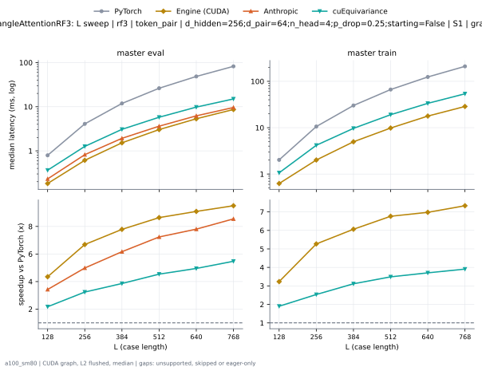
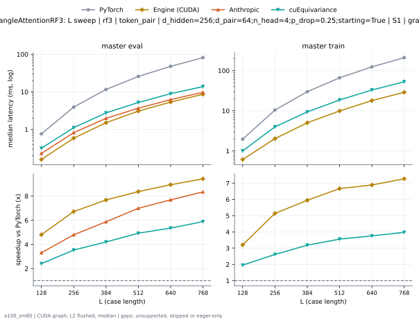
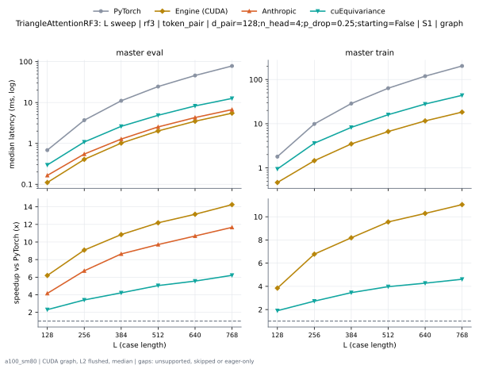
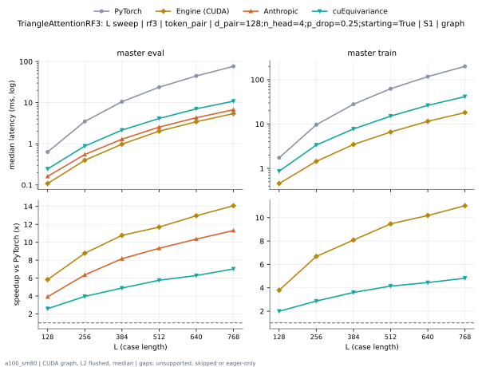

# TriangleAttentionRF3 on a100_sm80

Generated by `python -m miniworld_engine.measure.plot` from speed tokens `judge/tokens/a100_sm80/`; do not edit.

### L sweep: rf3 | token_pair | d_hidden=256;d_pair=64;n_head=4;p_drop=0.25;starting=False | S1 | graph

**master eval** (median ms; x = speedup vs PyTorch)

| L | PyTorch | Engine (Triton) | Engine (CUDA) | Anthropic | cuEquivariance |
|---|---|---|---|---|---|
| 128 | 0.7926 | 0.2744 (2.89x) | 0.1823 (4.35x) | 0.2314 (3.42x) | 0.3645 (2.17x) |
| 256 | 4.089 | 0.9462 (4.32x) | 0.6113 (6.69x) | 0.8202 (4.99x) | 1.263 (3.24x) |
| 384 | 11.87 | 2.361 (5.03x) | 1.524 (7.79x) | 1.925 (6.17x) | 3.076 (3.86x) |
| 512 | 26.24 | 4.506 (5.82x) | 3.036 (8.64x) | 3.625 (7.24x) | 5.78 (4.54x) |
| 640 | 48.53 | 7.713 (6.29x) | 5.338 (9.09x) | 6.218 (7.80x) | 9.801 (4.95x) |
| 768 | 82.22 | 11.92 (6.90x) | 8.652 (9.50x) | 9.617 (8.55x) | 15.02 (5.47x) |

**master train** (median ms; x = speedup vs PyTorch)

| L | PyTorch | Engine (Triton) | Engine (CUDA) | Anthropic | cuEquivariance |
|---|---|---|---|---|---|
| 128 | 2.022 | 0.8561 (2.36x) | 0.6257 (3.23x) | unsupported | 1.064 (1.90x) |
| 256 | 10.59 | 3.236 (3.27x) | 2.01 (5.27x) | unsupported | 4.177 (2.53x) |
| 384 | 30.13 | 7.513 (4.01x) | 4.97 (6.06x) | unsupported | 9.674 (3.11x) |
| 512 | 66.52 | 14.86 (4.48x) | 9.833 (6.76x) | unsupported | 19.06 (3.49x) |
| 640 | 124.2 | 26.21 (4.74x) | 17.8 (6.98x) | unsupported | 33.52 (3.71x) |
| 768 | 210.5 | 42.3 (4.98x) | 28.7 (7.33x) | unsupported | 53.84 (3.91x) |

### L sweep: rf3 | token_pair | d_hidden=256;d_pair=64;n_head=4;p_drop=0.25;starting=True | S1 | graph

**master eval** (median ms; x = speedup vs PyTorch)

| L | PyTorch | Engine (Triton) | Engine (CUDA) | Anthropic | cuEquivariance |
|---|---|---|---|---|---|
| 128 | 0.7629 | 0.2335 (3.27x) | 0.1731 (4.41x) | 0.2304 (3.31x) | 0.3164 (2.41x) |
| 256 | 3.963 | 0.7905 (5.01x) | 0.6042 (6.56x) | 0.8233 (4.81x) | 1.117 (3.55x) |
| 384 | 11.63 | 2.013 (5.78x) | 1.515 (7.68x) | 1.976 (5.89x) | 2.761 (4.21x) |
| 512 | 25.8 | 3.917 (6.59x) | 3.058 (8.44x) | 3.684 (7.00x) | 5.226 (4.94x) |
| 640 | 47.99 | 6.751 (7.11x) | 5.352 (8.97x) | 6.233 (7.70x) | 8.958 (5.36x) |
| 768 | 81.41 | 10.6 (7.68x) | 8.679 (9.38x) | 9.753 (8.35x) | 13.83 (5.89x) |

**master train** (median ms; x = speedup vs PyTorch)

| L | PyTorch | Engine (Triton) | Engine (CUDA) | Anthropic | cuEquivariance |
|---|---|---|---|---|---|
| 128 | 1.967 | 0.7987 (2.46x) | 0.6144 (3.20x) | unsupported | 1.006 (1.96x) |
| 256 | 10.44 | 3.08 (3.39x) | 2.03 (5.14x) | unsupported | 3.994 (2.61x) |
| 384 | 29.93 | 7.178 (4.17x) | 5.019 (5.96x) | unsupported | 9.38 (3.19x) |
| 512 | 66.21 | 14.2 (4.66x) | 10.03 (6.60x) | unsupported | 18.61 (3.56x) |
| 640 | 123.7 | 25.36 (4.88x) | 18.02 (6.86x) | unsupported | 32.91 (3.76x) |
| 768 | 209.9 | 40.87 (5.14x) | 28.74 (7.30x) | unsupported | 52.8 (3.98x) |

### L sweep: rf3 | token_pair | d_pair=128;n_head=4;p_drop=0.25;starting=False | S1 | graph

**master eval** (median ms; x = speedup vs PyTorch)

| L | PyTorch | Engine (Triton) | Engine (CUDA) | Anthropic | cuEquivariance |
|---|---|---|---|---|---|
| 128 | 0.6748 | 0.2447 (2.76x) | 0.1311 (5.15x) | 0.1649 (4.09x) | 0.297 (2.27x) |
| 256 | 3.687 | 0.8556 (4.31x) | 0.425 (8.68x) | 0.5489 (6.72x) | 1.082 (3.41x) |
| 384 | 11.02 | 2.055 (5.36x) | 1.029 (10.71x) | 1.276 (8.63x) | 2.613 (4.22x) |
| 512 | 24.55 | 3.833 (6.41x) | 2.031 (12.09x) | 2.531 (9.70x) | 4.87 (5.04x) |
| 640 | 45.8 | 6.342 (7.22x) | 3.503 (13.08x) | 4.287 (10.68x) | 8.245 (5.56x) |
| 768 | 78.13 | 9.602 (8.14x) | 5.429 (14.39x) | 6.702 (11.66x) | 12.59 (6.21x) |

**master train** (median ms; x = speedup vs PyTorch)

| L | PyTorch | Engine (Triton) | Engine (CUDA) | Anthropic | cuEquivariance |
|---|---|---|---|---|---|
| 128 | 1.797 | 0.8038 (2.24x) | 0.471 (3.82x) | unsupported | 0.9462 (1.90x) |
| 256 | 9.908 | 2.947 (3.36x) | 1.442 (6.87x) | unsupported | 3.626 (2.73x) |
| 384 | 28.56 | 6.398 (4.46x) | 3.488 (8.19x) | unsupported | 8.263 (3.46x) |
| 512 | 63.51 | 12.16 (5.22x) | 6.701 (9.48x) | unsupported | 16 (3.97x) |
| 640 | 119.1 | 20.79 (5.73x) | 11.43 (10.42x) | unsupported | 27.86 (4.27x) |
| 768 | 202.2 | 32.54 (6.21x) | 18.25 (11.08x) | unsupported | 43.86 (4.61x) |

### L sweep: rf3 | token_pair | d_pair=128;n_head=4;p_drop=0.25;starting=True | S1 | graph

**master eval** (median ms; x = speedup vs PyTorch)

| L | PyTorch | Engine (Triton) | Engine (CUDA) | Anthropic | cuEquivariance |
|---|---|---|---|---|---|
| 128 | 0.6236 | 0.1894 (3.29x) | 0.1229 (5.07x) | 0.1618 (3.85x) | 0.2447 (2.55x) |
| 256 | 3.493 | 0.6543 (5.34x) | 0.4127 (8.46x) | 0.5499 (6.35x) | 0.8827 (3.96x) |
| 384 | 10.59 | 1.584 (6.69x) | 1.024 (10.34x) | 1.294 (8.18x) | 2.161 (4.90x) |
| 512 | 23.83 | 3.022 (7.88x) | 2.025 (11.76x) | 2.548 (9.35x) | 4.125 (5.78x) |
| 640 | 44.74 | 5.028 (8.90x) | 3.485 (12.84x) | 4.313 (10.37x) | 7.101 (6.30x) |
| 768 | 76.57 | 7.701 (9.94x) | 5.446 (14.06x) | 6.753 (11.34x) | 10.88 (7.04x) |

**master train** (median ms; x = speedup vs PyTorch)

| L | PyTorch | Engine (Triton) | Engine (CUDA) | Anthropic | cuEquivariance |
|---|---|---|---|---|---|
| 128 | 1.725 | 0.7311 (2.36x) | 0.4577 (3.77x) | unsupported | 0.8684 (1.99x) |
| 256 | 9.675 | 2.685 (3.60x) | 1.437 (6.73x) | unsupported | 3.365 (2.87x) |
| 384 | 28.06 | 5.846 (4.80x) | 3.493 (8.03x) | unsupported | 7.767 (3.61x) |
| 512 | 62.74 | 11.12 (5.64x) | 6.677 (9.40x) | unsupported | 15.11 (4.15x) |
| 640 | 117.8 | 19.18 (6.14x) | 11.58 (10.17x) | unsupported | 26.41 (4.46x) |
| 768 | 200.6 | 30.17 (6.65x) | 18.2 (11.02x) | unsupported | 41.52 (4.83x) |

