# TriangleMultiplication on a100_sm80

Generated by `python -m miniworld_engine.measure.plot` from speed tokens `judge/tokens/a100_sm80/`; do not edit.

### L sweep: af3|boltz2|chai1|opendde|openfold3|openfold3_preview2|protenix | token_pair | d_pair=64;outgoing=False;p_drop=0.25 | S1 | graph

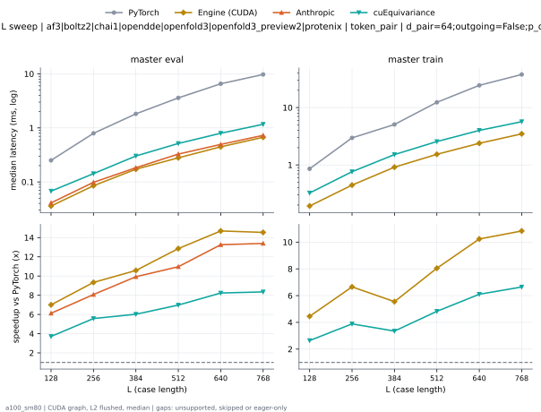

**master eval** (median ms; x = speedup vs PyTorch)

| L | PyTorch | Engine (Triton) | Engine (CUDA) | Anthropic | cuEquivariance |
|---|---|---|---|---|---|
| 128 | 0.2509 | 0.07168 (3.50x) | 0.04096 (6.13x) | 0.04096 (6.13x) | 0.06758 (3.71x) |
| 256 | 0.7905 | 0.1341 (5.89x) | 0.1009 (7.84x) | 0.0983 (8.04x) | 0.1423 (5.55x) |
| 384 | 1.811 | 0.2386 (7.59x) | 0.2048 (8.85x) | 0.1833 (9.88x) | 0.3021 (6.00x) |
| 512 | 3.584 | 0.3707 (9.67x) | 0.3338 (10.74x) | 0.3277 (10.94x) | 0.5151 (6.96x) |
| 640 | 6.543 | 0.5663 (11.56x) | 0.5356 (12.22x) | 0.4946 (13.23x) | 0.7967 (8.21x) |
| 768 | 9.724 | 0.8407 (11.57x) | 0.7926 (12.27x) | 0.7276 (13.37x) | 1.167 (8.33x) |

**master train** (median ms; x = speedup vs PyTorch)

| L | PyTorch | Engine (Triton) | Engine (CUDA) | Anthropic | cuEquivariance |
|---|---|---|---|---|---|
| 128 | 0.855 | 0.2447 (3.49x) | 0.1956 (4.37x) | unsupported | 0.3246 (2.63x) |
| 256 | 2.946 | 0.5263 (5.60x) | 0.4577 (6.44x) | unsupported | 0.7629 (3.86x) |
| 384 | 5.044 | 1.035 (4.87x) | 0.9411 (5.36x) | unsupported | 1.516 (3.33x) |
| 512 | 12.33 | 1.736 (7.10x) | 1.601 (7.70x) | unsupported | 2.557 (4.82x) |
| 640 | 24.39 | 2.727 (8.94x) | 2.521 (9.67x) | unsupported | 3.999 (6.10x) |
| 768 | 37.65 | 3.906 (9.64x) | 3.661 (10.29x) | unsupported | 5.677 (6.63x) |

### L sweep: af3|boltz2|chai1|opendde|openfold3|openfold3_preview2|protenix | token_pair | d_pair=64;outgoing=True;p_drop=0.25 | S1 | graph

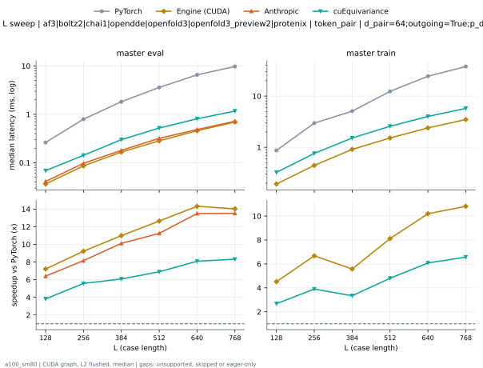

**master eval** (median ms; x = speedup vs PyTorch)

| L | PyTorch | Engine (Triton) | Engine (CUDA) | Anthropic | cuEquivariance |
|---|---|---|---|---|---|
| 128 | 0.2611 | 0.07373 (3.54x) | 0.04198 (6.22x) | 0.04096 (6.37x) | 0.06861 (3.81x) |
| 256 | 0.7905 | 0.1341 (5.89x) | 0.1014 (7.80x) | 0.09728 (8.13x) | 0.1423 (5.55x) |
| 384 | 1.811 | 0.2324 (7.79x) | 0.1997 (9.07x) | 0.1802 (10.05x) | 0.3 (6.04x) |
| 512 | 3.576 | 0.3768 (9.49x) | 0.34 (10.52x) | 0.3195 (11.19x) | 0.5212 (6.86x) |
| 640 | 6.538 | 0.5791 (11.29x) | 0.5468 (11.96x) | 0.4854 (13.47x) | 0.81 (8.07x) |
| 768 | 9.72 | 0.852 (11.41x) | 0.8269 (11.75x) | 0.7199 (13.50x) | 1.17 (8.31x) |

**master train** (median ms; x = speedup vs PyTorch)

| L | PyTorch | Engine (Triton) | Engine (CUDA) | Anthropic | cuEquivariance |
|---|---|---|---|---|---|
| 128 | 0.8561 | 0.2447 (3.50x) | 0.1956 (4.38x) | unsupported | 0.3246 (2.64x) |
| 256 | 2.945 | 0.5253 (5.61x) | 0.4577 (6.43x) | unsupported | 0.7608 (3.87x) |
| 384 | 5.045 | 1.034 (4.88x) | 0.9411 (5.36x) | unsupported | 1.521 (3.32x) |
| 512 | 12.32 | 1.748 (7.05x) | 1.605 (7.67x) | unsupported | 2.572 (4.79x) |
| 640 | 24.37 | 2.728 (8.93x) | 2.531 (9.63x) | unsupported | 4.009 (6.08x) |
| 768 | 37.68 | 3.903 (9.65x) | 3.686 (10.22x) | unsupported | 5.744 (6.56x) |

### L sweep: af3|boltz2|openfold3|openfold3_preview2|protenix | token_pair | d_pair=128;outgoing=False;p_drop=0.25 | S1 | graph

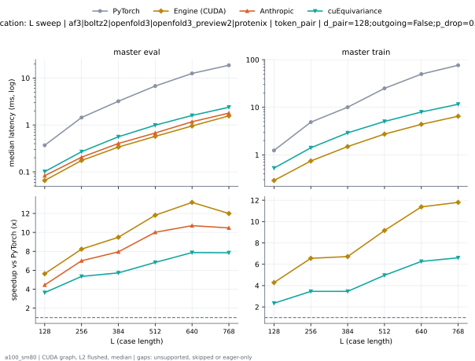

**master eval** (median ms; x = speedup vs PyTorch)

| L | PyTorch | Engine (Triton) | Engine (CUDA) | Anthropic | cuEquivariance |
|---|---|---|---|---|---|
| 128 | 0.3553 | 0.1116 (3.18x) | 0.06554 (5.42x) | 0.08294 (4.28x) | 0.1014 (3.51x) |
| 256 | 1.438 | 0.2693 (5.34x) | 0.1746 (8.23x) | 0.2058 (6.99x) | 0.2693 (5.34x) |
| 384 | 3.191 | 0.5309 (6.01x) | 0.3379 (9.44x) | 0.4035 (7.91x) | 0.5601 (5.70x) |
| 512 | 6.762 | 0.8899 (7.60x) | 0.5868 (11.53x) | 0.6748 (10.02x) | 0.9892 (6.84x) |
| 640 | 12.54 | 1.467 (8.55x) | 1.051 (11.94x) | 1.171 (10.71x) | 1.594 (7.87x) |
| 768 | 18.69 | 2.216 (8.43x) | 1.662 (11.25x) | 1.788 (10.45x) | 2.386 (7.83x) |

**master train** (median ms; x = speedup vs PyTorch)

| L | PyTorch | Engine (Triton) | Engine (CUDA) | Anthropic | cuEquivariance |
|---|---|---|---|---|---|
| 128 | 1.233 | 0.3645 (3.38x) | 0.2877 (4.28x) | unsupported | 0.5268 (2.34x) |
| 256 | 4.865 | 1.008 (4.83x) | 0.7439 (6.54x) | unsupported | 1.409 (3.45x) |
| 384 | 10.04 | 2.051 (4.89x) | 1.542 (6.51x) | unsupported | 2.901 (3.46x) |
| 512 | 25.11 | 3.596 (6.98x) | 2.844 (8.83x) | unsupported | 5.038 (4.98x) |
| 640 | 49.86 | 5.773 (8.64x) | 4.598 (10.84x) | unsupported | 7.957 (6.27x) |
| 768 | 76.53 | 8.42 (9.09x) | 6.765 (11.31x) | unsupported | 11.58 (6.61x) |

### L sweep: af3|boltz2|openfold3|openfold3_preview2|protenix | token_pair | d_pair=128;outgoing=True;p_drop=0.25 | S1 | graph

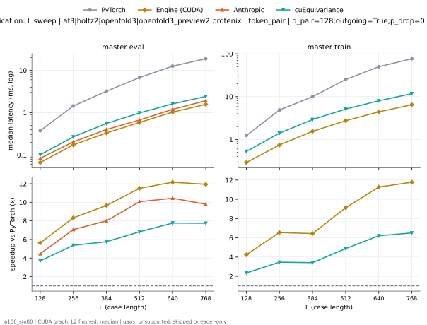

**master eval** (median ms; x = speedup vs PyTorch)

| L | PyTorch | Engine (Triton) | Engine (CUDA) | Anthropic | cuEquivariance |
|---|---|---|---|---|---|
| 128 | 0.3553 | 0.1137 (3.13x) | 0.06758 (5.26x) | 0.08397 (4.23x) | 0.1014 (3.51x) |
| 256 | 1.437 | 0.2683 (5.35x) | 0.1731 (8.30x) | 0.2038 (7.05x) | 0.2683 (5.35x) |
| 384 | 3.194 | 0.5243 (6.09x) | 0.3359 (9.51x) | 0.4004 (7.98x) | 0.556 (5.74x) |
| 512 | 6.754 | 0.9277 (7.28x) | 0.599 (11.28x) | 0.6707 (10.07x) | 0.9882 (6.84x) |
| 640 | 12.54 | 1.523 (8.24x) | 1.063 (11.80x) | 1.202 (10.44x) | 1.615 (7.77x) |
| 768 | 18.71 | 2.27 (8.24x) | 1.652 (11.32x) | 1.913 (9.78x) | 2.42 (7.73x) |

**master train** (median ms; x = speedup vs PyTorch)

| L | PyTorch | Engine (Triton) | Engine (CUDA) | Anthropic | cuEquivariance |
|---|---|---|---|---|---|
| 128 | 1.232 | 0.3645 (3.38x) | 0.2867 (4.30x) | unsupported | 0.5258 (2.34x) |
| 256 | 4.87 | 1.013 (4.81x) | 0.745 (6.54x) | unsupported | 1.404 (3.47x) |
| 384 | 10.02 | 2.076 (4.83x) | 1.556 (6.44x) | unsupported | 2.93 (3.42x) |
| 512 | 25.09 | 3.589 (6.99x) | 2.855 (8.79x) | unsupported | 5.128 (4.89x) |
| 640 | 49.84 | 5.776 (8.63x) | 4.638 (10.75x) | unsupported | 8.025 (6.21x) |
| 768 | 76.51 | 8.423 (9.08x) | 6.735 (11.36x) | unsupported | 11.76 (6.51x) |

### L sweep: chai1|esmfold2|intellifold2|protenix | token_pair | d_pair=256;outgoing=False;p_drop=0.25 | S1 | graph

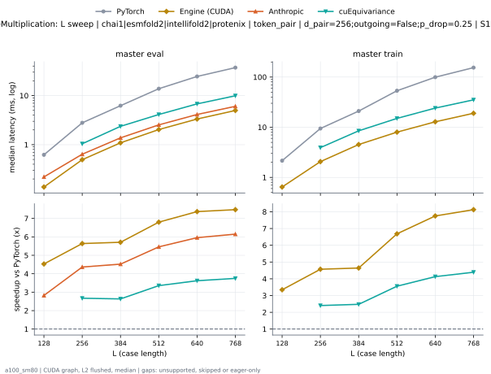

**master eval** (median ms; x = speedup vs PyTorch)

| L | PyTorch | Engine (Triton) | Engine (CUDA) | Anthropic | cuEquivariance |
|---|---|---|---|---|---|
| 128 | 0.6226 | 0.234 (2.66x) | 0.1449 (4.30x) | 0.2202 (2.83x) | unsupported |
| 256 | 2.78 | 0.6502 (4.28x) | 0.5048 (5.51x) | 0.639 (4.35x) | 1.043 (2.66x) |
| 384 | 6.3 | 1.369 (4.60x) | 1.141 (5.52x) | 1.378 (4.57x) | 2.364 (2.66x) |
| 512 | 13.91 | 2.454 (5.67x) | 2.097 (6.63x) | 2.532 (5.49x) | 4.119 (3.38x) |
| 640 | 24.54 | 3.918 (6.26x) | 3.426 (7.16x) | 4.124 (5.95x) | 6.784 (3.62x) |
| 768 | 37.43 | 5.751 (6.51x) | 5.031 (7.44x) | 6.052 (6.18x) | 9.927 (3.77x) |

**master train** (median ms; x = speedup vs PyTorch)

| L | PyTorch | Engine (Triton) | Engine (CUDA) | Anthropic | cuEquivariance |
|---|---|---|---|---|---|
| 128 | 2.153 | 0.6789 (3.17x) | 0.6487 (3.32x) | unsupported | unsupported |
| 256 | 9.427 | 2.249 (4.19x) | 2.122 (4.44x) | unsupported | 3.926 (2.40x) |
| 384 | 21.14 | 4.764 (4.44x) | 4.592 (4.60x) | unsupported | 8.486 (2.49x) |
| 512 | 53.73 | 8.408 (6.39x) | 8.158 (6.59x) | unsupported | 15.01 (3.58x) |
| 640 | 99.94 | 13.68 (7.30x) | 13.13 (7.61x) | unsupported | 24.09 (4.15x) |
| 768 | 155 | 19.9 (7.79x) | 19.15 (8.09x) | unsupported | 35.16 (4.41x) |

### L sweep: chai1|esmfold2|intellifold2|protenix | token_pair | d_pair=256;outgoing=True;p_drop=0.25 | S1 | graph

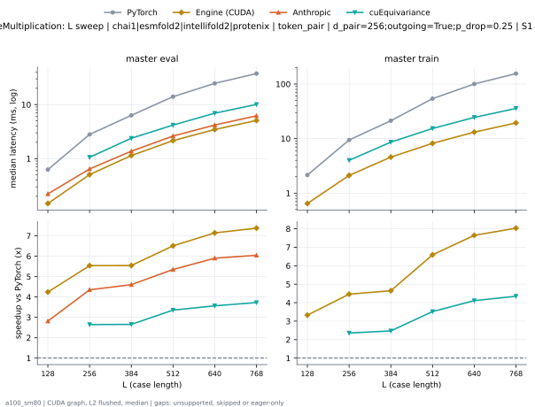

**master eval** (median ms; x = speedup vs PyTorch)

| L | PyTorch | Engine (Triton) | Engine (CUDA) | Anthropic | cuEquivariance |
|---|---|---|---|---|---|
| 128 | 0.6257 | 0.2355 (2.66x) | 0.1475 (4.24x) | 0.2222 (2.82x) | unsupported |
| 256 | 2.802 | 0.6564 (4.27x) | 0.5059 (5.54x) | 0.6436 (4.35x) | 1.058 (2.65x) |
| 384 | 6.323 | 1.343 (4.71x) | 1.14 (5.55x) | 1.373 (4.61x) | 2.382 (2.65x) |
| 512 | 14.02 | 2.491 (5.63x) | 2.152 (6.51x) | 2.619 (5.35x) | 4.175 (3.36x) |
| 640 | 24.71 | 3.951 (6.25x) | 3.457 (7.15x) | 4.185 (5.91x) | 6.928 (3.57x) |
| 768 | 37.52 | 5.887 (6.37x) | 5.085 (7.38x) | 6.203 (6.05x) | 10.07 (3.73x) |

**master train** (median ms; x = speedup vs PyTorch)

| L | PyTorch | Engine (Triton) | Engine (CUDA) | Anthropic | cuEquivariance |
|---|---|---|---|---|---|
| 128 | 2.149 | 0.684 (3.14x) | 0.6461 (3.33x) | unsupported | unsupported |
| 256 | 9.438 | 2.259 (4.18x) | 2.116 (4.46x) | unsupported | 4.003 (2.36x) |
| 384 | 21.3 | 4.771 (4.46x) | 4.583 (4.65x) | unsupported | 8.617 (2.47x) |
| 512 | 54.01 | 8.407 (6.42x) | 8.194 (6.59x) | unsupported | 15.34 (3.52x) |
| 640 | 100.5 | 13.69 (7.34x) | 13.14 (7.64x) | unsupported | 24.44 (4.11x) |
| 768 | 155.7 | 20.1 (7.74x) | 19.38 (8.03x) | unsupported | 35.8 (4.35x) |

### L sweep: intellifold2 | token_pair | d_pair=512;outgoing=False;p_drop=0.25 | S1 | graph

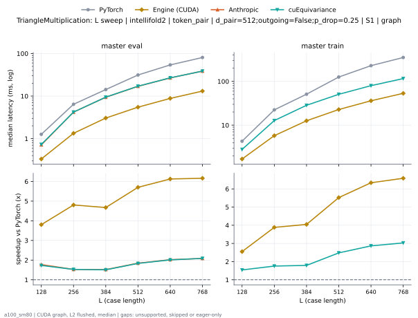

**master eval** (median ms; x = speedup vs PyTorch)

| L | PyTorch | Engine (Triton) | Engine (CUDA) | Anthropic | cuEquivariance |
|---|---|---|---|---|---|
| 128 | 1.266 | 0.6943 (1.82x) | 0.3328 (3.80x) | 0.7137 (1.77x) | 0.7322 (1.73x) |
| 256 | 6.425 | 2.202 (2.92x) | 1.337 (4.80x) | 4.209 (1.53x) | 4.206 (1.53x) |
| 384 | 14.26 | 4.804 (2.97x) | 3.05 (4.67x) | 9.393 (1.52x) | 9.461 (1.51x) |
| 512 | 31.34 | 8.475 (3.70x) | 5.496 (5.70x) | 16.98 (1.85x) | 17.09 (1.83x) |
| 640 | 54.09 | 13.46 (4.02x) | 8.83 (6.13x) | 26.75 (2.02x) | 26.88 (2.01x) |
| 768 | 80.81 | 20.05 (4.03x) | 13.11 (6.16x) | 38.74 (2.09x) | 38.7 (2.09x) |

**master train** (median ms; x = speedup vs PyTorch)

| L | PyTorch | Engine (Triton) | Engine (CUDA) | Anthropic | cuEquivariance |
|---|---|---|---|---|---|
| 128 | 4.312 | 1.708 (2.53x) | 1.691 (2.55x) | unsupported | 2.796 (1.54x) |
| 256 | 22.4 | 6.08 (3.68x) | 5.767 (3.88x) | unsupported | 12.77 (1.75x) |
| 384 | 51.06 | 13.31 (3.83x) | 12.62 (4.05x) | unsupported | 28.5 (1.79x) |
| 512 | 126 | 23.8 (5.29x) | 22.81 (5.52x) | unsupported | 50.78 (2.48x) |
| 640 | 229 | 39.77 (5.76x) | 36.13 (6.34x) | unsupported | 79.9 (2.87x) |
| 768 | 351.8 | 58.2 (6.04x) | 53.42 (6.58x) | unsupported | 116.2 (3.03x) |

### L sweep: intellifold2 | token_pair | d_pair=512;outgoing=True;p_drop=0.25 | S1 | graph

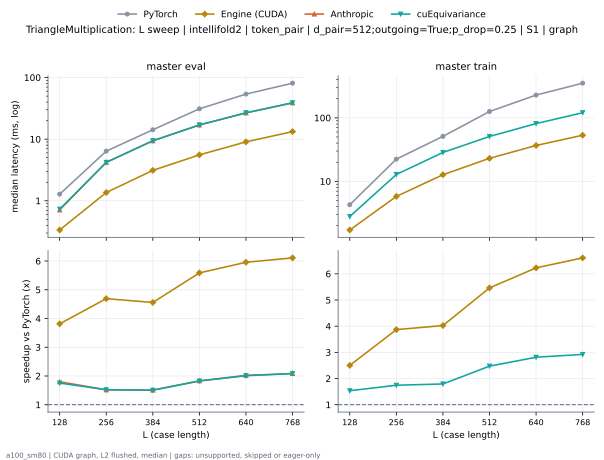

**master eval** (median ms; x = speedup vs PyTorch)

| L | PyTorch | Engine (Triton) | Engine (CUDA) | Anthropic | cuEquivariance |
|---|---|---|---|---|---|
| 128 | 1.281 | 0.706 (1.81x) | 0.3359 (3.81x) | 0.7122 (1.80x) | 0.7311 (1.75x) |
| 256 | 6.393 | 2.224 (2.87x) | 1.363 (4.69x) | 4.21 (1.52x) | 4.204 (1.52x) |
| 384 | 14.21 | 4.858 (2.92x) | 3.117 (4.56x) | 9.412 (1.51x) | 9.432 (1.51x) |
| 512 | 31.08 | 8.639 (3.60x) | 5.562 (5.59x) | 16.97 (1.83x) | 17.02 (1.83x) |
| 640 | 53.87 | 13.81 (3.90x) | 9.045 (5.96x) | 26.66 (2.02x) | 26.8 (2.01x) |
| 768 | 81.05 | 20.01 (4.05x) | 13.27 (6.11x) | 38.87 (2.09x) | 38.89 (2.08x) |

**master train** (median ms; x = speedup vs PyTorch)

| L | PyTorch | Engine (Triton) | Engine (CUDA) | Anthropic | cuEquivariance |
|---|---|---|---|---|---|
| 128 | 4.28 | 1.708 (2.51x) | 1.71 (2.50x) | unsupported | 2.789 (1.53x) |
| 256 | 22.38 | 6.113 (3.66x) | 5.786 (3.87x) | unsupported | 12.83 (1.74x) |
| 384 | 51.13 | 13.33 (3.84x) | 12.7 (4.02x) | unsupported | 28.51 (1.79x) |
| 512 | 126 | 24.05 (5.24x) | 23.07 (5.46x) | unsupported | 50.93 (2.47x) |
| 640 | 228.8 | 40.07 (5.71x) | 36.74 (6.23x) | unsupported | 81.29 (2.81x) |
| 768 | 352.4 | 57.91 (6.08x) | 53.31 (6.61x) | unsupported | 120.6 (2.92x) |

### L sweep: opendde | token_pair | d_pair=384;outgoing=False;p_drop=0.25 | S1 | graph

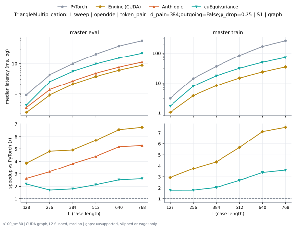

**master eval** (median ms; x = speedup vs PyTorch)

| L | PyTorch | Engine (Triton) | Engine (CUDA) | Anthropic | cuEquivariance |
|---|---|---|---|---|---|
| 128 | 0.8888 | 0.4127 (2.15x) | 0.2386 (3.73x) | 0.3354 (2.65x) | 0.4014 (2.21x) |
| 256 | 4.286 | 1.209 (3.54x) | 0.9001 (4.76x) | 1.333 (3.22x) | 2.46 (1.74x) |
| 384 | 10.29 | 2.627 (3.92x) | 2.116 (4.86x) | 2.618 (3.93x) | 5.528 (1.86x) |
| 512 | 21.35 | 4.575 (4.67x) | 3.807 (5.61x) | 4.783 (4.46x) | 9.852 (2.17x) |
| 640 | 40.07 | 7.364 (5.44x) | 6.175 (6.49x) | 7.639 (5.25x) | 15.63 (2.56x) |
| 768 | 60.35 | 10.82 (5.58x) | 9.061 (6.66x) | 11.33 (5.33x) | 22.82 (2.64x) |

**master train** (median ms; x = speedup vs PyTorch)

| L | PyTorch | Engine (Triton) | Engine (CUDA) | Anthropic | cuEquivariance |
|---|---|---|---|---|---|
| 128 | 3.144 | 1.12 (2.81x) | 1.055 (2.98x) | unsupported | 1.71 (1.84x) |
| 256 | 14.36 | 3.988 (3.60x) | 3.834 (3.75x) | unsupported | 7.86 (1.83x) |
| 384 | 36.23 | 8.712 (4.16x) | 8.339 (4.34x) | unsupported | 17.48 (2.07x) |
| 512 | 84.43 | 15.37 (5.49x) | 15.01 (5.63x) | unsupported | 31.13 (2.71x) |
| 640 | 168.3 | 25.17 (6.69x) | 23.96 (7.03x) | unsupported | 49.35 (3.41x) |
| 768 | 259.3 | 36.89 (7.03x) | 35.11 (7.39x) | unsupported | 71.7 (3.62x) |

### L sweep: opendde | token_pair | d_pair=384;outgoing=True;p_drop=0.25 | S1 | graph

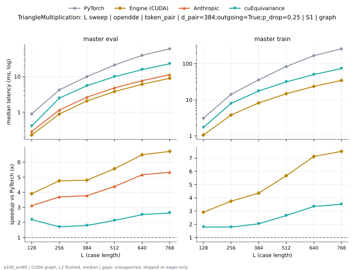

**master eval** (median ms; x = speedup vs PyTorch)

| L | PyTorch | Engine (Triton) | Engine (CUDA) | Anthropic | cuEquivariance |
|---|---|---|---|---|---|
| 128 | 0.9006 | 0.4209 (2.14x) | 0.2417 (3.73x) | 0.2867 (3.14x) | 0.4076 (2.21x) |
| 256 | 4.312 | 1.217 (3.54x) | 0.9052 (4.76x) | 1.143 (3.77x) | 2.47 (1.75x) |
| 384 | 10.24 | 2.626 (3.90x) | 2.133 (4.80x) | 2.632 (3.89x) | 5.512 (1.86x) |
| 512 | 21.35 | 4.668 (4.57x) | 3.875 (5.51x) | 4.809 (4.44x) | 9.88 (2.16x) |
| 640 | 39.94 | 7.42 (5.38x) | 6.217 (6.42x) | 7.652 (5.22x) | 15.69 (2.55x) |
| 768 | 60.22 | 10.88 (5.54x) | 9.134 (6.59x) | 11.28 (5.34x) | 22.82 (2.64x) |

**master train** (median ms; x = speedup vs PyTorch)

| L | PyTorch | Engine (Triton) | Engine (CUDA) | Anthropic | cuEquivariance |
|---|---|---|---|---|---|
| 128 | 3.119 | 1.107 (2.82x) | 1.071 (2.91x) | unsupported | 1.72 (1.81x) |
| 256 | 14.39 | 4.016 (3.58x) | 3.849 (3.74x) | unsupported | 7.929 (1.81x) |
| 384 | 36.18 | 8.723 (4.15x) | 8.346 (4.33x) | unsupported | 17.49 (2.07x) |
| 512 | 84.32 | 15.38 (5.48x) | 14.97 (5.63x) | unsupported | 31.33 (2.69x) |
| 640 | 168.4 | 25.13 (6.70x) | 23.95 (7.03x) | unsupported | 49.97 (3.37x) |
| 768 | 259.2 | 36.73 (7.06x) | 35.08 (7.39x) | unsupported | 73.47 (3.53x) |

### L sweep: protenix | token_pair | d_hidden=128;d_pair=64;outgoing=False;p_drop=0.25 | S1 | graph

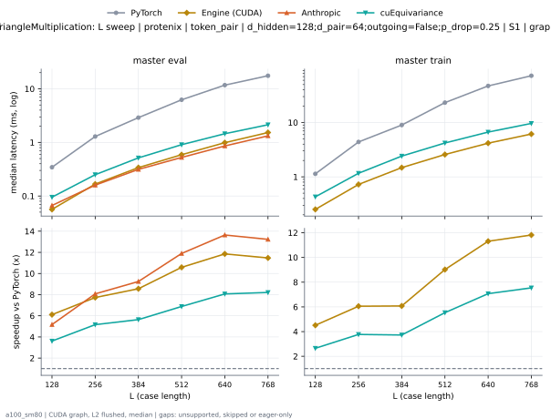

**master eval** (median ms; x = speedup vs PyTorch)

| L | PyTorch | Engine (Triton) | Engine (CUDA) | Anthropic | cuEquivariance |
|---|---|---|---|---|---|
| 128 | 0.3441 | 0.09216 (3.73x) | 0.05632 (6.11x) | 0.06656 (5.17x) | 0.09523 (3.61x) |
| 256 | 1.29 | 0.2007 (6.43x) | 0.1669 (7.73x) | 0.1597 (8.07x) | 0.2499 (5.16x) |
| 384 | 2.901 | 0.3666 (7.91x) | 0.3389 (8.56x) | 0.3139 (9.24x) | 0.5146 (5.64x) |
| 512 | 6.242 | 0.6011 (10.39x) | 0.5898 (10.58x) | 0.5248 (11.89x) | 0.9073 (6.88x) |
| 640 | 11.72 | 0.9964 (11.76x) | 0.9887 (11.85x) | 0.8591 (13.64x) | 1.453 (8.07x) |
| 768 | 17.54 | 1.544 (11.36x) | 1.529 (11.47x) | 1.326 (13.23x) | 2.138 (8.21x) |

**master train** (median ms; x = speedup vs PyTorch)

| L | PyTorch | Engine (Triton) | Engine (CUDA) | Anthropic | cuEquivariance |
|---|---|---|---|---|---|
| 128 | 1.137 | 0.3041 (3.74x) | 0.2519 (4.51x) | unsupported | 0.4291 (2.65x) |
| 256 | 4.389 | 0.7946 (5.52x) | 0.725 (6.05x) | unsupported | 1.164 (3.77x) |
| 384 | 8.983 | 1.583 (5.68x) | 1.479 (6.07x) | unsupported | 2.412 (3.72x) |
| 512 | 23.23 | 2.725 (8.53x) | 2.575 (9.02x) | unsupported | 4.199 (5.53x) |
| 640 | 47.14 | 4.439 (10.62x) | 4.167 (11.31x) | unsupported | 6.668 (7.07x) |
| 768 | 72.61 | 6.484 (11.20x) | 6.144 (11.82x) | unsupported | 9.627 (7.54x) |

### L sweep: protenix | token_pair | d_hidden=128;d_pair=64;outgoing=True;p_drop=0.25 | S1 | graph

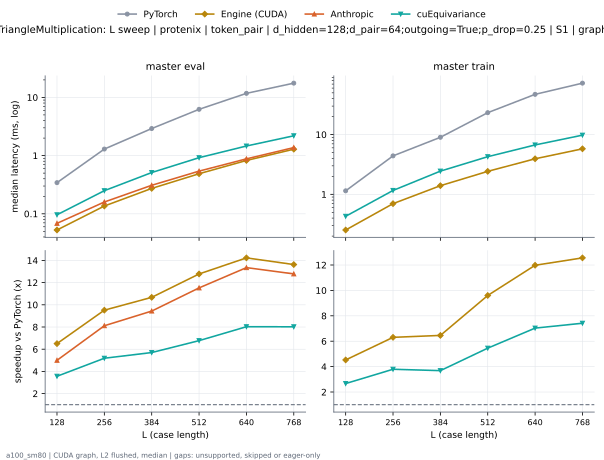

**master eval** (median ms; x = speedup vs PyTorch)

| L | PyTorch | Engine (Triton) | Engine (CUDA) | Anthropic | cuEquivariance |
|---|---|---|---|---|---|
| 128 | 0.3415 | 0.09216 (3.71x) | 0.05837 (5.85x) | 0.06861 (4.98x) | 0.09626 (3.55x) |
| 256 | 1.29 | 0.1997 (6.46x) | 0.1669 (7.73x) | 0.1597 (8.08x) | 0.2499 (5.16x) |
| 384 | 2.903 | 0.3625 (8.01x) | 0.3348 (8.67x) | 0.3092 (9.39x) | 0.512 (5.67x) |
| 512 | 6.248 | 0.617 (10.13x) | 0.6031 (10.36x) | 0.5417 (11.53x) | 0.9216 (6.78x) |
| 640 | 11.71 | 1.04 (11.26x) | 1.031 (11.36x) | 0.8796 (13.32x) | 1.463 (8.01x) |
| 768 | 17.55 | 1.593 (11.02x) | 1.577 (11.13x) | 1.375 (12.77x) | 2.191 (8.01x) |

**master train** (median ms; x = speedup vs PyTorch)

| L | PyTorch | Engine (Triton) | Engine (CUDA) | Anthropic | cuEquivariance |
|---|---|---|---|---|---|
| 128 | 1.138 | 0.3057 (3.72x) | 0.2519 (4.52x) | unsupported | 0.4291 (2.65x) |
| 256 | 4.39 | 0.7926 (5.54x) | 0.724 (6.06x) | unsupported | 1.161 (3.78x) |
| 384 | 8.959 | 1.59 (5.63x) | 1.475 (6.08x) | unsupported | 2.446 (3.66x) |
| 512 | 23.24 | 2.743 (8.47x) | 2.611 (8.90x) | unsupported | 4.268 (5.45x) |
| 640 | 47.14 | 4.477 (10.53x) | 4.193 (11.24x) | unsupported | 6.709 (7.03x) |
| 768 | 72.56 | 6.504 (11.16x) | 6.167 (11.77x) | unsupported | 9.79 (7.41x) |

### d_pair sweep at L768: token_pair | outgoing=False;p_drop=0.25 | S1 | graph

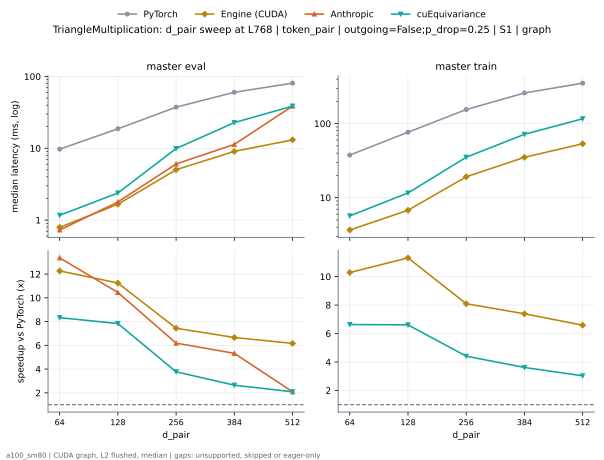

**master eval** (median ms; x = speedup vs PyTorch)

| d_pair | PyTorch | Engine (Triton) | Engine (CUDA) | Anthropic | cuEquivariance |
|---|---|---|---|---|---|
| 64 | 9.724 | 0.8407 (11.57x) | 0.7926 (12.27x) | 0.7276 (13.37x) | 1.167 (8.33x) |
| 128 | 18.69 | 2.216 (8.43x) | 1.662 (11.25x) | 1.788 (10.45x) | 2.386 (7.83x) |
| 256 | 37.43 | 5.751 (6.51x) | 5.031 (7.44x) | 6.052 (6.18x) | 9.927 (3.77x) |
| 384 | 60.35 | 10.82 (5.58x) | 9.061 (6.66x) | 11.33 (5.33x) | 22.82 (2.64x) |
| 512 | 80.81 | 20.05 (4.03x) | 13.11 (6.16x) | 38.74 (2.09x) | 38.7 (2.09x) |

**master train** (median ms; x = speedup vs PyTorch)

| d_pair | PyTorch | Engine (Triton) | Engine (CUDA) | Anthropic | cuEquivariance |
|---|---|---|---|---|---|
| 64 | 37.65 | 3.906 (9.64x) | 3.661 (10.29x) | unsupported | 5.677 (6.63x) |
| 128 | 76.53 | 8.42 (9.09x) | 6.765 (11.31x) | unsupported | 11.58 (6.61x) |
| 256 | 155 | 19.9 (7.79x) | 19.15 (8.09x) | unsupported | 35.16 (4.41x) |
| 384 | 259.3 | 36.89 (7.03x) | 35.11 (7.39x) | unsupported | 71.7 (3.62x) |
| 512 | 351.8 | 58.2 (6.04x) | 53.42 (6.58x) | unsupported | 116.2 (3.03x) |

### d_pair sweep at L768: token_pair | outgoing=True;p_drop=0.25 | S1 | graph

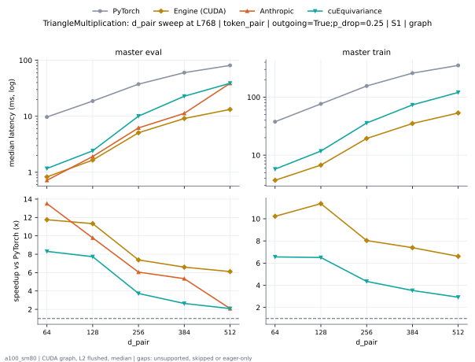

**master eval** (median ms; x = speedup vs PyTorch)

| d_pair | PyTorch | Engine (Triton) | Engine (CUDA) | Anthropic | cuEquivariance |
|---|---|---|---|---|---|
| 64 | 9.72 | 0.852 (11.41x) | 0.8269 (11.75x) | 0.7199 (13.50x) | 1.17 (8.31x) |
| 128 | 18.71 | 2.27 (8.24x) | 1.652 (11.32x) | 1.913 (9.78x) | 2.42 (7.73x) |
| 256 | 37.52 | 5.887 (6.37x) | 5.085 (7.38x) | 6.203 (6.05x) | 10.07 (3.73x) |
| 384 | 60.22 | 10.88 (5.54x) | 9.134 (6.59x) | 11.28 (5.34x) | 22.82 (2.64x) |
| 512 | 81.05 | 20.01 (4.05x) | 13.27 (6.11x) | 38.87 (2.09x) | 38.89 (2.08x) |

**master train** (median ms; x = speedup vs PyTorch)

| d_pair | PyTorch | Engine (Triton) | Engine (CUDA) | Anthropic | cuEquivariance |
|---|---|---|---|---|---|
| 64 | 37.68 | 3.903 (9.65x) | 3.686 (10.22x) | unsupported | 5.744 (6.56x) |
| 128 | 76.51 | 8.423 (9.08x) | 6.735 (11.36x) | unsupported | 11.76 (6.51x) |
| 256 | 155.7 | 20.1 (7.74x) | 19.38 (8.03x) | unsupported | 35.8 (4.35x) |
| 384 | 259.2 | 36.73 (7.06x) | 35.08 (7.39x) | unsupported | 73.47 (3.53x) |
| 512 | 352.4 | 57.91 (6.08x) | 53.31 (6.61x) | unsupported | 120.6 (2.92x) |

