# TriangleMultiplication on a100_sm80

Generated by `python -m foldjet_engine.measure.plot` from speed tokens `judge/tokens/a100_sm80/`; do not edit.

### L sweep: af3|boltz2|chai1|opendde|openfold3|openfold3_preview2|protenix | token_pair | d_pair=64;outgoing=False;p_drop=0.25 | S1 | graph

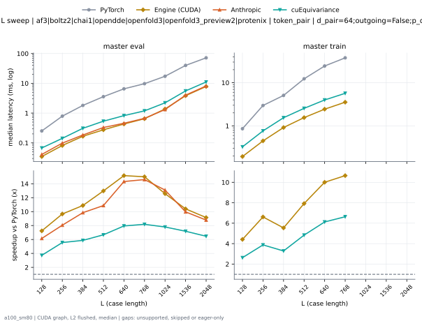

**master eval** (median ms; x = speedup vs PyTorch)

| L | PyTorch | Engine (Triton) | Engine (CUDA) | Anthropic | cuEquivariance |
|---|---|---|---|---|---|
| 128 | 0.2519 | 0.0727 (3.46x) | 0.03482 (7.24x) | 0.04096 (6.15x) | 0.06758 (3.73x) |
| 256 | 0.7916 | 0.1341 (5.90x) | 0.08192 (9.66x) | 0.0983 (8.05x) | 0.1423 (5.56x) |
| 384 | 1.816 | 0.2376 (7.64x) | 0.1669 (10.88x) | 0.1843 (9.85x) | 0.3092 (5.87x) |
| 512 | 3.573 | 0.3779 (9.46x) | 0.2755 (12.97x) | 0.3287 (10.87x) | 0.5356 (6.67x) |
| 640 | 6.539 | 0.5745 (11.38x) | 0.4311 (15.17x) | 0.4567 (14.32x) | 0.8233 (7.94x) |
| 768 | 9.74 | 0.8315 (11.71x) | 0.6492 (15.00x) | 0.6671 (14.60x) | 1.191 (8.18x) |
| 1024 | 17.29 | 1.641 (10.53x) | 1.375 (12.57x) | 1.32 (13.09x) | 2.218 (7.79x) |
| 1536 | 39.98 | 4.317 (9.26x) | 3.847 (10.39x) | 4.014 (9.96x) | 5.567 (7.18x) |
| 2048 | 71.83 | 8.864 (8.10x) | 7.852 (9.15x) | 8.175 (8.79x) | 11.11 (6.46x) |

**master train** (median ms; x = speedup vs PyTorch)

| L | PyTorch | Engine (Triton) | Engine (CUDA) | Anthropic | cuEquivariance |
|---|---|---|---|---|---|
| 128 | 0.8591 | 0.2468 (3.48x) | 0.1946 (4.42x) | unsupported | 0.3267 (2.63x) |
| 256 | 2.966 | 0.5274 (5.62x) | 0.4485 (6.61x) | unsupported | 0.7649 (3.88x) |
| 384 | 5.073 | 1.029 (4.93x) | 0.9155 (5.54x) | unsupported | 1.544 (3.29x) |
| 512 | 12.31 | 1.736 (7.09x) | 1.554 (7.92x) | unsupported | 2.546 (4.84x) |
| 640 | 24.37 | 2.71 (8.99x) | 2.436 (10.01x) | unsupported | 3.98 (6.12x) |
| 768 | 37.67 | 3.89 (9.68x) | 3.535 (10.66x) | unsupported | 5.679 (6.63x) |
| 1024 |  |  |  |  |  |
| 1536 |  |  |  |  |  |
| 2048 |  |  |  |  |  |

### L sweep: af3|boltz2|chai1|opendde|openfold3|openfold3_preview2|protenix | token_pair | d_pair=64;outgoing=True;p_drop=0.25 | S1 | graph

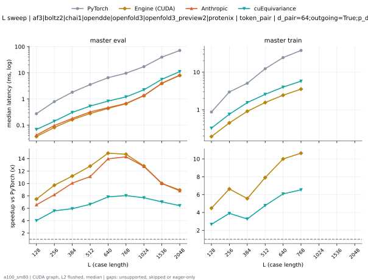

**master eval** (median ms; x = speedup vs PyTorch)

| L | PyTorch | Engine (Triton) | Engine (CUDA) | Anthropic | cuEquivariance |
|---|---|---|---|---|---|
| 128 | 0.2755 | 0.07475 (3.68x) | 0.03686 (7.47x) | 0.04198 (6.56x) | 0.06861 (4.01x) |
| 256 | 0.7956 | 0.1341 (5.93x) | 0.08192 (9.71x) | 0.09728 (8.18x) | 0.1423 (5.59x) |
| 384 | 1.823 | 0.2335 (7.81x) | 0.1628 (11.19x) | 0.1812 (10.06x) | 0.3072 (5.93x) |
| 512 | 3.575 | 0.3748 (9.54x) | 0.2796 (12.79x) | 0.3215 (11.12x) | 0.5386 (6.64x) |
| 640 | 6.538 | 0.5837 (11.20x) | 0.4393 (14.88x) | 0.468 (13.97x) | 0.834 (7.84x) |
| 768 | 9.719 | 0.8714 (11.15x) | 0.6605 (14.71x) | 0.6794 (14.30x) | 1.208 (8.04x) |
| 1024 | 17.29 | 1.661 (10.41x) | 1.349 (12.82x) | 1.357 (12.74x) | 2.247 (7.70x) |
| 1536 | 39.88 | 4.448 (8.97x) | 3.983 (10.01x) | 3.987 (10.00x) | 5.671 (7.03x) |
| 2048 | 71.84 | 8.965 (8.01x) | 8.038 (8.94x) | 8.148 (8.82x) | 11.18 (6.43x) |

**master train** (median ms; x = speedup vs PyTorch)

| L | PyTorch | Engine (Triton) | Engine (CUDA) | Anthropic | cuEquivariance |
|---|---|---|---|---|---|
| 128 | 0.8724 | 0.2458 (3.55x) | 0.1946 (4.48x) | unsupported | 0.3256 (2.68x) |
| 256 | 2.976 | 0.5274 (5.64x) | 0.4485 (6.64x) | unsupported | 0.7629 (3.90x) |
| 384 | 5.069 | 1.03 (4.92x) | 0.9114 (5.56x) | unsupported | 1.548 (3.27x) |
| 512 | 12.32 | 1.736 (7.10x) | 1.557 (7.91x) | unsupported | 2.575 (4.78x) |
| 640 | 24.38 | 2.711 (8.99x) | 2.438 (10.00x) | unsupported | 4.007 (6.08x) |
| 768 | 37.68 | 3.893 (9.68x) | 3.54 (10.64x) | unsupported | 5.762 (6.54x) |
| 1024 |  |  |  |  |  |
| 1536 |  |  |  |  |  |
| 2048 |  |  |  |  |  |

### L sweep: af3|boltz2|openfold3|openfold3_preview2|protenix | token_pair | d_pair=128;outgoing=False;p_drop=0.25 | S1 | graph

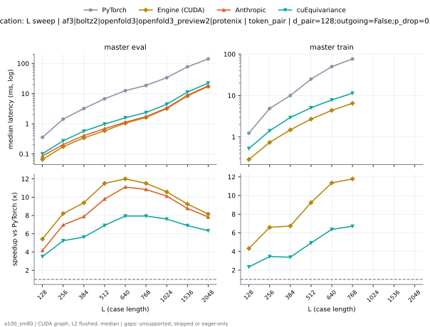

**master eval** (median ms; x = speedup vs PyTorch)

| L | PyTorch | Engine (Triton) | Engine (CUDA) | Anthropic | cuEquivariance |
|---|---|---|---|---|---|
| 128 | 0.3553 | 0.1116 (3.18x) | 0.06554 (5.42x) | 0.08499 (4.18x) | 0.1014 (3.51x) |
| 256 | 1.43 | 0.2724 (5.25x) | 0.1741 (8.21x) | 0.2053 (6.96x) | 0.2729 (5.24x) |
| 384 | 3.203 | 0.5253 (6.10x) | 0.341 (9.39x) | 0.4065 (7.88x) | 0.5683 (5.64x) |
| 512 | 6.745 | 0.8991 (7.50x) | 0.5857 (11.51x) | 0.6881 (9.80x) | 0.9759 (6.91x) |
| 640 | 12.55 | 1.453 (8.64x) | 1.046 (12.00x) | 1.129 (11.11x) | 1.58 (7.94x) |
| 768 | 18.74 | 2.174 (8.62x) | 1.628 (11.51x) | 1.729 (10.84x) | 2.361 (7.94x) |
| 1024 | 33.77 | 4.089 (8.26x) | 3.192 (10.58x) | 3.339 (10.11x) | 4.442 (7.60x) |
| 1536 | 77.65 | 10.52 (7.38x) | 8.395 (9.25x) | 8.851 (8.77x) | 11.26 (6.90x) |
| 2048 | 141.5 | 21.06 (6.72x) | 17.34 (8.16x) | 18.07 (7.83x) | 22.35 (6.33x) |

**master train** (median ms; x = speedup vs PyTorch)

| L | PyTorch | Engine (Triton) | Engine (CUDA) | Anthropic | cuEquivariance |
|---|---|---|---|---|---|
| 128 | 1.239 | 0.3666 (3.38x) | 0.2867 (4.32x) | unsupported | 0.5274 (2.35x) |
| 256 | 4.876 | 1.002 (4.86x) | 0.7404 (6.59x) | unsupported | 1.413 (3.45x) |
| 384 | 10.01 | 2.014 (4.97x) | 1.487 (6.73x) | unsupported | 2.956 (3.39x) |
| 512 | 24.98 | 3.496 (7.15x) | 2.703 (9.24x) | unsupported | 5.082 (4.92x) |
| 640 | 49.82 | 5.607 (8.88x) | 4.389 (11.35x) | unsupported | 7.822 (6.37x) |
| 768 | 76.57 | 8.177 (9.36x) | 6.499 (11.78x) | unsupported | 11.42 (6.70x) |
| 1024 |  |  |  |  |  |
| 1536 |  |  |  |  |  |
| 2048 |  |  |  |  |  |

### L sweep: af3|boltz2|openfold3|openfold3_preview2|protenix | token_pair | d_pair=128;outgoing=True;p_drop=0.25 | S1 | graph

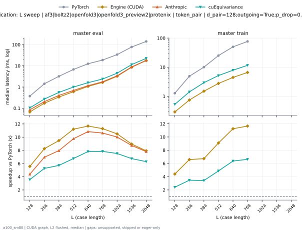

**master eval** (median ms; x = speedup vs PyTorch)

| L | PyTorch | Engine (Triton) | Engine (CUDA) | Anthropic | cuEquivariance |
|---|---|---|---|---|---|
| 128 | 0.3732 | 0.1147 (3.25x) | 0.06707 (5.56x) | 0.08499 (4.39x) | 0.1044 (3.57x) |
| 256 | 1.428 | 0.2714 (5.26x) | 0.1731 (8.25x) | 0.2053 (6.96x) | 0.2714 (5.26x) |
| 384 | 3.204 | 0.5243 (6.11x) | 0.3379 (9.48x) | 0.4024 (7.96x) | 0.5601 (5.72x) |
| 512 | 6.757 | 0.939 (7.20x) | 0.6031 (11.20x) | 0.6922 (9.76x) | 0.9994 (6.76x) |
| 640 | 12.54 | 1.488 (8.42x) | 1.074 (11.68x) | 1.157 (10.84x) | 1.604 (7.82x) |
| 768 | 18.75 | 2.246 (8.35x) | 1.661 (11.29x) | 1.765 (10.62x) | 2.39 (7.84x) |
| 1024 | 33.86 | 4.191 (8.08x) | 3.226 (10.50x) | 3.381 (10.01x) | 4.502 (7.52x) |
| 1536 | 77.36 | 10.83 (7.15x) | 8.642 (8.95x) | 8.861 (8.73x) | 11.47 (6.75x) |
| 2048 | 141.5 | 21.34 (6.63x) | 17.84 (7.93x) | 18.11 (7.81x) | 22.49 (6.29x) |

**master train** (median ms; x = speedup vs PyTorch)

| L | PyTorch | Engine (Triton) | Engine (CUDA) | Anthropic | cuEquivariance |
|---|---|---|---|---|---|
| 128 | 1.271 | 0.3666 (3.47x) | 0.2888 (4.40x) | unsupported | 0.5268 (2.41x) |
| 256 | 4.877 | 1.01 (4.83x) | 0.7404 (6.59x) | unsupported | 1.405 (3.47x) |
| 384 | 10.03 | 2.031 (4.94x) | 1.491 (6.72x) | unsupported | 2.932 (3.42x) |
| 512 | 25.02 | 3.514 (7.12x) | 2.753 (9.09x) | unsupported | 5.137 (4.87x) |
| 640 | 49.94 | 5.624 (8.88x) | 4.442 (11.24x) | unsupported | 7.847 (6.36x) |
| 768 | 76.69 | 8.247 (9.30x) | 6.586 (11.64x) | unsupported | 11.58 (6.62x) |
| 1024 |  |  |  |  |  |
| 1536 |  |  |  |  |  |
| 2048 |  |  |  |  |  |

### L sweep: chai1|esmfold2|intellifold2|protenix | token_pair | d_pair=256;outgoing=False;p_drop=0.25 | S1 | graph

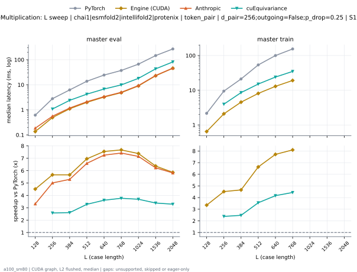

**master eval** (median ms; x = speedup vs PyTorch)

| L | PyTorch | Engine (Triton) | Engine (CUDA) | Anthropic | cuEquivariance |
|---|---|---|---|---|---|
| 128 | 0.6144 | 0.234 (2.63x) | 0.1362 (4.51x) | 0.1853 (3.31x) | unsupported |
| 256 | 2.789 | 0.6482 (4.30x) | 0.4925 (5.66x) | 0.5571 (5.01x) | 1.081 (2.58x) |
| 384 | 6.236 | 1.329 (4.69x) | 1.102 (5.66x) | 1.178 (5.30x) | 2.393 (2.61x) |
| 512 | 13.84 | 2.385 (5.80x) | 1.99 (6.96x) | 2.101 (6.59x) | 4.223 (3.28x) |
| 640 | 24.41 | 3.813 (6.40x) | 3.234 (7.55x) | 3.365 (7.26x) | 6.765 (3.61x) |
| 768 | 37.2 | 5.746 (6.47x) | 4.847 (7.67x) | 5.011 (7.42x) | 9.876 (3.77x) |
| 1024 | 66.57 | 10.43 (6.39x) | 9.018 (7.38x) | 9.31 (7.15x) | 18.05 (3.69x) |
| 1536 | 146.2 | 26.33 (5.55x) | 22.94 (6.37x) | 23.47 (6.23x) | 43.22 (3.38x) |
| 2048 | 268.6 | 51.69 (5.20x) | 45.85 (5.86x) | 46.19 (5.82x) | 81.66 (3.29x) |

**master train** (median ms; x = speedup vs PyTorch)

| L | PyTorch | Engine (Triton) | Engine (CUDA) | Anthropic | cuEquivariance |
|---|---|---|---|---|---|
| 128 | 2.161 | 0.682 (3.17x) | 0.6451 (3.35x) | unsupported | unsupported |
| 256 | 9.441 | 2.215 (4.26x) | 2.09 (4.52x) | unsupported | 3.963 (2.38x) |
| 384 | 21.13 | 4.697 (4.50x) | 4.536 (4.66x) | unsupported | 8.541 (2.47x) |
| 512 | 53.63 | 8.288 (6.47x) | 8.089 (6.63x) | unsupported | 15.09 (3.55x) |
| 640 | 99.89 | 13.51 (7.40x) | 12.95 (7.71x) | unsupported | 23.98 (4.17x) |
| 768 | 154.8 | 19.87 (7.79x) | 19.12 (8.09x) | unsupported | 34.86 (4.44x) |
| 1024 |  |  |  |  |  |
| 1536 |  |  |  |  |  |
| 2048 |  |  |  |  |  |

### L sweep: chai1|esmfold2|intellifold2|protenix | token_pair | d_pair=256;outgoing=True;p_drop=0.25 | S1 | graph

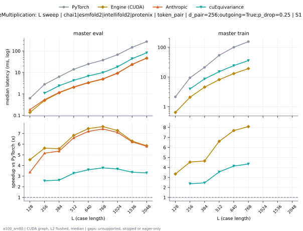

**master eval** (median ms; x = speedup vs PyTorch)

| L | PyTorch | Engine (Triton) | Engine (CUDA) | Anthropic | cuEquivariance |
|---|---|---|---|---|---|
| 128 | 0.6277 | 0.2355 (2.67x) | 0.1382 (4.54x) | 0.1864 (3.37x) | unsupported |
| 256 | 2.788 | 0.6584 (4.23x) | 0.4956 (5.63x) | 0.5407 (5.16x) | 1.089 (2.56x) |
| 384 | 6.295 | 1.353 (4.65x) | 1.129 (5.57x) | 1.178 (5.35x) | 2.401 (2.62x) |
| 512 | 13.94 | 2.457 (5.68x) | 2.043 (6.83x) | 2.116 (6.59x) | 4.257 (3.28x) |
| 640 | 24.57 | 3.901 (6.30x) | 3.293 (7.46x) | 3.414 (7.20x) | 6.825 (3.60x) |
| 768 | 37.33 | 5.743 (6.50x) | 4.882 (7.65x) | 5.026 (7.43x) | 9.89 (3.78x) |
| 1024 | 66.8 | 10.77 (6.20x) | 9.172 (7.28x) | 9.413 (7.10x) | 18.2 (3.67x) |
| 1536 | 146.8 | 27.01 (5.43x) | 23.33 (6.29x) | 23.62 (6.21x) | 43.64 (3.36x) |
| 2048 | 271.3 | 52.35 (5.18x) | 46.37 (5.85x) | 46.78 (5.80x) | 82.11 (3.30x) |

**master train** (median ms; x = speedup vs PyTorch)

| L | PyTorch | Engine (Triton) | Engine (CUDA) | Anthropic | cuEquivariance |
|---|---|---|---|---|---|
| 128 | 2.152 | 0.6861 (3.14x) | 0.6441 (3.34x) | unsupported | unsupported |
| 256 | 9.433 | 2.224 (4.24x) | 2.081 (4.53x) | unsupported | 3.984 (2.37x) |
| 384 | 21.17 | 4.74 (4.47x) | 4.56 (4.64x) | unsupported | 8.609 (2.46x) |
| 512 | 53.85 | 8.379 (6.43x) | 8.155 (6.60x) | unsupported | 15.17 (3.55x) |
| 640 | 100.1 | 13.62 (7.35x) | 13.03 (7.68x) | unsupported | 24.21 (4.13x) |
| 768 | 155.2 | 19.99 (7.76x) | 19.22 (8.07x) | unsupported | 35.75 (4.34x) |
| 1024 |  |  |  |  |  |
| 1536 |  |  |  |  |  |
| 2048 |  |  |  |  |  |

### L sweep: intellifold2 | token_pair | d_pair=512;outgoing=False;p_drop=0.25 | S1 | graph

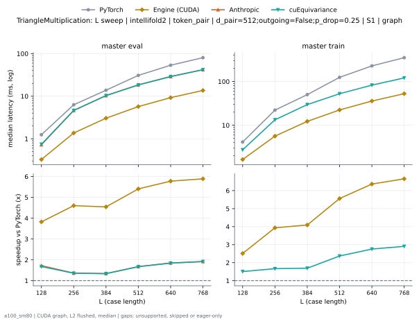

**master eval** (median ms; x = speedup vs PyTorch)

| L | PyTorch | Engine (Triton) | Engine (CUDA) | Anthropic | cuEquivariance |
|---|---|---|---|---|---|
| 128 | 1.245 | 0.6881 (1.81x) | 0.3256 (3.82x) | 0.7229 (1.72x) | 0.7424 (1.68x) |
| 256 | 6.29 | 2.123 (2.96x) | 1.367 (4.60x) | 4.618 (1.36x) | 4.634 (1.36x) |
| 384 | 13.84 | 4.666 (2.97x) | 3.045 (4.54x) | 10.32 (1.34x) | 10.35 (1.34x) |
| 512 | 30.83 | 8.321 (3.71x) | 5.701 (5.41x) | 18.41 (1.67x) | 18.44 (1.67x) |
| 640 | 53.48 | 13.36 (4.00x) | 9.253 (5.78x) | 28.92 (1.85x) | 29.01 (1.84x) |
| 768 | 80.48 | 19.92 (4.04x) | 13.66 (5.89x) | 41.91 (1.92x) | 41.98 (1.92x) |

**master train** (median ms; x = speedup vs PyTorch)

| L | PyTorch | Engine (Triton) | Engine (CUDA) | Anthropic | cuEquivariance |
|---|---|---|---|---|---|
| 128 | 4.14 | 1.651 (2.51x) | 1.649 (2.51x) | unsupported | 2.747 (1.51x) |
| 256 | 22.21 | 5.869 (3.78x) | 5.644 (3.94x) | unsupported | 13.33 (1.67x) |
| 384 | 50.2 | 12.98 (3.87x) | 12.27 (4.09x) | unsupported | 29.68 (1.69x) |
| 512 | 124.6 | 23.3 (5.35x) | 22.4 (5.56x) | unsupported | 52.58 (2.37x) |
| 640 | 227.9 | 39.14 (5.82x) | 35.81 (6.37x) | unsupported | 82.71 (2.76x) |
| 768 | 351.2 | 57.21 (6.14x) | 52.77 (6.65x) | unsupported | 120.9 (2.91x) |

### L sweep: intellifold2 | token_pair | d_pair=512;outgoing=True;p_drop=0.25 | S1 | graph

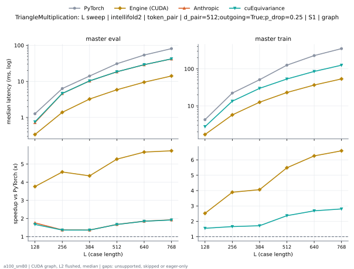

**master eval** (median ms; x = speedup vs PyTorch)

| L | PyTorch | Engine (Triton) | Engine (CUDA) | Anthropic | cuEquivariance |
|---|---|---|---|---|---|
| 128 | 1.268 | 0.6994 (1.81x) | 0.3369 (3.76x) | 0.7199 (1.76x) | 0.7567 (1.68x) |
| 256 | 6.332 | 2.168 (2.92x) | 1.387 (4.57x) | 4.618 (1.37x) | 4.639 (1.37x) |
| 384 | 14.1 | 4.784 (2.95x) | 3.24 (4.35x) | 10.31 (1.37x) | 10.34 (1.36x) |
| 512 | 30.93 | 8.514 (3.63x) | 5.865 (5.27x) | 18.46 (1.68x) | 18.5 (1.67x) |
| 640 | 53.82 | 13.64 (3.95x) | 9.504 (5.66x) | 29.01 (1.86x) | 29.1 (1.85x) |
| 768 | 81.09 | 19.87 (4.08x) | 14.14 (5.73x) | 42.03 (1.93x) | 42.21 (1.92x) |

**master train** (median ms; x = speedup vs PyTorch)

| L | PyTorch | Engine (Triton) | Engine (CUDA) | Anthropic | cuEquivariance |
|---|---|---|---|---|---|
| 128 | 4.24 | 1.671 (2.54x) | 1.682 (2.52x) | unsupported | 2.741 (1.55x) |
| 256 | 22.18 | 5.994 (3.70x) | 5.7 (3.89x) | unsupported | 13.39 (1.66x) |
| 384 | 51.04 | 13.25 (3.85x) | 12.57 (4.06x) | unsupported | 29.8 (1.71x) |
| 512 | 126.2 | 23.91 (5.28x) | 23 (5.49x) | unsupported | 53.3 (2.37x) |
| 640 | 229 | 40.02 (5.72x) | 36.58 (6.26x) | unsupported | 85.33 (2.68x) |
| 768 | 353 | 58.01 (6.08x) | 53.56 (6.59x) | unsupported | 125.8 (2.81x) |

### L sweep: opendde | token_pair | d_pair=384;outgoing=False;p_drop=0.25 | S1 | graph

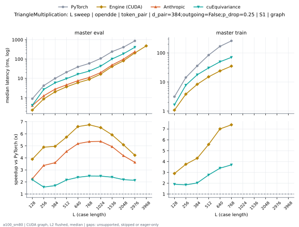

**master eval** (median ms; x = speedup vs PyTorch)

| L | PyTorch | Engine (Triton) | Engine (CUDA) | Anthropic | cuEquivariance |
|---|---|---|---|---|---|
| 128 | 0.8806 | 0.4239 (2.08x) | 0.2263 (3.89x) | 0.3881 (2.27x) | 0.4024 (2.19x) |
| 256 | 4.182 | 1.155 (3.62x) | 0.8556 (4.89x) | 1.241 (3.37x) | 2.655 (1.58x) |
| 384 | 9.944 | 2.501 (3.98x) | 2.006 (4.96x) | 2.76 (3.60x) | 5.856 (1.70x) |
| 512 | 20.84 | 4.424 (4.71x) | 3.642 (5.72x) | 4.602 (4.53x) | 9.629 (2.16x) |
| 640 | 39.19 | 7.179 (5.46x) | 5.941 (6.60x) | 7.565 (5.18x) | 16.43 (2.39x) |
| 768 | 59.52 | 10.44 (5.70x) | 8.822 (6.75x) | 11.12 (5.35x) | 23.85 (2.50x) |
| 1024 | 107.3 | 19.57 (5.48x) | 16.48 (6.51x) | 19.97 (5.37x) | 43.14 (2.49x) |
| 1536 | 242.5 | 47.68 (5.09x) | 41.02 (5.91x) | 49.17 (4.93x) | 101.1 (2.40x) |
| 2048 | 411.7 | 92.69 (4.44x) | 80.97 (5.08x) | 98.48 (4.18x) | 187.6 (2.19x) |
| 2976 | 874.6 | 234.2 (3.73x) | 207.3 (4.22x) | 240.9 (3.63x) | 409 (2.14x) |
| 3968 | skipped | 535.3 | 480.8 | skipped | skipped |

**master train** (median ms; x = speedup vs PyTorch)

| L | PyTorch | Engine (Triton) | Engine (CUDA) | Anthropic | cuEquivariance |
|---|---|---|---|---|---|
| 128 | 3.117 | 1.106 (2.82x) | 1.077 (2.89x) | unsupported | 1.64 (1.90x) |
| 256 | 14.27 | 3.961 (3.60x) | 3.809 (3.75x) | unsupported | 7.738 (1.84x) |
| 384 | 35.72 | 8.602 (4.15x) | 8.3 (4.30x) | unsupported | 17.68 (2.02x) |
| 512 | 83.83 | 15.34 (5.47x) | 15.04 (5.57x) | unsupported | 30.36 (2.76x) |
| 640 | 167.9 | 24.95 (6.73x) | 23.96 (7.01x) | unsupported | 49.6 (3.39x) |
| 768 | 258.8 | 36.66 (7.06x) | 35.04 (7.39x) | unsupported | 70.15 (3.69x) |
| 1024 |  |  |  |  |  |
| 1536 |  |  |  |  |  |
| 2048 |  |  |  |  |  |
| 2976 |  |  |  |  |  |
| 3968 |  |  |  |  |  |

### L sweep: opendde | token_pair | d_pair=384;outgoing=True;p_drop=0.25 | S1 | graph

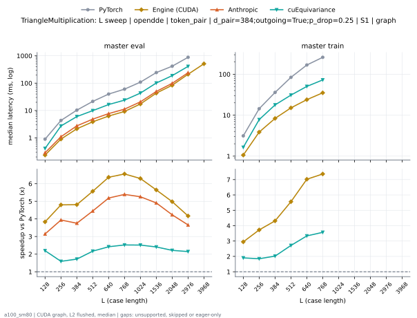

**master eval** (median ms; x = speedup vs PyTorch)

| L | PyTorch | Engine (Triton) | Engine (CUDA) | Anthropic | cuEquivariance |
|---|---|---|---|---|---|
| 128 | 0.8991 | 0.4275 (2.10x) | 0.2345 (3.83x) | 0.2857 (3.15x) | 0.4096 (2.20x) |
| 256 | 4.332 | 1.226 (3.53x) | 0.9027 (4.80x) | 1.1 (3.94x) | 2.721 (1.59x) |
| 384 | 10.32 | 2.666 (3.87x) | 2.145 (4.81x) | 2.747 (3.76x) | 6.005 (1.72x) |
| 512 | 21.5 | 4.676 (4.60x) | 3.859 (5.57x) | 4.83 (4.45x) | 9.905 (2.17x) |
| 640 | 39.94 | 7.554 (5.29x) | 6.273 (6.37x) | 7.7 (5.19x) | 16.51 (2.42x) |
| 768 | 60.43 | 11 (5.49x) | 9.221 (6.55x) | 11.21 (5.39x) | 23.96 (2.52x) |
| 1024 | 109.1 | 20.11 (5.42x) | 17.32 (6.30x) | 20.73 (5.26x) | 43.35 (2.52x) |
| 1536 | 243.8 | 50.22 (4.85x) | 43.17 (5.65x) | 49.67 (4.91x) | 101.2 (2.41x) |
| 2048 | 417.1 | 95.59 (4.36x) | 83.75 (4.98x) | 98.52 (4.23x) | 188.3 (2.22x) |
| 2976 | 882.1 | 238.6 (3.70x) | 211.6 (4.17x) | 241.1 (3.66x) | 411 (2.15x) |
| 3968 | skipped | 560 | 511.8 | skipped | skipped |

**master train** (median ms; x = speedup vs PyTorch)

| L | PyTorch | Engine (Triton) | Engine (CUDA) | Anthropic | cuEquivariance |
|---|---|---|---|---|---|
| 128 | 3.126 | 1.111 (2.81x) | 1.061 (2.95x) | unsupported | 1.642 (1.90x) |
| 256 | 14.4 | 4.027 (3.58x) | 3.866 (3.73x) | unsupported | 7.8 (1.85x) |
| 384 | 36 | 8.912 (4.04x) | 8.346 (4.31x) | unsupported | 17.83 (2.02x) |
| 512 | 84.06 | 15.48 (5.43x) | 15.11 (5.56x) | unsupported | 30.98 (2.71x) |
| 640 | 168.3 | 25.12 (6.70x) | 23.96 (7.02x) | unsupported | 50.48 (3.33x) |
| 768 | 259.5 | 36.68 (7.08x) | 35.22 (7.37x) | unsupported | 72.73 (3.57x) |
| 1024 |  |  |  |  |  |
| 1536 |  |  |  |  |  |
| 2048 |  |  |  |  |  |
| 2976 |  |  |  |  |  |
| 3968 |  |  |  |  |  |

### L sweep: protenix | token_pair | d_hidden=128;d_pair=64;outgoing=False;p_drop=0.25 | S1 | graph

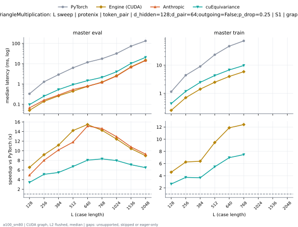

**master eval** (median ms; x = speedup vs PyTorch)

| L | PyTorch | Engine (Triton) | Engine (CUDA) | Anthropic | cuEquivariance |
|---|---|---|---|---|---|
| 128 | 0.3287 | 0.09114 (3.61x) | 0.05018 (6.55x) | 0.06656 (4.94x) | 0.09626 (3.41x) |
| 256 | 1.279 | 0.2002 (6.39x) | 0.1393 (9.18x) | 0.1597 (8.01x) | 0.2509 (5.10x) |
| 384 | 2.896 | 0.3727 (7.77x) | 0.2591 (11.18x) | 0.2847 (10.17x) | 0.5284 (5.48x) |
| 512 | 6.276 | 0.6195 (10.13x) | 0.4413 (14.22x) | 0.5315 (11.81x) | 0.9329 (6.73x) |
| 640 | 11.76 | 1.124 (10.47x) | 0.7608 (15.46x) | 0.7767 (15.14x) | 1.462 (8.05x) |
| 768 | 17.62 | 1.574 (11.20x) | 1.236 (14.26x) | 1.205 (14.62x) | 2.122 (8.31x) |
| 1024 | 31.83 | 3.045 (10.45x) | 2.559 (12.44x) | 2.462 (12.93x) | 3.996 (7.97x) |
| 1536 | 73.38 | 8.23 (8.92x) | 7.024 (10.45x) | 6.795 (10.80x) | 10.34 (7.10x) |
| 2048 | 133.5 | 16.97 (7.87x) | 14.88 (8.97x) | 14.35 (9.30x) | 20.57 (6.49x) |

**master train** (median ms; x = speedup vs PyTorch)

| L | PyTorch | Engine (Triton) | Engine (CUDA) | Anthropic | cuEquivariance |
|---|---|---|---|---|---|
| 128 | 1.144 | 0.3062 (3.74x) | 0.2493 (4.59x) | unsupported | 0.4332 (2.64x) |
| 256 | 4.387 | 0.7931 (5.53x) | 0.7014 (6.25x) | unsupported | 1.176 (3.73x) |
| 384 | 9.006 | 1.587 (5.68x) | 1.41 (6.39x) | unsupported | 2.458 (3.66x) |
| 512 | 23.42 | 2.733 (8.57x) | 2.476 (9.46x) | unsupported | 4.281 (5.47x) |
| 640 | 47.18 | 4.466 (10.57x) | 3.973 (11.88x) | unsupported | 6.77 (6.97x) |
| 768 | 72.73 | 6.463 (11.25x) | 5.862 (12.41x) | unsupported | 9.735 (7.47x) |
| 1024 |  |  |  |  |  |
| 1536 |  |  |  |  |  |
| 2048 |  |  |  |  |  |

### L sweep: protenix | token_pair | d_hidden=128;d_pair=64;outgoing=True;p_drop=0.25 | S1 | graph

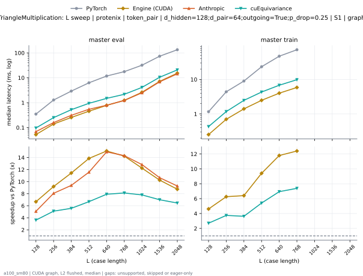

**master eval** (median ms; x = speedup vs PyTorch)

| L | PyTorch | Engine (Triton) | Engine (CUDA) | Anthropic | cuEquivariance |
|---|---|---|---|---|---|
| 128 | 0.3482 | 0.09318 (3.74x) | 0.05222 (6.67x) | 0.06861 (5.07x) | 0.09626 (3.62x) |
| 256 | 1.28 | 0.1987 (6.44x) | 0.1393 (9.19x) | 0.1587 (8.06x) | 0.2509 (5.10x) |
| 384 | 2.915 | 0.3645 (8.00x) | 0.255 (11.43x) | 0.3108 (9.38x) | 0.5233 (5.57x) |
| 512 | 6.292 | 0.6369 (9.88x) | 0.4541 (13.86x) | 0.5437 (11.57x) | 0.9421 (6.68x) |
| 640 | 11.77 | 1.041 (11.31x) | 0.7803 (15.09x) | 0.788 (14.94x) | 1.488 (7.91x) |
| 768 | 17.64 | 1.608 (10.97x) | 1.239 (14.24x) | 1.232 (14.32x) | 2.172 (8.12x) |
| 1024 | 32.06 | 3.135 (10.23x) | 2.618 (12.24x) | 2.499 (12.83x) | 4.111 (7.80x) |
| 1536 | 73.52 | 8.503 (8.65x) | 7.17 (10.25x) | 6.9 (10.66x) | 10.51 (7.00x) |
| 2048 | 134 | 17.17 (7.80x) | 15.33 (8.74x) | 14.45 (9.28x) | 20.77 (6.45x) |

**master train** (median ms; x = speedup vs PyTorch)

| L | PyTorch | Engine (Triton) | Engine (CUDA) | Anthropic | cuEquivariance |
|---|---|---|---|---|---|
| 128 | 1.162 | 0.3052 (3.81x) | 0.2519 (4.61x) | unsupported | 0.4301 (2.70x) |
| 256 | 4.387 | 0.7946 (5.52x) | 0.7004 (6.26x) | unsupported | 1.17 (3.75x) |
| 384 | 8.984 | 1.594 (5.63x) | 1.402 (6.41x) | unsupported | 2.474 (3.63x) |
| 512 | 23.35 | 2.73 (8.55x) | 2.482 (9.41x) | unsupported | 4.315 (5.41x) |
| 640 | 47.18 | 4.462 (10.57x) | 3.999 (11.80x) | unsupported | 6.797 (6.94x) |
| 768 | 72.63 | 6.463 (11.24x) | 5.856 (12.40x) | unsupported | 9.833 (7.39x) |
| 1024 |  |  |  |  |  |
| 1536 |  |  |  |  |  |
| 2048 |  |  |  |  |  |

### d_pair sweep at L768: token_pair | outgoing=False;p_drop=0.25 | S1 | graph

**master eval** (median ms; x = speedup vs PyTorch)

| d_pair | PyTorch | Engine (Triton) | Engine (CUDA) | Anthropic | cuEquivariance |
|---|---|---|---|---|---|
| 64 | 9.74 | 0.8315 (11.71x) | 0.6492 (15.00x) | 0.6671 (14.60x) | 1.191 (8.18x) |
| 128 | 18.74 | 2.174 (8.62x) | 1.628 (11.51x) | 1.729 (10.84x) | 2.361 (7.94x) |
| 256 | 37.2 | 5.746 (6.47x) | 4.847 (7.67x) | 5.011 (7.42x) | 9.876 (3.77x) |
| 384 | 59.52 | 10.44 (5.70x) | 8.822 (6.75x) | 11.12 (5.35x) | 23.85 (2.50x) |
| 512 | 80.48 | 19.92 (4.04x) | 13.66 (5.89x) | 41.91 (1.92x) | 41.98 (1.92x) |

**master train** (median ms; x = speedup vs PyTorch)

| d_pair | PyTorch | Engine (Triton) | Engine (CUDA) | Anthropic | cuEquivariance |
|---|---|---|---|---|---|
| 64 | 37.67 | 3.89 (9.68x) | 3.535 (10.66x) | unsupported | 5.679 (6.63x) |
| 128 | 76.57 | 8.177 (9.36x) | 6.499 (11.78x) | unsupported | 11.42 (6.70x) |
| 256 | 154.8 | 19.87 (7.79x) | 19.12 (8.09x) | unsupported | 34.86 (4.44x) |
| 384 | 258.8 | 36.66 (7.06x) | 35.04 (7.39x) | unsupported | 70.15 (3.69x) |
| 512 | 351.2 | 57.21 (6.14x) | 52.77 (6.65x) | unsupported | 120.9 (2.91x) |

### d_pair sweep at L768: token_pair | outgoing=True;p_drop=0.25 | S1 | graph

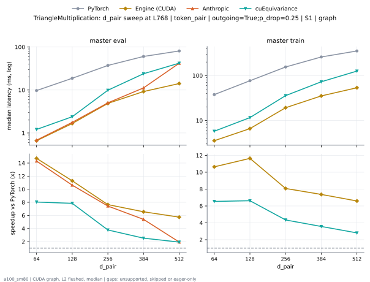

**master eval** (median ms; x = speedup vs PyTorch)

| d_pair | PyTorch | Engine (Triton) | Engine (CUDA) | Anthropic | cuEquivariance |
|---|---|---|---|---|---|
| 64 | 9.719 | 0.8714 (11.15x) | 0.6605 (14.71x) | 0.6794 (14.30x) | 1.208 (8.04x) |
| 128 | 18.75 | 2.246 (8.35x) | 1.661 (11.29x) | 1.765 (10.62x) | 2.39 (7.84x) |
| 256 | 37.33 | 5.743 (6.50x) | 4.882 (7.65x) | 5.026 (7.43x) | 9.89 (3.78x) |
| 384 | 60.43 | 11 (5.49x) | 9.221 (6.55x) | 11.21 (5.39x) | 23.96 (2.52x) |
| 512 | 81.09 | 19.87 (4.08x) | 14.14 (5.73x) | 42.03 (1.93x) | 42.21 (1.92x) |

**master train** (median ms; x = speedup vs PyTorch)

| d_pair | PyTorch | Engine (Triton) | Engine (CUDA) | Anthropic | cuEquivariance |
|---|---|---|---|---|---|
| 64 | 37.68 | 3.893 (9.68x) | 3.54 (10.64x) | unsupported | 5.762 (6.54x) |
| 128 | 76.69 | 8.247 (9.30x) | 6.586 (11.64x) | unsupported | 11.58 (6.62x) |
| 256 | 155.2 | 19.99 (7.76x) | 19.22 (8.07x) | unsupported | 35.75 (4.34x) |
| 384 | 259.5 | 36.68 (7.08x) | 35.22 (7.37x) | unsupported | 72.73 (3.57x) |
| 512 | 353 | 58.01 (6.08x) | 53.56 (6.59x) | unsupported | 125.8 (2.81x) |

