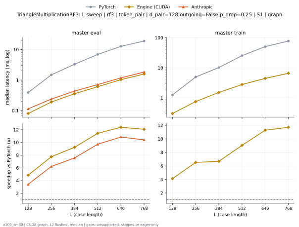
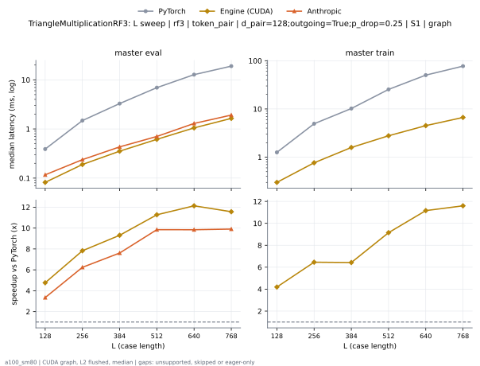
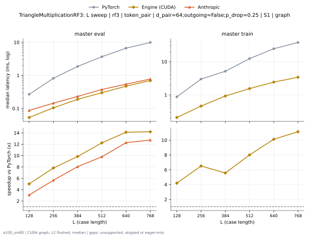
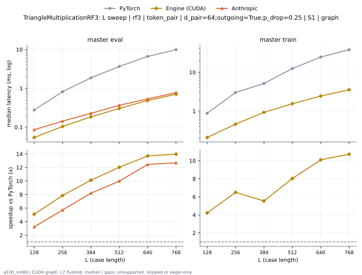

# TriangleMultiplicationRF3 on a100_sm80

Generated by `python -m miniworld_engine.measure.plot` from speed tokens `judge/tokens/a100_sm80/`; do not edit.

### L sweep: rf3 | token_pair | d_pair=128;outgoing=False;p_drop=0.25 | S1 | graph

**master eval** (median ms; x = speedup vs PyTorch)

| L | PyTorch | Engine (Triton) | Engine (CUDA) | Anthropic |
|---|---|---|---|---|
| 128 | 0.3886 | 0.127 (3.06x) | 0.07987 (4.87x) | 0.1137 (3.42x) |
| 256 | 1.478 | 0.2867 (5.15x) | 0.1905 (7.76x) | 0.2371 (6.23x) |
| 384 | 3.283 | 0.5427 (6.05x) | 0.3553 (9.24x) | 0.4342 (7.56x) |
| 512 | 6.911 | 0.9073 (7.62x) | 0.6042 (11.44x) | 0.7107 (9.72x) |
| 640 | 12.76 | 1.458 (8.75x) | 1.03 (12.39x) | 1.176 (10.85x) |
| 768 | 19.03 | 2.187 (8.70x) | 1.576 (12.07x) | 1.828 (10.41x) |

**master train** (median ms; x = speedup vs PyTorch)

| L | PyTorch | Engine (Triton) | Engine (CUDA) | Anthropic |
|---|---|---|---|---|
| 128 | 1.266 | 0.385 (3.29x) | 0.3072 (4.12x) | unsupported |
| 256 | 4.964 | 1.02 (4.87x) | 0.7624 (6.51x) | unsupported |
| 384 | 10.23 | 2.055 (4.98x) | 1.532 (6.68x) | unsupported |
| 512 | 25.33 | 3.519 (7.20x) | 2.803 (9.04x) | unsupported |
| 640 | 50.3 | 5.684 (8.85x) | 4.461 (11.28x) | unsupported |
| 768 | 77.13 | 8.185 (9.42x) | 6.587 (11.71x) | unsupported |

### L sweep: rf3 | token_pair | d_pair=128;outgoing=True;p_drop=0.25 | S1 | graph

**master eval** (median ms; x = speedup vs PyTorch)

| L | PyTorch | Engine (Triton) | Engine (CUDA) | Anthropic |
|---|---|---|---|---|
| 128 | 0.3891 | 0.129 (3.02x) | 0.08192 (4.75x) | 0.1167 (3.33x) |
| 256 | 1.481 | 0.2862 (5.17x) | 0.1894 (7.82x) | 0.2376 (6.23x) |
| 384 | 3.288 | 0.5437 (6.05x) | 0.3502 (9.39x) | 0.4321 (7.61x) |
| 512 | 6.909 | 0.9267 (7.46x) | 0.6226 (11.10x) | 0.7045 (9.81x) |
| 640 | 12.77 | 1.476 (8.65x) | 1.063 (12.01x) | 1.296 (9.85x) |
| 768 | 19.01 | 2.217 (8.57x) | 1.614 (11.78x) | 1.919 (9.91x) |

**master train** (median ms; x = speedup vs PyTorch)

| L | PyTorch | Engine (Triton) | Engine (CUDA) | Anthropic |
|---|---|---|---|---|
| 128 | 1.271 | 0.384 (3.31x) | 0.3123 (4.07x) | unsupported |
| 256 | 4.962 | 1.021 (4.86x) | 0.7649 (6.49x) | unsupported |
| 384 | 10.23 | 2.056 (4.98x) | 1.531 (6.68x) | unsupported |
| 512 | 25.32 | 3.54 (7.15x) | 2.807 (9.02x) | unsupported |
| 640 | 50.34 | 5.706 (8.82x) | 4.507 (11.17x) | unsupported |
| 768 | 77.07 | 8.214 (9.38x) | 6.601 (11.68x) | unsupported |

### L sweep: rf3 | token_pair | d_pair=64;outgoing=False;p_drop=0.25 | S1 | graph

**master eval** (median ms; x = speedup vs PyTorch)

| L | PyTorch | Engine (Triton) | Engine (CUDA) | Anthropic |
|---|---|---|---|---|
| 128 | 0.2693 | 0.08806 (3.06x) | 0.05632 (4.78x) | 0.08704 (3.09x) |
| 256 | 0.8192 | 0.1505 (5.44x) | 0.1178 (6.96x) | 0.1444 (5.67x) |
| 384 | 1.873 | 0.254 (7.37x) | 0.2212 (8.47x) | 0.2314 (8.09x) |
| 512 | 3.664 | 0.3871 (9.47x) | 0.3502 (10.46x) | 0.3738 (9.80x) |
| 640 | 6.662 | 0.5775 (11.54x) | 0.5509 (12.09x) | 0.5417 (12.30x) |
| 768 | 9.913 | 0.8264 (12.00x) | 0.8228 (12.05x) | 0.7752 (12.79x) |

**master train** (median ms; x = speedup vs PyTorch)

| L | PyTorch | Engine (Triton) | Engine (CUDA) | Anthropic |
|---|---|---|---|---|
| 128 | 0.8786 | 0.2627 (3.35x) | 0.213 (4.13x) | unsupported |
| 256 | 3.017 | 0.5407 (5.58x) | 0.4762 (6.34x) | unsupported |
| 384 | 5.159 | 1.046 (4.93x) | 0.9549 (5.40x) | unsupported |
| 512 | 12.45 | 1.725 (7.22x) | 1.595 (7.81x) | unsupported |
| 640 | 24.62 | 2.704 (9.10x) | 2.508 (9.81x) | unsupported |
| 768 | 38.03 | 3.871 (9.83x) | 3.621 (10.50x) | unsupported |

### L sweep: rf3 | token_pair | d_pair=64;outgoing=True;p_drop=0.25 | S1 | graph

**master eval** (median ms; x = speedup vs PyTorch)

| L | PyTorch | Engine (Triton) | Engine (CUDA) | Anthropic |
|---|---|---|---|---|
| 128 | 0.2847 | 0.08806 (3.23x) | 0.05632 (5.05x) | 0.08602 (3.31x) |
| 256 | 0.8192 | 0.1505 (5.44x) | 0.1178 (6.96x) | 0.1434 (5.71x) |
| 384 | 1.874 | 0.2488 (7.53x) | 0.2161 (8.68x) | 0.2273 (8.25x) |
| 512 | 3.666 | 0.3942 (9.30x) | 0.3574 (10.26x) | 0.3666 (10.00x) |
| 640 | 6.664 | 0.5949 (11.20x) | 0.5652 (11.79x) | 0.5345 (12.47x) |
| 768 | 9.917 | 0.8591 (11.54x) | 0.8392 (11.82x) | 0.7788 (12.74x) |

**master train** (median ms; x = speedup vs PyTorch)

| L | PyTorch | Engine (Triton) | Engine (CUDA) | Anthropic |
|---|---|---|---|---|
| 128 | 0.8796 | 0.2632 (3.34x) | 0.213 (4.13x) | unsupported |
| 256 | 3.018 | 0.5391 (5.60x) | 0.4762 (6.34x) | unsupported |
| 384 | 5.153 | 1.05 (4.91x) | 0.9544 (5.40x) | unsupported |
| 512 | 12.46 | 1.731 (7.20x) | 1.601 (7.78x) | unsupported |
| 640 | 24.62 | 2.703 (9.11x) | 2.507 (9.82x) | unsupported |
| 768 | 38.02 | 3.875 (9.81x) | 3.657 (10.40x) | unsupported |

