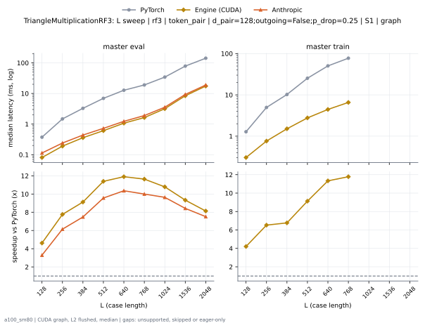
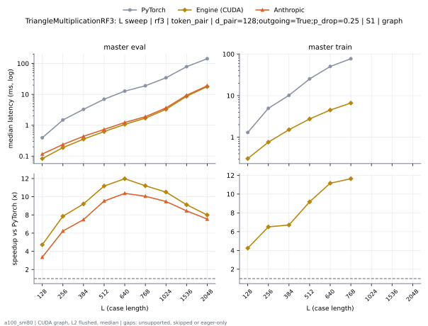
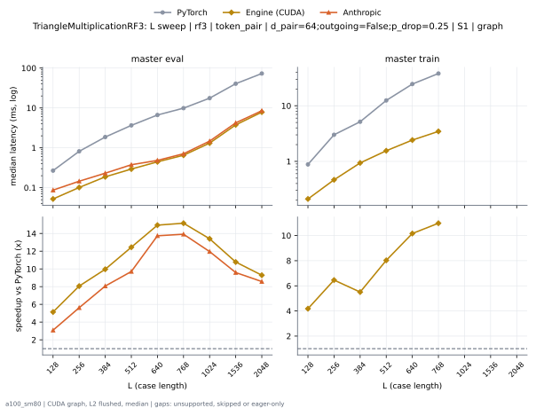
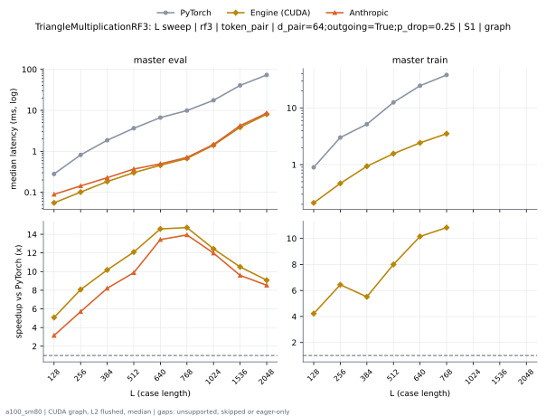

# TriangleMultiplicationRF3 on a100_sm80

Generated by `python -m miniworld_engine.measure.plot` from speed tokens `judge/tokens/a100_sm80/`; do not edit.

### L sweep: rf3 | token_pair | d_pair=128;outgoing=False;p_drop=0.25 | S1 | graph

**master eval** (median ms; x = speedup vs PyTorch)

| L | PyTorch | Engine (Triton) | Engine (CUDA) | Anthropic |
|---|---|---|---|---|
| 128 | 0.3738 | 0.127 (2.94x) | 0.0809 (4.62x) | 0.1137 (3.29x) |
| 256 | 1.479 | 0.2877 (5.14x) | 0.1905 (7.76x) | 0.2406 (6.14x) |
| 384 | 3.279 | 0.5417 (6.05x) | 0.3594 (9.12x) | 0.4383 (7.48x) |
| 512 | 6.943 | 0.9211 (7.54x) | 0.6093 (11.39x) | 0.726 (9.56x) |
| 640 | 12.77 | 1.489 (8.57x) | 1.073 (11.90x) | 1.232 (10.36x) |
| 768 | 19.01 | 2.236 (8.50x) | 1.633 (11.64x) | 1.902 (10.00x) |
| 1024 | 34.36 | 4.154 (8.27x) | 3.186 (10.79x) | 3.566 (9.64x) |
| 1536 | 78.6 | 10.68 (7.36x) | 8.423 (9.33x) | 9.331 (8.42x) |
| 2048 | 142.4 | 21.25 (6.70x) | 17.5 (8.14x) | 18.94 (7.52x) |

**master train** (median ms; x = speedup vs PyTorch)

| L | PyTorch | Engine (Triton) | Engine (CUDA) | Anthropic |
|---|---|---|---|---|
| 128 | 1.279 | 0.383 (3.34x) | 0.3041 (4.21x) | unsupported |
| 256 | 4.964 | 1.021 (4.86x) | 0.7608 (6.52x) | unsupported |
| 384 | 10.22 | 2.037 (5.02x) | 1.51 (6.77x) | unsupported |
| 512 | 25.29 | 3.496 (7.23x) | 2.771 (9.13x) | unsupported |
| 640 | 50.32 | 5.628 (8.94x) | 4.442 (11.33x) | unsupported |
| 768 | 77.32 | 8.177 (9.46x) | 6.564 (11.78x) | unsupported |
| 1024 |  |  |  |  |
| 1536 |  |  |  |  |
| 2048 |  |  |  |  |

### L sweep: rf3 | token_pair | d_pair=128;outgoing=True;p_drop=0.25 | S1 | graph

**master eval** (median ms; x = speedup vs PyTorch)

| L | PyTorch | Engine (Triton) | Engine (CUDA) | Anthropic |
|---|---|---|---|---|
| 128 | 0.3917 | 0.13 (3.01x) | 0.08294 (4.72x) | 0.1167 (3.36x) |
| 256 | 1.48 | 0.2857 (5.18x) | 0.1884 (7.85x) | 0.2376 (6.23x) |
| 384 | 3.273 | 0.5448 (6.01x) | 0.3553 (9.21x) | 0.4372 (7.48x) |
| 512 | 6.97 | 0.9375 (7.43x) | 0.6236 (11.18x) | 0.7316 (9.53x) |
| 640 | 12.76 | 1.531 (8.33x) | 1.065 (11.98x) | 1.23 (10.37x) |
| 768 | 19.02 | 2.256 (8.43x) | 1.697 (11.20x) | 1.892 (10.05x) |
| 1024 | 34.47 | 4.214 (8.18x) | 3.28 (10.51x) | 3.638 (9.48x) |
| 1536 | 79.07 | 10.95 (7.22x) | 8.668 (9.12x) | 9.362 (8.44x) |
| 2048 | 143 | 21.42 (6.68x) | 17.89 (7.99x) | 18.96 (7.54x) |

**master train** (median ms; x = speedup vs PyTorch)

| L | PyTorch | Engine (Triton) | Engine (CUDA) | Anthropic |
|---|---|---|---|---|
| 128 | 1.299 | 0.383 (3.39x) | 0.3062 (4.24x) | unsupported |
| 256 | 4.959 | 1.021 (4.86x) | 0.7619 (6.51x) | unsupported |
| 384 | 10.18 | 2.035 (5.00x) | 1.517 (6.71x) | unsupported |
| 512 | 25.24 | 3.496 (7.22x) | 2.751 (9.17x) | unsupported |
| 640 | 50.26 | 5.662 (8.88x) | 4.504 (11.16x) | unsupported |
| 768 | 77.19 | 8.203 (9.41x) | 6.634 (11.64x) | unsupported |
| 1024 |  |  |  |  |
| 1536 |  |  |  |  |
| 2048 |  |  |  |  |

### L sweep: rf3 | token_pair | d_pair=64;outgoing=False;p_drop=0.25 | S1 | graph

**master eval** (median ms; x = speedup vs PyTorch)

| L | PyTorch | Engine (Triton) | Engine (CUDA) | Anthropic |
|---|---|---|---|---|
| 128 | 0.2683 | 0.08704 (3.08x) | 0.05222 (5.14x) | 0.08704 (3.08x) |
| 256 | 0.8172 | 0.1505 (5.43x) | 0.1014 (8.06x) | 0.1454 (5.62x) |
| 384 | 1.867 | 0.255 (7.32x) | 0.1874 (9.96x) | 0.2314 (8.07x) |
| 512 | 3.659 | 0.3876 (9.44x) | 0.2939 (12.45x) | 0.3768 (9.71x) |
| 640 | 6.654 | 0.5878 (11.32x) | 0.4454 (14.94x) | 0.4844 (13.74x) |
| 768 | 9.887 | 0.8504 (11.63x) | 0.6523 (15.16x) | 0.7107 (13.91x) |
| 1024 | 17.61 | 1.617 (10.89x) | 1.314 (13.40x) | 1.473 (11.95x) |
| 1536 | 40.56 | 4.28 (9.48x) | 3.763 (10.78x) | 4.23 (9.59x) |
| 2048 | 73.02 | 8.799 (8.30x) | 7.862 (9.29x) | 8.519 (8.57x) |

**master train** (median ms; x = speedup vs PyTorch)

| L | PyTorch | Engine (Triton) | Engine (CUDA) | Anthropic |
|---|---|---|---|---|
| 128 | 0.8817 | 0.2621 (3.36x) | 0.2109 (4.18x) | unsupported |
| 256 | 3.009 | 0.5407 (5.56x) | 0.4659 (6.46x) | unsupported |
| 384 | 5.162 | 1.045 (4.94x) | 0.938 (5.50x) | unsupported |
| 512 | 12.46 | 1.725 (7.22x) | 1.552 (8.03x) | unsupported |
| 640 | 24.56 | 2.696 (9.11x) | 2.417 (10.16x) | unsupported |
| 768 | 37.99 | 3.839 (9.90x) | 3.459 (10.98x) | unsupported |
| 1024 |  |  |  |  |
| 1536 |  |  |  |  |
| 2048 |  |  |  |  |

### L sweep: rf3 | token_pair | d_pair=64;outgoing=True;p_drop=0.25 | S1 | graph

**master eval** (median ms; x = speedup vs PyTorch)

| L | PyTorch | Engine (Triton) | Engine (CUDA) | Anthropic |
|---|---|---|---|---|
| 128 | 0.2806 | 0.08909 (3.15x) | 0.0553 (5.07x) | 0.08909 (3.15x) |
| 256 | 0.8182 | 0.1495 (5.47x) | 0.1014 (8.07x) | 0.1434 (5.71x) |
| 384 | 1.866 | 0.2478 (7.53x) | 0.1833 (10.18x) | 0.2273 (8.21x) |
| 512 | 3.654 | 0.3963 (9.22x) | 0.3021 (12.09x) | 0.3697 (9.88x) |
| 640 | 6.657 | 0.6006 (11.08x) | 0.4567 (14.58x) | 0.4956 (13.43x) |
| 768 | 9.886 | 0.8704 (11.36x) | 0.6717 (14.72x) | 0.7096 (13.93x) |
| 1024 | 17.58 | 1.674 (10.51x) | 1.414 (12.43x) | 1.468 (11.98x) |
| 1536 | 40.63 | 4.38 (9.28x) | 3.87 (10.50x) | 4.237 (9.59x) |
| 2048 | 73.03 | 8.956 (8.15x) | 8.046 (9.08x) | 8.557 (8.53x) |

**master train** (median ms; x = speedup vs PyTorch)

| L | PyTorch | Engine (Triton) | Engine (CUDA) | Anthropic |
|---|---|---|---|---|
| 128 | 0.895 | 0.2601 (3.44x) | 0.212 (4.22x) | unsupported |
| 256 | 3.006 | 0.5386 (5.58x) | 0.4669 (6.44x) | unsupported |
| 384 | 5.158 | 1.043 (4.94x) | 0.9359 (5.51x) | unsupported |
| 512 | 12.5 | 1.73 (7.23x) | 1.563 (8.00x) | unsupported |
| 640 | 24.58 | 2.701 (9.10x) | 2.421 (10.15x) | unsupported |
| 768 | 38.06 | 3.862 (9.86x) | 3.513 (10.83x) | unsupported |
| 1024 |  |  |  |  |
| 1536 |  |  |  |  |
| 2048 |  |  |  |  |

