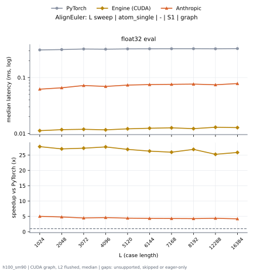

# AlignEuler on h100_sm90

Generated by `python -m foldjet_engine.measure.plot` from speed tokens `judge/tokens/h100_sm90/`; do not edit.

### L sweep: atom_single | - | S1 | graph

**float32 eval** (median ms; x = speedup vs PyTorch)

| L | PyTorch | Engine (Triton) | Engine (CUDA) | Anthropic |
|---|---|---|---|---|
| 1024 | 0.3116 | 0.0168 (18.55x) | 0.01123 (27.75x) | 0.06197 (5.03x) |
| 2048 | 0.3163 | 0.01741 (18.17x) | 0.01171 (27.00x) | 0.06557 (4.82x) |
| 3072 | 0.3237 | 0.0177 (18.29x) | 0.01189 (27.23x) | 0.07205 (4.49x) |
| 4096 | 0.3212 | 0.01786 (17.99x) | 0.01162 (27.65x) | 0.06939 (4.63x) |
| 5120 | 0.3252 | 0.01837 (17.70x) | 0.01211 (26.85x) | 0.07331 (4.44x) |
| 6144 | 0.3263 | 0.0187 (17.45x) | 0.01242 (26.28x) | 0.0749 (4.36x) |
| 7168 | 0.3273 | 0.01866 (17.54x) | 0.01262 (25.93x) | 0.0756 (4.33x) |
| 8192 | 0.3277 | 0.01834 (17.87x) | 0.01221 (26.85x) | 0.07637 (4.29x) |
| 12288 | 0.3264 | 0.02069 (15.77x) | 0.01293 (25.24x) | 0.07422 (4.40x) |
| 16384 | 0.3291 | 0.02011 (16.36x) | 0.01274 (25.84x) | 0.0781 (4.21x) |

