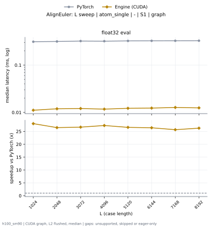

# AlignEuler on h100_sm90

Generated by `python -m miniworld_engine.measure.plot` from speed tokens `judge/tokens/h100_sm90/`; do not edit.

### L sweep: atom_single | - | S1 | graph

**float32 eval** (median ms; x = speedup vs PyTorch)

| L | PyTorch | Engine (Triton) | Engine (CUDA) | Anthropic |
|---|---|---|---|---|
| 1024 | 0.3127 | 0.01675 (18.67x) | 0.01139 (27.45x) | 0.06218 (5.03x) |
| 2048 | 0.3161 | 0.01752 (18.04x) | 0.01178 (26.85x) | 0.06584 (4.80x) |
| 3072 | 0.3235 | 0.01773 (18.25x) | 0.012 (26.96x) | 0.07286 (4.44x) |
| 4096 | 0.3212 | 0.01805 (17.80x) | 0.01158 (27.73x) | 0.07046 (4.56x) |
| 5120 | 0.3256 | 0.01837 (17.73x) | 0.01226 (26.57x) | 0.07378 (4.41x) |
| 6144 | 0.3265 | 0.01862 (17.53x) | 0.01235 (26.43x) | 0.07506 (4.35x) |
| 7168 | 0.3277 | 0.01874 (17.49x) | 0.01264 (25.93x) | 0.07576 (4.33x) |
| 8192 | 0.3274 | 0.01866 (17.55x) | 0.01245 (26.30x) | 0.07674 (4.27x) |

