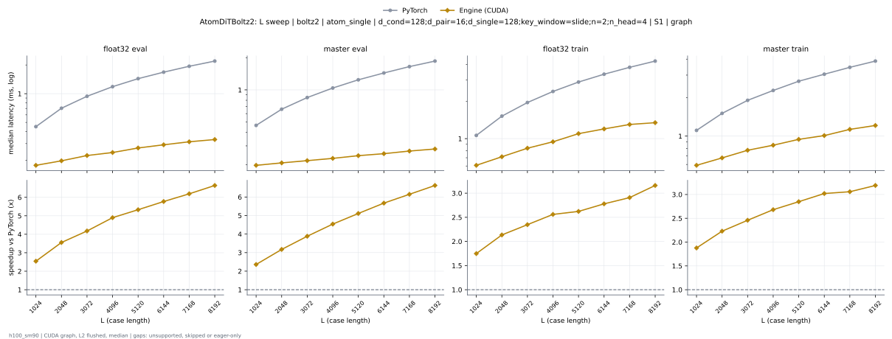
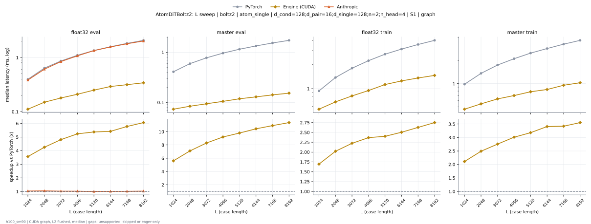

# AtomDiTBoltz2 on h100_sm90

Generated by `python -m miniworld_engine.measure.plot` from speed tokens `judge/tokens/h100_sm90/`; do not edit.

### L sweep: boltz2 | atom_single | d_cond=128;d_pair=16;d_single=128;key_window=slide;n=2;n_head=4 | S1 | graph

**float32 eval** (median ms; x = speedup vs PyTorch)

| L | PyTorch | Engine (Triton) | Engine (CUDA) | Anthropic |
|---|---|---|---|---|
| 1024 | 0.4513 | 0.3613 (1.25x) | 0.1817 (2.48x) | unsupported |
| 2048 | 0.7056 | 0.5908 (1.19x) | 0.2023 (3.49x) | unsupported |
| 3072 | 0.9385 | 0.8004 (1.17x) | 0.2304 (4.07x) | unsupported |
| 4096 | 1.185 | 1.022 (1.16x) | 0.2468 (4.80x) | unsupported |
| 5120 | 1.444 | 1.256 (1.15x) | 0.2739 (5.27x) | unsupported |
| 6144 | 1.689 | 1.472 (1.15x) | 0.2971 (5.69x) | unsupported |
| 7168 | 1.941 | 1.699 (1.14x) | 0.3181 (6.10x) | unsupported |
| 8192 | 2.194 | 1.927 (1.14x) | 0.3364 (6.52x) | unsupported |

**master eval** (median ms; x = speedup vs PyTorch)

| L | PyTorch | Engine (Triton) | Engine (CUDA) | Anthropic |
|---|---|---|---|---|
| 1024 | 0.4669 | 0.3706 (1.26x) | 0.2015 (2.32x) | unsupported |
| 2048 | 0.6612 | 0.5387 (1.23x) | 0.2123 (3.11x) | unsupported |
| 3072 | 0.852 | 0.7018 (1.21x) | 0.2236 (3.81x) | unsupported |
| 4096 | 1.041 | 0.8695 (1.20x) | 0.2343 (4.44x) | unsupported |
| 5120 | 1.248 | 1.043 (1.20x) | 0.2479 (5.04x) | unsupported |
| 6144 | 1.44 | 1.202 (1.20x) | 0.2578 (5.58x) | unsupported |
| 7168 | 1.641 | 1.373 (1.19x) | 0.2726 (6.02x) | unsupported |
| 8192 | 1.86 | 1.554 (1.20x) | 0.286 (6.50x) | unsupported |

**float32 train** (median ms; x = speedup vs PyTorch)

| L | PyTorch | Engine (Triton) | Engine (CUDA) | Anthropic |
|---|---|---|---|---|
| 1024 | 1.063 | 0.8563 (1.24x) | 0.6089 (1.75x) | unsupported |
| 2048 | 1.522 | 1.27 (1.20x) | 0.7087 (2.15x) | unsupported |
| 3072 | 1.963 | 1.669 (1.18x) | 0.8324 (2.36x) | unsupported |
| 4096 | 2.415 | 2.064 (1.17x) | 0.9394 (2.57x) | unsupported |
| 5120 | 2.888 | 2.523 (1.14x) | 1.1 (2.63x) | unsupported |
| 6144 | 3.332 | 2.9 (1.15x) | 1.198 (2.78x) | unsupported |
| 7168 | 3.788 | 3.297 (1.15x) | 1.301 (2.91x) | unsupported |
| 8192 | 4.258 | 3.729 (1.14x) | 1.409 (3.02x) | unsupported |

**master train** (median ms; x = speedup vs PyTorch)

| L | PyTorch | Engine (Triton) | Engine (CUDA) | Anthropic |
|---|---|---|---|---|
| 1024 | 1.111 | 0.8948 (1.24x) | 0.5909 (1.88x) | unsupported |
| 2048 | 1.504 | 1.248 (1.20x) | 0.6772 (2.22x) | unsupported |
| 3072 | 1.906 | 1.595 (1.19x) | 0.7813 (2.44x) | unsupported |
| 4096 | 2.28 | 1.922 (1.19x) | 0.8552 (2.67x) | unsupported |
| 5120 | 2.67 | 2.285 (1.17x) | 0.9478 (2.82x) | unsupported |
| 6144 | 3.049 | 2.616 (1.17x) | 1.01 (3.02x) | unsupported |
| 7168 | 3.456 | 2.95 (1.17x) | 1.13 (3.06x) | unsupported |
| 8192 | 3.859 | 3.286 (1.17x) | 1.211 (3.19x) | unsupported |

### L sweep: boltz2 | atom_single | d_cond=128;d_pair=16;d_single=128;n=2;n_head=4 | S1 | graph

**float32 eval** (median ms; x = speedup vs PyTorch)

| L | PyTorch | Engine (Triton) | Engine (CUDA) | Anthropic |
|---|---|---|---|---|
| 1024 | 0.3987 | 0.3475 (1.15x) | 0.08782 (4.54x) | 0.3315 (1.20x) |
| 2048 | 0.6352 | 0.5707 (1.11x) | 0.1071 (5.93x) | 0.5568 (1.14x) |
| 3072 | 0.8623 | 0.7849 (1.10x) | 0.1312 (6.57x) | 0.7707 (1.12x) |
| 4096 | 1.099 | 1.006 (1.09x) | 0.1456 (7.55x) | 0.9896 (1.11x) |
| 5120 | 1.347 | 1.236 (1.09x) | 0.1735 (7.77x) | 1.225 (1.10x) |
| 6144 | 1.573 | 1.447 (1.09x) | 0.1948 (8.07x) | 1.434 (1.10x) |
| 7168 | 1.824 | 1.679 (1.09x) | 0.2157 (8.46x) | 1.664 (1.10x) |
| 8192 | 2.073 | 1.91 (1.09x) | 0.2328 (8.91x) | 1.892 (1.10x) |

**master eval** (median ms; x = speedup vs PyTorch)

| L | PyTorch | Engine (Triton) | Engine (CUDA) | Anthropic |
|---|---|---|---|---|
| 1024 | 0.412 | 0.3565 (1.16x) | 0.07402 (5.57x) | 0.3244 (1.27x) |
| 2048 | 0.594 | 0.523 (1.14x) | 0.0839 (7.08x) | 0.4892 (1.21x) |
| 3072 | 0.7767 | 0.682 (1.14x) | 0.09378 (8.28x) | 0.6471 (1.20x) |
| 4096 | 0.9665 | 0.8538 (1.13x) | 0.1049 (9.22x) | 0.8166 (1.18x) |
| 5120 | 1.154 | 1.02 (1.13x) | 0.1185 (9.73x) | 0.982 (1.17x) |
| 6144 | 1.348 | 1.191 (1.13x) | 0.1288 (10.46x) | 1.15 (1.17x) |
| 7168 | 1.536 | 1.354 (1.13x) | 0.1416 (10.85x) | 1.313 (1.17x) |
| 8192 | 1.744 | 1.537 (1.13x) | 0.1534 (11.37x) | 1.492 (1.17x) |

**float32 train** (median ms; x = speedup vs PyTorch)

| L | PyTorch | Engine (Triton) | Engine (CUDA) | Anthropic |
|---|---|---|---|---|
| 1024 | 0.9401 | 0.8347 (1.13x) | 0.4776 (1.97x) | unsupported |
| 2048 | 1.38 | 1.254 (1.10x) | 0.5636 (2.45x) | unsupported |
| 3072 | 1.805 | 1.645 (1.10x) | 0.6647 (2.71x) | unsupported |
| 4096 | 2.243 | 2.054 (1.09x) | 0.7583 (2.96x) | unsupported |
| 5120 | 2.705 | 2.493 (1.09x) | 0.9041 (2.99x) | unsupported |
| 6144 | 3.118 | 2.88 (1.08x) | 0.9872 (3.16x) | unsupported |
| 7168 | 3.578 | 3.286 (1.09x) | 1.084 (3.30x) | unsupported |
| 8192 | 4.029 | 3.707 (1.09x) | 1.178 (3.42x) | unsupported |

**master train** (median ms; x = speedup vs PyTorch)

| L | PyTorch | Engine (Triton) | Engine (CUDA) | Anthropic |
|---|---|---|---|---|
| 1024 | 0.9817 | 0.8734 (1.12x) | 0.4665 (2.10x) | unsupported |
| 2048 | 1.357 | 1.229 (1.10x) | 0.5433 (2.50x) | unsupported |
| 3072 | 1.742 | 1.578 (1.10x) | 0.6341 (2.75x) | unsupported |
| 4096 | 2.111 | 1.906 (1.11x) | 0.6996 (3.02x) | unsupported |
| 5120 | 2.487 | 2.259 (1.10x) | 0.783 (3.18x) | unsupported |
| 6144 | 2.858 | 2.595 (1.10x) | 0.8412 (3.40x) | unsupported |
| 7168 | 3.252 | 2.938 (1.11x) | 0.9514 (3.42x) | unsupported |
| 8192 | 3.651 | 3.274 (1.12x) | 1.026 (3.56x) | unsupported |

