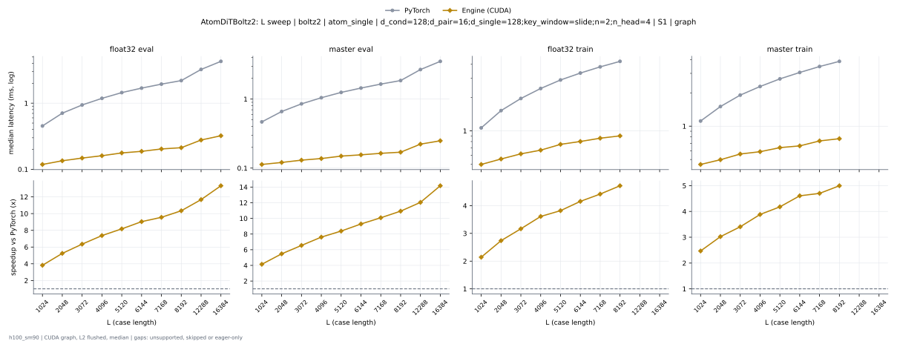
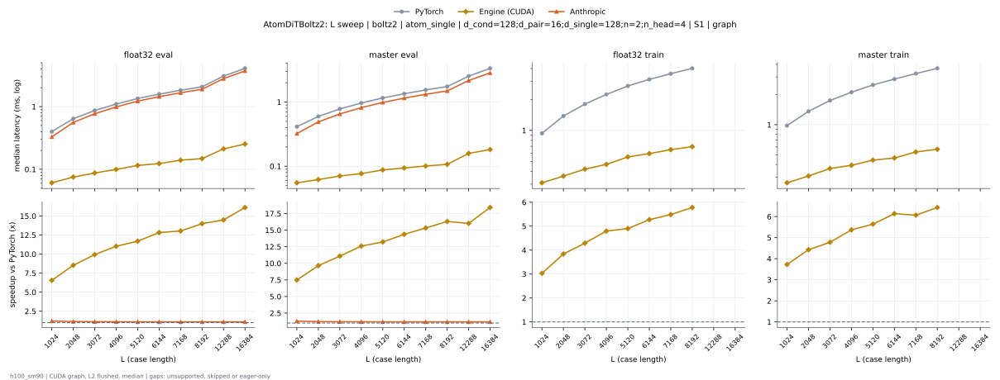
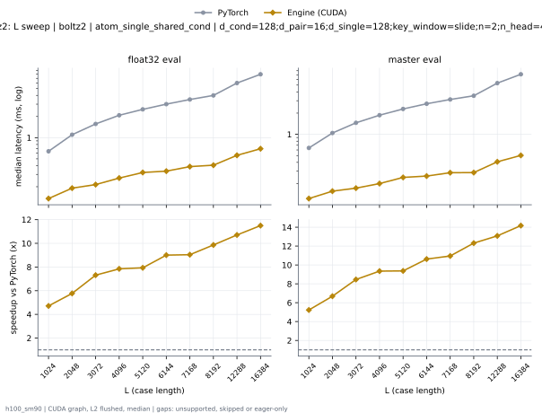
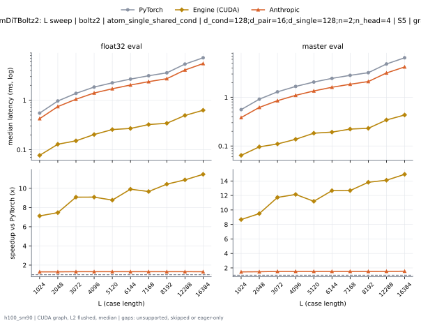

# AtomDiTBoltz2 on h100_sm90

Generated by `python -m foldjet_engine.measure.plot` from speed tokens `judge/tokens/h100_sm90/`; do not edit.

### L sweep: boltz2 | atom_single | d_cond=128;d_pair=16;d_single=128;key_window=slide;n=2;n_head=4 | S1 | graph

**float32 eval** (median ms; x = speedup vs PyTorch)

| L | PyTorch | Engine (Triton) | Engine (CUDA) | Anthropic |
|---|---|---|---|---|
| 1024 | 0.4525 | 0.3606 (1.25x) | 0.1184 (3.82x) | unsupported |
| 2048 | 0.706 | 0.5907 (1.20x) | 0.1346 (5.24x) | unsupported |
| 3072 | 0.9388 | 0.7998 (1.17x) | 0.1479 (6.35x) | unsupported |
| 4096 | 1.183 | 1.02 (1.16x) | 0.1605 (7.37x) | unsupported |
| 5120 | 1.445 | 1.255 (1.15x) | 0.1768 (8.18x) | unsupported |
| 6144 | 1.689 | 1.475 (1.15x) | 0.1869 (9.04x) | unsupported |
| 7168 | 1.941 | 1.697 (1.14x) | 0.2031 (9.56x) | unsupported |
| 8192 | 2.194 | 1.926 (1.14x) | 0.2122 (10.34x) | unsupported |
| 12288 | 3.236 | 2.835 (1.14x) | 0.2772 (11.67x) | unsupported |
| 16384 | 4.288 | 3.756 (1.14x) | 0.3217 (13.33x) | unsupported |

**master eval** (median ms; x = speedup vs PyTorch)

| L | PyTorch | Engine (Triton) | Engine (CUDA) | Anthropic |
|---|---|---|---|---|
| 1024 | 0.4676 | 0.3709 (1.26x) | 0.1129 (4.14x) | unsupported |
| 2048 | 0.661 | 0.5386 (1.23x) | 0.1207 (5.48x) | unsupported |
| 3072 | 0.8535 | 0.7016 (1.22x) | 0.1304 (6.55x) | unsupported |
| 4096 | 1.047 | 0.8707 (1.20x) | 0.1375 (7.61x) | unsupported |
| 5120 | 1.25 | 1.042 (1.20x) | 0.1492 (8.38x) | unsupported |
| 6144 | 1.446 | 1.211 (1.19x) | 0.1557 (9.29x) | unsupported |
| 7168 | 1.651 | 1.379 (1.20x) | 0.1637 (10.08x) | unsupported |
| 8192 | 1.857 | 1.554 (1.20x) | 0.17 (10.93x) | unsupported |
| 12288 | 2.68 | 2.248 (1.19x) | 0.2225 (12.05x) | unsupported |
| 16384 | 3.525 | 2.936 (1.20x) | 0.2488 (14.17x) | unsupported |

**float32 train** (median ms; x = speedup vs PyTorch)

| L | PyTorch | Engine (Triton) | Engine (CUDA) | Anthropic |
|---|---|---|---|---|
| 1024 | 1.064 | 0.8505 (1.25x) | 0.4971 (2.14x) | unsupported |
| 2048 | 1.524 | 1.272 (1.20x) | 0.5569 (2.74x) | unsupported |
| 3072 | 1.963 | 1.67 (1.18x) | 0.6198 (3.17x) | unsupported |
| 4096 | 2.417 | 2.074 (1.17x) | 0.6693 (3.61x) | unsupported |
| 5120 | 2.885 | 2.515 (1.15x) | 0.7552 (3.82x) | unsupported |
| 6144 | 3.332 | 2.913 (1.14x) | 0.8019 (4.15x) | unsupported |
| 7168 | 3.791 | 3.314 (1.14x) | 0.858 (4.42x) | unsupported |
| 8192 | 4.25 | 3.705 (1.15x) | 0.901 (4.72x) | unsupported |
| 12288 |  |  |  |  |
| 16384 |  |  |  |  |

**master train** (median ms; x = speedup vs PyTorch)

| L | PyTorch | Engine (Triton) | Engine (CUDA) | Anthropic |
|---|---|---|---|---|
| 1024 | 1.114 | 0.8947 (1.24x) | 0.4512 (2.47x) | unsupported |
| 2048 | 1.504 | 1.248 (1.21x) | 0.4977 (3.02x) | unsupported |
| 3072 | 1.909 | 1.595 (1.20x) | 0.5606 (3.41x) | unsupported |
| 4096 | 2.283 | 1.928 (1.18x) | 0.5882 (3.88x) | unsupported |
| 5120 | 2.675 | 2.282 (1.17x) | 0.6402 (4.18x) | unsupported |
| 6144 | 3.056 | 2.613 (1.17x) | 0.6638 (4.60x) | unsupported |
| 7168 | 3.458 | 2.951 (1.17x) | 0.736 (4.70x) | unsupported |
| 8192 | 3.851 | 3.278 (1.17x) | 0.771 (4.99x) | unsupported |
| 12288 |  |  |  |  |
| 16384 |  |  |  |  |

### L sweep: boltz2 | atom_single | d_cond=128;d_pair=16;d_single=128;n=2;n_head=4 | S1 | graph

**float32 eval** (median ms; x = speedup vs PyTorch)

| L | PyTorch | Engine (Triton) | Engine (CUDA) | Anthropic |
|---|---|---|---|---|
| 1024 | 0.3995 | 0.346 (1.15x) | 0.06098 (6.55x) | 0.3292 (1.21x) |
| 2048 | 0.6424 | 0.5738 (1.12x) | 0.07531 (8.53x) | 0.5601 (1.15x) |
| 3072 | 0.8683 | 0.7839 (1.11x) | 0.08739 (9.94x) | 0.7709 (1.13x) |
| 4096 | 1.1 | 1.004 (1.10x) | 0.09978 (11.03x) | 0.9903 (1.11x) |
| 5120 | 1.349 | 1.238 (1.09x) | 0.1153 (11.70x) | 1.225 (1.10x) |
| 6144 | 1.583 | 1.459 (1.09x) | 0.1235 (12.82x) | 1.443 (1.10x) |
| 7168 | 1.825 | 1.679 (1.09x) | 0.14 (13.04x) | 1.666 (1.10x) |
| 8192 | 2.075 | 1.908 (1.09x) | 0.1483 (13.99x) | 1.893 (1.10x) |
| 12288 | 3.073 | 2.82 (1.09x) | 0.2121 (14.49x) | 2.799 (1.10x) |
| 16384 | 4.081 | 3.734 (1.09x) | 0.2531 (16.12x) | 3.716 (1.10x) |

**master eval** (median ms; x = speedup vs PyTorch)

| L | PyTorch | Engine (Triton) | Engine (CUDA) | Anthropic |
|---|---|---|---|---|
| 1024 | 0.4134 | 0.3573 (1.16x) | 0.0552 (7.49x) | 0.3228 (1.28x) |
| 2048 | 0.5977 | 0.5236 (1.14x) | 0.06197 (9.65x) | 0.4907 (1.22x) |
| 3072 | 0.78 | 0.6853 (1.14x) | 0.07035 (11.09x) | 0.652 (1.20x) |
| 4096 | 0.9665 | 0.8495 (1.14x) | 0.07672 (12.60x) | 0.8177 (1.18x) |
| 5120 | 1.158 | 1.026 (1.13x) | 0.08765 (13.22x) | 0.9863 (1.17x) |
| 6144 | 1.347 | 1.192 (1.13x) | 0.09376 (14.37x) | 1.151 (1.17x) |
| 7168 | 1.544 | 1.363 (1.13x) | 0.1008 (15.33x) | 1.32 (1.17x) |
| 8192 | 1.744 | 1.537 (1.13x) | 0.1069 (16.31x) | 1.491 (1.17x) |
| 12288 | 2.535 | 2.23 (1.14x) | 0.1583 (16.01x) | 2.165 (1.17x) |
| 16384 | 3.35 | 2.913 (1.15x) | 0.1819 (18.42x) | 2.846 (1.18x) |

**float32 train** (median ms; x = speedup vs PyTorch)

| L | PyTorch | Engine (Triton) | Engine (CUDA) | Anthropic |
|---|---|---|---|---|
| 1024 | 0.9372 | 0.8388 (1.12x) | 0.3093 (3.03x) | unsupported |
| 2048 | 1.379 | 1.25 (1.10x) | 0.3595 (3.84x) | unsupported |
| 3072 | 1.803 | 1.645 (1.10x) | 0.4202 (4.29x) | unsupported |
| 4096 | 2.24 | 2.048 (1.09x) | 0.4673 (4.79x) | unsupported |
| 5120 | 2.706 | 2.49 (1.09x) | 0.5524 (4.90x) | unsupported |
| 6144 | 3.135 | 2.886 (1.09x) | 0.5948 (5.27x) | unsupported |
| 7168 | 3.562 | 3.268 (1.09x) | 0.6497 (5.48x) | unsupported |
| 8192 | 4.015 | 3.686 (1.09x) | 0.6946 (5.78x) | unsupported |
| 12288 |  |  |  |  |
| 16384 |  |  |  |  |

**master train** (median ms; x = speedup vs PyTorch)

| L | PyTorch | Engine (Triton) | Engine (CUDA) | Anthropic |
|---|---|---|---|---|
| 1024 | 0.9794 | 0.8772 (1.12x) | 0.2628 (3.73x) | unsupported |
| 2048 | 1.359 | 1.227 (1.11x) | 0.3072 (4.42x) | unsupported |
| 3072 | 1.745 | 1.58 (1.10x) | 0.3652 (4.78x) | unsupported |
| 4096 | 2.11 | 1.902 (1.11x) | 0.3929 (5.37x) | unsupported |
| 5120 | 2.495 | 2.26 (1.10x) | 0.4425 (5.64x) | unsupported |
| 6144 | 2.853 | 2.585 (1.10x) | 0.4649 (6.14x) | unsupported |
| 7168 | 3.24 | 2.934 (1.10x) | 0.5341 (6.07x) | unsupported |
| 8192 | 3.652 | 3.258 (1.12x) | 0.568 (6.43x) | unsupported |
| 12288 |  |  |  |  |
| 16384 |  |  |  |  |

### L sweep: boltz2 | atom_single_shared_cond | d_cond=128;d_pair=16;d_single=128;key_window=slide;n=2;n_head=4 | S5 | graph

**float32 eval** (median ms; x = speedup vs PyTorch)

| L | PyTorch | Engine (Triton) | Engine (CUDA) | Anthropic |
|---|---|---|---|---|
| 1024 | 0.6396 | 0.455 (1.41x) | 0.1357 (4.71x) | unsupported |
| 2048 | 1.102 | 0.7771 (1.42x) | 0.191 (5.77x) | unsupported |
| 3072 | 1.569 | 1.08 (1.45x) | 0.2145 (7.31x) | unsupported |
| 4096 | 2.086 | 1.438 (1.45x) | 0.2659 (7.85x) | unsupported |
| 5120 | 2.531 | 1.745 (1.45x) | 0.3191 (7.93x) | unsupported |
| 6144 | 3.003 | 2.073 (1.45x) | 0.3335 (9.00x) | unsupported |
| 7168 | 3.498 | 2.416 (1.45x) | 0.3869 (9.04x) | unsupported |
| 8192 | 3.998 | 2.787 (1.43x) | 0.4053 (9.86x) | unsupported |
| 12288 | 6.002 | 4.138 (1.45x) | 0.5604 (10.71x) | unsupported |
| 16384 | 8 | 5.535 (1.45x) | 0.6957 (11.50x) | unsupported |

**master eval** (median ms; x = speedup vs PyTorch)

| L | PyTorch | Engine (Triton) | Engine (CUDA) | Anthropic |
|---|---|---|---|---|
| 1024 | 0.6405 | 0.4366 (1.47x) | 0.1225 (5.23x) | unsupported |
| 2048 | 1.043 | 0.686 (1.52x) | 0.156 (6.69x) | unsupported |
| 3072 | 1.457 | 0.9364 (1.56x) | 0.1722 (8.46x) | unsupported |
| 4096 | 1.869 | 1.187 (1.57x) | 0.1999 (9.35x) | unsupported |
| 5120 | 2.292 | 1.454 (1.58x) | 0.2446 (9.37x) | unsupported |
| 6144 | 2.715 | 1.725 (1.57x) | 0.2555 (10.62x) | unsupported |
| 7168 | 3.123 | 1.992 (1.57x) | 0.2852 (10.95x) | unsupported |
| 8192 | 3.525 | 2.244 (1.57x) | 0.2862 (12.32x) | unsupported |
| 12288 | 5.329 | 3.358 (1.59x) | 0.4074 (13.08x) | unsupported |
| 16384 | 7.117 | 4.449 (1.60x) | 0.5022 (14.17x) | unsupported |

### L sweep: boltz2 | atom_single_shared_cond | d_cond=128;d_pair=16;d_single=128;n=2;n_head=4 | S5 | graph

**float32 eval** (median ms; x = speedup vs PyTorch)

| L | PyTorch | Engine (Triton) | Engine (CUDA) | Anthropic |
|---|---|---|---|---|
| 1024 | 0.5497 | 0.4434 (1.24x) | 0.07712 (7.13x) | 0.4246 (1.29x) |
| 2048 | 0.9659 | 0.7642 (1.26x) | 0.1293 (7.47x) | 0.7439 (1.30x) |
| 3072 | 1.377 | 1.066 (1.29x) | 0.1516 (9.08x) | 1.047 (1.31x) |
| 4096 | 1.846 | 1.419 (1.30x) | 0.2032 (9.08x) | 1.4 (1.32x) |
| 5120 | 2.245 | 1.737 (1.29x) | 0.2558 (8.77x) | 1.704 (1.32x) |
| 6144 | 2.669 | 2.058 (1.30x) | 0.2693 (9.91x) | 2.03 (1.31x) |
| 7168 | 3.121 | 2.418 (1.29x) | 0.3228 (9.67x) | 2.371 (1.32x) |
| 8192 | 3.575 | 2.748 (1.30x) | 0.3425 (10.44x) | 2.721 (1.31x) |
| 12288 | 5.371 | 4.107 (1.31x) | 0.4935 (10.88x) | 4.079 (1.32x) |
| 16384 | 7.194 | 5.516 (1.30x) | 0.6277 (11.46x) | 5.495 (1.31x) |

**master eval** (median ms; x = speedup vs PyTorch)

| L | PyTorch | Engine (Triton) | Engine (CUDA) | Anthropic |
|---|---|---|---|---|
| 1024 | 0.5572 | 0.4236 (1.32x) | 0.06422 (8.68x) | 0.3829 (1.46x) |
| 2048 | 0.9117 | 0.672 (1.36x) | 0.09598 (9.50x) | 0.6188 (1.47x) |
| 3072 | 1.291 | 0.9182 (1.41x) | 0.11 (11.73x) | 0.8497 (1.52x) |
| 4096 | 1.666 | 1.175 (1.42x) | 0.1372 (12.14x) | 1.094 (1.52x) |
| 5120 | 2.049 | 1.441 (1.42x) | 0.183 (11.19x) | 1.346 (1.52x) |
| 6144 | 2.438 | 1.706 (1.43x) | 0.1925 (12.66x) | 1.602 (1.52x) |
| 7168 | 2.815 | 1.963 (1.43x) | 0.2221 (12.68x) | 1.847 (1.52x) |
| 8192 | 3.187 | 2.223 (1.43x) | 0.2306 (13.82x) | 2.098 (1.52x) |
| 12288 | 4.814 | 3.351 (1.44x) | 0.3415 (14.10x) | 3.148 (1.53x) |
| 16384 | 6.447 | 4.433 (1.45x) | 0.4323 (14.91x) | 4.182 (1.54x) |

