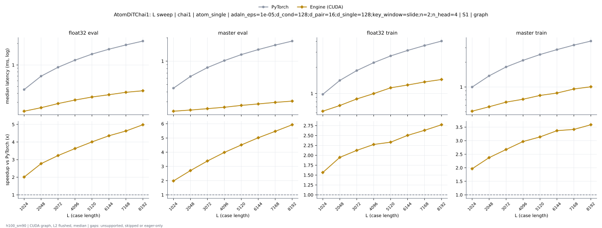
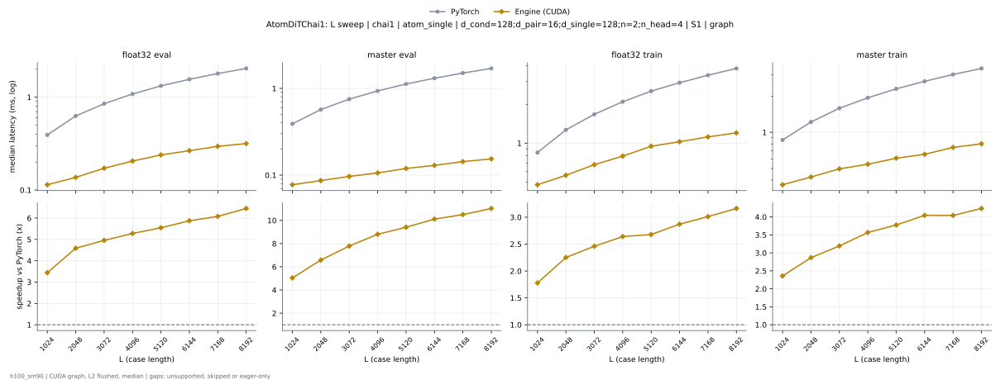

# AtomDiTChai1 on h100_sm90

Generated by `python -m miniworld_engine.measure.plot` from speed tokens `judge/tokens/h100_sm90/`; do not edit.

### L sweep: chai1 | atom_single | adaln_eps=1e-05;d_cond=128;d_pair=16;d_single=128;key_window=slide;n=2;n_head=4 | S1 | graph

**float32 eval** (median ms; x = speedup vs PyTorch)

| L | PyTorch | Engine (Triton) | Engine (CUDA) |
|---|---|---|---|
| 1024 | 0.4514 | 0.357 (1.26x) | 0.2244 (2.01x) |
| 2048 | 0.6965 | 0.5751 (1.21x) | 0.2512 (2.77x) |
| 3072 | 0.9284 | 0.8032 (1.16x) | 0.2872 (3.23x) |
| 4096 | 1.169 | 1.025 (1.14x) | 0.3221 (3.63x) |
| 5120 | 1.422 | 1.27 (1.12x) | 0.3548 (4.01x) |
| 6144 | 1.665 | 1.486 (1.12x) | 0.3823 (4.36x) |
| 7168 | 1.912 | 1.707 (1.12x) | 0.4133 (4.63x) |
| 8192 | 2.165 | 1.925 (1.12x) | 0.4345 (4.98x) |

**master eval** (median ms; x = speedup vs PyTorch)

| L | PyTorch | Engine (Triton) | Engine (CUDA) |
|---|---|---|---|
| 1024 | 0.4483 | 0.3332 (1.35x) | 0.2265 (1.98x) |
| 2048 | 0.6344 | 0.4941 (1.28x) | 0.2343 (2.71x) |
| 3072 | 0.8256 | 0.6554 (1.26x) | 0.2441 (3.38x) |
| 4096 | 1.015 | 0.8201 (1.24x) | 0.2546 (3.99x) |
| 5120 | 1.214 | 0.9905 (1.23x) | 0.269 (4.51x) |
| 6144 | 1.409 | 1.154 (1.22x) | 0.2807 (5.02x) |
| 7168 | 1.609 | 1.318 (1.22x) | 0.2941 (5.47x) |
| 8192 | 1.811 | 1.457 (1.24x) | 0.3053 (5.93x) |

**float32 train** (median ms; x = speedup vs PyTorch)

| L | PyTorch | Engine (Triton) | Engine (CUDA) |
|---|---|---|---|
| 1024 | 0.9788 | 0.8286 (1.18x) | 0.6255 (1.56x) |
| 2048 | 1.415 | 1.251 (1.13x) | 0.7269 (1.95x) |
| 3072 | 1.838 | 1.684 (1.09x) | 0.8655 (2.12x) |
| 4096 | 2.269 | 2.103 (1.08x) | 0.9979 (2.27x) |
| 5120 | 2.714 | 2.564 (1.06x) | 1.164 (2.33x) |
| 6144 | 3.138 | 2.959 (1.06x) | 1.254 (2.50x) |
| 7168 | 3.576 | 3.362 (1.06x) | 1.359 (2.63x) |
| 8192 | 4.023 | 3.763 (1.07x) | 1.451 (2.77x) |

**master train** (median ms; x = speedup vs PyTorch)

| L | PyTorch | Engine (Triton) | Engine (CUDA) |
|---|---|---|---|
| 1024 | 0.997 | 0.7611 (1.31x) | 0.5077 (1.96x) |
| 2048 | 1.364 | 1.091 (1.25x) | 0.5744 (2.37x) |
| 3072 | 1.749 | 1.423 (1.23x) | 0.654 (2.67x) |
| 4096 | 2.105 | 1.742 (1.21x) | 0.7091 (2.97x) |
| 5120 | 2.476 | 2.089 (1.19x) | 0.7888 (3.14x) |
| 6144 | 2.842 | 2.406 (1.18x) | 0.8435 (3.37x) |
| 7168 | 3.227 | 2.719 (1.19x) | 0.9444 (3.42x) |
| 8192 | 3.608 | 3.034 (1.19x) | 1.005 (3.59x) |

### L sweep: chai1 | atom_single | d_cond=128;d_pair=16;d_single=128;n=2;n_head=4 | S1 | graph

**float32 eval** (median ms; x = speedup vs PyTorch)

| L | PyTorch | Engine (Triton) | Engine (CUDA) |
|---|---|---|---|
| 1024 | 0.3923 | 0.3393 (1.16x) | 0.114 (3.44x) |
| 2048 | 0.6281 | 0.5585 (1.12x) | 0.1369 (4.59x) |
| 3072 | 0.8514 | 0.7864 (1.08x) | 0.1718 (4.96x) |
| 4096 | 1.084 | 1.007 (1.08x) | 0.2053 (5.28x) |
| 5120 | 1.326 | 1.253 (1.06x) | 0.239 (5.55x) |
| 6144 | 1.559 | 1.468 (1.06x) | 0.2654 (5.87x) |
| 7168 | 1.799 | 1.689 (1.07x) | 0.2959 (6.08x) |
| 8192 | 2.041 | 1.908 (1.07x) | 0.3164 (6.45x) |

**master eval** (median ms; x = speedup vs PyTorch)

| L | PyTorch | Engine (Triton) | Engine (CUDA) |
|---|---|---|---|
| 1024 | 0.3903 | 0.3164 (1.23x) | 0.07747 (5.04x) |
| 2048 | 0.5698 | 0.4781 (1.19x) | 0.08658 (6.58x) |
| 3072 | 0.7521 | 0.6387 (1.18x) | 0.09656 (7.79x) |
| 4096 | 0.9337 | 0.8038 (1.16x) | 0.106 (8.80x) |
| 5120 | 1.123 | 0.9726 (1.15x) | 0.1194 (9.41x) |
| 6144 | 1.31 | 1.136 (1.15x) | 0.1295 (10.11x) |
| 7168 | 1.502 | 1.301 (1.15x) | 0.1431 (10.50x) |
| 8192 | 1.697 | 1.466 (1.16x) | 0.1539 (11.03x) |

**float32 train** (median ms; x = speedup vs PyTorch)

| L | PyTorch | Engine (Triton) | Engine (CUDA) |
|---|---|---|---|
| 1024 | 0.8451 | 0.8086 (1.05x) | 0.4752 (1.78x) |
| 2048 | 1.267 | 1.232 (1.03x) | 0.5629 (2.25x) |
| 3072 | 1.674 | 1.667 (1.00x) | 0.6805 (2.46x) |
| 4096 | 2.095 | 2.083 (1.01x) | 0.7932 (2.64x) |
| 5120 | 2.532 | 2.546 (0.99x) | 0.9451 (2.68x) |
| 6144 | 2.943 | 2.941 (1.00x) | 1.025 (2.87x) |
| 7168 | 3.365 | 3.35 (1.00x) | 1.118 (3.01x) |
| 8192 | 3.799 | 3.744 (1.01x) | 1.201 (3.16x) |

**master train** (median ms; x = speedup vs PyTorch)

| L | PyTorch | Engine (Triton) | Engine (CUDA) |
|---|---|---|---|
| 1024 | 0.8632 | 0.7429 (1.16x) | 0.3661 (2.36x) |
| 2048 | 1.218 | 1.072 (1.14x) | 0.4247 (2.87x) |
| 3072 | 1.584 | 1.406 (1.13x) | 0.4962 (3.19x) |
| 4096 | 1.934 | 1.723 (1.12x) | 0.5423 (3.57x) |
| 5120 | 2.297 | 2.071 (1.11x) | 0.6085 (3.78x) |
| 6144 | 2.653 | 2.386 (1.11x) | 0.656 (4.04x) |
| 7168 | 3.024 | 2.698 (1.12x) | 0.7483 (4.04x) |
| 8192 | 3.394 | 3.015 (1.13x) | 0.8013 (4.24x) |

