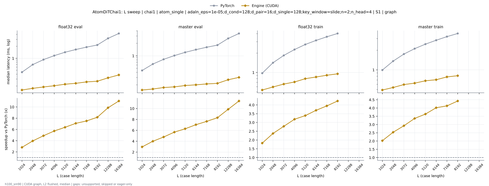
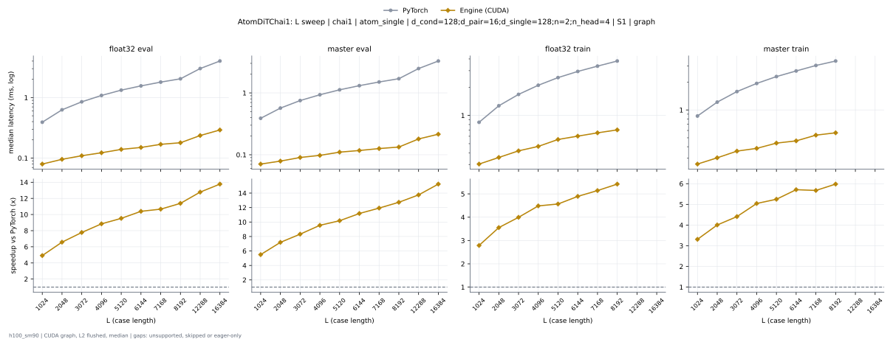
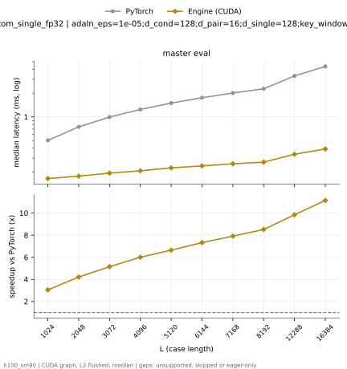
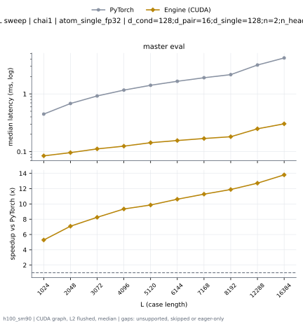
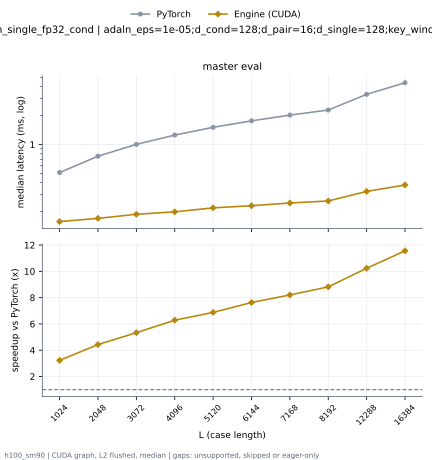
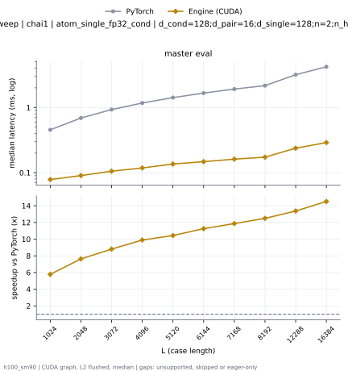
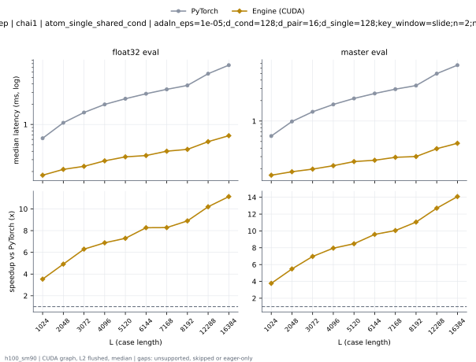
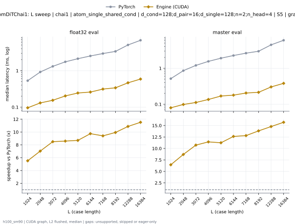

# AtomDiTChai1 on h100_sm90

Generated by `python -m foldjet_engine.measure.plot` from speed tokens `judge/tokens/h100_sm90/`; do not edit.

### L sweep: chai1 | atom_single | adaln_eps=1e-05;d_cond=128;d_pair=16;d_single=128;key_window=slide;n=2;n_head=4 | S1 | graph

**float32 eval** (median ms; x = speedup vs PyTorch)

| L | PyTorch | Engine (Triton) | Engine (CUDA) |
|---|---|---|---|
| 1024 | 0.4479 | 0.3384 (1.32x) | 0.1592 (2.81x) |
| 2048 | 0.6944 | 0.5628 (1.23x) | 0.1756 (3.95x) |
| 3072 | 0.9272 | 0.7705 (1.20x) | 0.19 (4.88x) |
| 4096 | 1.169 | 0.9855 (1.19x) | 0.2041 (5.73x) |
| 5120 | 1.423 | 1.218 (1.17x) | 0.2229 (6.38x) |
| 6144 | 1.666 | 1.433 (1.16x) | 0.235 (7.09x) |
| 7168 | 1.914 | 1.652 (1.16x) | 0.2547 (7.51x) |
| 8192 | 2.164 | 1.876 (1.15x) | 0.265 (8.17x) |
| 12288 | 3.184 | 2.763 (1.15x) | 0.3227 (9.87x) |
| 16384 | 4.22 | 3.669 (1.15x) | 0.3816 (11.06x) |

**master eval** (median ms; x = speedup vs PyTorch)

| L | PyTorch | Engine (Triton) | Engine (CUDA) |
|---|---|---|---|
| 1024 | 0.4444 | 0.3324 (1.34x) | 0.1505 (2.95x) |
| 2048 | 0.6343 | 0.4926 (1.29x) | 0.159 (3.99x) |
| 3072 | 0.8237 | 0.6543 (1.26x) | 0.1727 (4.77x) |
| 4096 | 1.014 | 0.8194 (1.24x) | 0.179 (5.67x) |
| 5120 | 1.213 | 0.9894 (1.23x) | 0.1931 (6.28x) |
| 6144 | 1.409 | 1.156 (1.22x) | 0.2004 (7.03x) |
| 7168 | 1.61 | 1.326 (1.21x) | 0.2108 (7.64x) |
| 8192 | 1.811 | 1.484 (1.22x) | 0.2178 (8.32x) |
| 12288 | 2.621 | 2.163 (1.21x) | 0.2659 (9.86x) |
| 16384 | 3.449 | 2.827 (1.22x) | 0.3032 (11.38x) |

**float32 train** (median ms; x = speedup vs PyTorch)

| L | PyTorch | Engine (Triton) | Engine (CUDA) |
|---|---|---|---|
| 1024 | 0.9743 | 0.7485 (1.30x) | 0.5344 (1.82x) |
| 2048 | 1.414 | 1.142 (1.24x) | 0.5961 (2.37x) |
| 3072 | 1.837 | 1.525 (1.20x) | 0.6607 (2.78x) |
| 4096 | 2.267 | 1.908 (1.19x) | 0.712 (3.18x) |
| 5120 | 2.717 | 2.329 (1.17x) | 0.8008 (3.39x) |
| 6144 | 3.142 | 2.7 (1.16x) | 0.8507 (3.69x) |
| 7168 | 3.576 | 3.087 (1.16x) | 0.9061 (3.95x) |
| 8192 | 4.023 | 3.463 (1.16x) | 0.9522 (4.22x) |
| 12288 |  |  |  |
| 16384 |  |  |  |

**master train** (median ms; x = speedup vs PyTorch)

| L | PyTorch | Engine (Triton) | Engine (CUDA) |
|---|---|---|---|
| 1024 | 0.9947 | 0.7567 (1.31x) | 0.4922 (2.02x) |
| 2048 | 1.362 | 1.09 (1.25x) | 0.538 (2.53x) |
| 3072 | 1.745 | 1.423 (1.23x) | 0.5965 (2.93x) |
| 4096 | 2.112 | 1.738 (1.21x) | 0.6269 (3.37x) |
| 5120 | 2.476 | 2.079 (1.19x) | 0.6814 (3.63x) |
| 6144 | 2.84 | 2.401 (1.18x) | 0.707 (4.02x) |
| 7168 | 3.227 | 2.716 (1.19x) | 0.7812 (4.13x) |
| 8192 | 3.604 | 3.024 (1.19x) | 0.8145 (4.42x) |
| 12288 |  |  |  |
| 16384 |  |  |  |

### L sweep: chai1 | atom_single | d_cond=128;d_pair=16;d_single=128;n=2;n_head=4 | S1 | graph

**float32 eval** (median ms; x = speedup vs PyTorch)

| L | PyTorch | Engine (Triton) | Engine (CUDA) |
|---|---|---|---|
| 1024 | 0.3913 | 0.3211 (1.22x) | 0.07965 (4.91x) |
| 2048 | 0.6272 | 0.5462 (1.15x) | 0.09539 (6.58x) |
| 3072 | 0.8504 | 0.7545 (1.13x) | 0.1094 (7.77x) |
| 4096 | 1.083 | 0.9687 (1.12x) | 0.1224 (8.85x) |
| 5120 | 1.326 | 1.2 (1.11x) | 0.1392 (9.52x) |
| 6144 | 1.558 | 1.416 (1.10x) | 0.1499 (10.40x) |
| 7168 | 1.799 | 1.634 (1.10x) | 0.1687 (10.67x) |
| 8192 | 2.041 | 1.856 (1.10x) | 0.1792 (11.39x) |
| 12288 | 3.016 | 2.746 (1.10x) | 0.236 (12.78x) |
| 16384 | 4.013 | 3.649 (1.10x) | 0.2914 (13.77x) |

**master eval** (median ms; x = speedup vs PyTorch)

| L | PyTorch | Engine (Triton) | Engine (CUDA) |
|---|---|---|---|
| 1024 | 0.3884 | 0.3153 (1.23x) | 0.07067 (5.50x) |
| 2048 | 0.5677 | 0.4778 (1.19x) | 0.07893 (7.19x) |
| 3072 | 0.7517 | 0.6374 (1.18x) | 0.09029 (8.33x) |
| 4096 | 0.9327 | 0.8029 (1.16x) | 0.09768 (9.55x) |
| 5120 | 1.121 | 0.9726 (1.15x) | 0.1101 (10.18x) |
| 6144 | 1.309 | 1.137 (1.15x) | 0.1171 (11.18x) |
| 7168 | 1.501 | 1.302 (1.15x) | 0.1258 (11.93x) |
| 8192 | 1.696 | 1.465 (1.16x) | 0.1332 (12.73x) |
| 12288 | 2.475 | 2.143 (1.15x) | 0.18 (13.75x) |
| 16384 | 3.275 | 2.807 (1.17x) | 0.2148 (15.25x) |

**float32 train** (median ms; x = speedup vs PyTorch)

| L | PyTorch | Engine (Triton) | Engine (CUDA) |
|---|---|---|---|
| 1024 | 0.8452 | 0.7297 (1.16x) | 0.3032 (2.79x) |
| 2048 | 1.267 | 1.128 (1.12x) | 0.3566 (3.55x) |
| 3072 | 1.676 | 1.507 (1.11x) | 0.4194 (4.00x) |
| 4096 | 2.097 | 1.891 (1.11x) | 0.4677 (4.48x) |
| 5120 | 2.531 | 2.303 (1.10x) | 0.5544 (4.57x) |
| 6144 | 2.944 | 2.679 (1.10x) | 0.6016 (4.89x) |
| 7168 | 3.354 | 3.053 (1.10x) | 0.6523 (5.14x) |
| 8192 | 3.801 | 3.443 (1.10x) | 0.7013 (5.42x) |
| 12288 |  |  |  |
| 16384 |  |  |  |

**master train** (median ms; x = speedup vs PyTorch)

| L | PyTorch | Engine (Triton) | Engine (CUDA) |
|---|---|---|---|
| 1024 | 0.8599 | 0.7416 (1.16x) | 0.2597 (3.31x) |
| 2048 | 1.215 | 1.074 (1.13x) | 0.3035 (4.00x) |
| 3072 | 1.582 | 1.407 (1.12x) | 0.3586 (4.41x) |
| 4096 | 1.936 | 1.714 (1.13x) | 0.3838 (5.04x) |
| 5120 | 2.298 | 2.061 (1.12x) | 0.4378 (5.25x) |
| 6144 | 2.643 | 2.387 (1.11x) | 0.4627 (5.71x) |
| 7168 | 3.029 | 2.641 (1.15x) | 0.5338 (5.67x) |
| 8192 | 3.385 | 3.009 (1.12x) | 0.5658 (5.98x) |
| 12288 |  |  |  |
| 16384 |  |  |  |

### L sweep: chai1 | atom_single_fp32 | adaln_eps=1e-05;d_cond=128;d_pair=16;d_single=128;key_window=slide;n=2;n_head=4 | S1 | graph

**master eval** (median ms; x = speedup vs PyTorch)

| L | PyTorch | Engine (Triton) | Engine (CUDA) |
|---|---|---|---|
| 1024 | 0.5036 | 0.387 (1.30x) | 0.1651 (3.05x) |
| 2048 | 0.7478 | 0.6063 (1.23x) | 0.1774 (4.22x) |
| 3072 | 0.9961 | 0.8253 (1.21x) | 0.1936 (5.15x) |
| 4096 | 1.244 | 1.048 (1.19x) | 0.207 (6.01x) |
| 5120 | 1.5 | 1.276 (1.17x) | 0.2257 (6.64x) |
| 6144 | 1.752 | 1.498 (1.17x) | 0.2391 (7.33x) |
| 7168 | 2.011 | 1.721 (1.17x) | 0.2543 (7.91x) |
| 8192 | 2.272 | 1.945 (1.17x) | 0.2669 (8.51x) |
| 12288 | 3.31 | 2.866 (1.16x) | 0.3363 (9.84x) |
| 16384 | 4.369 | 3.77 (1.16x) | 0.392 (11.15x) |

### L sweep: chai1 | atom_single_fp32 | d_cond=128;d_pair=16;d_single=128;n=2;n_head=4 | S1 | graph

**master eval** (median ms; x = speedup vs PyTorch)

| L | PyTorch | Engine (Triton) | Engine (CUDA) |
|---|---|---|---|
| 1024 | 0.4474 | 0.3745 (1.19x) | 0.08469 (5.28x) |
| 2048 | 0.682 | 0.5929 (1.15x) | 0.09626 (7.09x) |
| 3072 | 0.9216 | 0.814 (1.13x) | 0.1117 (8.25x) |
| 4096 | 1.164 | 1.037 (1.12x) | 0.1246 (9.34x) |
| 5120 | 1.41 | 1.267 (1.11x) | 0.143 (9.86x) |
| 6144 | 1.655 | 1.489 (1.11x) | 0.1559 (10.62x) |
| 7168 | 1.906 | 1.714 (1.11x) | 0.169 (11.28x) |
| 8192 | 2.156 | 1.937 (1.11x) | 0.1814 (11.89x) |
| 12288 | 3.165 | 2.846 (1.11x) | 0.2489 (12.72x) |
| 16384 | 4.192 | 3.73 (1.12x) | 0.3037 (13.80x) |

### L sweep: chai1 | atom_single_fp32_cond | adaln_eps=1e-05;d_cond=128;d_pair=16;d_single=128;key_window=slide;n=2;n_head=4 | S1 | graph

**master eval** (median ms; x = speedup vs PyTorch)

| L | PyTorch | Engine (Triton) | Engine (CUDA) |
|---|---|---|---|
| 1024 | 0.51 | 0.3968 (1.29x) | 0.1578 (3.23x) |
| 2048 | 0.755 | 0.6155 (1.23x) | 0.1704 (4.43x) |
| 3072 | 1.003 | 0.834 (1.20x) | 0.1879 (5.34x) |
| 4096 | 1.252 | 1.057 (1.18x) | 0.1992 (6.28x) |
| 5120 | 1.507 | 1.285 (1.17x) | 0.2191 (6.88x) |
| 6144 | 1.76 | 1.507 (1.17x) | 0.2306 (7.63x) |
| 7168 | 2.019 | 1.729 (1.17x) | 0.2461 (8.20x) |
| 8192 | 2.28 | 1.953 (1.17x) | 0.2585 (8.82x) |
| 12288 | 3.323 | 2.863 (1.16x) | 0.3247 (10.23x) |
| 16384 | 4.382 | 3.763 (1.16x) | 0.3792 (11.56x) |

### L sweep: chai1 | atom_single_fp32_cond | d_cond=128;d_pair=16;d_single=128;n=2;n_head=4 | S1 | graph

**master eval** (median ms; x = speedup vs PyTorch)

| L | PyTorch | Engine (Triton) | Engine (CUDA) |
|---|---|---|---|
| 1024 | 0.4543 | 0.3811 (1.19x) | 0.07858 (5.78x) |
| 2048 | 0.6896 | 0.5991 (1.15x) | 0.09037 (7.63x) |
| 3072 | 0.9295 | 0.8181 (1.14x) | 0.1056 (8.81x) |
| 4096 | 1.171 | 1.04 (1.13x) | 0.1183 (9.90x) |
| 5120 | 1.419 | 1.268 (1.12x) | 0.136 (10.43x) |
| 6144 | 1.663 | 1.489 (1.12x) | 0.1478 (11.26x) |
| 7168 | 1.915 | 1.714 (1.12x) | 0.1614 (11.87x) |
| 8192 | 2.165 | 1.935 (1.12x) | 0.1733 (12.49x) |
| 12288 | 3.18 | 2.843 (1.12x) | 0.2377 (13.37x) |
| 16384 | 4.207 | 3.744 (1.12x) | 0.2898 (14.52x) |

### L sweep: chai1 | atom_single_shared_cond | adaln_eps=1e-05;d_cond=128;d_pair=16;d_single=128;key_window=slide;n=2;n_head=4 | S5 | graph

**float32 eval** (median ms; x = speedup vs PyTorch)

| L | PyTorch | Engine (Triton) | Engine (CUDA) |
|---|---|---|---|
| 1024 | 0.6239 | 0.4202 (1.48x) | 0.1765 (3.53x) |
| 2048 | 1.059 | 0.7233 (1.46x) | 0.2155 (4.92x) |
| 3072 | 1.505 | 1.004 (1.50x) | 0.2391 (6.29x) |
| 4096 | 1.983 | 1.336 (1.48x) | 0.2883 (6.88x) |
| 5120 | 2.409 | 1.633 (1.47x) | 0.3303 (7.29x) |
| 6144 | 2.857 | 1.944 (1.47x) | 0.3455 (8.27x) |
| 7168 | 3.319 | 2.27 (1.46x) | 0.4009 (8.28x) |
| 8192 | 3.796 | 2.577 (1.47x) | 0.4266 (8.90x) |
| 12288 | 5.664 | 3.876 (1.46x) | 0.5554 (10.20x) |
| 16384 | 7.586 | 5.256 (1.44x) | 0.6812 (11.14x) |

**master eval** (median ms; x = speedup vs PyTorch)

| L | PyTorch | Engine (Triton) | Engine (CUDA) |
|---|---|---|---|
| 1024 | 0.6022 | 0.3796 (1.59x) | 0.1599 (3.77x) |
| 2048 | 0.9853 | 0.6072 (1.62x) | 0.1798 (5.48x) |
| 3072 | 1.369 | 0.8251 (1.66x) | 0.1965 (6.97x) |
| 4096 | 1.755 | 1.067 (1.64x) | 0.2207 (7.95x) |
| 5120 | 2.15 | 1.314 (1.64x) | 0.2536 (8.48x) |
| 6144 | 2.543 | 1.558 (1.63x) | 0.2653 (9.59x) |
| 7168 | 2.944 | 1.813 (1.62x) | 0.293 (10.05x) |
| 8192 | 3.326 | 2.034 (1.63x) | 0.3009 (11.05x) |
| 12288 | 4.984 | 3.043 (1.64x) | 0.3924 (12.70x) |
| 16384 | 6.636 | 3.988 (1.66x) | 0.4712 (14.08x) |

### L sweep: chai1 | atom_single_shared_cond | d_cond=128;d_pair=16;d_single=128;n=2;n_head=4 | S5 | graph

**float32 eval** (median ms; x = speedup vs PyTorch)

| L | PyTorch | Engine (Triton) | Engine (CUDA) |
|---|---|---|---|
| 1024 | 0.5312 | 0.4034 (1.32x) | 0.09626 (5.52x) |
| 2048 | 0.9188 | 0.7078 (1.30x) | 0.1307 (7.03x) |
| 3072 | 1.312 | 0.9887 (1.33x) | 0.1544 (8.50x) |
| 4096 | 1.746 | 1.317 (1.33x) | 0.2032 (8.59x) |
| 5120 | 2.125 | 1.616 (1.32x) | 0.2444 (8.70x) |
| 6144 | 2.526 | 1.917 (1.32x) | 0.2591 (9.75x) |
| 7168 | 2.943 | 2.246 (1.31x) | 0.3129 (9.41x) |
| 8192 | 3.368 | 2.57 (1.31x) | 0.339 (9.93x) |
| 12288 | 5.057 | 3.824 (1.32x) | 0.465 (10.87x) |
| 16384 | 6.784 | 5.162 (1.31x) | 0.5887 (11.52x) |

**master eval** (median ms; x = speedup vs PyTorch)

| L | PyTorch | Engine (Triton) | Engine (CUDA) |
|---|---|---|---|
| 1024 | 0.5148 | 0.3622 (1.42x) | 0.07989 (6.44x) |
| 2048 | 0.8583 | 0.5918 (1.45x) | 0.09872 (8.69x) |
| 3072 | 1.203 | 0.8087 (1.49x) | 0.1121 (10.73x) |
| 4096 | 1.555 | 1.051 (1.48x) | 0.136 (11.44x) |
| 5120 | 1.906 | 1.296 (1.47x) | 0.1695 (11.24x) |
| 6144 | 2.263 | 1.54 (1.47x) | 0.1792 (12.62x) |
| 7168 | 2.631 | 1.785 (1.47x) | 0.2055 (12.80x) |
| 8192 | 2.971 | 2.008 (1.48x) | 0.2148 (13.83x) |
| 12288 | 4.479 | 3.011 (1.49x) | 0.3032 (14.78x) |
| 16384 | 5.992 | 3.97 (1.51x) | 0.3815 (15.71x) |

