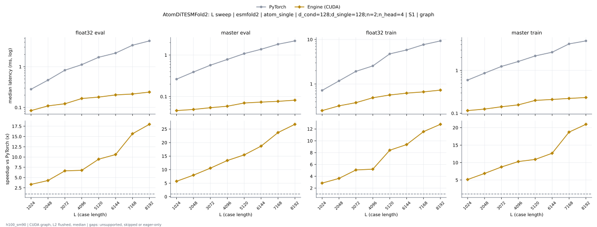

# AtomDiTESMFold2 on h100_sm90

Generated by `python -m miniworld_engine.measure.plot` from speed tokens `judge/tokens/h100_sm90/`; do not edit.

### L sweep: esmfold2 | atom_single | d_cond=128;d_single=128;n=2;n_head=4 | S1 | graph

**float32 eval** (median ms; x = speedup vs PyTorch)

| L | PyTorch | Engine (CUDA) | Anthropic |
|---|---|---|---|
| 1024 | 0.2783 | 0.04573 (6.09x) | 0.0489 (5.69x) |
| 2048 | 0.4664 | 0.05038 (9.26x) | 0.05453 (8.55x) |
| 3072 | 0.8184 | 0.0568 (14.41x) | 0.06443 (12.70x) |
| 4096 | 1.121 | 0.0581 (19.29x) | 0.06859 (16.34x) |
| 5120 | 1.718 | 0.08157 (21.06x) | 0.09157 (18.76x) |
| 6144 | 2.16 | 0.08698 (24.83x) | 0.09637 (22.41x) |
| 7168 | 3.346 | 0.0924 (36.21x) | 0.1035 (32.34x) |
| 8192 | 4.275 | 0.1001 (42.69x) | 0.1085 (39.38x) |

**master eval** (median ms; x = speedup vs PyTorch)

| L | PyTorch | Engine (CUDA) | Anthropic |
|---|---|---|---|
| 1024 | 0.2629 | 0.03158 (8.32x) | 0.05014 (5.24x) |
| 2048 | 0.3869 | 0.03389 (11.42x) | 0.05488 (7.05x) |
| 3072 | 0.5701 | 0.03923 (14.53x) | 0.05946 (9.59x) |
| 4096 | 0.7792 | 0.04331 (17.99x) | 0.06691 (11.65x) |
| 5120 | 1.08 | 0.05571 (19.38x) | 0.07795 (13.85x) |
| 6144 | 1.371 | 0.05811 (23.60x) | 0.08294 (16.53x) |
| 7168 | 1.813 | 0.06099 (29.73x) | 0.08989 (20.17x) |
| 8192 | 2.184 | 0.06589 (33.15x) | 0.09613 (22.72x) |

**float32 train** (median ms; x = speedup vs PyTorch)

| L | PyTorch | Engine (CUDA) | Anthropic |
|---|---|---|---|
| 1024 | 0.7147 | 0.157 (4.55x) | 1.758 (eager) |
| 2048 | 1.17 | 0.1737 (6.74x) | 1.775 (eager) |
| 3072 | 1.924 | 0.1967 (9.78x) | 2.306 (eager) |
| 4096 | 2.557 | 0.2147 (11.91x) | 2.83 (eager) |
| 5120 | 4.758 | 0.2996 (15.88x) | 3.55 (eager) |
| 6144 | 5.812 | 0.319 (18.22x) | 4.141 (eager) |
| 7168 | 7.645 | 0.3383 (22.60x) | 4.883 (eager) |
| 8192 | 9.303 | 0.3567 (26.08x) | 5.428 (eager) |

**master train** (median ms; x = speedup vs PyTorch)

| L | PyTorch | Engine (CUDA) | Anthropic |
|---|---|---|---|
| 1024 | 0.589 | 0.1158 (5.09x) | 2.116 (eager) |
| 2048 | 0.8597 | 0.1259 (6.83x) | 2.107 (eager) |
| 3072 | 1.239 | 0.1427 (8.69x) | 2.519 (eager) |
| 4096 | 1.613 | 0.1587 (10.16x) | 2.515 (eager) |
| 5120 | 2.185 | 0.2002 (10.92x) | 2.817 (eager) |
| 6144 | 2.655 | 0.2107 (12.60x) | 2.834 (eager) |
| 7168 | 4.162 | 0.2223 (18.73x) | 3.201 (eager) |
| 8192 | 4.92 | 0.2332 (21.10x) | 3.525 (eager) |

