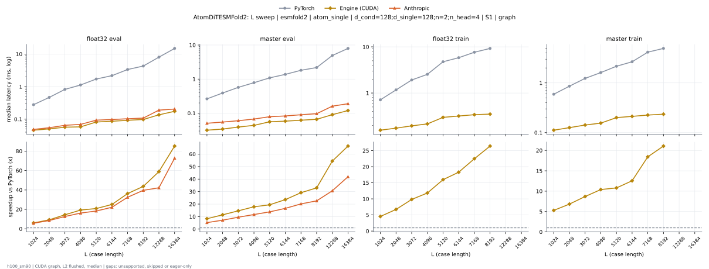

# AtomDiTESMFold2 on h100_sm90

Generated by `python -m foldjet_engine.measure.plot` from speed tokens `judge/tokens/h100_sm90/`; do not edit.

### L sweep: esmfold2 | atom_single | d_cond=128;d_single=128;n=2;n_head=4 | S1 | graph

**float32 eval** (median ms; x = speedup vs PyTorch)

| L | PyTorch | Engine (Triton) | Engine (CUDA) | Anthropic |
|---|---|---|---|---|
| 1024 | 0.2776 | 0.06738 (4.12x) | 0.04594 (6.04x) | 0.04859 (5.71x) |
| 2048 | 0.4665 | 0.07069 (6.60x) | 0.05042 (9.25x) | 0.05461 (8.54x) |
| 3072 | 0.8205 | 0.07794 (10.53x) | 0.05606 (14.64x) | 0.06485 (12.65x) |
| 4096 | 1.122 | 0.07808 (14.37x) | 0.058 (19.35x) | 0.06925 (16.21x) |
| 5120 | 1.709 | 0.1205 (14.18x) | 0.08208 (20.82x) | 0.09328 (18.32x) |
| 6144 | 2.166 | 0.1322 (16.38x) | 0.08637 (25.08x) | 0.09758 (22.20x) |
| 7168 | 3.361 | 0.1444 (23.28x) | 0.09317 (36.07x) | 0.1031 (32.61x) |
| 8192 | 4.288 | 0.1484 (28.89x) | 0.09806 (43.72x) | 0.108 (39.71x) |
| 12288 | 8.028 | 0.211 (38.05x) | 0.1365 (58.80x) | 0.1898 (42.29x) |
| 16384 | 14.87 | 0.2712 (54.85x) | 0.174 (85.48x) | 0.2045 (72.72x) |

**master eval** (median ms; x = speedup vs PyTorch)

| L | PyTorch | Engine (Triton) | Engine (CUDA) | Anthropic |
|---|---|---|---|---|
| 1024 | 0.263 | 0.0568 (4.63x) | 0.03184 (8.26x) | 0.05056 (5.20x) |
| 2048 | 0.3907 | 0.0605 (6.46x) | 0.0344 (11.36x) | 0.05488 (7.12x) |
| 3072 | 0.5741 | 0.06518 (8.81x) | 0.03928 (14.61x) | 0.06008 (9.55x) |
| 4096 | 0.7859 | 0.06462 (12.16x) | 0.04373 (17.97x) | 0.06731 (11.68x) |
| 5120 | 1.087 | 0.07571 (14.36x) | 0.05592 (19.44x) | 0.07882 (13.79x) |
| 6144 | 1.376 | 0.07984 (17.24x) | 0.0585 (23.53x) | 0.08296 (16.59x) |
| 7168 | 1.821 | 0.08448 (21.56x) | 0.06243 (29.17x) | 0.09002 (20.23x) |
| 8192 | 2.183 | 0.08851 (24.66x) | 0.06651 (32.82x) | 0.09656 (22.61x) |
| 12288 | 4.947 | 0.1361 (36.34x) | 0.09086 (54.44x) | 0.1608 (30.77x) |
| 16384 | 7.97 | 0.1509 (52.81x) | 0.1226 (65.01x) | 0.1896 (42.05x) |

**float32 train** (median ms; x = speedup vs PyTorch)

| L | PyTorch | Engine (Triton) | Engine (CUDA) | Anthropic |
|---|---|---|---|---|
| 1024 | 0.7117 | 0.2042 (3.48x) | 0.1586 (4.49x) | 1.815 (eager) |
| 2048 | 1.174 | 0.2255 (5.21x) | 0.1732 (6.78x) | 1.886 (eager) |
| 3072 | 1.921 | 0.2663 (7.21x) | 0.1956 (9.82x) | 2.309 (eager) |
| 4096 | 2.548 | 0.287 (8.88x) | 0.2152 (11.84x) | 2.797 (eager) |
| 5120 | 4.749 | 0.4307 (11.03x) | 0.2994 (15.86x) | 3.511 (eager) |
| 6144 | 5.828 | 0.4636 (12.57x) | 0.3231 (18.04x) | 4.108 (eager) |
| 7168 | 7.633 | 0.494 (15.45x) | 0.3387 (22.54x) | 4.813 (eager) |
| 8192 | 9.314 | 0.5149 (18.09x) | 0.3565 (26.13x) | 5.382 (eager) |
| 12288 |  |  |  |  |
| 16384 |  |  |  |  |

**master train** (median ms; x = speedup vs PyTorch)

| L | PyTorch | Engine (Triton) | Engine (CUDA) | Anthropic |
|---|---|---|---|---|
| 1024 | 0.592 | 0.1496 (3.96x) | 0.1044 (5.67x) | 2.299 (eager) |
| 2048 | 0.8627 | 0.1666 (5.18x) | 0.1128 (7.65x) | 2.254 (eager) |
| 3072 | 1.235 | 0.1996 (6.19x) | 0.1258 (9.82x) | 2.704 (eager) |
| 4096 | 1.605 | 0.2139 (7.51x) | 0.1371 (11.71x) | 2.657 (eager) |
| 5120 | 2.162 | 0.2755 (7.85x) | 0.1767 (12.24x) | 2.988 (eager) |
| 6144 | 2.668 | 0.2932 (9.10x) | 0.1858 (14.36x) | 3.001 (eager) |
| 7168 | 4.164 | 0.3162 (13.17x) | 0.1949 (21.36x) | 3.273 (eager) |
| 8192 | 4.944 | 0.3321 (14.88x) | 0.204 (24.24x) | 3.228 (eager) |
| 12288 |  |  |  |  |
| 16384 |  |  |  |  |

