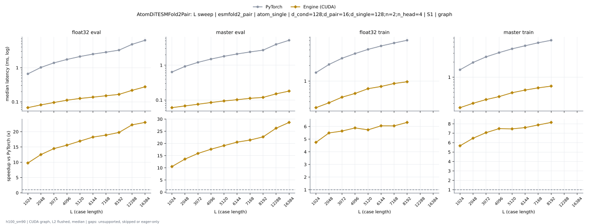
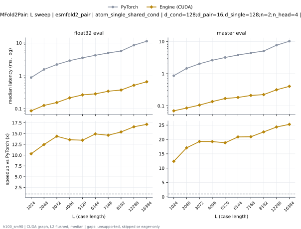

# AtomDiTESMFold2Pair on h100_sm90

Generated by `python -m miniworld_engine.measure.plot` from speed tokens `judge/tokens/h100_sm90/`; do not edit.

### L sweep: esmfold2_pair | atom_single | d_cond=128;d_pair=16;d_single=128;n=2;n_head=4 | S1 | graph

**float32 eval** (median ms; x = speedup vs PyTorch)

| L | PyTorch | Engine (Triton) | Engine (CUDA) |
|---|---|---|---|
| 1024 | 0.6598 | 0.5506 (1.20x) | 0.06762 (9.76x) |
| 2048 | 1.018 | 0.8723 (1.17x) | 0.08142 (12.51x) |
| 3072 | 1.384 | 1.193 (1.16x) | 0.09562 (14.47x) |
| 4096 | 1.743 | 1.516 (1.15x) | 0.1117 (15.60x) |
| 5120 | 2.124 | 1.863 (1.14x) | 0.1256 (16.92x) |
| 6144 | 2.503 | 2.201 (1.14x) | 0.1373 (18.23x) |
| 7168 | 2.842 | 2.538 (1.12x) | 0.1505 (18.88x) |
| 8192 | 3.266 | 2.862 (1.14x) | 0.1654 (19.75x) |
| 12288 | 4.828 | 4.229 (1.14x) | 0.2171 (22.23x) |
| 16384 | 6.345 | 5.589 (1.14x) | 0.2755 (23.03x) |

**master eval** (median ms; x = speedup vs PyTorch)

| L | PyTorch | Engine (Triton) | Engine (CUDA) |
|---|---|---|---|
| 1024 | 0.6366 | 0.5139 (1.24x) | 0.06051 (10.52x) |
| 2048 | 0.9212 | 0.7555 (1.22x) | 0.06778 (13.59x) |
| 3072 | 1.206 | 0.9957 (1.21x) | 0.07576 (15.91x) |
| 4096 | 1.498 | 1.24 (1.21x) | 0.08494 (17.64x) |
| 5120 | 1.799 | 1.493 (1.20x) | 0.09408 (19.12x) |
| 6144 | 2.096 | 1.742 (1.20x) | 0.102 (20.54x) |
| 7168 | 2.398 | 1.991 (1.20x) | 0.112 (21.41x) |
| 8192 | 2.701 | 2.237 (1.21x) | 0.119 (22.70x) |
| 12288 | 3.953 | 3.258 (1.21x) | 0.1505 (26.26x) |
| 16384 | 5.179 | 4.266 (1.21x) | 0.1808 (28.64x) |

**float32 train** (median ms; x = speedup vs PyTorch)

| L | PyTorch | Engine (Triton) | Engine (CUDA) |
|---|---|---|---|
| 1024 | 1.458 | 1.23 (1.19x) | 0.3069 (4.75x) |
| 2048 | 2.093 | 1.799 (1.16x) | 0.3812 (5.49x) |
| 3072 | 2.756 | 2.383 (1.16x) | 0.4885 (5.64x) |
| 4096 | 3.395 | 2.959 (1.15x) | 0.5767 (5.89x) |
| 5120 | 4.092 | 3.603 (1.14x) | 0.7133 (5.74x) |
| 6144 | 4.764 | 4.17 (1.14x) | 0.7867 (6.05x) |
| 7168 | 5.432 | 4.765 (1.14x) | 0.8977 (6.05x) |
| 8192 | 6.13 | 5.333 (1.15x) | 0.9692 (6.32x) |
| 12288 |  |  |  |
| 16384 |  |  |  |

**master train** (median ms; x = speedup vs PyTorch)

| L | PyTorch | Engine (Triton) | Engine (CUDA) |
|---|---|---|---|
| 1024 | 1.405 | 1.151 (1.22x) | 0.248 (5.67x) |
| 2048 | 1.959 | 1.632 (1.20x) | 0.3028 (6.47x) |
| 3072 | 2.536 | 2.119 (1.20x) | 0.3591 (7.06x) |
| 4096 | 3.078 | 2.59 (1.19x) | 0.4111 (7.49x) |
| 5120 | 3.664 | 3.089 (1.19x) | 0.4911 (7.46x) |
| 6144 | 4.214 | 3.549 (1.19x) | 0.5546 (7.60x) |
| 7168 | 4.829 | 4.046 (1.19x) | 0.6131 (7.88x) |
| 8192 | 5.413 | 4.529 (1.20x) | 0.6643 (8.15x) |
| 12288 |  |  |  |
| 16384 |  |  |  |

### L sweep: esmfold2_pair | atom_single_shared_cond | d_cond=128;d_pair=16;d_single=128;n=2;n_head=4 | S5 | graph

**float32 eval** (median ms; x = speedup vs PyTorch)

| L | PyTorch | Engine (Triton) | Engine (CUDA) |
|---|---|---|---|
| 1024 | 0.8871 | 0.6463 (1.37x) | 0.08605 (10.31x) |
| 2048 | 1.564 | 1.081 (1.45x) | 0.1256 (12.45x) |
| 3072 | 2.212 | 1.512 (1.46x) | 0.154 (14.37x) |
| 4096 | 2.896 | 1.981 (1.46x) | 0.2134 (13.57x) |
| 5120 | 3.537 | 2.415 (1.46x) | 0.2628 (13.46x) |
| 6144 | 4.209 | 2.889 (1.46x) | 0.2822 (14.91x) |
| 7168 | 4.963 | 3.397 (1.46x) | 0.3397 (14.61x) |
| 8192 | 5.682 | 3.939 (1.44x) | 0.3696 (15.37x) |
| 12288 | 8.538 | 5.952 (1.43x) | 0.5152 (16.57x) |
| 16384 | 11.29 | 7.959 (1.42x) | 0.6592 (17.13x) |

**master eval** (median ms; x = speedup vs PyTorch)

| L | PyTorch | Engine (Triton) | Engine (CUDA) |
|---|---|---|---|
| 1024 | 0.8648 | 0.5761 (1.50x) | 0.0699 (12.37x) |
| 2048 | 1.458 | 0.9248 (1.58x) | 0.08536 (17.09x) |
| 3072 | 2.032 | 1.258 (1.62x) | 0.1054 (19.28x) |
| 4096 | 2.611 | 1.615 (1.62x) | 0.1356 (19.26x) |
| 5120 | 3.184 | 1.965 (1.62x) | 0.169 (18.84x) |
| 6144 | 3.804 | 2.347 (1.62x) | 0.1821 (20.89x) |
| 7168 | 4.407 | 2.712 (1.62x) | 0.2104 (20.94x) |
| 8192 | 5.05 | 3.095 (1.63x) | 0.2232 (22.62x) |
| 12288 | 7.672 | 4.706 (1.63x) | 0.3153 (24.33x) |
| 16384 | 10.2 | 6.246 (1.63x) | 0.404 (25.26x) |

