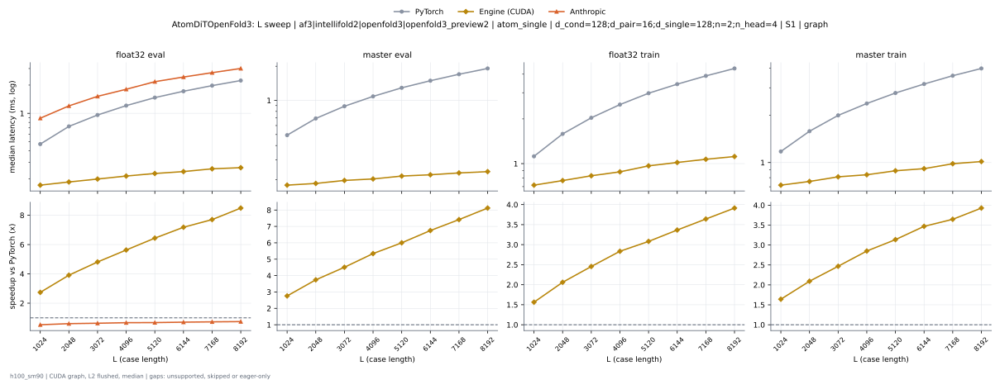
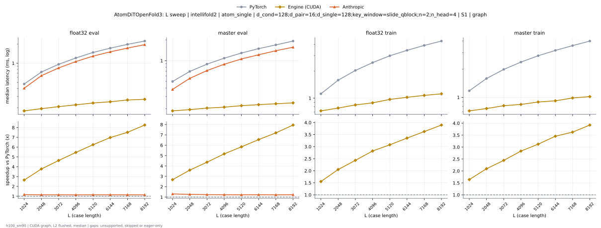

# AtomDiTOpenFold3 on h100_sm90

Generated by `python -m miniworld_engine.measure.plot` from speed tokens `judge/tokens/h100_sm90/`; do not edit.

### L sweep: af3|intellifold2|openfold3|openfold3_preview2 | atom_single | d_cond=128;d_pair=16;d_single=128;n=2;n_head=4 | S1 | graph

**float32 eval** (median ms; x = speedup vs PyTorch)

| L | PyTorch | Engine (Triton) | Engine (CUDA) | Anthropic |
|---|---|---|---|---|
| 1024 | 0.4691 | 0.377 (1.24x) | 0.174 (2.70x) | 0.3987 (1.18x) |
| 2048 | 0.7262 | 0.6096 (1.19x) | 0.189 (3.84x) | 0.6295 (1.15x) |
| 3072 | 0.9604 | 0.8206 (1.17x) | 0.2019 (4.76x) | 0.8369 (1.15x) |
| 4096 | 1.203 | 1.039 (1.16x) | 0.2162 (5.56x) | 1.056 (1.14x) |
| 5120 | 1.472 | 1.286 (1.14x) | 0.2312 (6.37x) | 1.288 (1.14x) |
| 6144 | 1.71 | 1.498 (1.14x) | 0.2412 (7.09x) | 1.504 (1.14x) |
| 7168 | 1.975 | 1.734 (1.14x) | 0.2581 (7.65x) | 1.724 (1.15x) |
| 8192 | 2.237 | 1.965 (1.14x) | 0.2664 (8.40x) | 1.952 (1.15x) |

**master eval** (median ms; x = speedup vs PyTorch)

| L | PyTorch | Engine (Triton) | Engine (CUDA) | Anthropic |
|---|---|---|---|---|
| 1024 | 0.4935 | 0.3992 (1.24x) | 0.182 (2.71x) | 0.3762 (1.31x) |
| 2048 | 0.69 | 0.5728 (1.20x) | 0.1879 (3.67x) | 0.548 (1.26x) |
| 3072 | 0.8835 | 0.7353 (1.20x) | 0.1988 (4.44x) | 0.7117 (1.24x) |
| 4096 | 1.08 | 0.9036 (1.19x) | 0.2052 (5.26x) | 0.8797 (1.23x) |
| 5120 | 1.285 | 1.081 (1.19x) | 0.2159 (5.95x) | 1.053 (1.22x) |
| 6144 | 1.49 | 1.257 (1.19x) | 0.2243 (6.65x) | 1.212 (1.23x) |
| 7168 | 1.699 | 1.43 (1.19x) | 0.2321 (7.32x) | 1.39 (1.22x) |
| 8192 | 1.903 | 1.604 (1.19x) | 0.2369 (8.03x) | 1.565 (1.22x) |

**float32 train** (median ms; x = speedup vs PyTorch)

| L | PyTorch | Engine (Triton) | Engine (CUDA) | Anthropic |
|---|---|---|---|---|
| 1024 | 1.118 | 0.9049 (1.23x) | 0.7129 (1.57x) | unsupported |
| 2048 | 1.583 | 1.333 (1.19x) | 0.7658 (2.07x) | unsupported |
| 3072 | 2.034 | 1.729 (1.18x) | 0.8281 (2.46x) | unsupported |
| 4096 | 2.484 | 2.137 (1.16x) | 0.8743 (2.84x) | unsupported |
| 5120 | 2.978 | 2.591 (1.15x) | 0.961 (3.10x) | unsupported |
| 6144 | 3.424 | 3.009 (1.14x) | 1.013 (3.38x) | unsupported |
| 7168 | 3.888 | 3.389 (1.15x) | 1.064 (3.66x) | unsupported |
| 8192 | 4.367 | 3.803 (1.15x) | 1.109 (3.94x) | unsupported |

**master train** (median ms; x = speedup vs PyTorch)

| L | PyTorch | Engine (Triton) | Engine (CUDA) | Anthropic |
|---|---|---|---|---|
| 1024 | 1.174 | 0.9549 (1.23x) | 0.7104 (1.65x) | unsupported |
| 2048 | 1.587 | 1.328 (1.20x) | 0.7512 (2.11x) | unsupported |
| 3072 | 1.99 | 1.679 (1.18x) | 0.8051 (2.47x) | unsupported |
| 4096 | 2.38 | 2.026 (1.17x) | 0.8322 (2.86x) | unsupported |
| 5120 | 2.782 | 2.384 (1.17x) | 0.8834 (3.15x) | unsupported |
| 6144 | 3.17 | 2.735 (1.16x) | 0.911 (3.48x) | unsupported |
| 7168 | 3.583 | 3.085 (1.16x) | 0.9784 (3.66x) | unsupported |
| 8192 | 3.992 | 3.41 (1.17x) | 1.01 (3.95x) | unsupported |

### L sweep: intellifold2 | atom_single | d_cond=128;d_pair=16;d_single=128;key_window=slide_qblock;n=2;n_head=4 | S1 | graph

**float32 eval** (median ms; x = speedup vs PyTorch)

| L | PyTorch | Engine (Triton) | Engine (CUDA) | Anthropic |
|---|---|---|---|---|
| 1024 | 0.4709 | 0.3792 (1.24x) | 0.1778 (2.65x) | 0.4039 (1.17x) |
| 2048 | 0.7275 | 0.6124 (1.19x) | 0.1926 (3.78x) | 0.6366 (1.14x) |
| 3072 | 0.9619 | 0.8261 (1.16x) | 0.2073 (4.64x) | 0.8425 (1.14x) |
| 4096 | 1.209 | 1.051 (1.15x) | 0.2214 (5.46x) | 1.062 (1.14x) |
| 5120 | 1.478 | 1.295 (1.14x) | 0.2365 (6.25x) | 1.294 (1.14x) |
| 6144 | 1.726 | 1.513 (1.14x) | 0.2473 (6.98x) | 1.511 (1.14x) |
| 7168 | 1.981 | 1.739 (1.14x) | 0.2638 (7.51x) | 1.732 (1.14x) |
| 8192 | 2.232 | 1.96 (1.14x) | 0.2705 (8.25x) | 1.96 (1.14x) |

**master eval** (median ms; x = speedup vs PyTorch)

| L | PyTorch | Engine (Triton) | Engine (CUDA) | Anthropic |
|---|---|---|---|---|
| 1024 | 0.4976 | 0.4033 (1.23x) | 0.1857 (2.68x) | 0.3817 (1.30x) |
| 2048 | 0.6971 | 0.5782 (1.21x) | 0.1936 (3.60x) | 0.5528 (1.26x) |
| 3072 | 0.8902 | 0.7403 (1.20x) | 0.2039 (4.37x) | 0.718 (1.24x) |
| 4096 | 1.087 | 0.9142 (1.19x) | 0.2103 (5.17x) | 0.8861 (1.23x) |
| 5120 | 1.292 | 1.087 (1.19x) | 0.2211 (5.85x) | 1.06 (1.22x) |
| 6144 | 1.497 | 1.263 (1.19x) | 0.2287 (6.55x) | 1.219 (1.23x) |
| 7168 | 1.697 | 1.428 (1.19x) | 0.2359 (7.20x) | 1.396 (1.22x) |
| 8192 | 1.929 | 1.619 (1.19x) | 0.2427 (7.95x) | 1.57 (1.23x) |

**float32 train** (median ms; x = speedup vs PyTorch)

| L | PyTorch | Engine (Triton) | Engine (CUDA) | Anthropic |
|---|---|---|---|---|
| 1024 | 1.119 | 0.9059 (1.24x) | 0.7205 (1.55x) | unsupported |
| 2048 | 1.589 | 1.331 (1.19x) | 0.7746 (2.05x) | unsupported |
| 3072 | 2.042 | 1.733 (1.18x) | 0.8396 (2.43x) | unsupported |
| 4096 | 2.498 | 2.142 (1.17x) | 0.8858 (2.82x) | unsupported |
| 5120 | 2.979 | 2.6 (1.15x) | 0.9681 (3.08x) | unsupported |
| 6144 | 3.429 | 3.014 (1.14x) | 1.022 (3.35x) | unsupported |
| 7168 | 3.894 | 3.412 (1.14x) | 1.074 (3.63x) | unsupported |
| 8192 | 4.354 | 3.827 (1.14x) | 1.117 (3.90x) | unsupported |

**master train** (median ms; x = speedup vs PyTorch)

| L | PyTorch | Engine (Triton) | Engine (CUDA) | Anthropic |
|---|---|---|---|---|
| 1024 | 1.177 | 0.9603 (1.23x) | 0.7177 (1.64x) | unsupported |
| 2048 | 1.591 | 1.333 (1.19x) | 0.76 (2.09x) | unsupported |
| 3072 | 1.99 | 1.689 (1.18x) | 0.8148 (2.44x) | unsupported |
| 4096 | 2.383 | 2.032 (1.17x) | 0.841 (2.83x) | unsupported |
| 5120 | 2.786 | 2.401 (1.16x) | 0.8925 (3.12x) | unsupported |
| 6144 | 3.176 | 2.74 (1.16x) | 0.9193 (3.45x) | unsupported |
| 7168 | 3.574 | 3.076 (1.16x) | 0.9856 (3.63x) | unsupported |
| 8192 | 3.997 | 3.414 (1.17x) | 1.019 (3.92x) | unsupported |

