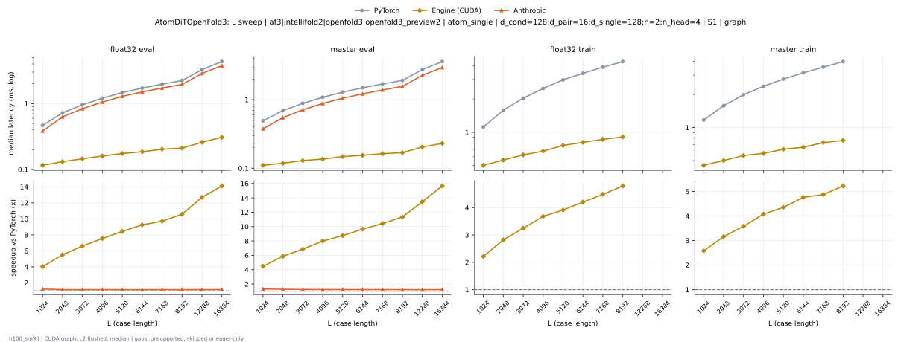
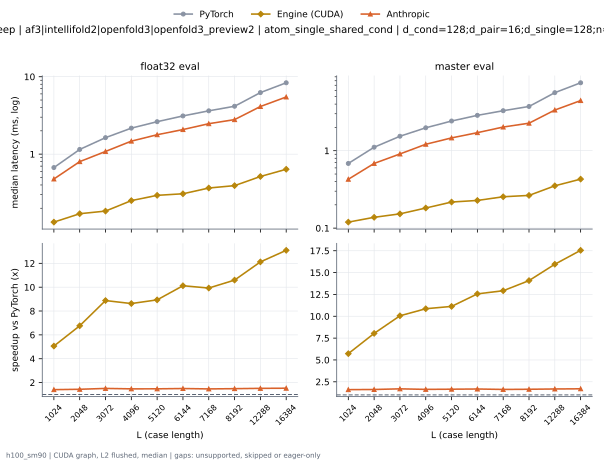
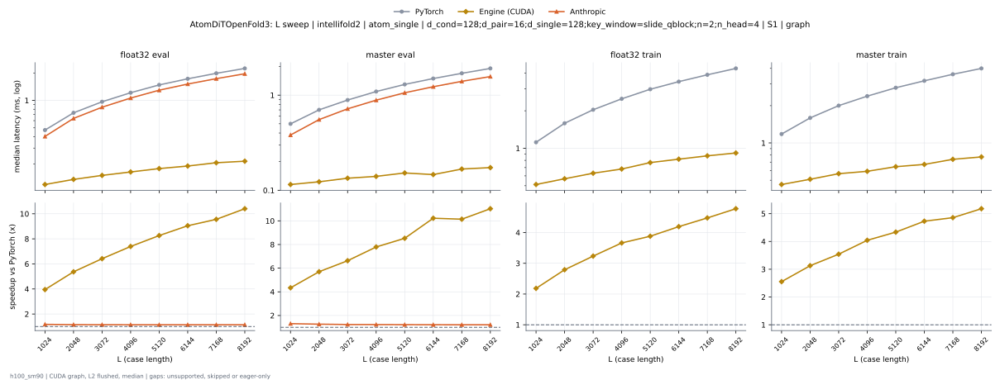
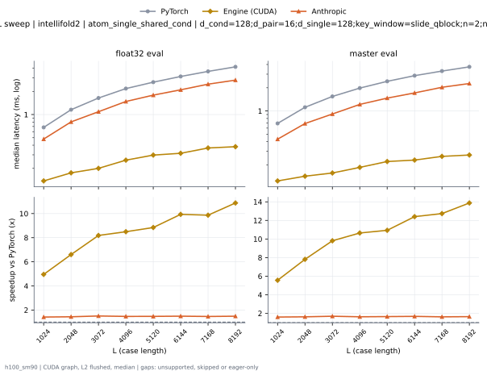

# AtomDiTOpenFold3 on h100_sm90

Generated by `python -m foldjet_engine.measure.plot` from speed tokens `judge/tokens/h100_sm90/`; do not edit.

### L sweep: af3|intellifold2|openfold3|openfold3_preview2 | atom_single | d_cond=128;d_pair=16;d_single=128;n=2;n_head=4 | S1 | graph

**float32 eval** (median ms; x = speedup vs PyTorch)

| L | PyTorch | Engine (Triton) | Engine (CUDA) | Anthropic |
|---|---|---|---|---|
| 1024 | 0.4665 | 0.377 (1.24x) | 0.1157 (4.03x) | 0.3829 (1.22x) |
| 2048 | 0.724 | 0.6129 (1.18x) | 0.1314 (5.51x) | 0.63 (1.15x) |
| 3072 | 0.96 | 0.8199 (1.17x) | 0.1454 (6.60x) | 0.8371 (1.15x) |
| 4096 | 1.208 | 1.044 (1.16x) | 0.1601 (7.55x) | 1.056 (1.14x) |
| 5120 | 1.473 | 1.286 (1.15x) | 0.1746 (8.44x) | 1.288 (1.14x) |
| 6144 | 1.72 | 1.506 (1.14x) | 0.1858 (9.25x) | 1.505 (1.14x) |
| 7168 | 1.973 | 1.732 (1.14x) | 0.203 (9.72x) | 1.725 (1.14x) |
| 8192 | 2.236 | 1.964 (1.14x) | 0.2113 (10.58x) | 1.953 (1.14x) |
| 12288 | 3.284 | 2.885 (1.14x) | 0.2586 (12.70x) | 2.869 (1.14x) |
| 16384 | 4.347 | 3.816 (1.14x) | 0.3079 (14.12x) | 3.76 (1.16x) |

**master eval** (median ms; x = speedup vs PyTorch)

| L | PyTorch | Engine (Triton) | Engine (CUDA) | Anthropic |
|---|---|---|---|---|
| 1024 | 0.4937 | 0.4005 (1.23x) | 0.1104 (4.47x) | 0.3764 (1.31x) |
| 2048 | 0.6936 | 0.572 (1.21x) | 0.1182 (5.87x) | 0.548 (1.27x) |
| 3072 | 0.8869 | 0.7373 (1.20x) | 0.1293 (6.86x) | 0.7127 (1.24x) |
| 4096 | 1.086 | 0.909 (1.19x) | 0.1359 (7.99x) | 0.8804 (1.23x) |
| 5120 | 1.293 | 1.086 (1.19x) | 0.1479 (8.75x) | 1.054 (1.23x) |
| 6144 | 1.492 | 1.256 (1.19x) | 0.1547 (9.65x) | 1.219 (1.22x) |
| 7168 | 1.7 | 1.429 (1.19x) | 0.1631 (10.42x) | 1.39 (1.22x) |
| 8192 | 1.914 | 1.611 (1.19x) | 0.1688 (11.34x) | 1.565 (1.22x) |
| 12288 | 2.754 | 2.319 (1.19x) | 0.2046 (13.46x) | 2.27 (1.21x) |
| 16384 | 3.61 | 3.02 (1.20x) | 0.2306 (15.66x) | 2.95 (1.22x) |

**float32 train** (median ms; x = speedup vs PyTorch)

| L | PyTorch | Engine (Triton) | Engine (CUDA) | Anthropic |
|---|---|---|---|---|
| 1024 | 1.114 | 0.906 (1.23x) | 0.5034 (2.21x) | unsupported |
| 2048 | 1.583 | 1.332 (1.19x) | 0.5611 (2.82x) | unsupported |
| 3072 | 2.031 | 1.736 (1.17x) | 0.6256 (3.25x) | unsupported |
| 4096 | 2.488 | 2.14 (1.16x) | 0.6759 (3.68x) | unsupported |
| 5120 | 2.976 | 2.598 (1.15x) | 0.7606 (3.91x) | unsupported |
| 6144 | 3.408 | 3 (1.14x) | 0.8107 (4.20x) | unsupported |
| 7168 | 3.871 | 3.41 (1.14x) | 0.8629 (4.49x) | unsupported |
| 8192 | 4.353 | 3.841 (1.13x) | 0.9082 (4.79x) | unsupported |
| 12288 |  |  |  |  |
| 16384 |  |  |  |  |

**master train** (median ms; x = speedup vs PyTorch)

| L | PyTorch | Engine (Triton) | Engine (CUDA) | Anthropic |
|---|---|---|---|---|
| 1024 | 1.172 | 0.9602 (1.22x) | 0.4536 (2.58x) | unsupported |
| 2048 | 1.582 | 1.329 (1.19x) | 0.501 (3.16x) | unsupported |
| 3072 | 1.995 | 1.678 (1.19x) | 0.5566 (3.58x) | unsupported |
| 4096 | 2.377 | 2.029 (1.17x) | 0.5829 (4.08x) | unsupported |
| 5120 | 2.765 | 2.388 (1.16x) | 0.635 (4.35x) | unsupported |
| 6144 | 3.153 | 2.722 (1.16x) | 0.662 (4.76x) | unsupported |
| 7168 | 3.559 | 3.083 (1.15x) | 0.7302 (4.87x) | unsupported |
| 8192 | 3.997 | 3.433 (1.16x) | 0.7648 (5.23x) | unsupported |
| 12288 |  |  |  |  |
| 16384 |  |  |  |  |

### L sweep: af3|intellifold2|openfold3|openfold3_preview2 | atom_single_shared_cond | d_cond=128;d_pair=16;d_single=128;n=2;n_head=4 | S5 | graph

**float32 eval** (median ms; x = speedup vs PyTorch)

| L | PyTorch | Engine (Triton) | Engine (CUDA) | Anthropic |
|---|---|---|---|---|
| 1024 | 0.6708 | 0.4892 (1.37x) | 0.1325 (5.06x) | 0.4775 (1.40x) |
| 2048 | 1.15 | 0.8284 (1.39x) | 0.1701 (6.76x) | 0.8005 (1.44x) |
| 3072 | 1.633 | 1.147 (1.42x) | 0.1839 (8.88x) | 1.083 (1.51x) |
| 4096 | 2.168 | 1.529 (1.42x) | 0.2512 (8.63x) | 1.472 (1.47x) |
| 5120 | 2.625 | 1.84 (1.43x) | 0.2937 (8.94x) | 1.781 (1.47x) |
| 6144 | 3.115 | 2.187 (1.42x) | 0.3077 (10.12x) | 2.078 (1.50x) |
| 7168 | 3.626 | 2.548 (1.42x) | 0.3652 (9.93x) | 2.473 (1.47x) |
| 8192 | 4.153 | 2.934 (1.42x) | 0.3919 (10.60x) | 2.792 (1.49x) |
| 12288 | 6.237 | 4.374 (1.43x) | 0.5145 (12.12x) | 4.122 (1.51x) |
| 16384 | 8.349 | 5.878 (1.42x) | 0.6377 (13.09x) | 5.472 (1.53x) |

**master eval** (median ms; x = speedup vs PyTorch)

| L | PyTorch | Engine (Triton) | Engine (CUDA) | Anthropic |
|---|---|---|---|---|
| 1024 | 0.6844 | 0.4821 (1.42x) | 0.1196 (5.72x) | 0.4278 (1.60x) |
| 2048 | 1.109 | 0.7549 (1.47x) | 0.138 (8.04x) | 0.6849 (1.62x) |
| 3072 | 1.537 | 1.019 (1.51x) | 0.1529 (10.06x) | 0.9079 (1.69x) |
| 4096 | 1.976 | 1.306 (1.51x) | 0.1819 (10.86x) | 1.211 (1.63x) |
| 5120 | 2.418 | 1.586 (1.52x) | 0.2173 (11.13x) | 1.464 (1.65x) |
| 6144 | 2.862 | 1.879 (1.52x) | 0.2278 (12.56x) | 1.71 (1.67x) |
| 7168 | 3.285 | 2.155 (1.52x) | 0.2542 (12.92x) | 2.022 (1.62x) |
| 8192 | 3.726 | 2.44 (1.53x) | 0.2646 (14.08x) | 2.266 (1.64x) |
| 12288 | 5.618 | 3.657 (1.54x) | 0.3521 (15.96x) | 3.351 (1.68x) |
| 16384 | 7.537 | 4.841 (1.56x) | 0.4296 (17.55x) | 4.439 (1.70x) |

### L sweep: intellifold2 | atom_single | d_cond=128;d_pair=16;d_single=128;key_window=slide_qblock;n=2;n_head=4 | S1 | graph

**float32 eval** (median ms; x = speedup vs PyTorch)

| L | PyTorch | Engine (Triton) | Engine (CUDA) | Anthropic |
|---|---|---|---|---|
| 1024 | 0.4727 | 0.3818 (1.24x) | 0.1197 (3.95x) | 0.4028 (1.17x) |
| 2048 | 0.7307 | 0.6154 (1.19x) | 0.1361 (5.37x) | 0.6346 (1.15x) |
| 3072 | 0.9661 | 0.8255 (1.17x) | 0.1506 (6.42x) | 0.8423 (1.15x) |
| 4096 | 1.214 | 1.051 (1.16x) | 0.1642 (7.39x) | 1.061 (1.14x) |
| 5120 | 1.478 | 1.292 (1.14x) | 0.1789 (8.26x) | 1.294 (1.14x) |
| 6144 | 1.725 | 1.513 (1.14x) | 0.1907 (9.04x) | 1.511 (1.14x) |
| 7168 | 1.981 | 1.738 (1.14x) | 0.2073 (9.56x) | 1.731 (1.14x) |
| 8192 | 2.241 | 1.972 (1.14x) | 0.2154 (10.40x) | 1.958 (1.14x) |

**master eval** (median ms; x = speedup vs PyTorch)

| L | PyTorch | Engine (Triton) | Engine (CUDA) | Anthropic |
|---|---|---|---|---|
| 1024 | 0.4993 | 0.4049 (1.23x) | 0.1151 (4.34x) | 0.3812 (1.31x) |
| 2048 | 0.7004 | 0.5777 (1.21x) | 0.1228 (5.70x) | 0.5532 (1.27x) |
| 3072 | 0.8883 | 0.7435 (1.19x) | 0.134 (6.63x) | 0.7183 (1.24x) |
| 4096 | 1.091 | 0.9143 (1.19x) | 0.14 (7.79x) | 0.8854 (1.23x) |
| 5120 | 1.297 | 1.092 (1.19x) | 0.1521 (8.53x) | 1.059 (1.22x) |
| 6144 | 1.495 | 1.255 (1.19x) | 0.1462 (10.22x) | 1.226 (1.22x) |
| 7168 | 1.696 | 1.435 (1.18x) | 0.1673 (10.14x) | 1.397 (1.21x) |
| 8192 | 1.909 | 1.616 (1.18x) | 0.1731 (11.03x) | 1.569 (1.22x) |

**float32 train** (median ms; x = speedup vs PyTorch)

| L | PyTorch | Engine (Triton) | Engine (CUDA) | Anthropic |
|---|---|---|---|---|
| 1024 | 1.117 | 0.9096 (1.23x) | 0.5117 (2.18x) | unsupported |
| 2048 | 1.587 | 1.34 (1.18x) | 0.5689 (2.79x) | unsupported |
| 3072 | 2.039 | 1.746 (1.17x) | 0.6304 (3.23x) | unsupported |
| 4096 | 2.495 | 2.154 (1.16x) | 0.6813 (3.66x) | unsupported |
| 5120 | 2.978 | 2.617 (1.14x) | 0.7674 (3.88x) | unsupported |
| 6144 | 3.428 | 2.999 (1.14x) | 0.8175 (4.19x) | unsupported |
| 7168 | 3.891 | 3.431 (1.13x) | 0.8692 (4.48x) | unsupported |
| 8192 | 4.376 | 3.846 (1.14x) | 0.9164 (4.78x) | unsupported |

**master train** (median ms; x = speedup vs PyTorch)

| L | PyTorch | Engine (Triton) | Engine (CUDA) | Anthropic |
|---|---|---|---|---|
| 1024 | 1.18 | 0.9641 (1.22x) | 0.462 (2.55x) | unsupported |
| 2048 | 1.593 | 1.329 (1.20x) | 0.5092 (3.13x) | unsupported |
| 3072 | 2 | 1.69 (1.18x) | 0.5648 (3.54x) | unsupported |
| 4096 | 2.386 | 2.03 (1.18x) | 0.5903 (4.04x) | unsupported |
| 5120 | 2.789 | 2.402 (1.16x) | 0.6432 (4.34x) | unsupported |
| 6144 | 3.173 | 2.726 (1.16x) | 0.6709 (4.73x) | unsupported |
| 7168 | 3.584 | 3.084 (1.16x) | 0.7378 (4.86x) | unsupported |
| 8192 | 3.994 | 3.434 (1.16x) | 0.7712 (5.18x) | unsupported |

### L sweep: intellifold2 | atom_single_shared_cond | d_cond=128;d_pair=16;d_single=128;key_window=slide_qblock;n=2;n_head=4 | S5 | graph

**float32 eval** (median ms; x = speedup vs PyTorch)

| L | PyTorch | Engine (Triton) | Engine (CUDA) | Anthropic |
|---|---|---|---|---|
| 1024 | 0.6814 | 0.4938 (1.38x) | 0.1375 (4.95x) | 0.4806 (1.42x) |
| 2048 | 1.156 | 0.8334 (1.39x) | 0.1751 (6.60x) | 0.8031 (1.44x) |
| 3072 | 1.639 | 1.151 (1.42x) | 0.2002 (8.19x) | 1.088 (1.51x) |
| 4096 | 2.173 | 1.525 (1.42x) | 0.2558 (8.50x) | 1.478 (1.47x) |
| 5120 | 2.633 | 1.837 (1.43x) | 0.2977 (8.84x) | 1.787 (1.47x) |
| 6144 | 3.121 | 2.193 (1.42x) | 0.3141 (9.94x) | 2.095 (1.49x) |
| 7168 | 3.633 | 2.555 (1.42x) | 0.3681 (9.87x) | 2.48 (1.46x) |
| 8192 | 4.162 | 2.956 (1.41x) | 0.3825 (10.88x) | 2.799 (1.49x) |

**master eval** (median ms; x = speedup vs PyTorch)

| L | PyTorch | Engine (Triton) | Engine (CUDA) | Anthropic |
|---|---|---|---|---|
| 1024 | 0.6904 | 0.4878 (1.42x) | 0.1242 (5.56x) | 0.4314 (1.60x) |
| 2048 | 1.117 | 0.7589 (1.47x) | 0.143 (7.81x) | 0.6878 (1.62x) |
| 3072 | 1.543 | 1.021 (1.51x) | 0.1573 (9.81x) | 0.9146 (1.69x) |
| 4096 | 1.981 | 1.302 (1.52x) | 0.186 (10.65x) | 1.217 (1.63x) |
| 5120 | 2.423 | 1.588 (1.53x) | 0.2216 (10.94x) | 1.469 (1.65x) |
| 6144 | 2.87 | 1.88 (1.53x) | 0.2313 (12.41x) | 1.715 (1.67x) |
| 7168 | 3.291 | 2.163 (1.52x) | 0.2584 (12.74x) | 2.029 (1.62x) |
| 8192 | 3.732 | 2.445 (1.53x) | 0.2689 (13.88x) | 2.271 (1.64x) |

### Single-length cases (no sweep)

- af3|openfold3|openfold3_preview2 | atom_single | d_cond=128;d_pair=16;d_single=128;mask_form=af3;n=2;n_head=4 | S1 | graph L128 float32 eval anthropic: 0.2152 ms
- af3|openfold3|openfold3_preview2 | atom_single | d_cond=128;d_pair=16;d_single=128;mask_form=af3;n=2;n_head=4 | S1 | graph L128 float32 eval cuda: 0.1116 ms
- af3|openfold3|openfold3_preview2 | atom_single | d_cond=128;d_pair=16;d_single=128;mask_form=af3;n=2;n_head=4 | S1 | graph L128 float32 eval pytorch: 0.2654 ms
- af3|openfold3|openfold3_preview2 | atom_single | d_cond=128;d_pair=16;d_single=128;mask_form=af3;n=2;n_head=4 | S1 | graph L128 float32 eval triton: 0.1855 ms
- af3|openfold3|openfold3_preview2 | atom_single | d_cond=128;d_pair=16;d_single=128;mask_form=af3;n=2;n_head=4 | S1 | graph L128 float32 train anthropic: unsupported
- af3|openfold3|openfold3_preview2 | atom_single | d_cond=128;d_pair=16;d_single=128;mask_form=af3;n=2;n_head=4 | S1 | graph L128 float32 train cuda: 0.4452 ms
- af3|openfold3|openfold3_preview2 | atom_single | d_cond=128;d_pair=16;d_single=128;mask_form=af3;n=2;n_head=4 | S1 | graph L128 float32 train pytorch: 0.6672 ms
- af3|openfold3|openfold3_preview2 | atom_single | d_cond=128;d_pair=16;d_single=128;mask_form=af3;n=2;n_head=4 | S1 | graph L128 float32 train triton: 0.5398 ms
- af3|openfold3|openfold3_preview2 | atom_single | d_cond=128;d_pair=16;d_single=128;mask_form=af3;n=2;n_head=4 | S1 | graph L128 master eval anthropic: 0.2421 ms
- af3|openfold3|openfold3_preview2 | atom_single | d_cond=128;d_pair=16;d_single=128;mask_form=af3;n=2;n_head=4 | S1 | graph L128 master eval cuda: 0.1098 ms
- af3|openfold3|openfold3_preview2 | atom_single | d_cond=128;d_pair=16;d_single=128;mask_form=af3;n=2;n_head=4 | S1 | graph L128 master eval pytorch: 0.3401 ms
- af3|openfold3|openfold3_preview2 | atom_single | d_cond=128;d_pair=16;d_single=128;mask_form=af3;n=2;n_head=4 | S1 | graph L128 master eval triton: 0.2572 ms
- af3|openfold3|openfold3_preview2 | atom_single | d_cond=128;d_pair=16;d_single=128;mask_form=af3;n=2;n_head=4 | S1 | graph L128 master train anthropic: unsupported
- af3|openfold3|openfold3_preview2 | atom_single | d_cond=128;d_pair=16;d_single=128;mask_form=af3;n=2;n_head=4 | S1 | graph L128 master train cuda: 0.4218 ms
- af3|openfold3|openfold3_preview2 | atom_single | d_cond=128;d_pair=16;d_single=128;mask_form=af3;n=2;n_head=4 | S1 | graph L128 master train pytorch: 0.7954 ms
- af3|openfold3|openfold3_preview2 | atom_single | d_cond=128;d_pair=16;d_single=128;mask_form=af3;n=2;n_head=4 | S1 | graph L128 master train triton: 0.6588 ms
- af3|openfold3|openfold3_preview2 | atom_single_shared_cond | d_cond=128;d_pair=16;d_single=128;mask_form=af3;n=2;n_head=4 | S5 | graph L128 float32 eval anthropic: 0.2272 ms
- af3|openfold3|openfold3_preview2 | atom_single_shared_cond | d_cond=128;d_pair=16;d_single=128;mask_form=af3;n=2;n_head=4 | S5 | graph L128 float32 eval cuda: 0.1141 ms
- af3|openfold3|openfold3_preview2 | atom_single_shared_cond | d_cond=128;d_pair=16;d_single=128;mask_form=af3;n=2;n_head=4 | S5 | graph L128 float32 eval pytorch: 0.2936 ms
- af3|openfold3|openfold3_preview2 | atom_single_shared_cond | d_cond=128;d_pair=16;d_single=128;mask_form=af3;n=2;n_head=4 | S5 | graph L128 float32 eval triton: 0.2057 ms
- af3|openfold3|openfold3_preview2 | atom_single_shared_cond | d_cond=128;d_pair=16;d_single=128;mask_form=af3;n=2;n_head=4 | S5 | graph L128 master eval anthropic: 0.2477 ms
- af3|openfold3|openfold3_preview2 | atom_single_shared_cond | d_cond=128;d_pair=16;d_single=128;mask_form=af3;n=2;n_head=4 | S5 | graph L128 master eval cuda: 0.1106 ms
- af3|openfold3|openfold3_preview2 | atom_single_shared_cond | d_cond=128;d_pair=16;d_single=128;mask_form=af3;n=2;n_head=4 | S5 | graph L128 master eval pytorch: 0.3654 ms
- af3|openfold3|openfold3_preview2 | atom_single_shared_cond | d_cond=128;d_pair=16;d_single=128;mask_form=af3;n=2;n_head=4 | S5 | graph L128 master eval triton: 0.2745 ms
