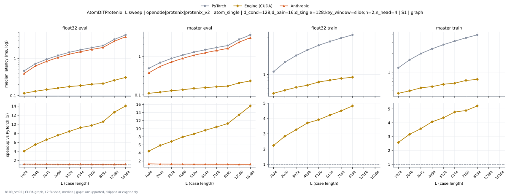
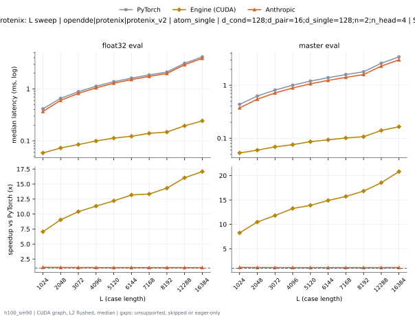
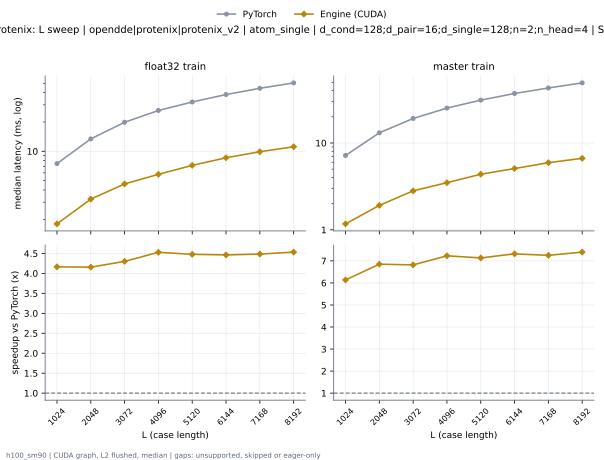
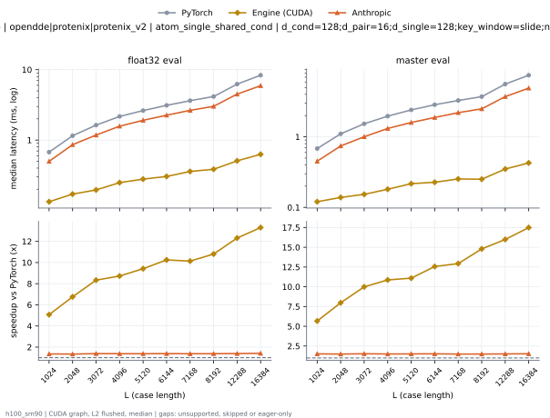
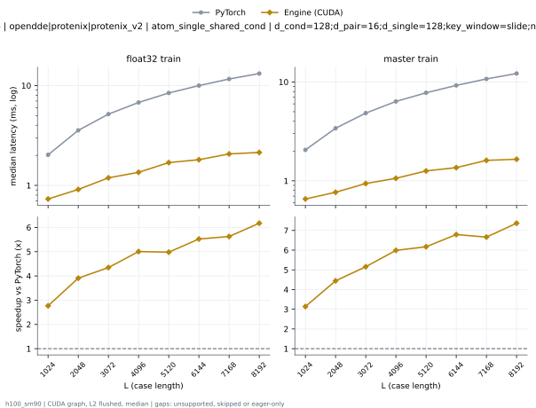
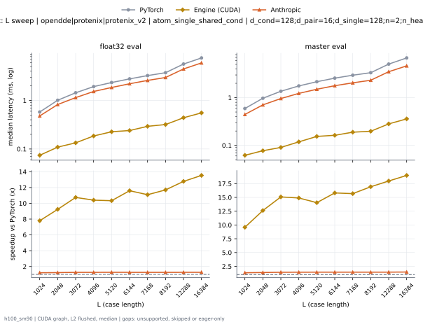
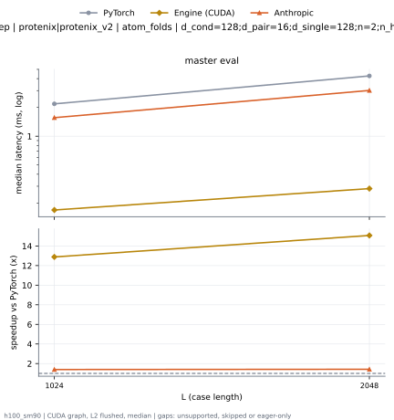
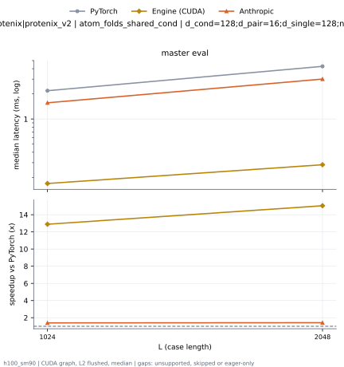

# AtomDiTProtenix on h100_sm90

Generated by `python -m foldjet_engine.measure.plot` from speed tokens `judge/tokens/h100_sm90/`; do not edit.

### L sweep: opendde|protenix|protenix_v2 | atom_single | d_cond=128;d_pair=16;d_single=128;key_window=slide;n=2;n_head=4 | S1 | graph

**float32 eval** (median ms; x = speedup vs PyTorch)

| L | PyTorch | Engine (Triton) | Engine (CUDA) | Anthropic |
|---|---|---|---|---|
| 1024 | 0.4666 | 0.3759 (1.24x) | 0.1155 (4.04x) | 0.3954 (1.18x) |
| 2048 | 0.7233 | 0.6099 (1.19x) | 0.1316 (5.50x) | 0.6302 (1.15x) |
| 3072 | 0.9587 | 0.8202 (1.17x) | 0.1455 (6.59x) | 0.8414 (1.14x) |
| 4096 | 1.207 | 1.044 (1.16x) | 0.1598 (7.56x) | 1.069 (1.13x) |
| 5120 | 1.471 | 1.285 (1.14x) | 0.175 (8.41x) | 1.31 (1.12x) |
| 6144 | 1.72 | 1.507 (1.14x) | 0.186 (9.25x) | 1.53 (1.12x) |
| 7168 | 1.972 | 1.732 (1.14x) | 0.2028 (9.73x) | 1.759 (1.12x) |
| 8192 | 2.235 | 1.965 (1.14x) | 0.2115 (10.57x) | 1.994 (1.12x) |
| 12288 | 3.282 | 2.886 (1.14x) | 0.2593 (12.66x) | 2.937 (1.12x) |
| 16384 | 4.345 | 3.815 (1.14x) | 0.3093 (14.05x) | 3.859 (1.13x) |

**master eval** (median ms; x = speedup vs PyTorch)

| L | PyTorch | Engine (Triton) | Engine (CUDA) | Anthropic |
|---|---|---|---|---|
| 1024 | 0.4912 | 0.3956 (1.24x) | 0.1104 (4.45x) | 0.3753 (1.31x) |
| 2048 | 0.689 | 0.5684 (1.21x) | 0.1177 (5.85x) | 0.5484 (1.26x) |
| 3072 | 0.883 | 0.7349 (1.20x) | 0.1292 (6.83x) | 0.7154 (1.23x) |
| 4096 | 1.082 | 0.906 (1.19x) | 0.1361 (7.95x) | 0.8878 (1.22x) |
| 5120 | 1.288 | 1.084 (1.19x) | 0.1479 (8.71x) | 1.072 (1.20x) |
| 6144 | 1.486 | 1.252 (1.19x) | 0.1548 (9.60x) | 1.242 (1.20x) |
| 7168 | 1.696 | 1.426 (1.19x) | 0.1628 (10.42x) | 1.42 (1.19x) |
| 8192 | 1.909 | 1.607 (1.19x) | 0.1695 (11.26x) | 1.606 (1.19x) |
| 12288 | 2.748 | 2.315 (1.19x) | 0.2047 (13.42x) | 2.335 (1.18x) |
| 16384 | 3.604 | 3.015 (1.20x) | 0.2308 (15.62x) | 3.046 (1.18x) |

**float32 train** (median ms; x = speedup vs PyTorch)

| L | PyTorch | Engine (Triton) | Engine (CUDA) | Anthropic |
|---|---|---|---|---|
| 1024 | 1.112 | 0.9004 (1.23x) | 0.4973 (2.24x) | unsupported |
| 2048 | 1.582 | 1.331 (1.19x) | 0.5568 (2.84x) | unsupported |
| 3072 | 2.028 | 1.737 (1.17x) | 0.6204 (3.27x) | unsupported |
| 4096 | 2.49 | 2.137 (1.17x) | 0.672 (3.71x) | unsupported |
| 5120 | 2.968 | 2.59 (1.15x) | 0.7568 (3.92x) | unsupported |
| 6144 | 3.419 | 2.993 (1.14x) | 0.8099 (4.22x) | unsupported |
| 7168 | 3.891 | 3.4 (1.14x) | 0.8641 (4.50x) | unsupported |
| 8192 | 4.367 | 3.817 (1.14x) | 0.9058 (4.82x) | unsupported |
| 12288 |  |  |  |  |
| 16384 |  |  |  |  |

**master train** (median ms; x = speedup vs PyTorch)

| L | PyTorch | Engine (Triton) | Engine (CUDA) | Anthropic |
|---|---|---|---|---|
| 1024 | 1.172 | 0.9582 (1.22x) | 0.4547 (2.58x) | unsupported |
| 2048 | 1.577 | 1.319 (1.20x) | 0.4976 (3.17x) | unsupported |
| 3072 | 1.99 | 1.682 (1.18x) | 0.5568 (3.57x) | unsupported |
| 4096 | 2.378 | 2.029 (1.17x) | 0.5836 (4.07x) | unsupported |
| 5120 | 2.771 | 2.386 (1.16x) | 0.6358 (4.36x) | unsupported |
| 6144 | 3.161 | 2.726 (1.16x) | 0.6624 (4.77x) | unsupported |
| 7168 | 3.576 | 3.068 (1.17x) | 0.7326 (4.88x) | unsupported |
| 8192 | 3.984 | 3.422 (1.16x) | 0.7643 (5.21x) | unsupported |
| 12288 |  |  |  |  |
| 16384 |  |  |  |  |

### L sweep: opendde|protenix|protenix_v2 | atom_single | d_cond=128;d_pair=16;d_single=128;n=2;n_head=4 | S1 | graph

**float32 eval** (median ms; x = speedup vs PyTorch)

| L | PyTorch | Engine (Triton) | Engine (CUDA) | Anthropic |
|---|---|---|---|---|
| 1024 | 0.4128 | 0.3604 (1.15x) | 0.05845 (7.06x) | 0.3679 (1.12x) |
| 2048 | 0.6585 | 0.5945 (1.11x) | 0.07278 (9.05x) | 0.602 (1.09x) |
| 3072 | 0.8841 | 0.8043 (1.10x) | 0.08496 (10.41x) | 0.8199 (1.08x) |
| 4096 | 1.125 | 1.028 (1.09x) | 0.0993 (11.33x) | 1.045 (1.08x) |
| 5120 | 1.377 | 1.269 (1.09x) | 0.1128 (12.21x) | 1.289 (1.07x) |
| 6144 | 1.614 | 1.491 (1.08x) | 0.1224 (13.18x) | 1.513 (1.07x) |
| 7168 | 1.861 | 1.715 (1.08x) | 0.1395 (13.34x) | 1.743 (1.07x) |
| 8192 | 2.113 | 1.946 (1.09x) | 0.1475 (14.33x) | 1.98 (1.07x) |
| 12288 | 3.121 | 2.868 (1.09x) | 0.1944 (16.05x) | 2.926 (1.07x) |
| 16384 | 4.141 | 3.795 (1.09x) | 0.2425 (17.08x) | 3.88 (1.07x) |

**master eval** (median ms; x = speedup vs PyTorch)

| L | PyTorch | Engine (Triton) | Engine (CUDA) | Anthropic |
|---|---|---|---|---|
| 1024 | 0.4358 | 0.3808 (1.14x) | 0.05275 (8.26x) | 0.3734 (1.17x) |
| 2048 | 0.6244 | 0.5522 (1.13x) | 0.05954 (10.49x) | 0.5456 (1.14x) |
| 3072 | 0.8114 | 0.7192 (1.13x) | 0.06867 (11.82x) | 0.715 (1.13x) |
| 4096 | 1.003 | 0.889 (1.13x) | 0.07563 (13.26x) | 0.8879 (1.13x) |
| 5120 | 1.198 | 1.066 (1.12x) | 0.08613 (13.91x) | 1.065 (1.12x) |
| 6144 | 1.39 | 1.234 (1.13x) | 0.09323 (14.91x) | 1.235 (1.13x) |
| 7168 | 1.59 | 1.408 (1.13x) | 0.1011 (15.73x) | 1.407 (1.13x) |
| 8192 | 1.796 | 1.589 (1.13x) | 0.1067 (16.83x) | 1.591 (1.13x) |
| 12288 | 2.601 | 2.294 (1.13x) | 0.1403 (18.55x) | 2.298 (1.13x) |
| 16384 | 3.431 | 2.992 (1.15x) | 0.1648 (20.83x) | 3.013 (1.14x) |

### L sweep: opendde|protenix|protenix_v2 | atom_single | d_cond=128;d_pair=16;d_single=128;n=2;n_head=4 | S48 | graph

**float32 train** (median ms; x = speedup vs PyTorch)

| L | PyTorch | Engine (Triton) | Engine (CUDA) | Anthropic |
|---|---|---|---|---|
| 1024 | 7.471 | 5.355 (1.40x) | 1.794 (4.16x) | unsupported |
| 2048 | 13.39 | 9.163 (1.46x) | 3.222 (4.16x) | unsupported |
| 3072 | 19.87 | 13.67 (1.45x) | 4.619 (4.30x) | unsupported |
| 4096 | 26.24 | 17.78 (1.48x) | 5.795 (4.53x) | unsupported |
| 5120 | 32.09 | 22.43 (1.43x) | 7.165 (4.48x) | unsupported |
| 6144 | 38.27 | 26.16 (1.46x) | 8.574 (4.46x) | unsupported |
| 7168 | 44.35 | 29.86 (1.49x) | 9.891 (4.48x) | unsupported |
| 8192 | 50.44 | 33.57 (1.50x) | 11.12 (4.53x) | unsupported |

**master train** (median ms; x = speedup vs PyTorch)

| L | PyTorch | Engine (Triton) | Engine (CUDA) | Anthropic |
|---|---|---|---|---|
| 1024 | 7.185 | 4.856 (1.48x) | 1.171 (6.14x) | unsupported |
| 2048 | 13.1 | 8.589 (1.52x) | 1.912 (6.85x) | unsupported |
| 3072 | 19.17 | 12.54 (1.53x) | 2.811 (6.82x) | unsupported |
| 4096 | 25.25 | 16.29 (1.55x) | 3.491 (7.23x) | unsupported |
| 5120 | 31.18 | 20.47 (1.52x) | 4.371 (7.13x) | unsupported |
| 6144 | 37.19 | 24.04 (1.55x) | 5.08 (7.32x) | unsupported |
| 7168 | 43.02 | 27.47 (1.57x) | 5.932 (7.25x) | unsupported |
| 8192 | 49.26 | 31.11 (1.58x) | 6.658 (7.40x) | unsupported |

### L sweep: opendde|protenix|protenix_v2 | atom_single_shared_cond | d_cond=128;d_pair=16;d_single=128;key_window=slide;n=2;n_head=4 | S5 | graph

**float32 eval** (median ms; x = speedup vs PyTorch)

| L | PyTorch | Engine (Triton) | Engine (CUDA) | Anthropic |
|---|---|---|---|---|
| 1024 | 0.6736 | 0.4899 (1.38x) | 0.133 (5.07x) | 0.4977 (1.35x) |
| 2048 | 1.152 | 0.829 (1.39x) | 0.1706 (6.76x) | 0.8603 (1.34x) |
| 3072 | 1.63 | 1.142 (1.43x) | 0.1956 (8.34x) | 1.179 (1.38x) |
| 4096 | 2.167 | 1.522 (1.42x) | 0.2484 (8.72x) | 1.576 (1.38x) |
| 5120 | 2.624 | 1.844 (1.42x) | 0.2786 (9.42x) | 1.91 (1.37x) |
| 6144 | 3.115 | 2.179 (1.43x) | 0.304 (10.25x) | 2.256 (1.38x) |
| 7168 | 3.628 | 2.557 (1.42x) | 0.358 (10.14x) | 2.644 (1.37x) |
| 8192 | 4.153 | 2.923 (1.42x) | 0.3844 (10.80x) | 3.016 (1.38x) |
| 12288 | 6.24 | 4.381 (1.42x) | 0.5066 (12.32x) | 4.497 (1.39x) |
| 16384 | 8.349 | 5.852 (1.43x) | 0.6273 (13.31x) | 5.923 (1.41x) |

**master eval** (median ms; x = speedup vs PyTorch)

| L | PyTorch | Engine (Triton) | Engine (CUDA) | Anthropic |
|---|---|---|---|---|
| 1024 | 0.6821 | 0.4784 (1.43x) | 0.1203 (5.67x) | 0.4514 (1.51x) |
| 2048 | 1.103 | 0.7503 (1.47x) | 0.1383 (7.98x) | 0.743 (1.48x) |
| 3072 | 1.531 | 1.01 (1.51x) | 0.1532 (9.99x) | 1.003 (1.53x) |
| 4096 | 1.965 | 1.285 (1.53x) | 0.1808 (10.87x) | 1.314 (1.50x) |
| 5120 | 2.406 | 1.576 (1.53x) | 0.2169 (11.09x) | 1.596 (1.51x) |
| 6144 | 2.852 | 1.868 (1.53x) | 0.227 (12.56x) | 1.88 (1.52x) |
| 7168 | 3.272 | 2.143 (1.53x) | 0.253 (12.93x) | 2.2 (1.49x) |
| 8192 | 3.709 | 2.425 (1.53x) | 0.2507 (14.79x) | 2.492 (1.49x) |
| 12288 | 5.592 | 3.645 (1.53x) | 0.3498 (15.99x) | 3.715 (1.51x) |
| 16384 | 7.468 | 4.802 (1.56x) | 0.4269 (17.49x) | 4.901 (1.52x) |

### L sweep: opendde|protenix|protenix_v2 | atom_single_shared_cond | d_cond=128;d_pair=16;d_single=128;key_window=slide;n=2;n_head=4 | S8 | graph

**float32 train** (median ms; x = speedup vs PyTorch)

| L | PyTorch | Engine (Triton) | Engine (CUDA) | Anthropic |
|---|---|---|---|---|
| 1024 | 2.024 | 1.484 (1.36x) | 0.7315 (2.77x) | unsupported |
| 2048 | 3.56 | 2.507 (1.42x) | 0.9109 (3.91x) | unsupported |
| 3072 | 5.173 | 3.691 (1.40x) | 1.191 (4.35x) | unsupported |
| 4096 | 6.771 | 4.849 (1.40x) | 1.353 (5.01x) | unsupported |
| 5120 | 8.427 | 6.217 (1.36x) | 1.692 (4.98x) | unsupported |
| 6144 | 9.994 | 7.289 (1.37x) | 1.809 (5.52x) | unsupported |
| 7168 | 11.63 | 8.416 (1.38x) | 2.067 (5.63x) | unsupported |
| 8192 | 13.2 | 9.512 (1.39x) | 2.138 (6.17x) | unsupported |

**master train** (median ms; x = speedup vs PyTorch)

| L | PyTorch | Engine (Triton) | Engine (CUDA) | Anthropic |
|---|---|---|---|---|
| 1024 | 2.056 | 1.476 (1.39x) | 0.6553 (3.14x) | unsupported |
| 2048 | 3.402 | 2.34 (1.45x) | 0.7659 (4.44x) | unsupported |
| 3072 | 4.843 | 3.321 (1.46x) | 0.939 (5.16x) | unsupported |
| 4096 | 6.351 | 4.358 (1.46x) | 1.061 (5.99x) | unsupported |
| 5120 | 7.77 | 5.456 (1.42x) | 1.259 (6.17x) | unsupported |
| 6144 | 9.231 | 6.428 (1.44x) | 1.359 (6.79x) | unsupported |
| 7168 | 10.73 | 7.445 (1.44x) | 1.611 (6.66x) | unsupported |
| 8192 | 12.17 | 8.413 (1.45x) | 1.653 (7.37x) | unsupported |

### L sweep: opendde|protenix|protenix_v2 | atom_single_shared_cond | d_cond=128;d_pair=16;d_single=128;n=2;n_head=4 | S5 | graph

**float32 eval** (median ms; x = speedup vs PyTorch)

| L | PyTorch | Engine (Triton) | Engine (CUDA) | Anthropic |
|---|---|---|---|---|
| 1024 | 0.5778 | 0.4722 (1.22x) | 0.07414 (7.79x) | 0.4792 (1.21x) |
| 2048 | 1.009 | 0.8077 (1.25x) | 0.1092 (9.24x) | 0.8239 (1.22x) |
| 3072 | 1.439 | 1.127 (1.28x) | 0.1339 (10.75x) | 1.144 (1.26x) |
| 4096 | 1.928 | 1.5 (1.28x) | 0.1854 (10.40x) | 1.53 (1.26x) |
| 5120 | 2.339 | 1.818 (1.29x) | 0.2264 (10.33x) | 1.85 (1.26x) |
| 6144 | 2.782 | 2.166 (1.28x) | 0.2399 (11.60x) | 2.206 (1.26x) |
| 7168 | 3.25 | 2.541 (1.28x) | 0.2931 (11.09x) | 2.585 (1.26x) |
| 8192 | 3.728 | 2.917 (1.28x) | 0.3187 (11.70x) | 2.969 (1.26x) |
| 12288 | 5.626 | 4.345 (1.29x) | 0.4403 (12.78x) | 4.454 (1.26x) |
| 16384 | 7.51 | 5.829 (1.29x) | 0.5549 (13.53x) | 5.926 (1.27x) |

**master eval** (median ms; x = speedup vs PyTorch)

| L | PyTorch | Engine (Triton) | Engine (CUDA) | Anthropic |
|---|---|---|---|---|
| 1024 | 0.593 | 0.4603 (1.29x) | 0.06187 (9.58x) | 0.4452 (1.33x) |
| 2048 | 0.9744 | 0.734 (1.33x) | 0.07718 (12.62x) | 0.707 (1.38x) |
| 3072 | 1.365 | 0.9932 (1.37x) | 0.09046 (15.09x) | 0.9603 (1.42x) |
| 4096 | 1.764 | 1.274 (1.38x) | 0.1184 (14.90x) | 1.232 (1.43x) |
| 5120 | 2.163 | 1.552 (1.39x) | 0.154 (14.05x) | 1.503 (1.44x) |
| 6144 | 2.571 | 1.85 (1.39x) | 0.1626 (15.81x) | 1.785 (1.44x) |
| 7168 | 2.963 | 2.114 (1.40x) | 0.1889 (15.69x) | 2.049 (1.45x) |
| 8192 | 3.345 | 2.405 (1.39x) | 0.1976 (16.93x) | 2.324 (1.44x) |
| 12288 | 5.071 | 3.626 (1.40x) | 0.282 (17.98x) | 3.507 (1.45x) |
| 16384 | 6.824 | 4.783 (1.43x) | 0.3593 (18.99x) | 4.654 (1.47x) |

### L sweep: protenix|protenix_v2 | atom_folds | d_cond=128;d_pair=16;d_single=128;n=2;n_head=4 | D5 | S5 | graph

**master eval** (median ms; x = speedup vs PyTorch)

| L | PyTorch | Engine (Triton) | Engine (CUDA) | Anthropic |
|---|---|---|---|---|
| 1024 | 2.18 | 1.566 (1.39x) | 0.1692 (12.88x) | 1.563 (1.39x) |
| 2048 | 4.271 | 3.049 (1.40x) | 0.2833 (15.08x) | 3.01 (1.42x) |

### L sweep: protenix|protenix_v2 | atom_folds_shared_cond | d_cond=128;d_pair=16;d_single=128;n=2;n_head=4 | D5 | S5 | graph

**master eval** (median ms; x = speedup vs PyTorch)

| L | PyTorch | Engine (Triton) | Engine (CUDA) | Anthropic |
|---|---|---|---|---|
| 1024 | 2.181 | 1.566 (1.39x) | 0.1691 (12.89x) | 1.563 (1.39x) |
| 2048 | 4.268 | 3.062 (1.39x) | 0.2837 (15.05x) | 3.008 (1.42x) |

