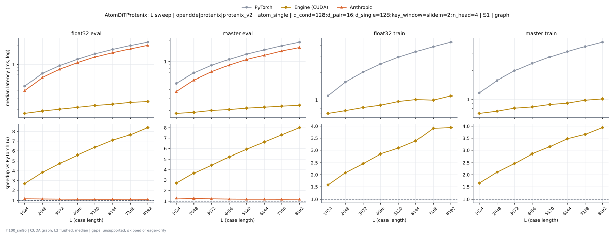
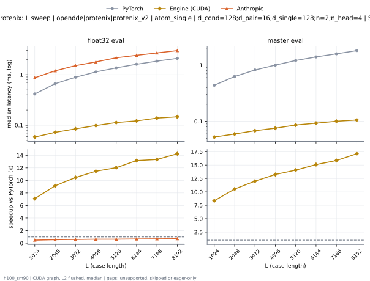
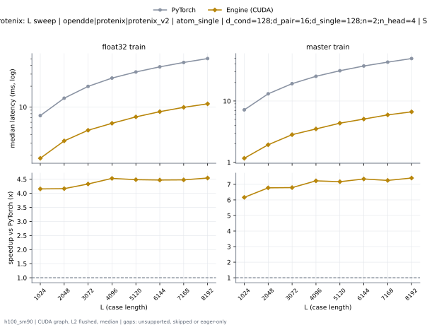

# AtomDiTProtenix on h100_sm90

Generated by `python -m miniworld_engine.measure.plot` from speed tokens `judge/tokens/h100_sm90/`; do not edit.

### L sweep: opendde|protenix|protenix_v2 | atom_single | d_cond=128;d_pair=16;d_single=128;key_window=slide;n=2;n_head=4 | S1 | graph

**float32 eval** (median ms; x = speedup vs PyTorch)

| L | PyTorch | Engine (Triton) | Engine (CUDA) | Anthropic |
|---|---|---|---|---|
| 1024 | 0.4669 | 0.3753 (1.24x) | 0.111 (4.21x) | 0.3943 (1.18x) |
| 2048 | 0.7252 | 0.6093 (1.19x) | 0.127 (5.71x) | 0.6274 (1.16x) |
| 3072 | 0.9596 | 0.8185 (1.17x) | 0.1405 (6.83x) | 0.8426 (1.14x) |
| 4096 | 1.208 | 1.044 (1.16x) | 0.1545 (7.82x) | 1.069 (1.13x) |
| 5120 | 1.471 | 1.285 (1.14x) | 0.1684 (8.74x) | 1.309 (1.12x) |
| 6144 | 1.718 | 1.505 (1.14x) | 0.1789 (9.60x) | 1.53 (1.12x) |
| 7168 | 1.974 | 1.732 (1.14x) | 0.1964 (10.05x) | 1.75 (1.13x) |
| 8192 | 2.236 | 1.964 (1.14x) | 0.2031 (11.01x) | 1.992 (1.12x) |

**master eval** (median ms; x = speedup vs PyTorch)

| L | PyTorch | Engine (Triton) | Engine (CUDA) | Anthropic |
|---|---|---|---|---|
| 1024 | 0.4901 | 0.3957 (1.24x) | 0.1052 (4.66x) | 0.3759 (1.30x) |
| 2048 | 0.6899 | 0.5696 (1.21x) | 0.1127 (6.12x) | 0.5462 (1.26x) |
| 3072 | 0.8841 | 0.7344 (1.20x) | 0.124 (7.13x) | 0.7148 (1.24x) |
| 4096 | 1.075 | 0.9044 (1.19x) | 0.1301 (8.27x) | 0.8894 (1.21x) |
| 5120 | 1.283 | 1.077 (1.19x) | 0.1414 (9.07x) | 1.072 (1.20x) |
| 6144 | 1.487 | 1.244 (1.20x) | 0.1484 (10.02x) | 1.235 (1.20x) |
| 7168 | 1.687 | 1.416 (1.19x) | 0.1559 (10.82x) | 1.421 (1.19x) |
| 8192 | 1.909 | 1.605 (1.19x) | 0.1622 (11.77x) | 1.596 (1.20x) |

**float32 train** (median ms; x = speedup vs PyTorch)

| L | PyTorch | Engine (Triton) | Engine (CUDA) | Anthropic |
|---|---|---|---|---|
| 1024 | 1.108 | 0.9022 (1.23x) | 0.4637 (2.39x) | unsupported |
| 2048 | 1.583 | 1.331 (1.19x) | 0.5233 (3.03x) | unsupported |
| 3072 | 2.031 | 1.734 (1.17x) | 0.585 (3.47x) | unsupported |
| 4096 | 2.491 | 2.151 (1.16x) | 0.6327 (3.94x) | unsupported |
| 5120 | 2.97 | 2.593 (1.15x) | 0.7176 (4.14x) | unsupported |
| 6144 | 3.424 | 3.007 (1.14x) | 0.7683 (4.46x) | unsupported |
| 7168 | 3.888 | 3.404 (1.14x) | 0.82 (4.74x) | unsupported |
| 8192 | 4.369 | 3.826 (1.14x) | 0.8678 (5.03x) | unsupported |

**master train** (median ms; x = speedup vs PyTorch)

| L | PyTorch | Engine (Triton) | Engine (CUDA) | Anthropic |
|---|---|---|---|---|
| 1024 | 1.171 | 0.9558 (1.22x) | 0.4187 (2.80x) | unsupported |
| 2048 | 1.581 | 1.32 (1.20x) | 0.4635 (3.41x) | unsupported |
| 3072 | 1.992 | 1.682 (1.18x) | 0.5228 (3.81x) | unsupported |
| 4096 | 2.375 | 2.019 (1.18x) | 0.5468 (4.34x) | unsupported |
| 5120 | 2.779 | 2.394 (1.16x) | 0.5996 (4.64x) | unsupported |
| 6144 | 3.161 | 2.729 (1.16x) | 0.6269 (5.04x) | unsupported |
| 7168 | 3.575 | 3.062 (1.17x) | 0.6931 (5.16x) | unsupported |
| 8192 | 3.986 | 3.411 (1.17x) | 0.7255 (5.49x) | unsupported |

### L sweep: opendde|protenix|protenix_v2 | atom_single | d_cond=128;d_pair=16;d_single=128;n=2;n_head=4 | S1 | graph

**float32 eval** (median ms; x = speedup vs PyTorch)

| L | PyTorch | Engine (Triton) | Engine (CUDA) | Anthropic |
|---|---|---|---|---|
| 1024 | 0.4147 | 0.3604 (1.15x) | 0.05859 (7.08x) | 0.3655 (1.13x) |
| 2048 | 0.6616 | 0.5982 (1.11x) | 0.0725 (9.13x) | 0.6059 (1.09x) |
| 3072 | 0.8896 | 0.8044 (1.11x) | 0.08522 (10.44x) | 0.8195 (1.09x) |
| 4096 | 1.119 | 1.028 (1.09x) | 0.09851 (11.36x) | 1.049 (1.07x) |
| 5120 | 1.361 | 1.263 (1.08x) | 0.1123 (12.11x) | 1.281 (1.06x) |
| 6144 | 1.624 | 1.482 (1.10x) | 0.1207 (13.45x) | 1.504 (1.08x) |
| 7168 | 1.838 | 1.706 (1.08x) | 0.1382 (13.30x) | 1.733 (1.06x) |
| 8192 | 2.125 | 1.947 (1.09x) | 0.1481 (14.35x) | 1.967 (1.08x) |

**master eval** (median ms; x = speedup vs PyTorch)

| L | PyTorch | Engine (Triton) | Engine (CUDA) | Anthropic |
|---|---|---|---|---|
| 1024 | 0.4382 | 0.3823 (1.15x) | 0.05274 (8.31x) | 0.3712 (1.18x) |
| 2048 | 0.6286 | 0.5564 (1.13x) | 0.05966 (10.54x) | 0.5471 (1.15x) |
| 3072 | 0.8161 | 0.7189 (1.14x) | 0.06902 (11.82x) | 0.715 (1.14x) |
| 4096 | 0.9902 | 0.8883 (1.11x) | 0.07408 (13.37x) | 0.8882 (1.11x) |
| 5120 | 1.186 | 1.065 (1.11x) | 0.08576 (13.83x) | 1.069 (1.11x) |
| 6144 | 1.368 | 1.234 (1.11x) | 0.09208 (14.86x) | 1.228 (1.11x) |
| 7168 | 1.572 | 1.4 (1.12x) | 0.1002 (15.69x) | 1.409 (1.12x) |
| 8192 | 1.777 | 1.589 (1.12x) | 0.1058 (16.80x) | 1.583 (1.12x) |

### L sweep: opendde|protenix|protenix_v2 | atom_single | d_cond=128;d_pair=16;d_single=128;n=2;n_head=4 | S48 | graph

**float32 train** (median ms; x = speedup vs PyTorch)

| L | PyTorch | Engine (Triton) | Engine (CUDA) | Anthropic |
|---|---|---|---|---|
| 1024 | 7.496 | 5.374 (1.39x) | 1.804 (4.15x) | unsupported |
| 2048 | 13.42 | 9.18 (1.46x) | 3.223 (4.16x) | unsupported |
| 3072 | 19.91 | 13.62 (1.46x) | 4.598 (4.33x) | unsupported |
| 4096 | 26.27 | 17.87 (1.47x) | 5.802 (4.53x) | unsupported |
| 5120 | 32.22 | 22.42 (1.44x) | 7.187 (4.48x) | unsupported |
| 6144 | 38.24 | 26.19 (1.46x) | 8.555 (4.47x) | unsupported |
| 7168 | 44.28 | 29.89 (1.48x) | 9.891 (4.48x) | unsupported |
| 8192 | 50.45 | 33.65 (1.50x) | 11.11 (4.54x) | unsupported |

**master train** (median ms; x = speedup vs PyTorch)

| L | PyTorch | Engine (Triton) | Engine (CUDA) | Anthropic |
|---|---|---|---|---|
| 1024 | 7.171 | 4.854 (1.48x) | 1.164 (6.16x) | unsupported |
| 2048 | 13.1 | 8.591 (1.52x) | 1.933 (6.78x) | unsupported |
| 3072 | 19.17 | 12.57 (1.53x) | 2.824 (6.79x) | unsupported |
| 4096 | 25.3 | 16.24 (1.56x) | 3.501 (7.23x) | unsupported |
| 5120 | 31.17 | 20.48 (1.52x) | 4.348 (7.17x) | unsupported |
| 6144 | 37.25 | 24.01 (1.55x) | 5.072 (7.34x) | unsupported |
| 7168 | 43.06 | 27.51 (1.56x) | 5.937 (7.25x) | unsupported |
| 8192 | 49.26 | 31.11 (1.58x) | 6.653 (7.40x) | unsupported |

