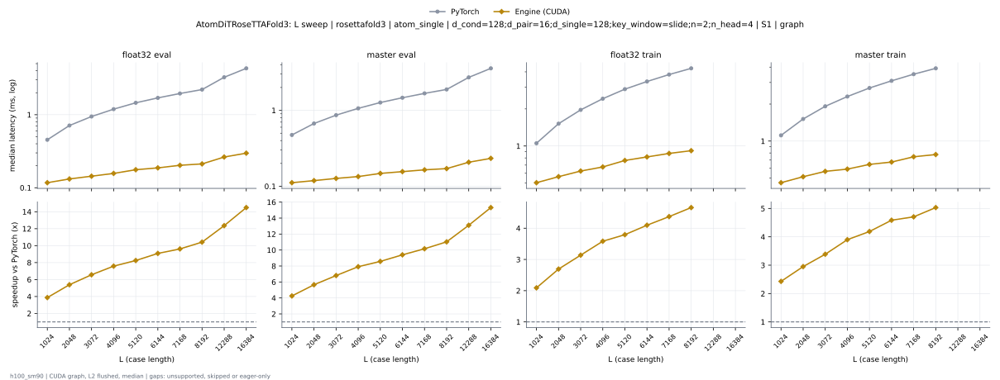
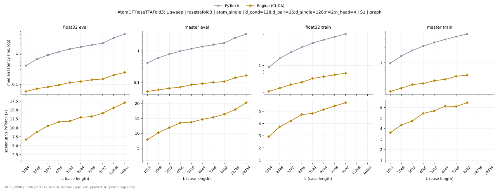
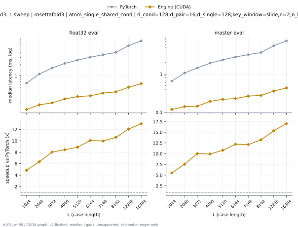
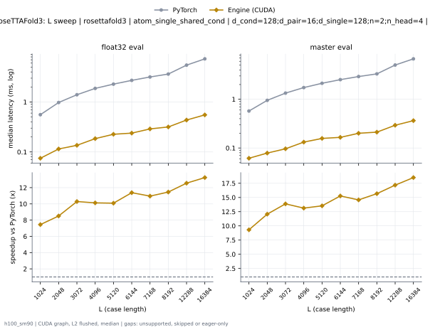

# AtomDiTRoseTTAFold3 on h100_sm90

Generated by `python -m miniworld_engine.measure.plot` from speed tokens `judge/tokens/h100_sm90/`; do not edit.

### L sweep: rosettafold3 | atom_single | d_cond=128;d_pair=16;d_single=128;key_window=slide;n=2;n_head=4 | S1 | graph

**float32 eval** (median ms; x = speedup vs PyTorch)

| L | PyTorch | Engine (Triton) | Engine (CUDA) |
|---|---|---|---|
| 1024 | 0.4536 | 0.3616 (1.25x) | 0.1172 (3.87x) |
| 2048 | 0.7108 | 0.5945 (1.20x) | 0.1319 (5.39x) |
| 3072 | 0.9444 | 0.8046 (1.17x) | 0.1439 (6.56x) |
| 4096 | 1.191 | 1.028 (1.16x) | 0.1571 (7.58x) |
| 5120 | 1.455 | 1.266 (1.15x) | 0.1764 (8.24x) |
| 6144 | 1.698 | 1.486 (1.14x) | 0.187 (9.08x) |
| 7168 | 1.951 | 1.711 (1.14x) | 0.2029 (9.61x) |
| 8192 | 2.208 | 1.94 (1.14x) | 0.2119 (10.42x) |
| 12288 | 3.254 | 2.857 (1.14x) | 0.2633 (12.36x) |
| 16384 | 4.311 | 3.779 (1.14x) | 0.2974 (14.49x) |

**master eval** (median ms; x = speedup vs PyTorch)

| L | PyTorch | Engine (Triton) | Engine (CUDA) |
|---|---|---|---|
| 1024 | 0.4739 | 0.3778 (1.25x) | 0.1115 (4.25x) |
| 2048 | 0.6711 | 0.5502 (1.22x) | 0.1187 (5.65x) |
| 3072 | 0.8642 | 0.7148 (1.21x) | 0.1269 (6.81x) |
| 4096 | 1.063 | 0.8859 (1.20x) | 0.1342 (7.92x) |
| 5120 | 1.267 | 1.062 (1.19x) | 0.1477 (8.58x) |
| 6144 | 1.465 | 1.23 (1.19x) | 0.1559 (9.40x) |
| 7168 | 1.673 | 1.403 (1.19x) | 0.1646 (10.16x) |
| 8192 | 1.884 | 1.583 (1.19x) | 0.1709 (11.03x) |
| 12288 | 2.717 | 2.286 (1.19x) | 0.2074 (13.10x) |
| 16384 | 3.573 | 2.983 (1.20x) | 0.2332 (15.32x) |

**float32 train** (median ms; x = speedup vs PyTorch)

| L | PyTorch | Engine (Triton) | Engine (CUDA) |
|---|---|---|---|
| 1024 | 1.052 | 0.8459 (1.24x) | 0.5034 (2.09x) |
| 2048 | 1.518 | 1.267 (1.20x) | 0.5636 (2.69x) |
| 3072 | 1.965 | 1.666 (1.18x) | 0.6261 (3.14x) |
| 4096 | 2.421 | 2.073 (1.17x) | 0.6757 (3.58x) |
| 5120 | 2.894 | 2.513 (1.15x) | 0.763 (3.79x) |
| 6144 | 3.339 | 2.91 (1.15x) | 0.8151 (4.10x) |
| 7168 | 3.804 | 3.331 (1.14x) | 0.87 (4.37x) |
| 8192 | 4.27 | 3.724 (1.15x) | 0.9161 (4.66x) |
| 12288 |  |  |  |
| 16384 |  |  |  |

**master train** (median ms; x = speedup vs PyTorch)

| L | PyTorch | Engine (Triton) | Engine (CUDA) |
|---|---|---|---|
| 1024 | 1.113 | 0.8922 (1.25x) | 0.4581 (2.43x) |
| 2048 | 1.513 | 1.251 (1.21x) | 0.5126 (2.95x) |
| 3072 | 1.919 | 1.607 (1.19x) | 0.5666 (3.39x) |
| 4096 | 2.305 | 1.946 (1.18x) | 0.5911 (3.90x) |
| 5120 | 2.704 | 2.305 (1.17x) | 0.6458 (4.19x) |
| 6144 | 3.094 | 2.648 (1.17x) | 0.6747 (4.59x) |
| 7168 | 3.504 | 2.998 (1.17x) | 0.7448 (4.70x) |
| 8192 | 3.909 | 3.344 (1.17x) | 0.7769 (5.03x) |
| 12288 |  |  |  |
| 16384 |  |  |  |

### L sweep: rosettafold3 | atom_single | d_cond=128;d_pair=16;d_single=128;n=2;n_head=4 | S1 | graph

**float32 eval** (median ms; x = speedup vs PyTorch)

| L | PyTorch | Engine (Triton) | Engine (CUDA) |
|---|---|---|---|
| 1024 | 0.3975 | 0.346 (1.15x) | 0.05912 (6.72x) |
| 2048 | 0.6417 | 0.579 (1.11x) | 0.07232 (8.87x) |
| 3072 | 0.8672 | 0.7887 (1.10x) | 0.08227 (10.54x) |
| 4096 | 1.107 | 1.012 (1.09x) | 0.09477 (11.68x) |
| 5120 | 1.355 | 1.248 (1.09x) | 0.114 (11.89x) |
| 6144 | 1.59 | 1.47 (1.08x) | 0.1227 (12.96x) |
| 7168 | 1.838 | 1.694 (1.08x) | 0.1394 (13.18x) |
| 8192 | 2.087 | 1.922 (1.09x) | 0.1479 (14.12x) |
| 12288 | 3.086 | 2.839 (1.09x) | 0.1976 (15.62x) |
| 16384 | 4.101 | 3.76 (1.09x) | 0.2406 (17.04x) |

**master eval** (median ms; x = speedup vs PyTorch)

| L | PyTorch | Engine (Triton) | Engine (CUDA) |
|---|---|---|---|
| 1024 | 0.4171 | 0.3619 (1.15x) | 0.05302 (7.87x) |
| 2048 | 0.605 | 0.5338 (1.13x) | 0.05926 (10.21x) |
| 3072 | 0.7905 | 0.6992 (1.13x) | 0.0665 (11.89x) |
| 4096 | 0.9808 | 0.8703 (1.13x) | 0.07258 (13.51x) |
| 5120 | 1.177 | 1.045 (1.13x) | 0.08581 (13.71x) |
| 6144 | 1.368 | 1.213 (1.13x) | 0.09322 (14.67x) |
| 7168 | 1.569 | 1.386 (1.13x) | 0.1022 (15.35x) |
| 8192 | 1.77 | 1.566 (1.13x) | 0.108 (16.38x) |
| 12288 | 2.572 | 2.267 (1.13x) | 0.1431 (17.98x) |
| 16384 | 3.397 | 2.963 (1.15x) | 0.1676 (20.27x) |

**float32 train** (median ms; x = speedup vs PyTorch)

| L | PyTorch | Engine (Triton) | Engine (CUDA) |
|---|---|---|---|
| 1024 | 0.9236 | 0.8291 (1.11x) | 0.3154 (2.93x) |
| 2048 | 1.37 | 1.25 (1.10x) | 0.3663 (3.74x) |
| 3072 | 1.798 | 1.65 (1.09x) | 0.4274 (4.21x) |
| 4096 | 2.243 | 2.055 (1.09x) | 0.4736 (4.74x) |
| 5120 | 2.708 | 2.495 (1.09x) | 0.5612 (4.83x) |
| 6144 | 3.139 | 2.892 (1.09x) | 0.6105 (5.14x) |
| 7168 | 3.587 | 3.3 (1.09x) | 0.6598 (5.44x) |
| 8192 | 4.049 | 3.711 (1.09x) | 0.7096 (5.71x) |
| 12288 |  |  |  |
| 16384 |  |  |  |

**master train** (median ms; x = speedup vs PyTorch)

| L | PyTorch | Engine (Triton) | Engine (CUDA) |
|---|---|---|---|
| 1024 | 0.9816 | 0.8774 (1.12x) | 0.2725 (3.60x) |
| 2048 | 1.365 | 1.235 (1.11x) | 0.3158 (4.32x) |
| 3072 | 1.753 | 1.59 (1.10x) | 0.3715 (4.72x) |
| 4096 | 2.13 | 1.928 (1.10x) | 0.3915 (5.44x) |
| 5120 | 2.522 | 2.299 (1.10x) | 0.4441 (5.68x) |
| 6144 | 2.891 | 2.622 (1.10x) | 0.4722 (6.12x) |
| 7168 | 3.3 | 2.965 (1.11x) | 0.5413 (6.10x) |
| 8192 | 3.702 | 3.313 (1.12x) | 0.5735 (6.45x) |
| 12288 |  |  |  |
| 16384 |  |  |  |

### L sweep: rosettafold3 | atom_single_shared_cond | d_cond=128;d_pair=16;d_single=128;key_window=slide;n=2;n_head=4 | S5 | graph

**float32 eval** (median ms; x = speedup vs PyTorch)

| L | PyTorch | Engine (Triton) | Engine (CUDA) |
|---|---|---|---|
| 1024 | 0.6498 | 0.4689 (1.39x) | 0.1336 (4.87x) |
| 2048 | 1.116 | 0.7945 (1.41x) | 0.1758 (6.35x) |
| 3072 | 1.591 | 1.103 (1.44x) | 0.198 (8.03x) |
| 4096 | 2.11 | 1.472 (1.43x) | 0.2498 (8.45x) |
| 5120 | 2.566 | 1.779 (1.44x) | 0.2888 (8.89x) |
| 6144 | 3.045 | 2.113 (1.44x) | 0.3023 (10.07x) |
| 7168 | 3.547 | 2.462 (1.44x) | 0.3557 (9.97x) |
| 8192 | 4.051 | 2.833 (1.43x) | 0.382 (10.61x) |
| 12288 | 6.081 | 4.225 (1.44x) | 0.5044 (12.06x) |
| 16384 | 8.139 | 5.637 (1.44x) | 0.6259 (13.00x) |

**master eval** (median ms; x = speedup vs PyTorch)

| L | PyTorch | Engine (Triton) | Engine (CUDA) |
|---|---|---|---|
| 1024 | 0.6586 | 0.459 (1.43x) | 0.1194 (5.51x) |
| 2048 | 1.072 | 0.7241 (1.48x) | 0.1417 (7.56x) |
| 3072 | 1.452 | 0.9827 (1.48x) | 0.145 (10.01x) |
| 4096 | 1.933 | 1.255 (1.54x) | 0.1946 (9.93x) |
| 5120 | 2.372 | 1.527 (1.55x) | 0.2198 (10.79x) |
| 6144 | 2.803 | 1.823 (1.54x) | 0.2295 (12.21x) |
| 7168 | 3.234 | 2.098 (1.54x) | 0.2669 (12.12x) |
| 8192 | 3.667 | 2.375 (1.54x) | 0.277 (13.24x) |
| 12288 | 5.528 | 3.58 (1.54x) | 0.3602 (15.35x) |
| 16384 | 7.41 | 4.714 (1.57x) | 0.4361 (16.99x) |

### L sweep: rosettafold3 | atom_single_shared_cond | d_cond=128;d_pair=16;d_single=128;n=2;n_head=4 | S5 | graph

**float32 eval** (median ms; x = speedup vs PyTorch)

| L | PyTorch | Engine (Triton) | Engine (CUDA) |
|---|---|---|---|
| 1024 | 0.5572 | 0.4515 (1.23x) | 0.07478 (7.45x) |
| 2048 | 0.9771 | 0.7775 (1.26x) | 0.1148 (8.51x) |
| 3072 | 1.398 | 1.087 (1.29x) | 0.1358 (10.29x) |
| 4096 | 1.872 | 1.454 (1.29x) | 0.1849 (10.13x) |
| 5120 | 2.279 | 1.762 (1.29x) | 0.2259 (10.09x) |
| 6144 | 2.711 | 2.099 (1.29x) | 0.2382 (11.38x) |
| 7168 | 3.169 | 2.457 (1.29x) | 0.2892 (10.96x) |
| 8192 | 3.626 | 2.826 (1.28x) | 0.3164 (11.46x) |
| 12288 | 5.468 | 4.204 (1.30x) | 0.4356 (12.55x) |
| 16384 | 7.303 | 5.671 (1.29x) | 0.5516 (13.24x) |

**master eval** (median ms; x = speedup vs PyTorch)

| L | PyTorch | Engine (Triton) | Engine (CUDA) |
|---|---|---|---|
| 1024 | 0.5729 | 0.4434 (1.29x) | 0.06155 (9.31x) |
| 2048 | 0.9488 | 0.7078 (1.34x) | 0.07866 (12.06x) |
| 3072 | 1.335 | 0.9637 (1.39x) | 0.09624 (13.88x) |
| 4096 | 1.734 | 1.238 (1.40x) | 0.1321 (13.13x) |
| 5120 | 2.125 | 1.511 (1.41x) | 0.1571 (13.53x) |
| 6144 | 2.522 | 1.8 (1.40x) | 0.1652 (15.27x) |
| 7168 | 2.918 | 2.079 (1.40x) | 0.2003 (14.57x) |
| 8192 | 3.31 | 2.346 (1.41x) | 0.2112 (15.67x) |
| 12288 | 5.027 | 3.545 (1.42x) | 0.2927 (17.17x) |
| 16384 | 6.728 | 4.71 (1.43x) | 0.3636 (18.50x) |

