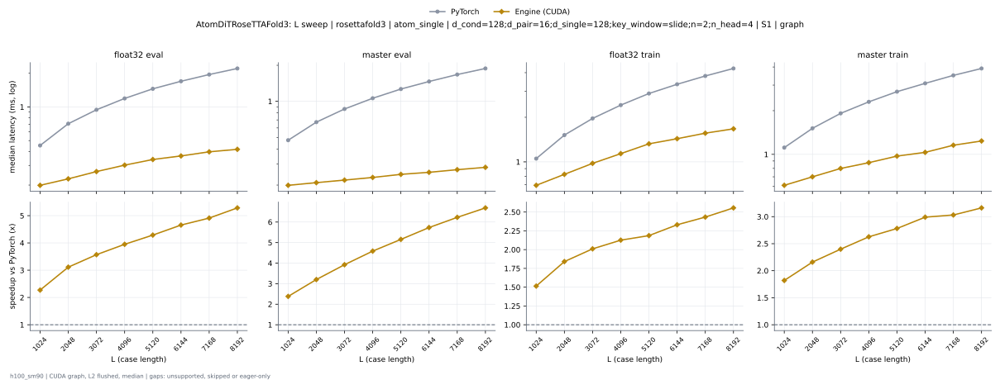
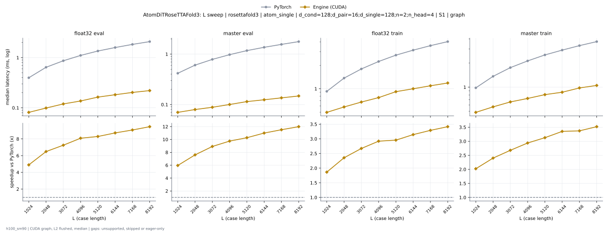

# AtomDiTRoseTTAFold3 on h100_sm90

Generated by `python -m miniworld_engine.measure.plot` from speed tokens `judge/tokens/h100_sm90/`; do not edit.

### L sweep: rosettafold3 | atom_single | d_cond=128;d_pair=16;d_single=128;key_window=slide;n=2;n_head=4 | S1 | graph

**float32 eval** (median ms; x = speedup vs PyTorch)

| L | PyTorch | Engine (Triton) | Engine (CUDA) |
|---|---|---|---|
| 1024 | 0.4521 | 0.3611 (1.25x) | 0.1126 (4.01x) |
| 2048 | 0.7106 | 0.5943 (1.20x) | 0.1273 (5.58x) |
| 3072 | 0.9445 | 0.804 (1.17x) | 0.1369 (6.90x) |
| 4096 | 1.192 | 1.027 (1.16x) | 0.1506 (7.91x) |
| 5120 | 1.454 | 1.266 (1.15x) | 0.17 (8.56x) |
| 6144 | 1.698 | 1.484 (1.14x) | 0.1802 (9.42x) |
| 7168 | 1.952 | 1.708 (1.14x) | 0.1961 (9.95x) |
| 8192 | 2.209 | 1.94 (1.14x) | 0.204 (10.83x) |

**master eval** (median ms; x = speedup vs PyTorch)

| L | PyTorch | Engine (Triton) | Engine (CUDA) |
|---|---|---|---|
| 1024 | 0.4737 | 0.3779 (1.25x) | 0.1069 (4.43x) |
| 2048 | 0.6721 | 0.5498 (1.22x) | 0.1133 (5.93x) |
| 3072 | 0.8639 | 0.7144 (1.21x) | 0.1219 (7.09x) |
| 4096 | 1.063 | 0.8847 (1.20x) | 0.128 (8.30x) |
| 5120 | 1.267 | 1.055 (1.20x) | 0.1412 (8.97x) |
| 6144 | 1.467 | 1.223 (1.20x) | 0.149 (9.84x) |
| 7168 | 1.674 | 1.402 (1.19x) | 0.1579 (10.60x) |
| 8192 | 1.882 | 1.581 (1.19x) | 0.1643 (11.46x) |

**float32 train** (median ms; x = speedup vs PyTorch)

| L | PyTorch | Engine (Triton) | Engine (CUDA) |
|---|---|---|---|
| 1024 | 1.055 | 0.8441 (1.25x) | 0.4731 (2.23x) |
| 2048 | 1.52 | 1.267 (1.20x) | 0.5298 (2.87x) |
| 3072 | 1.961 | 1.667 (1.18x) | 0.5914 (3.32x) |
| 4096 | 2.419 | 2.076 (1.16x) | 0.6389 (3.79x) |
| 5120 | 2.895 | 2.512 (1.15x) | 0.7282 (3.97x) |
| 6144 | 3.344 | 2.913 (1.15x) | 0.7776 (4.30x) |
| 7168 | 3.801 | 3.333 (1.14x) | 0.8337 (4.56x) |
| 8192 | 4.272 | 3.749 (1.14x) | 0.8756 (4.88x) |

**master train** (median ms; x = speedup vs PyTorch)

| L | PyTorch | Engine (Triton) | Engine (CUDA) |
|---|---|---|---|
| 1024 | 1.115 | 0.8975 (1.24x) | 0.4247 (2.63x) |
| 2048 | 1.517 | 1.252 (1.21x) | 0.4727 (3.21x) |
| 3072 | 1.92 | 1.609 (1.19x) | 0.5322 (3.61x) |
| 4096 | 2.307 | 1.944 (1.19x) | 0.5568 (4.14x) |
| 5120 | 2.706 | 2.319 (1.17x) | 0.6105 (4.43x) |
| 6144 | 3.089 | 2.649 (1.17x) | 0.6387 (4.84x) |
| 7168 | 3.502 | 2.995 (1.17x) | 0.7059 (4.96x) |
| 8192 | 3.908 | 3.351 (1.17x) | 0.7389 (5.29x) |

### L sweep: rosettafold3 | atom_single | d_cond=128;d_pair=16;d_single=128;n=2;n_head=4 | S1 | graph

**float32 eval** (median ms; x = speedup vs PyTorch)

| L | PyTorch | Engine (Triton) | Engine (CUDA) |
|---|---|---|---|
| 1024 | 0.4007 | 0.346 (1.16x) | 0.05968 (6.71x) |
| 2048 | 0.6436 | 0.5786 (1.11x) | 0.07246 (8.88x) |
| 3072 | 0.8677 | 0.7882 (1.10x) | 0.08213 (10.57x) |
| 4096 | 1.107 | 1.012 (1.09x) | 0.09534 (11.61x) |
| 5120 | 1.358 | 1.247 (1.09x) | 0.1149 (11.82x) |
| 6144 | 1.591 | 1.468 (1.08x) | 0.1231 (12.93x) |
| 7168 | 1.838 | 1.695 (1.08x) | 0.1394 (13.19x) |
| 8192 | 2.088 | 1.922 (1.09x) | 0.1477 (14.14x) |

**master eval** (median ms; x = speedup vs PyTorch)

| L | PyTorch | Engine (Triton) | Engine (CUDA) |
|---|---|---|---|
| 1024 | 0.4187 | 0.3624 (1.16x) | 0.05355 (7.82x) |
| 2048 | 0.6057 | 0.5343 (1.13x) | 0.05965 (10.15x) |
| 3072 | 0.7925 | 0.6981 (1.14x) | 0.06618 (11.98x) |
| 4096 | 0.9831 | 0.8641 (1.14x) | 0.07296 (13.47x) |
| 5120 | 1.171 | 1.044 (1.12x) | 0.08522 (13.74x) |
| 6144 | 1.367 | 1.213 (1.13x) | 0.0929 (14.71x) |
| 7168 | 1.57 | 1.38 (1.14x) | 0.1022 (15.36x) |
| 8192 | 1.764 | 1.566 (1.13x) | 0.1076 (16.40x) |

**float32 train** (median ms; x = speedup vs PyTorch)

| L | PyTorch | Engine (Triton) | Engine (CUDA) |
|---|---|---|---|
| 1024 | 0.9301 | 0.8273 (1.12x) | 0.3157 (2.95x) |
| 2048 | 1.372 | 1.249 (1.10x) | 0.3688 (3.72x) |
| 3072 | 1.802 | 1.642 (1.10x) | 0.4277 (4.21x) |
| 4096 | 2.246 | 2.049 (1.10x) | 0.4747 (4.73x) |
| 5120 | 2.714 | 2.507 (1.08x) | 0.5604 (4.84x) |
| 6144 | 3.143 | 2.891 (1.09x) | 0.6111 (5.14x) |
| 7168 | 3.593 | 3.297 (1.09x) | 0.664 (5.41x) |
| 8192 | 4.048 | 3.733 (1.08x) | 0.7096 (5.71x) |

**master train** (median ms; x = speedup vs PyTorch)

| L | PyTorch | Engine (Triton) | Engine (CUDA) |
|---|---|---|---|
| 1024 | 0.984 | 0.8809 (1.12x) | 0.2702 (3.64x) |
| 2048 | 1.367 | 1.235 (1.11x) | 0.3184 (4.29x) |
| 3072 | 1.76 | 1.59 (1.11x) | 0.3688 (4.77x) |
| 4096 | 2.135 | 1.929 (1.11x) | 0.3931 (5.43x) |
| 5120 | 2.527 | 2.297 (1.10x) | 0.4464 (5.66x) |
| 6144 | 2.898 | 2.637 (1.10x) | 0.4737 (6.12x) |
| 7168 | 3.303 | 2.979 (1.11x) | 0.5419 (6.10x) |
| 8192 | 3.701 | 3.328 (1.11x) | 0.575 (6.44x) |

