# AttentionPairBias on h100_sm90

Generated by `python -m foldjet_engine.measure.plot` from speed tokens `judge/tokens/h100_sm90/`; do not edit.

### L sweep: token_single | d_pair=128;d_single=384;n_head=12 | S1 | graph

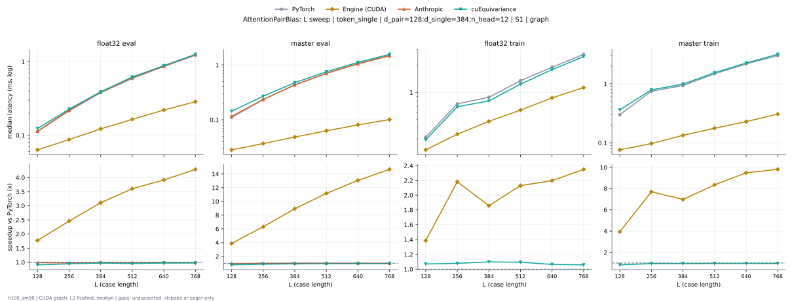

**float32 eval** (median ms; x = speedup vs PyTorch)

| L | PyTorch | Engine (Triton) | Engine (CUDA) | Anthropic | cuEquivariance |
|---|---|---|---|---|---|
| 128 | 0.1124 | 0.09734 (1.15x) | 0.06333 (1.77x) | 0.1137 (0.99x) | 0.1236 (0.91x) |
| 256 | 0.2146 | 0.1851 (1.16x) | 0.08736 (2.46x) | 0.2195 (0.98x) | 0.2266 (0.95x) |
| 384 | 0.3796 | 0.3323 (1.14x) | 0.1221 (3.11x) | 0.3839 (0.99x) | 0.3904 (0.97x) |
| 512 | 0.5921 | 0.5421 (1.09x) | 0.1644 (3.60x) | 0.6052 (0.98x) | 0.6182 (0.96x) |
| 640 | 0.8625 | 0.7888 (1.09x) | 0.2204 (3.91x) | 0.8689 (0.99x) | 0.8859 (0.97x) |
| 768 | 1.226 | 1.11 (1.10x) | 0.286 (4.29x) | 1.245 (0.99x) | 1.258 (0.97x) |

**master eval** (median ms; x = speedup vs PyTorch)

| L | PyTorch | Engine (Triton) | Engine (CUDA) | Anthropic | cuEquivariance |
|---|---|---|---|---|---|
| 128 | 0.1102 | 0.09934 (1.11x) | 0.02838 (3.88x) | 0.116 (0.95x) | 0.1434 (0.77x) |
| 256 | 0.2333 | 0.2157 (1.08x) | 0.03693 (6.32x) | 0.2342 (1.00x) | 0.2683 (0.87x) |
| 384 | 0.4344 | 0.4105 (1.06x) | 0.04861 (8.94x) | 0.4293 (1.01x) | 0.4739 (0.92x) |
| 512 | 0.7038 | 0.6725 (1.05x) | 0.06299 (11.17x) | 0.6974 (1.01x) | 0.749 (0.94x) |
| 640 | 1.056 | 1.017 (1.04x) | 0.0809 (13.06x) | 1.04 (1.02x) | 1.109 (0.95x) |
| 768 | 1.481 | 1.43 (1.04x) | 0.101 (14.66x) | 1.463 (1.01x) | 1.55 (0.96x) |

**float32 train** (median ms; x = speedup vs PyTorch)

| L | PyTorch | Engine (Triton) | Engine (CUDA) | Anthropic | cuEquivariance |
|---|---|---|---|---|---|
| 128 | 0.3171 | 0.2662 (1.19x) | 0.2289 (1.39x) | unsupported | 0.2963 (1.07x) |
| 256 | 0.7464 | 0.6564 (1.14x) | 0.3424 (2.18x) | unsupported | 0.6922 (1.08x) |
| 384 | 0.8836 | 0.7555 (1.17x) | 0.4758 (1.86x) | unsupported | 0.8041 (1.10x) |
| 512 | 1.353 | 1.166 (1.16x) | 0.6356 (2.13x) | unsupported | 1.237 (1.09x) |
| 640 | 1.91 | 1.688 (1.13x) | 0.8701 (2.20x) | unsupported | 1.795 (1.06x) |
| 768 | 2.655 | 2.345 (1.13x) | 1.131 (2.35x) | unsupported | 2.509 (1.06x) |

**master train** (median ms; x = speedup vs PyTorch)

| L | PyTorch | Engine (Triton) | Engine (CUDA) | Anthropic | cuEquivariance |
|---|---|---|---|---|---|
| 128 | 0.2988 | 0.2788 (1.07x) | 0.07586 (3.94x) | unsupported | 0.3616 (0.83x) |
| 256 | 0.7473 | 0.7025 (1.06x) | 0.09699 (7.70x) | unsupported | 0.7894 (0.95x) |
| 384 | 0.9329 | 0.8762 (1.06x) | 0.1336 (6.98x) | unsupported | 0.9847 (0.95x) |
| 512 | 1.476 | 1.403 (1.05x) | 0.1766 (8.36x) | unsupported | 1.542 (0.96x) |
| 640 | 2.168 | 2.067 (1.05x) | 0.2284 (9.49x) | unsupported | 2.25 (0.96x) |
| 768 | 3.007 | 2.887 (1.04x) | 0.3065 (9.81x) | unsupported | 3.149 (0.96x) |

### L sweep: token_single | d_pair=128;d_single=384;n_head=16 | S1 | graph

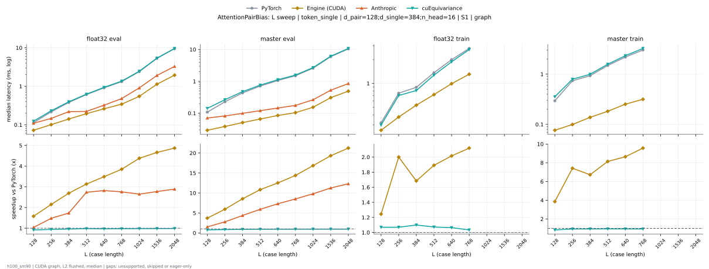

**float32 eval** (median ms; x = speedup vs PyTorch)

| L | PyTorch | Engine (Triton) | Engine (CUDA) | Anthropic | cuEquivariance |
|---|---|---|---|---|---|
| 128 | 0.114 | 0.0989 (1.15x) | 0.07221 (1.58x) | 0.1098 (1.04x) | 0.1244 (0.92x) |
| 256 | 0.2169 | 0.1916 (1.13x) | 0.101 (2.15x) | 0.1467 (1.48x) | 0.231 (0.94x) |
| 384 | 0.3807 | 0.3422 (1.11x) | 0.1415 (2.69x) | 0.2197 (1.73x) | 0.3972 (0.96x) |
| 512 | 0.6098 | 0.5513 (1.11x) | 0.1945 (3.13x) | 0.2227 (2.74x) | 0.6244 (0.98x) |
| 640 | 0.9108 | 0.8168 (1.12x) | 0.261 (3.49x) | 0.3232 (2.82x) | 0.9414 (0.97x) |
| 768 | 1.324 | 1.204 (1.10x) | 0.3438 (3.85x) | 0.4803 (2.76x) | 1.362 (0.97x) |
| 1024 | 2.407 | 2.364 (1.02x) | 0.5494 (4.38x) | 0.9096 (2.65x) | 2.466 (0.98x) |
| 1536 | 5.298 | 5.36 (0.99x) | 1.136 (4.66x) | 1.912 (2.77x) | 5.407 (0.98x) |
| 2048 | 9.48 | 9.202 (1.03x) | 1.945 (4.87x) | 3.282 (2.89x) | 9.63 (0.98x) |

**master eval** (median ms; x = speedup vs PyTorch)

| L | PyTorch | Engine (Triton) | Engine (CUDA) | Anthropic | cuEquivariance |
|---|---|---|---|---|---|
| 128 | 0.1081 | 0.09949 (1.09x) | 0.02912 (3.71x) | 0.07054 (1.53x) | 0.1416 (0.76x) |
| 256 | 0.2279 | 0.2142 (1.06x) | 0.0383 (5.95x) | 0.0819 (2.78x) | 0.2651 (0.86x) |
| 384 | 0.4332 | 0.4126 (1.05x) | 0.05066 (8.55x) | 0.09901 (4.38x) | 0.475 (0.91x) |
| 512 | 0.7098 | 0.681 (1.04x) | 0.0655 (10.84x) | 0.1199 (5.92x) | 0.7588 (0.94x) |
| 640 | 1.062 | 1.022 (1.04x) | 0.08482 (12.52x) | 0.1454 (7.30x) | 1.127 (0.94x) |
| 768 | 1.495 | 1.441 (1.04x) | 0.1039 (14.39x) | 0.1755 (8.52x) | 1.573 (0.95x) |
| 1024 | 2.589 | 2.522 (1.03x) | 0.1536 (16.85x) | 0.264 (9.80x) | 2.705 (0.96x) |
| 1536 | 5.932 | 5.836 (1.02x) | 0.307 (19.32x) | 0.5269 (11.26x) | 6.143 (0.97x) |
| 2048 | 10.45 | 10.26 (1.02x) | 0.4922 (21.24x) | 0.8493 (12.31x) | 10.8 (0.97x) |

**float32 train** (median ms; x = speedup vs PyTorch)

| L | PyTorch | Engine (Triton) | Engine (CUDA) | Anthropic | cuEquivariance |
|---|---|---|---|---|---|
| 128 | 0.3177 | 0.2709 (1.17x) | 0.2554 (1.24x) | unsupported | 0.2971 (1.07x) |
| 256 | 0.7517 | 0.6747 (1.11x) | 0.3758 (2.00x) | unsupported | 0.7029 (1.07x) |
| 384 | 0.8936 | 0.7714 (1.16x) | 0.5307 (1.68x) | unsupported | 0.813 (1.10x) |
| 512 | 1.365 | 1.22 (1.12x) | 0.722 (1.89x) | unsupported | 1.273 (1.07x) |
| 640 | 1.999 | 1.756 (1.14x) | 0.9917 (2.02x) | unsupported | 1.878 (1.06x) |
| 768 | 2.773 | 2.462 (1.13x) | 1.308 (2.12x) | unsupported | 2.681 (1.03x) |
| 1024 |  |  |  |  |  |
| 1536 |  |  |  |  |  |
| 2048 |  |  |  |  |  |

**master train** (median ms; x = speedup vs PyTorch)

| L | PyTorch | Engine (Triton) | Engine (CUDA) | Anthropic | cuEquivariance |
|---|---|---|---|---|---|
| 128 | 0.2955 | 0.2811 (1.05x) | 0.07656 (3.86x) | unsupported | 0.3555 (0.83x) |
| 256 | 0.7392 | 0.7064 (1.05x) | 0.0997 (7.41x) | unsupported | 0.7944 (0.93x) |
| 384 | 0.9301 | 0.8836 (1.05x) | 0.1383 (6.72x) | unsupported | 0.9958 (0.93x) |
| 512 | 1.487 | 1.423 (1.04x) | 0.1826 (8.14x) | unsupported | 1.576 (0.94x) |
| 640 | 2.185 | 2.095 (1.04x) | 0.2527 (8.64x) | unsupported | 2.331 (0.94x) |
| 768 | 3.028 | 2.92 (1.04x) | 0.3164 (9.57x) | unsupported | 3.253 (0.93x) |
| 1024 |  |  |  |  |  |
| 1536 |  |  |  |  |  |
| 2048 |  |  |  |  |  |

### L sweep: token_single | d_pair=128;d_single=384;n_head=24 | S1 | graph

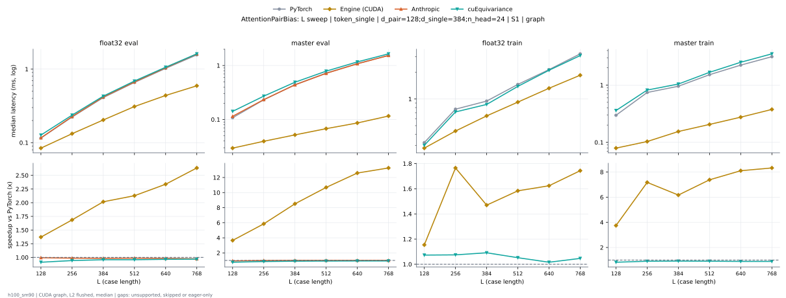

**float32 eval** (median ms; x = speedup vs PyTorch)

| L | PyTorch | Engine (Triton) | Engine (CUDA) | Anthropic | cuEquivariance |
|---|---|---|---|---|---|
| 128 | 0.1156 | 0.09808 (1.18x) | 0.08432 (1.37x) | 0.1163 (0.99x) | 0.1268 (0.91x) |
| 256 | 0.2233 | 0.1912 (1.17x) | 0.1325 (1.69x) | 0.2264 (0.99x) | 0.237 (0.94x) |
| 384 | 0.4107 | 0.3494 (1.18x) | 0.2036 (2.02x) | 0.418 (0.98x) | 0.4293 (0.96x) |
| 512 | 0.6596 | 0.5698 (1.16x) | 0.3099 (2.13x) | 0.6692 (0.99x) | 0.689 (0.96x) |
| 640 | 1.025 | 0.906 (1.13x) | 0.4383 (2.34x) | 1.044 (0.98x) | 1.062 (0.97x) |
| 768 | 1.564 | 1.389 (1.13x) | 0.5934 (2.64x) | 1.607 (0.97x) | 1.615 (0.97x) |

**master eval** (median ms; x = speedup vs PyTorch)

| L | PyTorch | Engine (Triton) | Engine (CUDA) | Anthropic | cuEquivariance |
|---|---|---|---|---|---|
| 128 | 0.108 | 0.09786 (1.10x) | 0.02954 (3.65x) | 0.1147 (0.94x) | 0.1415 (0.76x) |
| 256 | 0.2317 | 0.2131 (1.09x) | 0.03957 (5.86x) | 0.2338 (0.99x) | 0.271 (0.86x) |
| 384 | 0.442 | 0.4132 (1.07x) | 0.05192 (8.51x) | 0.4379 (1.01x) | 0.4904 (0.90x) |
| 512 | 0.7231 | 0.6826 (1.06x) | 0.06768 (10.68x) | 0.7154 (1.01x) | 0.7858 (0.92x) |
| 640 | 1.086 | 1.029 (1.06x) | 0.08626 (12.59x) | 1.074 (1.01x) | 1.166 (0.93x) |
| 768 | 1.539 | 1.457 (1.06x) | 0.116 (13.27x) | 1.531 (1.01x) | 1.645 (0.94x) |

**float32 train** (median ms; x = speedup vs PyTorch)

| L | PyTorch | Engine (Triton) | Engine (CUDA) | Anthropic | cuEquivariance |
|---|---|---|---|---|---|
| 128 | 0.3219 | 0.2646 (1.22x) | 0.2789 (1.15x) | unsupported | 0.3 (1.07x) |
| 256 | 0.7677 | 0.6682 (1.15x) | 0.4349 (1.77x) | unsupported | 0.7143 (1.07x) |
| 384 | 0.9475 | 0.7734 (1.23x) | 0.6446 (1.47x) | unsupported | 0.8682 (1.09x) |
| 512 | 1.46 | 1.225 (1.19x) | 0.9222 (1.58x) | unsupported | 1.388 (1.05x) |
| 640 | 2.147 | 1.82 (1.18x) | 1.322 (1.62x) | unsupported | 2.112 (1.02x) |
| 768 | 3.236 | 2.658 (1.22x) | 1.856 (1.74x) | unsupported | 3.091 (1.05x) |

**master train** (median ms; x = speedup vs PyTorch)

| L | PyTorch | Engine (Triton) | Engine (CUDA) | Anthropic | cuEquivariance |
|---|---|---|---|---|---|
| 128 | 0.2971 | 0.2763 (1.08x) | 0.07931 (3.75x) | unsupported | 0.3593 (0.83x) |
| 256 | 0.7418 | 0.7033 (1.05x) | 0.1034 (7.17x) | unsupported | 0.818 (0.91x) |
| 384 | 0.9539 | 0.8898 (1.07x) | 0.1547 (6.17x) | unsupported | 1.041 (0.92x) |
| 512 | 1.517 | 1.435 (1.06x) | 0.2055 (7.38x) | unsupported | 1.669 (0.91x) |
| 640 | 2.229 | 2.109 (1.06x) | 0.2751 (8.10x) | unsupported | 2.501 (0.89x) |
| 768 | 3.128 | 2.951 (1.06x) | 0.3758 (8.32x) | unsupported | 3.509 (0.89x) |

### L sweep: token_single | d_pair=128;d_single=512;n_head=16 | S1 | graph

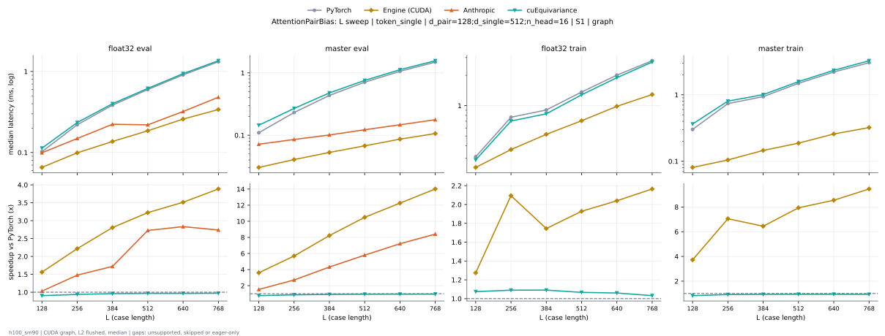

**float32 eval** (median ms; x = speedup vs PyTorch)

| L | PyTorch | Engine (Triton) | Engine (CUDA) | Anthropic | cuEquivariance |
|---|---|---|---|---|---|
| 128 | 0.1023 | 0.08704 (1.18x) | 0.06555 (1.56x) | 0.09936 (1.03x) | 0.1132 (0.90x) |
| 256 | 0.2199 | 0.1911 (1.15x) | 0.0992 (2.22x) | 0.1489 (1.48x) | 0.2343 (0.94x) |
| 384 | 0.3844 | 0.3392 (1.13x) | 0.1369 (2.81x) | 0.2232 (1.72x) | 0.4002 (0.96x) |
| 512 | 0.5987 | 0.5374 (1.11x) | 0.1857 (3.22x) | 0.2196 (2.73x) | 0.6186 (0.97x) |
| 640 | 0.9088 | 0.8095 (1.12x) | 0.2586 (3.51x) | 0.3208 (2.83x) | 0.9403 (0.97x) |
| 768 | 1.319 | 1.192 (1.11x) | 0.3394 (3.89x) | 0.4815 (2.74x) | 1.358 (0.97x) |

**master eval** (median ms; x = speedup vs PyTorch)

| L | PyTorch | Engine (Triton) | Engine (CUDA) | Anthropic | cuEquivariance |
|---|---|---|---|---|---|
| 128 | 0.1096 | 0.09946 (1.10x) | 0.03043 (3.60x) | 0.07163 (1.53x) | 0.1446 (0.76x) |
| 256 | 0.2311 | 0.2134 (1.08x) | 0.04064 (5.69x) | 0.08547 (2.70x) | 0.2688 (0.86x) |
| 384 | 0.435 | 0.4096 (1.06x) | 0.0529 (8.22x) | 0.1008 (4.32x) | 0.4778 (0.91x) |
| 512 | 0.7088 | 0.6755 (1.05x) | 0.06754 (10.50x) | 0.1224 (5.79x) | 0.7577 (0.94x) |
| 640 | 1.061 | 1.015 (1.05x) | 0.08653 (12.26x) | 0.147 (7.21x) | 1.126 (0.94x) |
| 768 | 1.49 | 1.429 (1.04x) | 0.1063 (14.02x) | 0.1772 (8.41x) | 1.569 (0.95x) |

**float32 train** (median ms; x = speedup vs PyTorch)

| L | PyTorch | Engine (Triton) | Engine (CUDA) | Anthropic | cuEquivariance |
|---|---|---|---|---|---|
| 128 | 0.3107 | 0.259 (1.20x) | 0.2438 (1.27x) | unsupported | 0.2892 (1.07x) |
| 256 | 0.7675 | 0.6643 (1.16x) | 0.3666 (2.09x) | unsupported | 0.7042 (1.09x) |
| 384 | 0.9053 | 0.7696 (1.18x) | 0.5189 (1.74x) | unsupported | 0.8299 (1.09x) |
| 512 | 1.366 | 1.183 (1.15x) | 0.7084 (1.93x) | unsupported | 1.281 (1.07x) |
| 640 | 2.009 | 1.729 (1.16x) | 0.9848 (2.04x) | unsupported | 1.895 (1.06x) |
| 768 | 2.792 | 2.437 (1.15x) | 1.29 (2.17x) | unsupported | 2.707 (1.03x) |

**master train** (median ms; x = speedup vs PyTorch)

| L | PyTorch | Engine (Triton) | Engine (CUDA) | Anthropic | cuEquivariance |
|---|---|---|---|---|---|
| 128 | 0.3014 | 0.2814 (1.07x) | 0.08091 (3.72x) | unsupported | 0.3638 (0.83x) |
| 256 | 0.7382 | 0.699 (1.06x) | 0.1047 (7.05x) | unsupported | 0.8043 (0.92x) |
| 384 | 0.9393 | 0.8804 (1.07x) | 0.1457 (6.45x) | unsupported | 1.006 (0.93x) |
| 512 | 1.488 | 1.417 (1.05x) | 0.1875 (7.94x) | unsupported | 1.58 (0.94x) |
| 640 | 2.201 | 2.087 (1.05x) | 0.2575 (8.55x) | unsupported | 2.336 (0.94x) |
| 768 | 3.043 | 2.911 (1.05x) | 0.3217 (9.46x) | unsupported | 3.258 (0.93x) |

### L sweep: token_single | d_pair=256;d_single=384;gate_bias=1.0;n_head=16 | S1 | graph

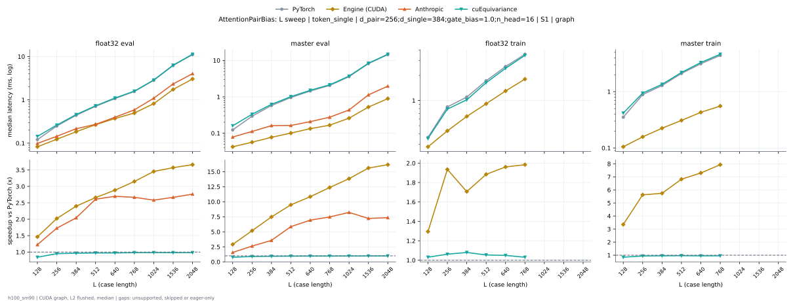

**float32 eval** (median ms; x = speedup vs PyTorch)

| L | PyTorch | Engine (Triton) | Engine (CUDA) | Anthropic | cuEquivariance |
|---|---|---|---|---|---|
| 128 | 0.1209 | 0.1061 (1.14x) | 0.08261 (1.46x) | 0.09874 (1.22x) | 0.1435 (0.84x) |
| 256 | 0.2492 | 0.2232 (1.12x) | 0.1233 (2.02x) | 0.1442 (1.73x) | 0.262 (0.95x) |
| 384 | 0.4419 | 0.4036 (1.09x) | 0.1842 (2.40x) | 0.2163 (2.04x) | 0.4584 (0.96x) |
| 512 | 0.7103 | 0.6585 (1.08x) | 0.267 (2.66x) | 0.2722 (2.61x) | 0.7304 (0.97x) |
| 640 | 1.072 | 0.9802 (1.09x) | 0.3717 (2.89x) | 0.3975 (2.70x) | 1.103 (0.97x) |
| 768 | 1.564 | 1.436 (1.09x) | 0.4967 (3.15x) | 0.5864 (2.67x) | 1.594 (0.98x) |
| 1024 | 2.829 | 2.776 (1.02x) | 0.8188 (3.46x) | 1.096 (2.58x) | 2.876 (0.98x) |
| 1536 | 6.219 | 6.279 (0.99x) | 1.741 (3.57x) | 2.333 (2.67x) | 6.336 (0.98x) |
| 2048 | 11.12 | 10.88 (1.02x) | 3.036 (3.66x) | 4.021 (2.76x) | 11.31 (0.98x) |

**master eval** (median ms; x = speedup vs PyTorch)

| L | PyTorch | Engine (Triton) | Engine (CUDA) | Anthropic | cuEquivariance |
|---|---|---|---|---|---|
| 128 | 0.123 | 0.115 (1.07x) | 0.04243 (2.90x) | 0.07861 (1.57x) | 0.1602 (0.77x) |
| 256 | 0.2939 | 0.2803 (1.05x) | 0.0567 (5.18x) | 0.1121 (2.62x) | 0.3327 (0.88x) |
| 384 | 0.578 | 0.5581 (1.04x) | 0.07728 (7.48x) | 0.1617 (3.57x) | 0.623 (0.93x) |
| 512 | 0.9575 | 0.9296 (1.03x) | 0.1009 (9.49x) | 0.1634 (5.86x) | 1.011 (0.95x) |
| 640 | 1.448 | 1.408 (1.03x) | 0.1336 (10.84x) | 0.2087 (6.94x) | 1.515 (0.96x) |
| 768 | 2.057 | 2.002 (1.03x) | 0.1663 (12.37x) | 0.2754 (7.47x) | 2.137 (0.96x) |
| 1024 | 3.587 | 3.514 (1.02x) | 0.2592 (13.84x) | 0.436 (8.23x) | 3.707 (0.97x) |
| 1536 | 8.175 | 8.081 (1.01x) | 0.5237 (15.61x) | 1.132 (7.22x) | 8.389 (0.97x) |
| 2048 | 14.44 | 14.24 (1.01x) | 0.8932 (16.17x) | 1.965 (7.35x) | 14.79 (0.98x) |

**float32 train** (median ms; x = speedup vs PyTorch)

| L | PyTorch | Engine (Triton) | Engine (CUDA) | Anthropic | cuEquivariance |
|---|---|---|---|---|---|
| 128 | 0.3617 | 0.3133 (1.15x) | 0.2793 (1.30x) | unsupported | 0.3508 (1.03x) |
| 256 | 0.8381 | 0.7565 (1.11x) | 0.4331 (1.93x) | unsupported | 0.7892 (1.06x) |
| 384 | 1.1 | 0.9765 (1.13x) | 0.6446 (1.71x) | unsupported | 1.019 (1.08x) |
| 512 | 1.722 | 1.569 (1.10x) | 0.9139 (1.88x) | unsupported | 1.633 (1.05x) |
| 640 | 2.548 | 2.301 (1.11x) | 1.3 (1.96x) | unsupported | 2.428 (1.05x) |
| 768 | 3.578 | 3.252 (1.10x) | 1.804 (1.98x) | unsupported | 3.471 (1.03x) |
| 1024 |  |  |  |  |  |
| 1536 |  |  |  |  |  |
| 2048 |  |  |  |  |  |

**master train** (median ms; x = speedup vs PyTorch)

| L | PyTorch | Engine (Triton) | Engine (CUDA) | Anthropic | cuEquivariance |
|---|---|---|---|---|---|
| 128 | 0.3515 | 0.336 (1.05x) | 0.1049 (3.35x) | unsupported | 0.4161 (0.84x) |
| 256 | 0.8858 | 0.8539 (1.04x) | 0.1575 (5.62x) | unsupported | 0.9435 (0.94x) |
| 384 | 1.287 | 1.239 (1.04x) | 0.2243 (5.74x) | unsupported | 1.351 (0.95x) |
| 512 | 2.105 | 2.035 (1.03x) | 0.3087 (6.82x) | unsupported | 2.191 (0.96x) |
| 640 | 3.134 | 3.055 (1.03x) | 0.4296 (7.30x) | unsupported | 3.298 (0.95x) |
| 768 | 4.403 | 4.288 (1.03x) | 0.5551 (7.93x) | unsupported | 4.623 (0.95x) |
| 1024 |  |  |  |  |  |
| 1536 |  |  |  |  |  |
| 2048 |  |  |  |  |  |

### L sweep: token_single | d_pair=256;d_single=384;n_head=16 | S1 | graph

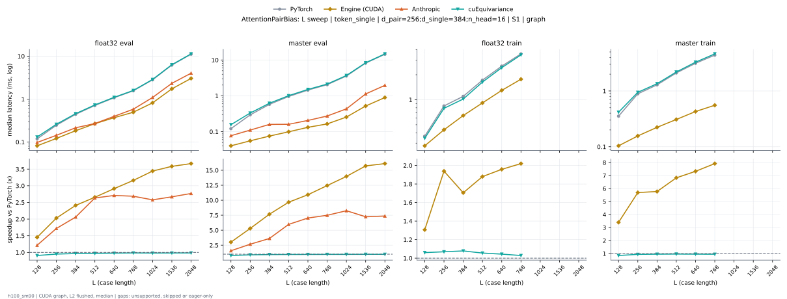

**float32 eval** (median ms; x = speedup vs PyTorch)

| L | PyTorch | Engine (Triton) | Engine (CUDA) | Anthropic | cuEquivariance |
|---|---|---|---|---|---|
| 128 | 0.1188 | 0.1042 (1.14x) | 0.08173 (1.45x) | 0.09782 (1.21x) | 0.131 (0.91x) |
| 256 | 0.2467 | 0.2208 (1.12x) | 0.1215 (2.03x) | 0.1436 (1.72x) | 0.2596 (0.95x) |
| 384 | 0.4426 | 0.4022 (1.10x) | 0.1836 (2.41x) | 0.2148 (2.06x) | 0.4579 (0.97x) |
| 512 | 0.7108 | 0.6583 (1.08x) | 0.2677 (2.66x) | 0.27 (2.63x) | 0.7321 (0.97x) |
| 640 | 1.077 | 0.9788 (1.10x) | 0.3694 (2.91x) | 0.3974 (2.71x) | 1.101 (0.98x) |
| 768 | 1.566 | 1.446 (1.08x) | 0.4953 (3.16x) | 0.5829 (2.69x) | 1.593 (0.98x) |
| 1024 | 2.817 | 2.774 (1.02x) | 0.8185 (3.44x) | 1.093 (2.58x) | 2.875 (0.98x) |
| 1536 | 6.214 | 6.278 (0.99x) | 1.734 (3.58x) | 2.329 (2.67x) | 6.329 (0.98x) |
| 2048 | 11.12 | 10.88 (1.02x) | 3.034 (3.67x) | 4.017 (2.77x) | 11.31 (0.98x) |

**master eval** (median ms; x = speedup vs PyTorch)

| L | PyTorch | Engine (Triton) | Engine (CUDA) | Anthropic | cuEquivariance |
|---|---|---|---|---|---|
| 128 | 0.1213 | 0.1129 (1.07x) | 0.04035 (3.01x) | 0.07722 (1.57x) | 0.1567 (0.77x) |
| 256 | 0.2942 | 0.2801 (1.05x) | 0.05562 (5.29x) | 0.1107 (2.66x) | 0.331 (0.89x) |
| 384 | 0.5783 | 0.5579 (1.04x) | 0.07541 (7.67x) | 0.1598 (3.62x) | 0.6213 (0.93x) |
| 512 | 0.9605 | 0.9327 (1.03x) | 0.09931 (9.67x) | 0.1608 (5.97x) | 1.011 (0.95x) |
| 640 | 1.446 | 1.407 (1.03x) | 0.1324 (10.92x) | 0.2057 (7.03x) | 1.511 (0.96x) |
| 768 | 2.048 | 2 (1.02x) | 0.1645 (12.45x) | 0.2734 (7.49x) | 2.126 (0.96x) |
| 1024 | 3.572 | 3.515 (1.02x) | 0.2556 (13.97x) | 0.4329 (8.25x) | 3.692 (0.97x) |
| 1536 | 8.175 | 8.08 (1.01x) | 0.5198 (15.73x) | 1.129 (7.24x) | 8.362 (0.98x) |
| 2048 | 14.44 | 14.25 (1.01x) | 0.896 (16.12x) | 1.961 (7.36x) | 14.79 (0.98x) |

**float32 train** (median ms; x = speedup vs PyTorch)

| L | PyTorch | Engine (Triton) | Engine (CUDA) | Anthropic | cuEquivariance |
|---|---|---|---|---|---|
| 128 | 0.364 | 0.3156 (1.15x) | 0.2786 (1.31x) | unsupported | 0.3434 (1.06x) |
| 256 | 0.8421 | 0.7609 (1.11x) | 0.4344 (1.94x) | unsupported | 0.7879 (1.07x) |
| 384 | 1.1 | 0.9786 (1.12x) | 0.6449 (1.71x) | unsupported | 1.02 (1.08x) |
| 512 | 1.723 | 1.565 (1.10x) | 0.9164 (1.88x) | unsupported | 1.633 (1.05x) |
| 640 | 2.539 | 2.302 (1.10x) | 1.297 (1.96x) | unsupported | 2.433 (1.04x) |
| 768 | 3.569 | 3.251 (1.10x) | 1.767 (2.02x) | unsupported | 3.471 (1.03x) |
| 1024 |  |  |  |  |  |
| 1536 |  |  |  |  |  |
| 2048 |  |  |  |  |  |

**master train** (median ms; x = speedup vs PyTorch)

| L | PyTorch | Engine (Triton) | Engine (CUDA) | Anthropic | cuEquivariance |
|---|---|---|---|---|---|
| 128 | 0.3535 | 0.3374 (1.05x) | 0.1039 (3.40x) | unsupported | 0.4158 (0.85x) |
| 256 | 0.8892 | 0.8582 (1.04x) | 0.1562 (5.69x) | unsupported | 0.9453 (0.94x) |
| 384 | 1.287 | 1.24 (1.04x) | 0.223 (5.77x) | unsupported | 1.35 (0.95x) |
| 512 | 2.104 | 2.028 (1.04x) | 0.3082 (6.83x) | unsupported | 2.186 (0.96x) |
| 640 | 3.138 | 3.052 (1.03x) | 0.4282 (7.33x) | unsupported | 3.282 (0.96x) |
| 768 | 4.392 | 4.283 (1.03x) | 0.5544 (7.92x) | unsupported | 4.623 (0.95x) |
| 1024 |  |  |  |  |  |
| 1536 |  |  |  |  |  |
| 2048 |  |  |  |  |  |

### L sweep: token_single | d_pair=384;d_single=384;n_head=16 | S1 | graph

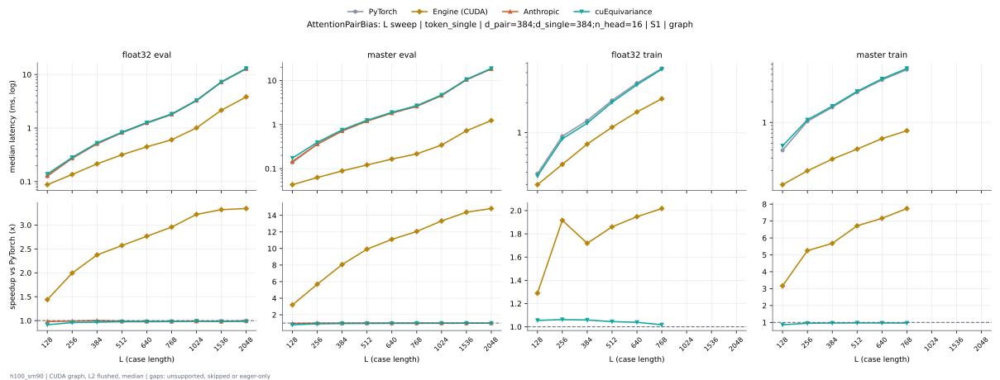

**float32 eval** (median ms; x = speedup vs PyTorch)

| L | PyTorch | Engine (Triton) | Engine (CUDA) | Anthropic | cuEquivariance |
|---|---|---|---|---|---|
| 128 | 0.1262 | 0.1113 (1.13x) | 0.0877 (1.44x) | 0.1287 (0.98x) | 0.1382 (0.91x) |
| 256 | 0.2714 | 0.2445 (1.11x) | 0.136 (2.00x) | 0.2747 (0.99x) | 0.2831 (0.96x) |
| 384 | 0.5094 | 0.4717 (1.08x) | 0.2145 (2.37x) | 0.5087 (1.00x) | 0.5267 (0.97x) |
| 512 | 0.8156 | 0.7606 (1.07x) | 0.3172 (2.57x) | 0.8259 (0.99x) | 0.8352 (0.98x) |
| 640 | 1.235 | 1.14 (1.08x) | 0.4465 (2.77x) | 1.254 (0.98x) | 1.264 (0.98x) |
| 768 | 1.788 | 1.668 (1.07x) | 0.6046 (2.96x) | 1.819 (0.98x) | 1.826 (0.98x) |
| 1024 | 3.245 | 3.179 (1.02x) | 1.007 (3.22x) | 3.29 (0.99x) | 3.28 (0.99x) |
| 1536 | 7.147 | 7.214 (0.99x) | 2.152 (3.32x) | 7.279 (0.98x) | 7.268 (0.98x) |
| 2048 | 12.78 | 12.54 (1.02x) | 3.82 (3.35x) | 12.82 (1.00x) | 12.98 (0.98x) |

**master eval** (median ms; x = speedup vs PyTorch)

| L | PyTorch | Engine (Triton) | Engine (CUDA) | Anthropic | cuEquivariance |
|---|---|---|---|---|---|
| 128 | 0.1384 | 0.1298 (1.07x) | 0.0433 (3.20x) | 0.1465 (0.94x) | 0.174 (0.80x) |
| 256 | 0.3581 | 0.344 (1.04x) | 0.06296 (5.69x) | 0.36 (0.99x) | 0.3951 (0.91x) |
| 384 | 0.7166 | 0.6957 (1.03x) | 0.08888 (8.06x) | 0.717 (1.00x) | 0.7597 (0.94x) |
| 512 | 1.206 | 1.177 (1.02x) | 0.1215 (9.92x) | 1.204 (1.00x) | 1.255 (0.96x) |
| 640 | 1.832 | 1.792 (1.02x) | 0.165 (11.11x) | 1.831 (1.00x) | 1.897 (0.97x) |
| 768 | 2.612 | 2.559 (1.02x) | 0.2166 (12.06x) | 2.599 (1.00x) | 2.692 (0.97x) |
| 1024 | 4.577 | 4.508 (1.02x) | 0.3434 (13.33x) | 4.577 (1.00x) | 4.697 (0.97x) |
| 1536 | 10.41 | 10.31 (1.01x) | 0.7235 (14.39x) | 10.44 (1.00x) | 10.62 (0.98x) |
| 2048 | 18.42 | 18.29 (1.01x) | 1.243 (14.82x) | 18.47 (1.00x) | 18.83 (0.98x) |

**float32 train** (median ms; x = speedup vs PyTorch)

| L | PyTorch | Engine (Triton) | Engine (CUDA) | Anthropic | cuEquivariance |
|---|---|---|---|---|---|
| 128 | 0.3864 | 0.339 (1.14x) | 0.2997 (1.29x) | unsupported | 0.3661 (1.06x) |
| 256 | 0.919 | 0.8347 (1.10x) | 0.4796 (1.92x) | unsupported | 0.8652 (1.06x) |
| 384 | 1.317 | 1.203 (1.09x) | 0.7663 (1.72x) | unsupported | 1.244 (1.06x) |
| 512 | 2.104 | 1.946 (1.08x) | 1.131 (1.86x) | unsupported | 2.014 (1.04x) |
| 640 | 3.137 | 2.893 (1.08x) | 1.611 (1.95x) | unsupported | 3.02 (1.04x) |
| 768 | 4.409 | 4.104 (1.07x) | 2.185 (2.02x) | unsupported | 4.332 (1.02x) |
| 1024 |  |  |  |  |  |
| 1536 |  |  |  |  |  |
| 2048 |  |  |  |  |  |

**master train** (median ms; x = speedup vs PyTorch)

| L | PyTorch | Engine (Triton) | Engine (CUDA) | Anthropic | cuEquivariance |
|---|---|---|---|---|---|
| 128 | 0.3927 | 0.3777 (1.04x) | 0.1242 (3.16x) | unsupported | 0.4558 (0.86x) |
| 256 | 1.038 | 1.01 (1.03x) | 0.1977 (5.25x) | unsupported | 1.092 (0.95x) |
| 384 | 1.661 | 1.608 (1.03x) | 0.2925 (5.68x) | unsupported | 1.724 (0.96x) |
| 512 | 2.752 | 2.679 (1.03x) | 0.4097 (6.72x) | unsupported | 2.835 (0.97x) |
| 640 | 4.16 | 4.066 (1.02x) | 0.5807 (7.16x) | unsupported | 4.304 (0.97x) |
| 768 | 5.868 | 5.763 (1.02x) | 0.758 (7.74x) | unsupported | 6.099 (0.96x) |
| 1024 |  |  |  |  |  |
| 1536 |  |  |  |  |  |
| 2048 |  |  |  |  |  |

### L sweep: token_single | d_pair=384;d_single=384;n_head=8 | S1 | graph

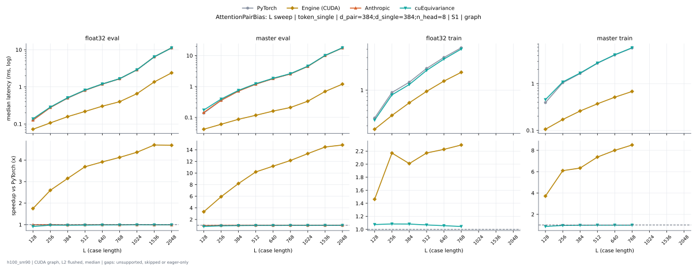

**float32 eval** (median ms; x = speedup vs PyTorch)

| L | PyTorch | Engine (Triton) | Engine (CUDA) | Anthropic | cuEquivariance |
|---|---|---|---|---|---|
| 128 | 0.1263 | 0.1103 (1.14x) | 0.07219 (1.75x) | 0.1278 (0.99x) | 0.1381 (0.91x) |
| 256 | 0.2777 | 0.2444 (1.14x) | 0.1069 (2.60x) | 0.277 (1.00x) | 0.2851 (0.97x) |
| 384 | 0.4966 | 0.4548 (1.09x) | 0.1577 (3.15x) | 0.5042 (0.98x) | 0.5101 (0.97x) |
| 512 | 0.8026 | 0.75 (1.07x) | 0.2174 (3.69x) | 0.8075 (0.99x) | 0.8219 (0.98x) |
| 640 | 1.181 | 1.105 (1.07x) | 0.3015 (3.92x) | 1.188 (0.99x) | 1.199 (0.99x) |
| 768 | 1.645 | 1.564 (1.05x) | 0.3984 (4.13x) | 1.661 (0.99x) | 1.667 (0.99x) |
| 1024 | 2.864 | 2.754 (1.04x) | 0.6559 (4.37x) | 2.885 (0.99x) | 2.889 (0.99x) |
| 1536 | 6.397 | 6.156 (1.04x) | 1.36 (4.71x) | 6.472 (0.99x) | 6.461 (0.99x) |
| 2048 | 11.19 | 10.84 (1.03x) | 2.385 (4.69x) | 11.33 (0.99x) | 11.3 (0.99x) |

**master eval** (median ms; x = speedup vs PyTorch)

| L | PyTorch | Engine (Triton) | Engine (CUDA) | Anthropic | cuEquivariance |
|---|---|---|---|---|---|
| 128 | 0.1386 | 0.1285 (1.08x) | 0.04158 (3.33x) | 0.145 (0.96x) | 0.1738 (0.80x) |
| 256 | 0.3566 | 0.3402 (1.05x) | 0.06018 (5.93x) | 0.359 (0.99x) | 0.3925 (0.91x) |
| 384 | 0.7132 | 0.688 (1.04x) | 0.0871 (8.19x) | 0.7128 (1.00x) | 0.7507 (0.95x) |
| 512 | 1.198 | 1.162 (1.03x) | 0.1175 (10.19x) | 1.188 (1.01x) | 1.234 (0.97x) |
| 640 | 1.795 | 1.763 (1.02x) | 0.1605 (11.18x) | 1.798 (1.00x) | 1.847 (0.97x) |
| 768 | 2.551 | 2.516 (1.01x) | 0.2098 (12.16x) | 2.551 (1.00x) | 2.604 (0.98x) |
| 1024 | 4.461 | 4.42 (1.01x) | 0.3344 (13.34x) | 4.461 (1.00x) | 4.551 (0.98x) |
| 1536 | 10.01 | 9.887 (1.01x) | 0.6911 (14.48x) | 9.994 (1.00x) | 10.13 (0.99x) |
| 2048 | 17.71 | 17.53 (1.01x) | 1.195 (14.83x) | 17.72 (1.00x) | 17.9 (0.99x) |

**float32 train** (median ms; x = speedup vs PyTorch)

| L | PyTorch | Engine (Triton) | Engine (CUDA) | Anthropic | cuEquivariance |
|---|---|---|---|---|---|
| 128 | 0.3889 | 0.3407 (1.14x) | 0.266 (1.46x) | unsupported | 0.3621 (1.07x) |
| 256 | 0.9215 | 0.8407 (1.10x) | 0.4246 (2.17x) | unsupported | 0.8508 (1.08x) |
| 384 | 1.306 | 1.193 (1.10x) | 0.6501 (2.01x) | unsupported | 1.208 (1.08x) |
| 512 | 2.08 | 1.926 (1.08x) | 0.9579 (2.17x) | unsupported | 1.947 (1.07x) |
| 640 | 3.019 | 2.821 (1.07x) | 1.356 (2.23x) | unsupported | 2.858 (1.06x) |
| 768 | 4.188 | 3.954 (1.06x) | 1.825 (2.29x) | unsupported | 4.009 (1.04x) |
| 1024 |  |  |  |  |  |
| 1536 |  |  |  |  |  |
| 2048 |  |  |  |  |  |

**master train** (median ms; x = speedup vs PyTorch)

| L | PyTorch | Engine (Triton) | Engine (CUDA) | Anthropic | cuEquivariance |
|---|---|---|---|---|---|
| 128 | 0.3924 | 0.3735 (1.05x) | 0.1057 (3.71x) | unsupported | 0.4541 (0.86x) |
| 256 | 1.041 | 1.004 (1.04x) | 0.1708 (6.10x) | unsupported | 1.085 (0.96x) |
| 384 | 1.644 | 1.595 (1.03x) | 0.2593 (6.34x) | unsupported | 1.682 (0.98x) |
| 512 | 2.727 | 2.654 (1.03x) | 0.3699 (7.37x) | unsupported | 2.758 (0.99x) |
| 640 | 4.095 | 4.011 (1.02x) | 0.5118 (8.00x) | unsupported | 4.138 (0.99x) |
| 768 | 5.784 | 5.673 (1.02x) | 0.68 (8.51x) | unsupported | 5.849 (0.99x) |
| 1024 |  |  |  |  |  |
| 1536 |  |  |  |  |  |
| 2048 |  |  |  |  |  |

### L sweep: token_single | d_pair=512;d_single=384;n_head=16 | S1 | graph

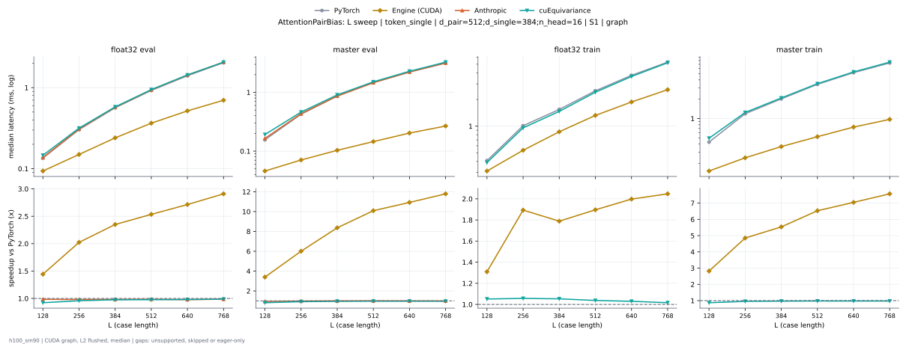

**float32 eval** (median ms; x = speedup vs PyTorch)

| L | PyTorch | Engine (Triton) | Engine (CUDA) | Anthropic | cuEquivariance |
|---|---|---|---|---|---|
| 128 | 0.1351 | 0.1204 (1.12x) | 0.0937 (1.44x) | 0.1373 (0.98x) | 0.1466 (0.92x) |
| 256 | 0.3034 | 0.2773 (1.09x) | 0.1499 (2.02x) | 0.3095 (0.98x) | 0.3167 (0.96x) |
| 384 | 0.5648 | 0.5234 (1.08x) | 0.2403 (2.35x) | 0.5749 (0.98x) | 0.579 (0.98x) |
| 512 | 0.9242 | 0.871 (1.06x) | 0.3646 (2.53x) | 0.9383 (0.98x) | 0.9462 (0.98x) |
| 640 | 1.403 | 1.315 (1.07x) | 0.5169 (2.71x) | 1.434 (0.98x) | 1.432 (0.98x) |
| 768 | 2.035 | 1.902 (1.07x) | 0.6996 (2.91x) | 2.064 (0.99x) | 2.061 (0.99x) |

**master eval** (median ms; x = speedup vs PyTorch)

| L | PyTorch | Engine (Triton) | Engine (CUDA) | Anthropic | cuEquivariance |
|---|---|---|---|---|---|
| 128 | 0.1559 | 0.1476 (1.06x) | 0.04589 (3.40x) | 0.1647 (0.95x) | 0.1916 (0.81x) |
| 256 | 0.4247 | 0.4085 (1.04x) | 0.07069 (6.01x) | 0.4342 (0.98x) | 0.4617 (0.92x) |
| 384 | 0.8644 | 0.8402 (1.03x) | 0.1033 (8.37x) | 0.8656 (1.00x) | 0.9055 (0.95x) |
| 512 | 1.466 | 1.432 (1.02x) | 0.1453 (10.09x) | 1.461 (1.00x) | 1.512 (0.97x) |
| 640 | 2.217 | 2.192 (1.01x) | 0.2029 (10.93x) | 2.226 (1.00x) | 2.288 (0.97x) |
| 768 | 3.155 | 3.135 (1.01x) | 0.2676 (11.79x) | 3.169 (1.00x) | 3.269 (0.97x) |

**float32 train** (median ms; x = speedup vs PyTorch)

| L | PyTorch | Engine (Triton) | Engine (CUDA) | Anthropic | cuEquivariance |
|---|---|---|---|---|---|
| 128 | 0.408 | 0.3613 (1.13x) | 0.3116 (1.31x) | unsupported | 0.3881 (1.05x) |
| 256 | 1.012 | 0.9301 (1.09x) | 0.5344 (1.89x) | unsupported | 0.9571 (1.06x) |
| 384 | 1.546 | 1.427 (1.08x) | 0.8646 (1.79x) | unsupported | 1.468 (1.05x) |
| 512 | 2.507 | 2.351 (1.07x) | 1.322 (1.90x) | unsupported | 2.416 (1.04x) |
| 640 | 3.748 | 3.504 (1.07x) | 1.876 (2.00x) | unsupported | 3.64 (1.03x) |
| 768 | 5.283 | 4.972 (1.06x) | 2.58 (2.05x) | unsupported | 5.198 (1.02x) |

**master train** (median ms; x = speedup vs PyTorch)

| L | PyTorch | Engine (Triton) | Engine (CUDA) | Anthropic | cuEquivariance |
|---|---|---|---|---|---|
| 128 | 0.4299 | 0.4139 (1.04x) | 0.1525 (2.82x) | unsupported | 0.4934 (0.87x) |
| 256 | 1.188 | 1.16 (1.02x) | 0.2449 (4.85x) | unsupported | 1.245 (0.95x) |
| 384 | 2.027 | 1.976 (1.03x) | 0.3661 (5.54x) | unsupported | 2.093 (0.97x) |
| 512 | 3.411 | 3.335 (1.02x) | 0.5223 (6.53x) | unsupported | 3.493 (0.98x) |
| 640 | 5.188 | 5.094 (1.02x) | 0.7362 (7.05x) | unsupported | 5.319 (0.98x) |
| 768 | 7.355 | 7.217 (1.02x) | 0.9714 (7.57x) | unsupported | 7.559 (0.97x) |

### L sweep: token_single_extra_bias | d_pair=384;d_single=384;n_head=8 | S1 | graph

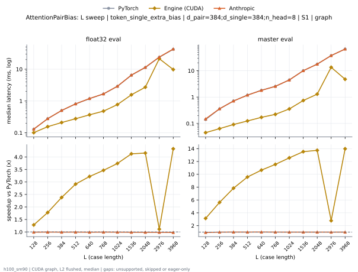

**float32 eval** (median ms; x = speedup vs PyTorch)

| L | PyTorch | Engine (Triton) | Engine (CUDA) | Anthropic | cuEquivariance |
|---|---|---|---|---|---|
| 128 | 0.1296 | 0.1131 (1.15x) | 0.1012 (1.28x) | 0.1309 (0.99x) | unsupported |
| 256 | 0.2772 | 0.2476 (1.12x) | 0.156 (1.78x) | 0.2789 (0.99x) | unsupported |
| 384 | 0.5014 | 0.4591 (1.09x) | 0.2106 (2.38x) | 0.5059 (0.99x) | unsupported |
| 512 | 0.8083 | 0.748 (1.08x) | 0.2773 (2.92x) | 0.8141 (0.99x) | unsupported |
| 640 | 1.185 | 1.119 (1.06x) | 0.368 (3.22x) | 1.198 (0.99x) | unsupported |
| 768 | 1.665 | 1.576 (1.06x) | 0.4802 (3.47x) | 1.677 (0.99x) | unsupported |
| 1024 | 2.89 | 2.796 (1.03x) | 0.7725 (3.74x) | 2.915 (0.99x) | unsupported |
| 1536 | 6.467 | 6.222 (1.04x) | 1.567 (4.13x) | 6.547 (0.99x) | unsupported |
| 2048 | 11.31 | 10.96 (1.03x) | 2.72 (4.16x) | 11.47 (0.99x) | unsupported |
| 2976 | 23.73 | 23.1 (1.03x) | 21.36 (1.11x) | 24.09 (0.98x) | unsupported |
| 3968 | 42.21 | 40.73 (1.04x) | 9.751 (4.33x) | 43.09 (0.98x) | unsupported |

**master eval** (median ms; x = speedup vs PyTorch)

| L | PyTorch | Engine (Triton) | Engine (CUDA) | Anthropic | cuEquivariance |
|---|---|---|---|---|---|
| 128 | 0.141 | 0.1317 (1.07x) | 0.04496 (3.14x) | 0.1492 (0.94x) | unsupported |
| 256 | 0.3593 | 0.3431 (1.05x) | 0.06386 (5.63x) | 0.3618 (0.99x) | unsupported |
| 384 | 0.716 | 0.6935 (1.03x) | 0.09139 (7.83x) | 0.7117 (1.01x) | unsupported |
| 512 | 1.195 | 1.165 (1.03x) | 0.1247 (9.58x) | 1.19 (1.00x) | unsupported |
| 640 | 1.822 | 1.778 (1.02x) | 0.171 (10.65x) | 1.801 (1.01x) | unsupported |
| 768 | 2.563 | 2.52 (1.02x) | 0.222 (11.55x) | 2.563 (1.00x) | unsupported |
| 1024 | 4.481 | 4.44 (1.01x) | 0.3567 (12.56x) | 4.483 (1.00x) | unsupported |
| 1536 | 10.05 | 9.939 (1.01x) | 0.7426 (13.53x) | 10.05 (1.00x) | unsupported |
| 2048 | 17.8 | 17.62 (1.01x) | 1.297 (13.73x) | 17.81 (1.00x) | unsupported |
| 2976 | 37.43 | 37.09 (1.01x) | 13.49 (2.77x) | 37.67 (0.99x) | unsupported |
| 3968 | 66.45 | 65.93 (1.01x) | 4.756 (13.97x) | 66.64 (1.00x) | unsupported |

### d_pair sweep at L768: token_single | - | S1 | graph

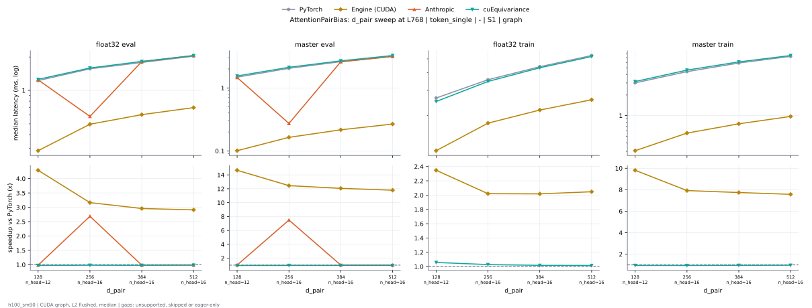

**float32 eval** (median ms; x = speedup vs PyTorch)

| d_pair | PyTorch | Engine (Triton) | Engine (CUDA) | Anthropic | cuEquivariance |
|---|---|---|---|---|---|
| 128 n_head=12 | 1.226 | 1.11 (1.10x) | 0.286 (4.29x) | 1.245 (0.99x) | 1.258 (0.97x) |
| 256 n_head=16 | 1.566 | 1.446 (1.08x) | 0.4953 (3.16x) | 0.5829 (2.69x) | 1.593 (0.98x) |
| 384 n_head=16 | 1.788 | 1.668 (1.07x) | 0.6046 (2.96x) | 1.819 (0.98x) | 1.826 (0.98x) |
| 512 n_head=16 | 2.035 | 1.902 (1.07x) | 0.6996 (2.91x) | 2.064 (0.99x) | 2.061 (0.99x) |

**master eval** (median ms; x = speedup vs PyTorch)

| d_pair | PyTorch | Engine (Triton) | Engine (CUDA) | Anthropic | cuEquivariance |
|---|---|---|---|---|---|
| 128 n_head=12 | 1.481 | 1.43 (1.04x) | 0.101 (14.66x) | 1.463 (1.01x) | 1.55 (0.96x) |
| 256 n_head=16 | 2.048 | 2 (1.02x) | 0.1645 (12.45x) | 0.2734 (7.49x) | 2.126 (0.96x) |
| 384 n_head=16 | 2.612 | 2.559 (1.02x) | 0.2166 (12.06x) | 2.599 (1.00x) | 2.692 (0.97x) |
| 512 n_head=16 | 3.155 | 3.135 (1.01x) | 0.2676 (11.79x) | 3.169 (1.00x) | 3.269 (0.97x) |

**float32 train** (median ms; x = speedup vs PyTorch)

| d_pair | PyTorch | Engine (Triton) | Engine (CUDA) | Anthropic | cuEquivariance |
|---|---|---|---|---|---|
| 128 n_head=12 | 2.655 | 2.345 (1.13x) | 1.131 (2.35x) | unsupported | 2.509 (1.06x) |
| 256 n_head=16 | 3.569 | 3.251 (1.10x) | 1.767 (2.02x) | unsupported | 3.471 (1.03x) |
| 384 n_head=16 | 4.409 | 4.104 (1.07x) | 2.185 (2.02x) | unsupported | 4.332 (1.02x) |
| 512 n_head=16 | 5.283 | 4.972 (1.06x) | 2.58 (2.05x) | unsupported | 5.198 (1.02x) |

**master train** (median ms; x = speedup vs PyTorch)

| d_pair | PyTorch | Engine (Triton) | Engine (CUDA) | Anthropic | cuEquivariance |
|---|---|---|---|---|---|
| 128 n_head=12 | 3.007 | 2.887 (1.04x) | 0.3065 (9.81x) | unsupported | 3.149 (0.96x) |
| 256 n_head=16 | 4.392 | 4.283 (1.03x) | 0.5544 (7.92x) | unsupported | 4.623 (0.95x) |
| 384 n_head=16 | 5.868 | 5.763 (1.02x) | 0.758 (7.74x) | unsupported | 6.099 (0.96x) |
| 512 n_head=16 | 7.355 | 7.217 (1.02x) | 0.9714 (7.57x) | unsupported | 7.559 (0.97x) |

### n_head sweep at L768: token_single | - | S1 | graph

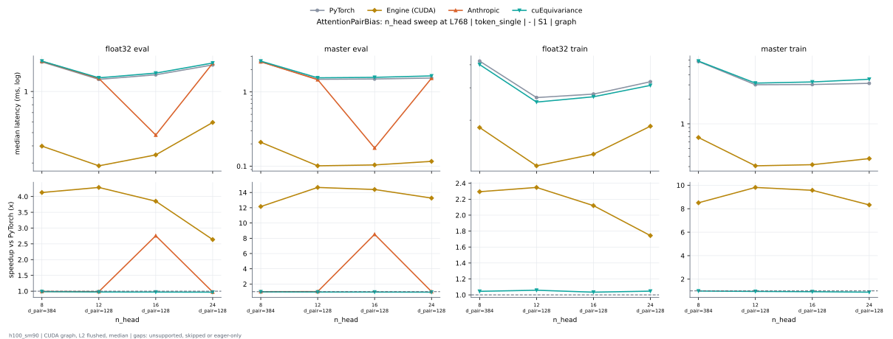

**float32 eval** (median ms; x = speedup vs PyTorch)

| n_head | PyTorch | Engine (Triton) | Engine (CUDA) | Anthropic | cuEquivariance |
|---|---|---|---|---|---|
| 8 d_pair=384 | 1.645 | 1.564 (1.05x) | 0.3984 (4.13x) | 1.661 (0.99x) | 1.667 (0.99x) |
| 12 d_pair=128 | 1.226 | 1.11 (1.10x) | 0.286 (4.29x) | 1.245 (0.99x) | 1.258 (0.97x) |
| 16 d_pair=128 | 1.324 | 1.204 (1.10x) | 0.3438 (3.85x) | 0.4803 (2.76x) | 1.362 (0.97x) |
| 24 d_pair=128 | 1.564 | 1.389 (1.13x) | 0.5934 (2.64x) | 1.607 (0.97x) | 1.615 (0.97x) |

**master eval** (median ms; x = speedup vs PyTorch)

| n_head | PyTorch | Engine (Triton) | Engine (CUDA) | Anthropic | cuEquivariance |
|---|---|---|---|---|---|
| 8 d_pair=384 | 2.551 | 2.516 (1.01x) | 0.2098 (12.16x) | 2.551 (1.00x) | 2.604 (0.98x) |
| 12 d_pair=128 | 1.481 | 1.43 (1.04x) | 0.101 (14.66x) | 1.463 (1.01x) | 1.55 (0.96x) |
| 16 d_pair=128 | 1.495 | 1.441 (1.04x) | 0.1039 (14.39x) | 0.1755 (8.52x) | 1.573 (0.95x) |
| 24 d_pair=128 | 1.539 | 1.457 (1.06x) | 0.116 (13.27x) | 1.531 (1.01x) | 1.645 (0.94x) |

**float32 train** (median ms; x = speedup vs PyTorch)

| n_head | PyTorch | Engine (Triton) | Engine (CUDA) | Anthropic | cuEquivariance |
|---|---|---|---|---|---|
| 8 d_pair=384 | 4.188 | 3.954 (1.06x) | 1.825 (2.29x) | unsupported | 4.009 (1.04x) |
| 12 d_pair=128 | 2.655 | 2.345 (1.13x) | 1.131 (2.35x) | unsupported | 2.509 (1.06x) |
| 16 d_pair=128 | 2.773 | 2.462 (1.13x) | 1.308 (2.12x) | unsupported | 2.681 (1.03x) |
| 24 d_pair=128 | 3.236 | 2.658 (1.22x) | 1.856 (1.74x) | unsupported | 3.091 (1.05x) |

**master train** (median ms; x = speedup vs PyTorch)

| n_head | PyTorch | Engine (Triton) | Engine (CUDA) | Anthropic | cuEquivariance |
|---|---|---|---|---|---|
| 8 d_pair=384 | 5.784 | 5.673 (1.02x) | 0.68 (8.51x) | unsupported | 5.849 (0.99x) |
| 12 d_pair=128 | 3.007 | 2.887 (1.04x) | 0.3065 (9.81x) | unsupported | 3.149 (0.96x) |
| 16 d_pair=128 | 3.028 | 2.92 (1.04x) | 0.3164 (9.57x) | unsupported | 3.253 (0.93x) |
| 24 d_pair=128 | 3.128 | 2.951 (1.06x) | 0.3758 (8.32x) | unsupported | 3.509 (0.89x) |

