# AttentionPairBias on h100_sm90

Generated by `python -m miniworld_engine.measure.plot` from speed tokens `judge/tokens/h100_sm90/`; do not edit.

### L sweep: token_single | d_pair=128;d_single=384;n_head=12 | S1 | graph

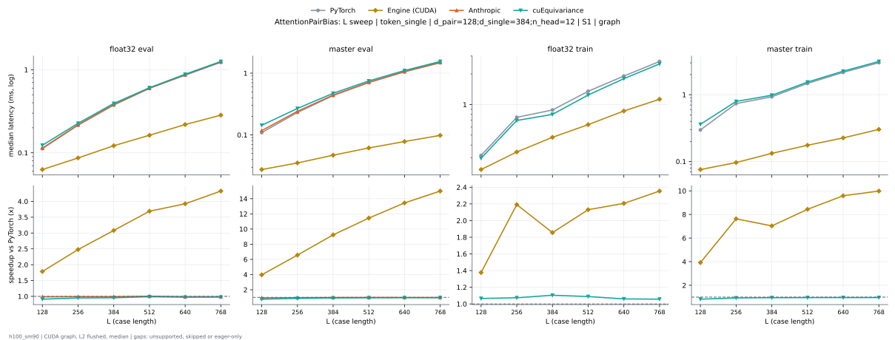

**float32 eval** (median ms; x = speedup vs PyTorch)

| L | PyTorch | Engine (Triton) | Engine (CUDA) | Anthropic | cuEquivariance |
|---|---|---|---|---|---|
| 128 | 0.1123 | 0.09725 (1.16x) | 0.06291 (1.79x) | 0.114 (0.99x) | 0.1233 (0.91x) |
| 256 | 0.215 | 0.1837 (1.17x) | 0.08675 (2.48x) | 0.2173 (0.99x) | 0.2265 (0.95x) |
| 384 | 0.3753 | 0.3352 (1.12x) | 0.1218 (3.08x) | 0.3804 (0.99x) | 0.3929 (0.96x) |
| 512 | 0.6003 | 0.5418 (1.11x) | 0.1627 (3.69x) | 0.5968 (1.01x) | 0.6075 (0.99x) |
| 640 | 0.8589 | 0.7852 (1.09x) | 0.2188 (3.92x) | 0.8705 (0.99x) | 0.8824 (0.97x) |
| 768 | 1.228 | 1.11 (1.11x) | 0.284 (4.33x) | 1.243 (0.99x) | 1.258 (0.98x) |

**master eval** (median ms; x = speedup vs PyTorch)

| L | PyTorch | Engine (Triton) | Engine (CUDA) | Anthropic | cuEquivariance |
|---|---|---|---|---|---|
| 128 | 0.1092 | 0.09885 (1.11x) | 0.02752 (3.97x) | 0.1177 (0.93x) | 0.1434 (0.76x) |
| 256 | 0.2311 | 0.2152 (1.07x) | 0.0352 (6.57x) | 0.2412 (0.96x) | 0.2684 (0.86x) |
| 384 | 0.434 | 0.41 (1.06x) | 0.04699 (9.24x) | 0.4429 (0.98x) | 0.4728 (0.92x) |
| 512 | 0.7048 | 0.6738 (1.05x) | 0.06158 (11.44x) | 0.7124 (0.99x) | 0.7497 (0.94x) |
| 640 | 1.051 | 1.012 (1.04x) | 0.07821 (13.44x) | 1.064 (0.99x) | 1.104 (0.95x) |
| 768 | 1.476 | 1.424 (1.04x) | 0.09838 (15.01x) | 1.496 (0.99x) | 1.55 (0.95x) |

**float32 train** (median ms; x = speedup vs PyTorch)

| L | PyTorch | Engine (Triton) | Engine (CUDA) | Anthropic | cuEquivariance |
|---|---|---|---|---|---|
| 128 | 0.3159 | 0.272 (1.16x) | 0.2295 (1.38x) | unsupported | 0.2964 (1.07x) |
| 256 | 0.7489 | 0.6705 (1.12x) | 0.3417 (2.19x) | unsupported | 0.6972 (1.07x) |
| 384 | 0.884 | 0.778 (1.14x) | 0.4765 (1.86x) | unsupported | 0.8006 (1.10x) |
| 512 | 1.351 | 1.203 (1.12x) | 0.6344 (2.13x) | unsupported | 1.241 (1.09x) |
| 640 | 1.907 | 1.741 (1.09x) | 0.8643 (2.21x) | unsupported | 1.798 (1.06x) |
| 768 | 2.655 | 2.408 (1.10x) | 1.128 (2.35x) | unsupported | 2.511 (1.06x) |

**master train** (median ms; x = speedup vs PyTorch)

| L | PyTorch | Engine (Triton) | Engine (CUDA) | Anthropic | cuEquivariance |
|---|---|---|---|---|---|
| 128 | 0.297 | 0.2907 (1.02x) | 0.07574 (3.92x) | unsupported | 0.3605 (0.82x) |
| 256 | 0.7357 | 0.7274 (1.01x) | 0.09642 (7.63x) | unsupported | 0.7933 (0.93x) |
| 384 | 0.931 | 0.9043 (1.03x) | 0.1324 (7.03x) | unsupported | 0.9818 (0.95x) |
| 512 | 1.477 | 1.438 (1.03x) | 0.175 (8.44x) | unsupported | 1.545 (0.96x) |
| 640 | 2.161 | 2.128 (1.02x) | 0.2255 (9.59x) | unsupported | 2.252 (0.96x) |
| 768 | 3.019 | 2.97 (1.02x) | 0.3025 (9.98x) | unsupported | 3.149 (0.96x) |

### L sweep: token_single | d_pair=128;d_single=384;n_head=16 | S1 | graph

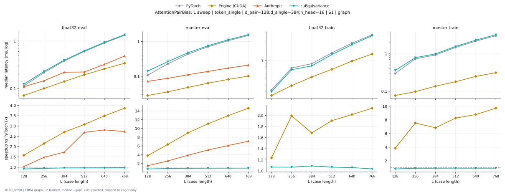

**float32 eval** (median ms; x = speedup vs PyTorch)

| L | PyTorch | Engine (Triton) | Engine (CUDA) | Anthropic | cuEquivariance |
|---|---|---|---|---|---|
| 128 | 0.1134 | 0.0985 (1.15x) | 0.07144 (1.59x) | 0.1097 (1.03x) | 0.124 (0.91x) |
| 256 | 0.2168 | 0.1904 (1.14x) | 0.1005 (2.16x) | 0.1463 (1.48x) | 0.2294 (0.94x) |
| 384 | 0.3803 | 0.3417 (1.11x) | 0.1396 (2.72x) | 0.22 (1.73x) | 0.3954 (0.96x) |
| 512 | 0.6035 | 0.5504 (1.10x) | 0.1943 (3.11x) | 0.2234 (2.70x) | 0.6218 (0.97x) |
| 640 | 0.9075 | 0.8141 (1.11x) | 0.26 (3.49x) | 0.3229 (2.81x) | 0.9373 (0.97x) |
| 768 | 1.318 | 1.199 (1.10x) | 0.3404 (3.87x) | 0.4826 (2.73x) | 1.356 (0.97x) |

**master eval** (median ms; x = speedup vs PyTorch)

| L | PyTorch | Engine (Triton) | Engine (CUDA) | Anthropic | cuEquivariance |
|---|---|---|---|---|---|
| 128 | 0.1082 | 0.09963 (1.09x) | 0.02819 (3.84x) | 0.0719 (1.50x) | 0.1411 (0.77x) |
| 256 | 0.2277 | 0.214 (1.06x) | 0.03581 (6.36x) | 0.0876 (2.60x) | 0.2644 (0.86x) |
| 384 | 0.4336 | 0.4135 (1.05x) | 0.04798 (9.04x) | 0.1113 (3.90x) | 0.4743 (0.91x) |
| 512 | 0.7125 | 0.6821 (1.04x) | 0.0635 (11.22x) | 0.1384 (5.15x) | 0.7569 (0.94x) |
| 640 | 1.055 | 1.017 (1.04x) | 0.08182 (12.89x) | 0.1723 (6.12x) | 1.121 (0.94x) |
| 768 | 1.492 | 1.435 (1.04x) | 0.1017 (14.68x) | 0.2092 (7.13x) | 1.566 (0.95x) |

**float32 train** (median ms; x = speedup vs PyTorch)

| L | PyTorch | Engine (Triton) | Engine (CUDA) | Anthropic | cuEquivariance |
|---|---|---|---|---|---|
| 128 | 0.3175 | 0.2801 (1.13x) | 0.2573 (1.23x) | unsupported | 0.2979 (1.07x) |
| 256 | 0.7552 | 0.6913 (1.09x) | 0.3773 (2.00x) | unsupported | 0.7061 (1.07x) |
| 384 | 0.8956 | 0.8011 (1.12x) | 0.5297 (1.69x) | unsupported | 0.8191 (1.09x) |
| 512 | 1.368 | 1.262 (1.08x) | 0.7192 (1.90x) | unsupported | 1.278 (1.07x) |
| 640 | 1.996 | 1.827 (1.09x) | 0.9939 (2.01x) | unsupported | 1.879 (1.06x) |
| 768 | 2.769 | 2.571 (1.08x) | 1.304 (2.12x) | unsupported | 2.677 (1.03x) |

**master train** (median ms; x = speedup vs PyTorch)

| L | PyTorch | Engine (Triton) | Engine (CUDA) | Anthropic | cuEquivariance |
|---|---|---|---|---|---|
| 128 | 0.297 | 0.2897 (1.03x) | 0.0764 (3.89x) | unsupported | 0.3594 (0.83x) |
| 256 | 0.7327 | 0.7157 (1.02x) | 0.09717 (7.54x) | unsupported | 0.7903 (0.93x) |
| 384 | 0.9364 | 0.9087 (1.03x) | 0.1361 (6.88x) | unsupported | 0.9981 (0.94x) |
| 512 | 1.487 | 1.453 (1.02x) | 0.1806 (8.24x) | unsupported | 1.574 (0.94x) |
| 640 | 2.185 | 2.152 (1.02x) | 0.2487 (8.79x) | unsupported | 2.329 (0.94x) |
| 768 | 3.043 | 3.002 (1.01x) | 0.3126 (9.73x) | unsupported | 3.252 (0.94x) |

### L sweep: token_single | d_pair=128;d_single=384;n_head=24 | S1 | graph

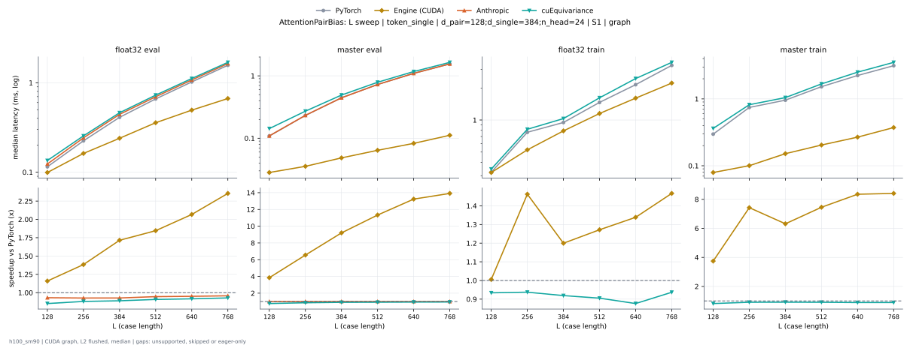

**float32 eval** (median ms; x = speedup vs PyTorch)

| L | PyTorch | Engine (Triton) | Engine (CUDA) | Anthropic | cuEquivariance |
|---|---|---|---|---|---|
| 128 | 0.1149 | 0.09789 (1.17x) | 0.0823 (1.40x) | 0.1164 (0.99x) | 0.1265 (0.91x) |
| 256 | 0.2225 | 0.1899 (1.17x) | 0.131 (1.70x) | 0.227 (0.98x) | 0.2362 (0.94x) |
| 384 | 0.4096 | 0.3491 (1.17x) | 0.204 (2.01x) | 0.4177 (0.98x) | 0.4276 (0.96x) |
| 512 | 0.6572 | 0.5711 (1.15x) | 0.3068 (2.14x) | 0.67 (0.98x) | 0.6882 (0.95x) |
| 640 | 1.017 | 0.9017 (1.13x) | 0.4337 (2.35x) | 1.043 (0.98x) | 1.058 (0.96x) |
| 768 | 1.564 | 1.391 (1.12x) | 0.5923 (2.64x) | 1.603 (0.98x) | 1.616 (0.97x) |

**master eval** (median ms; x = speedup vs PyTorch)

| L | PyTorch | Engine (Triton) | Engine (CUDA) | Anthropic | cuEquivariance |
|---|---|---|---|---|---|
| 128 | 0.1084 | 0.09773 (1.11x) | 0.02862 (3.79x) | 0.1157 (0.94x) | 0.1424 (0.76x) |
| 256 | 0.2317 | 0.2131 (1.09x) | 0.03547 (6.53x) | 0.2417 (0.96x) | 0.2705 (0.86x) |
| 384 | 0.4424 | 0.4132 (1.07x) | 0.04834 (9.15x) | 0.4516 (0.98x) | 0.4896 (0.90x) |
| 512 | 0.7209 | 0.6836 (1.05x) | 0.06432 (11.21x) | 0.7357 (0.98x) | 0.7846 (0.92x) |
| 640 | 1.085 | 1.029 (1.05x) | 0.08222 (13.20x) | 1.099 (0.99x) | 1.165 (0.93x) |
| 768 | 1.541 | 1.452 (1.06x) | 0.1114 (13.84x) | 1.565 (0.99x) | 1.644 (0.94x) |

**float32 train** (median ms; x = speedup vs PyTorch)

| L | PyTorch | Engine (Triton) | Engine (CUDA) | Anthropic | cuEquivariance |
|---|---|---|---|---|---|
| 128 | 0.3201 | 0.2731 (1.17x) | 0.2786 (1.15x) | unsupported | 0.3007 (1.06x) |
| 256 | 0.7635 | 0.6812 (1.12x) | 0.4336 (1.76x) | unsupported | 0.717 (1.06x) |
| 384 | 0.9462 | 0.8102 (1.17x) | 0.6442 (1.47x) | unsupported | 0.8671 (1.09x) |
| 512 | 1.462 | 1.281 (1.14x) | 0.9168 (1.59x) | unsupported | 1.384 (1.06x) |
| 640 | 2.148 | 1.928 (1.11x) | 1.324 (1.62x) | unsupported | 2.113 (1.02x) |
| 768 | 3.241 | 2.822 (1.15x) | 1.852 (1.75x) | unsupported | 3.069 (1.06x) |

**master train** (median ms; x = speedup vs PyTorch)

| L | PyTorch | Engine (Triton) | Engine (CUDA) | Anthropic | cuEquivariance |
|---|---|---|---|---|---|
| 128 | 0.2965 | 0.286 (1.04x) | 0.07882 (3.76x) | unsupported | 0.3603 (0.82x) |
| 256 | 0.7408 | 0.7259 (1.02x) | 0.1009 (7.34x) | unsupported | 0.8175 (0.91x) |
| 384 | 0.955 | 0.9185 (1.04x) | 0.152 (6.28x) | unsupported | 1.044 (0.91x) |
| 512 | 1.518 | 1.484 (1.02x) | 0.2031 (7.48x) | unsupported | 1.671 (0.91x) |
| 640 | 2.233 | 2.198 (1.02x) | 0.2677 (8.34x) | unsupported | 2.503 (0.89x) |
| 768 | 3.132 | 3.069 (1.02x) | 0.3736 (8.38x) | unsupported | 3.519 (0.89x) |

### L sweep: token_single | d_pair=128;d_single=512;n_head=16 | S1 | graph

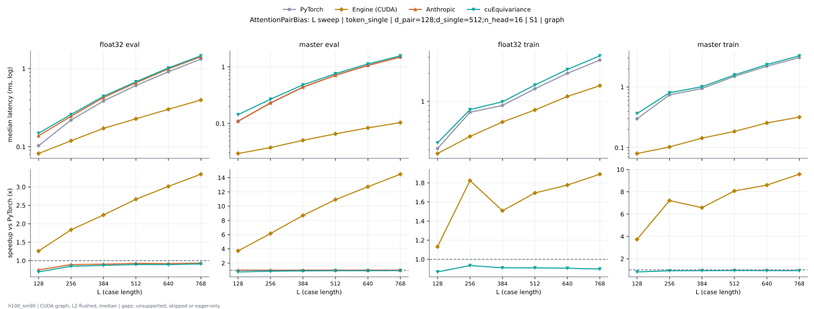

**float32 eval** (median ms; x = speedup vs PyTorch)

| L | PyTorch | Engine (Triton) | Engine (CUDA) | Anthropic | cuEquivariance |
|---|---|---|---|---|---|
| 128 | 0.1026 | 0.08658 (1.19x) | 0.0656 (1.56x) | 0.1 (1.03x) | 0.1136 (0.90x) |
| 256 | 0.2198 | 0.1895 (1.16x) | 0.09912 (2.22x) | 0.1492 (1.47x) | 0.2328 (0.94x) |
| 384 | 0.3842 | 0.3396 (1.13x) | 0.1361 (2.82x) | 0.2236 (1.72x) | 0.4008 (0.96x) |
| 512 | 0.6038 | 0.5377 (1.12x) | 0.1852 (3.26x) | 0.2202 (2.74x) | 0.6186 (0.98x) |
| 640 | 0.9097 | 0.8092 (1.12x) | 0.2577 (3.53x) | 0.3214 (2.83x) | 0.9356 (0.97x) |
| 768 | 1.319 | 1.192 (1.11x) | 0.3365 (3.92x) | 0.4821 (2.74x) | 1.364 (0.97x) |

**master eval** (median ms; x = speedup vs PyTorch)

| L | PyTorch | Engine (Triton) | Engine (CUDA) | Anthropic | cuEquivariance |
|---|---|---|---|---|---|
| 128 | 0.1091 | 0.09918 (1.10x) | 0.0293 (3.72x) | 0.07258 (1.50x) | 0.1435 (0.76x) |
| 256 | 0.2309 | 0.2147 (1.08x) | 0.03776 (6.11x) | 0.09165 (2.52x) | 0.268 (0.86x) |
| 384 | 0.4351 | 0.4094 (1.06x) | 0.04986 (8.73x) | 0.1142 (3.81x) | 0.4802 (0.91x) |
| 512 | 0.7116 | 0.6774 (1.05x) | 0.06581 (10.81x) | 0.1404 (5.07x) | 0.7572 (0.94x) |
| 640 | 1.06 | 1.015 (1.05x) | 0.08378 (12.66x) | 0.1761 (6.02x) | 1.125 (0.94x) |
| 768 | 1.489 | 1.429 (1.04x) | 0.1036 (14.37x) | 0.2108 (7.06x) | 1.567 (0.95x) |

**float32 train** (median ms; x = speedup vs PyTorch)

| L | PyTorch | Engine (Triton) | Engine (CUDA) | Anthropic | cuEquivariance |
|---|---|---|---|---|---|
| 128 | 0.309 | 0.2666 (1.16x) | 0.2421 (1.28x) | unsupported | 0.292 (1.06x) |
| 256 | 0.764 | 0.6857 (1.11x) | 0.3661 (2.09x) | unsupported | 0.7148 (1.07x) |
| 384 | 0.9047 | 0.7907 (1.14x) | 0.5163 (1.75x) | unsupported | 0.8343 (1.08x) |
| 512 | 1.364 | 1.238 (1.10x) | 0.7057 (1.93x) | unsupported | 1.282 (1.06x) |
| 640 | 2.011 | 1.801 (1.12x) | 0.9831 (2.05x) | unsupported | 1.89 (1.06x) |
| 768 | 2.788 | 2.529 (1.10x) | 1.287 (2.17x) | unsupported | 2.711 (1.03x) |

**master train** (median ms; x = speedup vs PyTorch)

| L | PyTorch | Engine (Triton) | Engine (CUDA) | Anthropic | cuEquivariance |
|---|---|---|---|---|---|
| 128 | 0.3003 | 0.2898 (1.04x) | 0.08085 (3.71x) | unsupported | 0.3663 (0.82x) |
| 256 | 0.7426 | 0.7181 (1.03x) | 0.1022 (7.27x) | unsupported | 0.7984 (0.93x) |
| 384 | 0.9391 | 0.9018 (1.04x) | 0.1428 (6.58x) | unsupported | 1.011 (0.93x) |
| 512 | 1.492 | 1.451 (1.03x) | 0.185 (8.07x) | unsupported | 1.578 (0.95x) |
| 640 | 2.191 | 2.142 (1.02x) | 0.2554 (8.58x) | unsupported | 2.341 (0.94x) |
| 768 | 3.039 | 2.991 (1.02x) | 0.3192 (9.52x) | unsupported | 3.272 (0.93x) |

### L sweep: token_single | d_pair=256;d_single=384;gate_bias=1.0;n_head=16 | S1 | graph

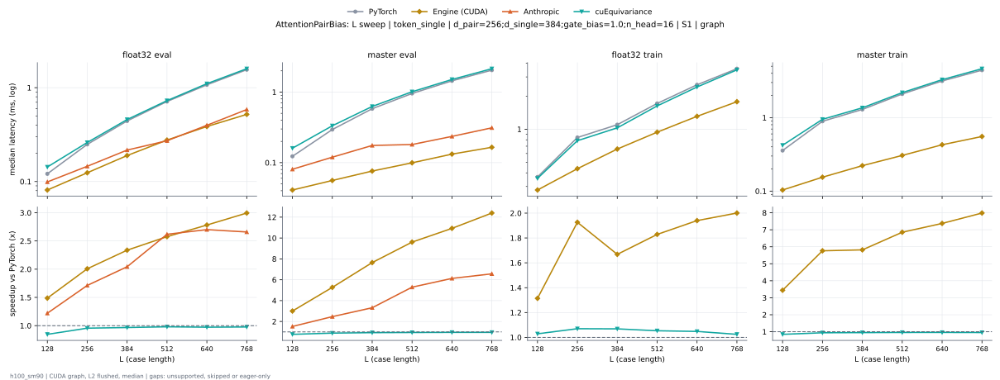

**float32 eval** (median ms; x = speedup vs PyTorch)

| L | PyTorch | Engine (Triton) | Engine (CUDA) | Anthropic | cuEquivariance |
|---|---|---|---|---|---|
| 128 | 0.1204 | 0.1053 (1.14x) | 0.08178 (1.47x) | 0.0991 (1.22x) | 0.1429 (0.84x) |
| 256 | 0.2485 | 0.2219 (1.12x) | 0.1225 (2.03x) | 0.1454 (1.71x) | 0.2606 (0.95x) |
| 384 | 0.4425 | 0.4026 (1.10x) | 0.1833 (2.41x) | 0.2165 (2.04x) | 0.4576 (0.97x) |
| 512 | 0.7091 | 0.6569 (1.08x) | 0.266 (2.67x) | 0.2722 (2.60x) | 0.7277 (0.97x) |
| 640 | 1.074 | 0.9806 (1.10x) | 0.3705 (2.90x) | 0.3976 (2.70x) | 1.104 (0.97x) |
| 768 | 1.557 | 1.437 (1.08x) | 0.496 (3.14x) | 0.5853 (2.66x) | 1.594 (0.98x) |

**master eval** (median ms; x = speedup vs PyTorch)

| L | PyTorch | Engine (Triton) | Engine (CUDA) | Anthropic | cuEquivariance |
|---|---|---|---|---|---|
| 128 | 0.1227 | 0.1146 (1.07x) | 0.04109 (2.99x) | 0.08062 (1.52x) | 0.1601 (0.77x) |
| 256 | 0.2939 | 0.2801 (1.05x) | 0.05578 (5.27x) | 0.1195 (2.46x) | 0.3331 (0.88x) |
| 384 | 0.5761 | 0.5561 (1.04x) | 0.07514 (7.67x) | 0.1752 (3.29x) | 0.6255 (0.92x) |
| 512 | 0.9551 | 0.9381 (1.02x) | 0.09984 (9.57x) | 0.1807 (5.29x) | 1.011 (0.94x) |
| 640 | 1.448 | 1.408 (1.03x) | 0.1328 (10.91x) | 0.2355 (6.15x) | 1.509 (0.96x) |
| 768 | 2.054 | 1.996 (1.03x) | 0.1644 (12.49x) | 0.3116 (6.59x) | 2.145 (0.96x) |

**float32 train** (median ms; x = speedup vs PyTorch)

| L | PyTorch | Engine (Triton) | Engine (CUDA) | Anthropic | cuEquivariance |
|---|---|---|---|---|---|
| 128 | 0.3661 | 0.3261 (1.12x) | 0.2804 (1.31x) | unsupported | 0.3561 (1.03x) |
| 256 | 0.842 | 0.7698 (1.09x) | 0.4341 (1.94x) | unsupported | 0.7854 (1.07x) |
| 384 | 1.1 | 0.989 (1.11x) | 0.6445 (1.71x) | unsupported | 1.029 (1.07x) |
| 512 | 1.722 | 1.581 (1.09x) | 0.9147 (1.88x) | unsupported | 1.631 (1.06x) |
| 640 | 2.547 | 2.35 (1.08x) | 1.296 (1.96x) | unsupported | 2.427 (1.05x) |
| 768 | 3.571 | 3.287 (1.09x) | 1.772 (2.02x) | unsupported | 3.481 (1.03x) |

**master train** (median ms; x = speedup vs PyTorch)

| L | PyTorch | Engine (Triton) | Engine (CUDA) | Anthropic | cuEquivariance |
|---|---|---|---|---|---|
| 128 | 0.3543 | 0.3475 (1.02x) | 0.1041 (3.40x) | unsupported | 0.4204 (0.84x) |
| 256 | 0.8874 | 0.8704 (1.02x) | 0.1543 (5.75x) | unsupported | 0.9479 (0.94x) |
| 384 | 1.289 | 1.261 (1.02x) | 0.2232 (5.77x) | unsupported | 1.36 (0.95x) |
| 512 | 2.106 | 2.065 (1.02x) | 0.3082 (6.83x) | unsupported | 2.188 (0.96x) |
| 640 | 3.148 | 3.103 (1.01x) | 0.4298 (7.32x) | unsupported | 3.28 (0.96x) |
| 768 | 4.407 | 4.357 (1.01x) | 0.554 (7.95x) | unsupported | 4.628 (0.95x) |

### L sweep: token_single | d_pair=256;d_single=384;n_head=16 | S1 | graph

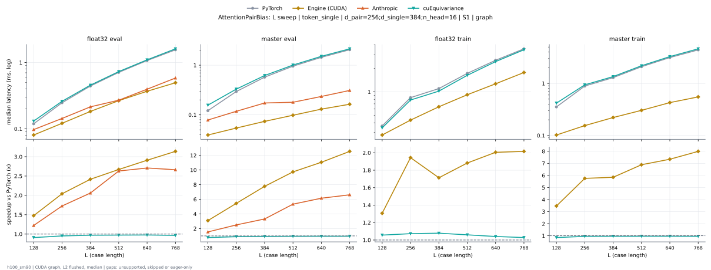

**float32 eval** (median ms; x = speedup vs PyTorch)

| L | PyTorch | Engine (Triton) | Engine (CUDA) | Anthropic | cuEquivariance |
|---|---|---|---|---|---|
| 128 | 0.1191 | 0.1044 (1.14x) | 0.0807 (1.48x) | 0.09744 (1.22x) | 0.1309 (0.91x) |
| 256 | 0.2473 | 0.2207 (1.12x) | 0.1212 (2.04x) | 0.1433 (1.73x) | 0.2598 (0.95x) |
| 384 | 0.4421 | 0.4025 (1.10x) | 0.1829 (2.42x) | 0.2146 (2.06x) | 0.4555 (0.97x) |
| 512 | 0.7102 | 0.6585 (1.08x) | 0.2661 (2.67x) | 0.27 (2.63x) | 0.7296 (0.97x) |
| 640 | 1.072 | 0.9781 (1.10x) | 0.3685 (2.91x) | 0.3958 (2.71x) | 1.097 (0.98x) |
| 768 | 1.554 | 1.441 (1.08x) | 0.4952 (3.14x) | 0.5836 (2.66x) | 1.609 (0.97x) |

**master eval** (median ms; x = speedup vs PyTorch)

| L | PyTorch | Engine (Triton) | Engine (CUDA) | Anthropic | cuEquivariance |
|---|---|---|---|---|---|
| 128 | 0.1214 | 0.1127 (1.08x) | 0.03923 (3.09x) | 0.07864 (1.54x) | 0.1568 (0.77x) |
| 256 | 0.2948 | 0.2803 (1.05x) | 0.05414 (5.44x) | 0.1178 (2.50x) | 0.3295 (0.89x) |
| 384 | 0.5744 | 0.5543 (1.04x) | 0.07389 (7.77x) | 0.1732 (3.32x) | 0.6194 (0.93x) |
| 512 | 0.957 | 0.9288 (1.03x) | 0.09816 (9.75x) | 0.1793 (5.34x) | 1.007 (0.95x) |
| 640 | 1.442 | 1.412 (1.02x) | 0.1303 (11.06x) | 0.2345 (6.15x) | 1.51 (0.95x) |
| 768 | 2.052 | 1.994 (1.03x) | 0.1635 (12.55x) | 0.3101 (6.62x) | 2.14 (0.96x) |

**float32 train** (median ms; x = speedup vs PyTorch)

| L | PyTorch | Engine (Triton) | Engine (CUDA) | Anthropic | cuEquivariance |
|---|---|---|---|---|---|
| 128 | 0.3638 | 0.3243 (1.12x) | 0.2784 (1.31x) | unsupported | 0.3444 (1.06x) |
| 256 | 0.8411 | 0.7627 (1.10x) | 0.4326 (1.94x) | unsupported | 0.7841 (1.07x) |
| 384 | 1.101 | 0.9868 (1.12x) | 0.6423 (1.71x) | unsupported | 1.021 (1.08x) |
| 512 | 1.725 | 1.59 (1.08x) | 0.9162 (1.88x) | unsupported | 1.628 (1.06x) |
| 640 | 2.543 | 2.341 (1.09x) | 1.268 (2.01x) | unsupported | 2.444 (1.04x) |
| 768 | 3.57 | 3.288 (1.09x) | 1.77 (2.02x) | unsupported | 3.472 (1.03x) |

**master train** (median ms; x = speedup vs PyTorch)

| L | PyTorch | Engine (Triton) | Engine (CUDA) | Anthropic | cuEquivariance |
|---|---|---|---|---|---|
| 128 | 0.3539 | 0.3447 (1.03x) | 0.1021 (3.47x) | unsupported | 0.4181 (0.85x) |
| 256 | 0.8907 | 0.8707 (1.02x) | 0.1548 (5.75x) | unsupported | 0.9391 (0.95x) |
| 384 | 1.294 | 1.261 (1.03x) | 0.2212 (5.85x) | unsupported | 1.353 (0.96x) |
| 512 | 2.095 | 2.062 (1.02x) | 0.3041 (6.89x) | unsupported | 2.187 (0.96x) |
| 640 | 3.144 | 3.095 (1.02x) | 0.4281 (7.34x) | unsupported | 3.278 (0.96x) |
| 768 | 4.407 | 4.356 (1.01x) | 0.5511 (8.00x) | unsupported | 4.626 (0.95x) |

### L sweep: token_single | d_pair=384;d_single=384;n_head=16 | S1 | graph

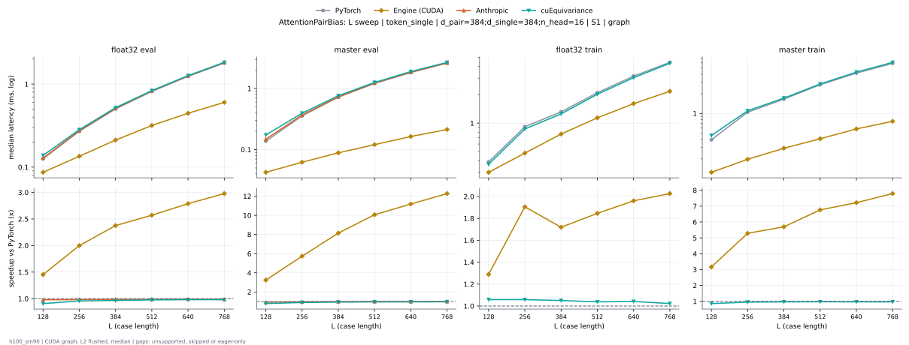

**float32 eval** (median ms; x = speedup vs PyTorch)

| L | PyTorch | Engine (Triton) | Engine (CUDA) | Anthropic | cuEquivariance |
|---|---|---|---|---|---|
| 128 | 0.1257 | 0.1109 (1.13x) | 0.0865 (1.45x) | 0.1284 (0.98x) | 0.1384 (0.91x) |
| 256 | 0.2701 | 0.2443 (1.11x) | 0.1351 (2.00x) | 0.2749 (0.98x) | 0.2823 (0.96x) |
| 384 | 0.5002 | 0.4624 (1.08x) | 0.2116 (2.36x) | 0.5094 (0.98x) | 0.5197 (0.96x) |
| 512 | 0.8187 | 0.7635 (1.07x) | 0.3173 (2.58x) | 0.8267 (0.99x) | 0.8348 (0.98x) |
| 640 | 1.234 | 1.141 (1.08x) | 0.4451 (2.77x) | 1.253 (0.99x) | 1.264 (0.98x) |
| 768 | 1.794 | 1.669 (1.07x) | 0.6023 (2.98x) | 1.82 (0.99x) | 1.827 (0.98x) |

**master eval** (median ms; x = speedup vs PyTorch)

| L | PyTorch | Engine (Triton) | Engine (CUDA) | Anthropic | cuEquivariance |
|---|---|---|---|---|---|
| 128 | 0.1383 | 0.1295 (1.07x) | 0.04245 (3.26x) | 0.1485 (0.93x) | 0.1737 (0.80x) |
| 256 | 0.357 | 0.3431 (1.04x) | 0.06218 (5.74x) | 0.3682 (0.97x) | 0.3945 (0.91x) |
| 384 | 0.7221 | 0.6984 (1.03x) | 0.08859 (8.15x) | 0.7338 (0.98x) | 0.7629 (0.95x) |
| 512 | 1.209 | 1.181 (1.02x) | 0.1206 (10.02x) | 1.227 (0.99x) | 1.26 (0.96x) |
| 640 | 1.845 | 1.799 (1.03x) | 0.1638 (11.26x) | 1.852 (1.00x) | 1.897 (0.97x) |
| 768 | 2.6 | 2.558 (1.02x) | 0.2132 (12.19x) | 2.624 (0.99x) | 2.684 (0.97x) |

**float32 train** (median ms; x = speedup vs PyTorch)

| L | PyTorch | Engine (Triton) | Engine (CUDA) | Anthropic | cuEquivariance |
|---|---|---|---|---|---|
| 128 | 0.3873 | 0.3457 (1.12x) | 0.3004 (1.29x) | unsupported | 0.3657 (1.06x) |
| 256 | 0.9183 | 0.8459 (1.09x) | 0.4805 (1.91x) | unsupported | 0.8652 (1.06x) |
| 384 | 1.32 | 1.221 (1.08x) | 0.7656 (1.72x) | unsupported | 1.253 (1.05x) |
| 512 | 2.104 | 1.978 (1.06x) | 1.138 (1.85x) | unsupported | 2.023 (1.04x) |
| 640 | 3.136 | 2.93 (1.07x) | 1.61 (1.95x) | unsupported | 3.031 (1.03x) |
| 768 | 4.416 | 4.151 (1.06x) | 2.177 (2.03x) | unsupported | 4.316 (1.02x) |

**master train** (median ms; x = speedup vs PyTorch)

| L | PyTorch | Engine (Triton) | Engine (CUDA) | Anthropic | cuEquivariance |
|---|---|---|---|---|---|
| 128 | 0.3928 | 0.3846 (1.02x) | 0.1243 (3.16x) | unsupported | 0.458 (0.86x) |
| 256 | 1.042 | 1.025 (1.02x) | 0.1974 (5.28x) | unsupported | 1.098 (0.95x) |
| 384 | 1.658 | 1.635 (1.01x) | 0.2917 (5.68x) | unsupported | 1.722 (0.96x) |
| 512 | 2.76 | 2.715 (1.02x) | 0.4082 (6.76x) | unsupported | 2.837 (0.97x) |
| 640 | 4.16 | 4.122 (1.01x) | 0.5778 (7.20x) | unsupported | 4.32 (0.96x) |
| 768 | 5.893 | 5.82 (1.01x) | 0.7566 (7.79x) | unsupported | 6.102 (0.97x) |

### L sweep: token_single | d_pair=384;d_single=384;n_head=8 | S1 | graph

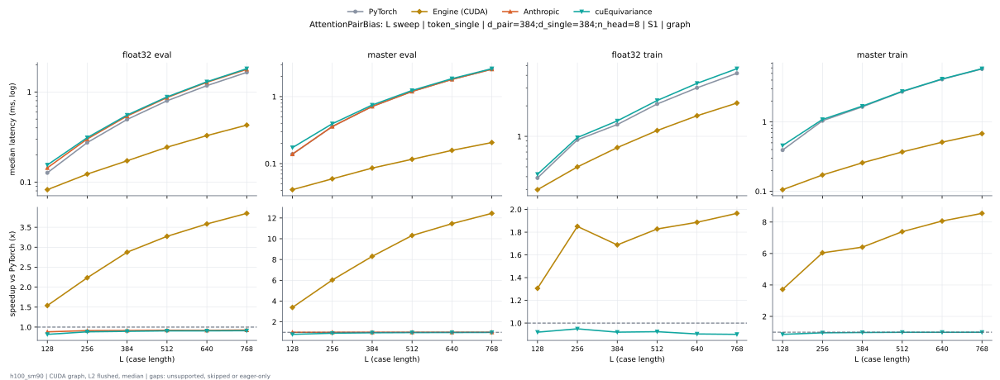

**float32 eval** (median ms; x = speedup vs PyTorch)

| L | PyTorch | Engine (Triton) | Engine (CUDA) | Anthropic | cuEquivariance |
|---|---|---|---|---|---|
| 128 | 0.1263 | 0.1099 (1.15x) | 0.07154 (1.76x) | 0.1286 (0.98x) | 0.1377 (0.92x) |
| 256 | 0.273 | 0.2436 (1.12x) | 0.1064 (2.57x) | 0.2764 (0.99x) | 0.2844 (0.96x) |
| 384 | 0.493 | 0.4504 (1.09x) | 0.1562 (3.16x) | 0.5034 (0.98x) | 0.5122 (0.96x) |
| 512 | 0.8019 | 0.7438 (1.08x) | 0.2174 (3.69x) | 0.8073 (0.99x) | 0.8133 (0.99x) |
| 640 | 1.175 | 1.11 (1.06x) | 0.2994 (3.93x) | 1.188 (0.99x) | 1.195 (0.98x) |
| 768 | 1.645 | 1.565 (1.05x) | 0.3972 (4.14x) | 1.663 (0.99x) | 1.667 (0.99x) |

**master eval** (median ms; x = speedup vs PyTorch)

| L | PyTorch | Engine (Triton) | Engine (CUDA) | Anthropic | cuEquivariance |
|---|---|---|---|---|---|
| 128 | 0.1378 | 0.1278 (1.08x) | 0.04069 (3.39x) | 0.1473 (0.94x) | 0.1727 (0.80x) |
| 256 | 0.3547 | 0.3391 (1.05x) | 0.05906 (6.01x) | 0.3659 (0.97x) | 0.3914 (0.91x) |
| 384 | 0.7134 | 0.6878 (1.04x) | 0.08586 (8.31x) | 0.7255 (0.98x) | 0.7522 (0.95x) |
| 512 | 1.189 | 1.159 (1.03x) | 0.1164 (10.21x) | 1.203 (0.99x) | 1.231 (0.97x) |
| 640 | 1.8 | 1.763 (1.02x) | 0.1578 (11.41x) | 1.817 (0.99x) | 1.847 (0.97x) |
| 768 | 2.546 | 2.516 (1.01x) | 0.2061 (12.35x) | 2.581 (0.99x) | 2.611 (0.97x) |

**float32 train** (median ms; x = speedup vs PyTorch)

| L | PyTorch | Engine (Triton) | Engine (CUDA) | Anthropic | cuEquivariance |
|---|---|---|---|---|---|
| 128 | 0.388 | 0.3458 (1.12x) | 0.2656 (1.46x) | unsupported | 0.3618 (1.07x) |
| 256 | 0.9225 | 0.8436 (1.09x) | 0.425 (2.17x) | unsupported | 0.8519 (1.08x) |
| 384 | 1.305 | 1.195 (1.09x) | 0.6533 (2.00x) | unsupported | 1.206 (1.08x) |
| 512 | 2.075 | 1.933 (1.07x) | 0.9608 (2.16x) | unsupported | 1.947 (1.07x) |
| 640 | 3.013 | 2.851 (1.06x) | 1.354 (2.23x) | unsupported | 2.854 (1.06x) |
| 768 | 4.194 | 3.974 (1.06x) | 1.822 (2.30x) | unsupported | 4.001 (1.05x) |

**master train** (median ms; x = speedup vs PyTorch)

| L | PyTorch | Engine (Triton) | Engine (CUDA) | Anthropic | cuEquivariance |
|---|---|---|---|---|---|
| 128 | 0.3924 | 0.3833 (1.02x) | 0.1054 (3.72x) | unsupported | 0.4555 (0.86x) |
| 256 | 1.039 | 1.017 (1.02x) | 0.1702 (6.11x) | unsupported | 1.08 (0.96x) |
| 384 | 1.649 | 1.616 (1.02x) | 0.2588 (6.37x) | unsupported | 1.691 (0.97x) |
| 512 | 2.727 | 2.67 (1.02x) | 0.3684 (7.40x) | unsupported | 2.758 (0.99x) |
| 640 | 4.104 | 4.032 (1.02x) | 0.5109 (8.03x) | unsupported | 4.154 (0.99x) |
| 768 | 5.785 | 5.68 (1.02x) | 0.6794 (8.52x) | unsupported | 5.828 (0.99x) |

### L sweep: token_single | d_pair=512;d_single=384;n_head=16 | S1 | graph

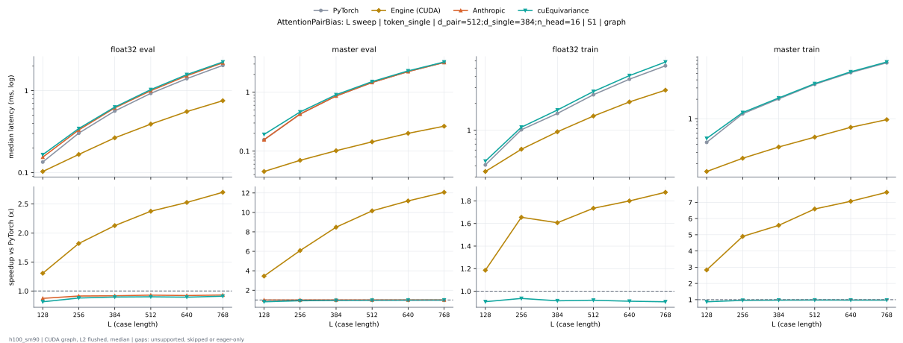

**float32 eval** (median ms; x = speedup vs PyTorch)

| L | PyTorch | Engine (Triton) | Engine (CUDA) | Anthropic | cuEquivariance |
|---|---|---|---|---|---|
| 128 | 0.1345 | 0.1196 (1.12x) | 0.09259 (1.45x) | 0.1383 (0.97x) | 0.1481 (0.91x) |
| 256 | 0.3031 | 0.2762 (1.10x) | 0.1489 (2.04x) | 0.3081 (0.98x) | 0.3194 (0.95x) |
| 384 | 0.5632 | 0.524 (1.07x) | 0.2393 (2.35x) | 0.5732 (0.98x) | 0.5807 (0.97x) |
| 512 | 0.9246 | 0.8783 (1.05x) | 0.3638 (2.54x) | 0.9419 (0.98x) | 0.9533 (0.97x) |
| 640 | 1.402 | 1.308 (1.07x) | 0.5137 (2.73x) | 1.441 (0.97x) | 1.447 (0.97x) |
| 768 | 2.028 | 1.919 (1.06x) | 0.705 (2.88x) | 2.056 (0.99x) | 2.06 (0.98x) |

**master eval** (median ms; x = speedup vs PyTorch)

| L | PyTorch | Engine (Triton) | Engine (CUDA) | Anthropic | cuEquivariance |
|---|---|---|---|---|---|
| 128 | 0.156 | 0.1471 (1.06x) | 0.0452 (3.45x) | 0.1665 (0.94x) | 0.1916 (0.81x) |
| 256 | 0.4214 | 0.4074 (1.03x) | 0.06922 (6.09x) | 0.4371 (0.96x) | 0.4599 (0.92x) |
| 384 | 0.8642 | 0.8402 (1.03x) | 0.1014 (8.52x) | 0.8791 (0.98x) | 0.9049 (0.95x) |
| 512 | 1.465 | 1.432 (1.02x) | 0.1444 (10.15x) | 1.48 (0.99x) | 1.512 (0.97x) |
| 640 | 2.223 | 2.184 (1.02x) | 0.2 (11.12x) | 2.247 (0.99x) | 2.291 (0.97x) |
| 768 | 3.172 | 3.113 (1.02x) | 0.2642 (12.00x) | 3.193 (0.99x) | 3.247 (0.98x) |

**float32 train** (median ms; x = speedup vs PyTorch)

| L | PyTorch | Engine (Triton) | Engine (CUDA) | Anthropic | cuEquivariance |
|---|---|---|---|---|---|
| 128 | 0.4073 | 0.3688 (1.10x) | 0.3114 (1.31x) | unsupported | 0.3892 (1.05x) |
| 256 | 1.006 | 0.931 (1.08x) | 0.5314 (1.89x) | unsupported | 0.9592 (1.05x) |
| 384 | 1.538 | 1.431 (1.07x) | 0.8635 (1.78x) | unsupported | 1.473 (1.04x) |
| 512 | 2.508 | 2.364 (1.06x) | 1.318 (1.90x) | unsupported | 2.418 (1.04x) |
| 640 | 3.748 | 3.537 (1.06x) | 1.877 (2.00x) | unsupported | 3.641 (1.03x) |
| 768 | 5.287 | 5.014 (1.05x) | 2.587 (2.04x) | unsupported | 5.195 (1.02x) |

**master train** (median ms; x = speedup vs PyTorch)

| L | PyTorch | Engine (Triton) | Engine (CUDA) | Anthropic | cuEquivariance |
|---|---|---|---|---|---|
| 128 | 0.4277 | 0.4206 (1.02x) | 0.1512 (2.83x) | unsupported | 0.4949 (0.86x) |
| 256 | 1.187 | 1.172 (1.01x) | 0.2423 (4.90x) | unsupported | 1.247 (0.95x) |
| 384 | 2.027 | 1.996 (1.02x) | 0.3644 (5.56x) | unsupported | 2.096 (0.97x) |
| 512 | 3.409 | 3.372 (1.01x) | 0.5198 (6.56x) | unsupported | 3.499 (0.97x) |
| 640 | 5.177 | 5.143 (1.01x) | 0.7307 (7.08x) | unsupported | 5.325 (0.97x) |
| 768 | 7.339 | 7.288 (1.01x) | 0.9694 (7.57x) | unsupported | 7.576 (0.97x) |

### d_pair sweep at L768: token_single | - | S1 | graph

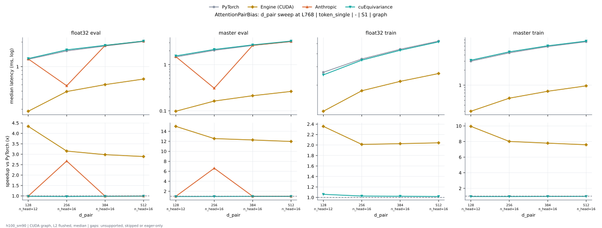

**float32 eval** (median ms; x = speedup vs PyTorch)

| d_pair | PyTorch | Engine (Triton) | Engine (CUDA) | Anthropic | cuEquivariance |
|---|---|---|---|---|---|
| 128 n_head=12 | 1.228 | 1.11 (1.11x) | 0.284 (4.33x) | 1.243 (0.99x) | 1.258 (0.98x) |
| 256 n_head=16 | 1.554 | 1.441 (1.08x) | 0.4952 (3.14x) | 0.5836 (2.66x) | 1.609 (0.97x) |
| 384 n_head=16 | 1.794 | 1.669 (1.07x) | 0.6023 (2.98x) | 1.82 (0.99x) | 1.827 (0.98x) |
| 512 n_head=16 | 2.028 | 1.919 (1.06x) | 0.705 (2.88x) | 2.056 (0.99x) | 2.06 (0.98x) |

**master eval** (median ms; x = speedup vs PyTorch)

| d_pair | PyTorch | Engine (Triton) | Engine (CUDA) | Anthropic | cuEquivariance |
|---|---|---|---|---|---|
| 128 n_head=12 | 1.476 | 1.424 (1.04x) | 0.09838 (15.01x) | 1.496 (0.99x) | 1.55 (0.95x) |
| 256 n_head=16 | 2.052 | 1.994 (1.03x) | 0.1635 (12.55x) | 0.3101 (6.62x) | 2.14 (0.96x) |
| 384 n_head=16 | 2.6 | 2.558 (1.02x) | 0.2132 (12.19x) | 2.624 (0.99x) | 2.684 (0.97x) |
| 512 n_head=16 | 3.172 | 3.113 (1.02x) | 0.2642 (12.00x) | 3.193 (0.99x) | 3.247 (0.98x) |

**float32 train** (median ms; x = speedup vs PyTorch)

| d_pair | PyTorch | Engine (Triton) | Engine (CUDA) | Anthropic | cuEquivariance |
|---|---|---|---|---|---|
| 128 n_head=12 | 2.655 | 2.408 (1.10x) | 1.128 (2.35x) | unsupported | 2.511 (1.06x) |
| 256 n_head=16 | 3.57 | 3.288 (1.09x) | 1.77 (2.02x) | unsupported | 3.472 (1.03x) |
| 384 n_head=16 | 4.416 | 4.151 (1.06x) | 2.177 (2.03x) | unsupported | 4.316 (1.02x) |
| 512 n_head=16 | 5.287 | 5.014 (1.05x) | 2.587 (2.04x) | unsupported | 5.195 (1.02x) |

**master train** (median ms; x = speedup vs PyTorch)

| d_pair | PyTorch | Engine (Triton) | Engine (CUDA) | Anthropic | cuEquivariance |
|---|---|---|---|---|---|
| 128 n_head=12 | 3.019 | 2.97 (1.02x) | 0.3025 (9.98x) | unsupported | 3.149 (0.96x) |
| 256 n_head=16 | 4.407 | 4.356 (1.01x) | 0.5511 (8.00x) | unsupported | 4.626 (0.95x) |
| 384 n_head=16 | 5.893 | 5.82 (1.01x) | 0.7566 (7.79x) | unsupported | 6.102 (0.97x) |
| 512 n_head=16 | 7.339 | 7.288 (1.01x) | 0.9694 (7.57x) | unsupported | 7.576 (0.97x) |

### n_head sweep at L768: token_single | - | S1 | graph

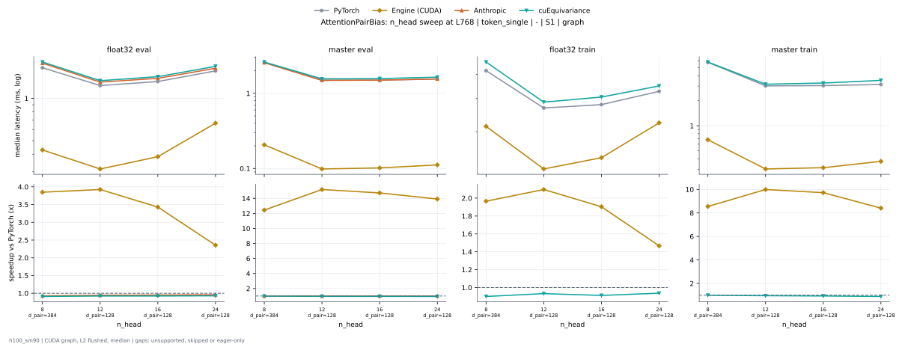

**float32 eval** (median ms; x = speedup vs PyTorch)

| n_head | PyTorch | Engine (Triton) | Engine (CUDA) | Anthropic | cuEquivariance |
|---|---|---|---|---|---|
| 8 d_pair=384 | 1.645 | 1.565 (1.05x) | 0.3972 (4.14x) | 1.663 (0.99x) | 1.667 (0.99x) |
| 12 d_pair=128 | 1.228 | 1.11 (1.11x) | 0.284 (4.33x) | 1.243 (0.99x) | 1.258 (0.98x) |
| 16 d_pair=128 | 1.318 | 1.199 (1.10x) | 0.3404 (3.87x) | 0.4826 (2.73x) | 1.356 (0.97x) |
| 24 d_pair=128 | 1.564 | 1.391 (1.12x) | 0.5923 (2.64x) | 1.603 (0.98x) | 1.616 (0.97x) |

**master eval** (median ms; x = speedup vs PyTorch)

| n_head | PyTorch | Engine (Triton) | Engine (CUDA) | Anthropic | cuEquivariance |
|---|---|---|---|---|---|
| 8 d_pair=384 | 2.546 | 2.516 (1.01x) | 0.2061 (12.35x) | 2.581 (0.99x) | 2.611 (0.97x) |
| 12 d_pair=128 | 1.476 | 1.424 (1.04x) | 0.09838 (15.01x) | 1.496 (0.99x) | 1.55 (0.95x) |
| 16 d_pair=128 | 1.492 | 1.435 (1.04x) | 0.1017 (14.68x) | 0.2092 (7.13x) | 1.566 (0.95x) |
| 24 d_pair=128 | 1.541 | 1.452 (1.06x) | 0.1114 (13.84x) | 1.565 (0.99x) | 1.644 (0.94x) |

**float32 train** (median ms; x = speedup vs PyTorch)

| n_head | PyTorch | Engine (Triton) | Engine (CUDA) | Anthropic | cuEquivariance |
|---|---|---|---|---|---|
| 8 d_pair=384 | 4.194 | 3.974 (1.06x) | 1.822 (2.30x) | unsupported | 4.001 (1.05x) |
| 12 d_pair=128 | 2.655 | 2.408 (1.10x) | 1.128 (2.35x) | unsupported | 2.511 (1.06x) |
| 16 d_pair=128 | 2.769 | 2.571 (1.08x) | 1.304 (2.12x) | unsupported | 2.677 (1.03x) |
| 24 d_pair=128 | 3.241 | 2.822 (1.15x) | 1.852 (1.75x) | unsupported | 3.069 (1.06x) |

**master train** (median ms; x = speedup vs PyTorch)

| n_head | PyTorch | Engine (Triton) | Engine (CUDA) | Anthropic | cuEquivariance |
|---|---|---|---|---|---|
| 8 d_pair=384 | 5.785 | 5.68 (1.02x) | 0.6794 (8.52x) | unsupported | 5.828 (0.99x) |
| 12 d_pair=128 | 3.019 | 2.97 (1.02x) | 0.3025 (9.98x) | unsupported | 3.149 (0.96x) |
| 16 d_pair=128 | 3.043 | 3.002 (1.01x) | 0.3126 (9.73x) | unsupported | 3.252 (0.94x) |
| 24 d_pair=128 | 3.132 | 3.069 (1.02x) | 0.3736 (8.38x) | unsupported | 3.519 (0.89x) |

