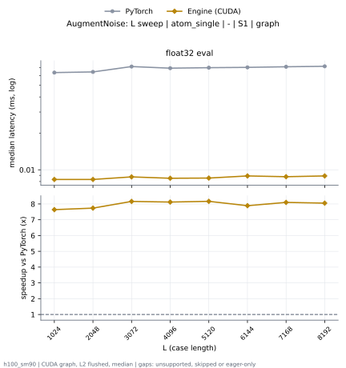
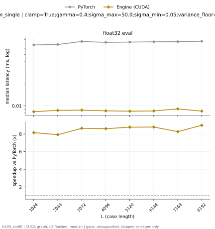

# AugmentNoise on h100_sm90

Generated by `python -m miniworld_engine.measure.plot` from speed tokens `judge/tokens/h100_sm90/`; do not edit.

### L sweep: atom_single | - | S1 | graph

**float32 eval** (median ms; x = speedup vs PyTorch)

| L | PyTorch | Engine (Triton) | Engine (CUDA) |
|---|---|---|---|
| 1024 | 0.06363 | 0.00872 (7.30x) | 0.008416 (7.56x) |
| 2048 | 0.06434 | 0.008784 (7.32x) | 0.008608 (7.47x) |
| 3072 | 0.07133 | 0.008928 (7.99x) | 0.008864 (8.05x) |
| 4096 | 0.06899 | 0.00912 (7.56x) | 0.008384 (8.23x) |
| 5120 | 0.06976 | 0.008992 (7.76x) | 0.008384 (8.32x) |
| 6144 | 0.07024 | 0.009248 (7.60x) | 0.008688 (8.08x) |
| 7168 | 0.07091 | 0.00928 (7.64x) | 0.008608 (8.24x) |
| 8192 | 0.07139 | 0.009168 (7.79x) | 0.008672 (8.23x) |

### L sweep: atom_single | clamp=True;gamma=0.4;sigma_max=50.0;sigma_min=0.05;variance_floor=1e-06;window=1 | S1 | graph

**float32 eval** (median ms; x = speedup vs PyTorch)

| L | PyTorch | Engine (Triton) | Engine (CUDA) |
|---|---|---|---|
| 1024 | 0.06784 | 0.008608 (7.88x) | 0.008208 (8.27x) |
| 2048 | 0.06856 | 0.008592 (7.98x) | 0.008528 (8.04x) |
| 3072 | 0.07542 | 0.008928 (8.45x) | 0.008672 (8.70x) |
| 4096 | 0.07339 | 0.009008 (8.15x) | 0.00872 (8.42x) |
| 5120 | 0.0744 | 0.009088 (8.19x) | 0.008576 (8.68x) |
| 6144 | 0.07478 | 0.009072 (8.24x) | 0.008608 (8.69x) |
| 7168 | 0.07528 | 0.00928 (8.11x) | 0.008848 (8.51x) |
| 8192 | 0.07595 | 0.00912 (8.33x) | 0.008416 (9.02x) |

