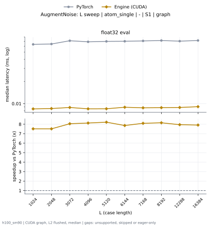
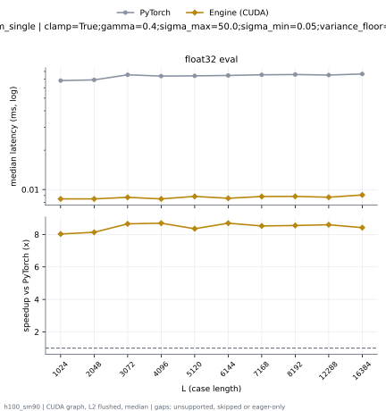

# AugmentNoise on h100_sm90

Generated by `python -m miniworld_engine.measure.plot` from speed tokens `judge/tokens/h100_sm90/`; do not edit.

### L sweep: atom_single | - | S1 | graph

**float32 eval** (median ms; x = speedup vs PyTorch)

| L | PyTorch | Engine (Triton) | Engine (CUDA) |
|---|---|---|---|
| 1024 | 0.06371 | 0.008768 (7.27x) | 0.00848 (7.51x) |
| 2048 | 0.06443 | 0.00888 (7.26x) | 0.008576 (7.51x) |
| 3072 | 0.07136 | 0.009008 (7.92x) | 0.008864 (8.05x) |
| 4096 | 0.06902 | 0.00936 (7.37x) | 0.008496 (8.12x) |
| 5120 | 0.06992 | 0.009344 (7.48x) | 0.008512 (8.21x) |
| 6144 | 0.07021 | 0.009584 (7.33x) | 0.008928 (7.86x) |
| 7168 | 0.07098 | 0.009744 (7.28x) | 0.008768 (8.09x) |
| 8192 | 0.07186 | 0.009488 (7.57x) | 0.008816 (8.15x) |
| 12288 | 0.07048 | 0.01032 (6.83x) | 0.008864 (7.95x) |
| 16384 | 0.0719 | 0.01048 (6.86x) | 0.009088 (7.91x) |

### L sweep: atom_single | clamp=True;gamma=0.4;sigma_max=50.0;sigma_min=0.05;variance_floor=1e-06;window=1 | S1 | graph

**float32 eval** (median ms; x = speedup vs PyTorch)

| L | PyTorch | Engine (Triton) | Engine (CUDA) |
|---|---|---|---|
| 1024 | 0.0681 | 0.008816 (7.72x) | 0.00848 (8.03x) |
| 2048 | 0.06898 | 0.009008 (7.66x) | 0.00848 (8.13x) |
| 3072 | 0.07546 | 0.008944 (8.44x) | 0.00872 (8.65x) |
| 4096 | 0.07373 | 0.00936 (7.88x) | 0.00848 (8.69x) |
| 5120 | 0.07405 | 0.009456 (7.83x) | 0.008864 (8.35x) |
| 6144 | 0.07456 | 0.009344 (7.98x) | 0.008576 (8.69x) |
| 7168 | 0.07542 | 0.009536 (7.91x) | 0.008848 (8.52x) |
| 8192 | 0.07581 | 0.009504 (7.98x) | 0.008864 (8.55x) |
| 12288 | 0.07512 | 0.0104 (7.22x) | 0.008736 (8.60x) |
| 16384 | 0.07653 | 0.01035 (7.39x) | 0.009088 (8.42x) |

