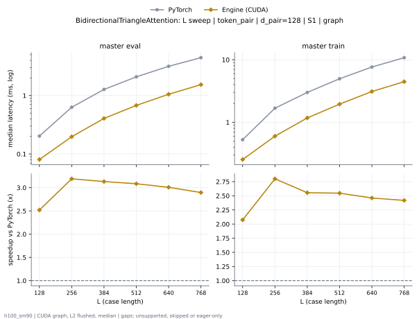

# BidirectionalTriangleAttention on h100_sm90

Generated by `python -m miniworld_engine.measure.plot` from speed tokens `judge/tokens/h100_sm90/`; do not edit.

### L sweep: token_pair | d_pair=128 | S1 | graph

**master eval** (median ms; x = speedup vs PyTorch)

| L | PyTorch | Engine (CUDA) |
|---|---|---|
| 128 | 0.2028 | 0.08051 (2.52x) |
| 256 | 0.6308 | 0.1977 (3.19x) |
| 384 | 1.274 | 0.4068 (3.13x) |
| 512 | 2.093 | 0.6785 (3.08x) |
| 640 | 3.169 | 1.054 (3.01x) |
| 768 | 4.454 | 1.538 (2.90x) |

**master train** (median ms; x = speedup vs PyTorch)

| L | PyTorch | Engine (CUDA) |
|---|---|---|
| 128 | 0.527 | 0.2541 (2.07x) |
| 256 | 1.68 | 0.5999 (2.80x) |
| 384 | 2.999 | 1.174 (2.55x) |
| 512 | 4.964 | 1.949 (2.55x) |
| 640 | 7.64 | 3.104 (2.46x) |
| 768 | 10.78 | 4.456 (2.42x) |

