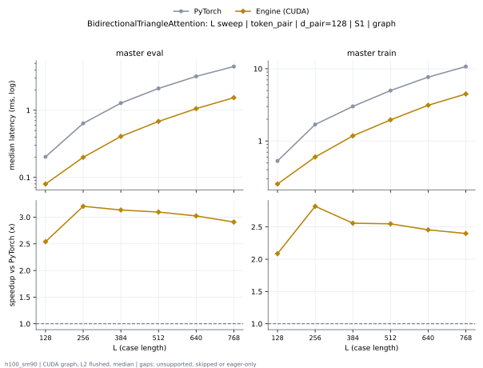

# BidirectionalTriangleAttention on h100_sm90

Generated by `python -m miniworld_engine.measure.plot` from speed tokens `judge/tokens/h100_sm90/`; do not edit.

### L sweep: token_pair | d_pair=128 | S1 | graph

**master eval** (median ms; x = speedup vs PyTorch)

| L | PyTorch | Engine (CUDA) |
|---|---|---|
| 128 | 0.2026 | 0.07978 (2.54x) |
| 256 | 0.6381 | 0.1991 (3.20x) |
| 384 | 1.279 | 0.4079 (3.13x) |
| 512 | 2.113 | 0.6823 (3.10x) |
| 640 | 3.195 | 1.057 (3.02x) |
| 768 | 4.479 | 1.54 (2.91x) |

**master train** (median ms; x = speedup vs PyTorch)

| L | PyTorch | Engine (CUDA) |
|---|---|---|
| 128 | 0.5286 | 0.2534 (2.09x) |
| 256 | 1.69 | 0.5992 (2.82x) |
| 384 | 3.01 | 1.176 (2.56x) |
| 512 | 4.988 | 1.957 (2.55x) |
| 640 | 7.661 | 3.12 (2.46x) |
| 768 | 10.73 | 4.473 (2.40x) |

