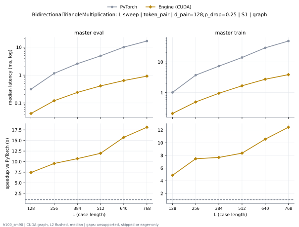
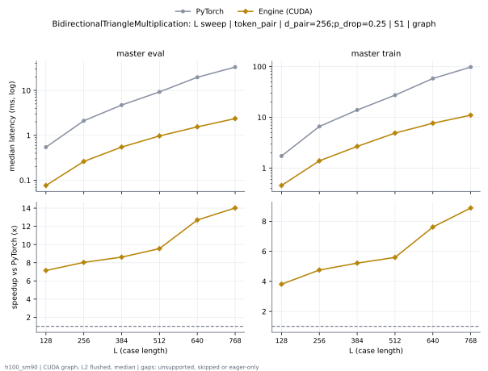
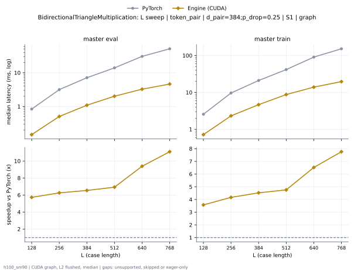
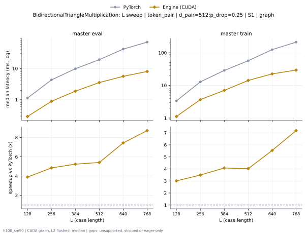
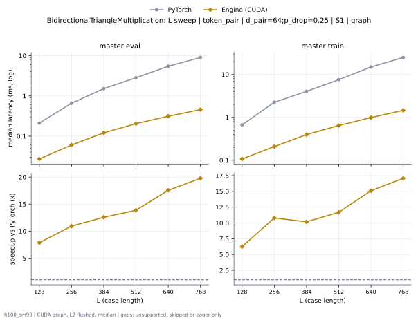

# BidirectionalTriangleMultiplication on h100_sm90

Generated by `python -m miniworld_engine.measure.plot` from speed tokens `judge/tokens/h100_sm90/`; do not edit.

### L sweep: token_pair | d_pair=128;p_drop=0.25 | S1 | graph

**master eval** (median ms; x = speedup vs PyTorch)

| L | PyTorch | Engine (Triton) | Engine (CUDA) |
|---|---|---|---|
| 128 | 0.3129 | 0.09565 (3.27x) | 0.04211 (7.43x) |
| 256 | 1.158 | 0.2357 (4.91x) | 0.1211 (9.56x) |
| 384 | 2.568 | 0.4683 (5.48x) | 0.2399 (10.71x) |
| 512 | 4.912 | 0.7754 (6.34x) | 0.4104 (11.97x) |
| 640 | 10.04 | 1.205 (8.33x) | 0.6383 (15.73x) |
| 768 | 16.67 | 1.728 (9.65x) | 0.9198 (18.12x) |

**master train** (median ms; x = speedup vs PyTorch)

| L | PyTorch | Engine (Triton) | Engine (CUDA) |
|---|---|---|---|
| 128 | 1.012 | 0.3179 (3.18x) | 0.2084 (4.85x) |
| 256 | 3.703 | 0.8699 (4.26x) | 0.4956 (7.47x) |
| 384 | 7.296 | 1.733 (4.21x) | 0.9502 (7.68x) |
| 512 | 13.94 | 2.951 (4.72x) | 1.669 (8.36x) |
| 640 | 28.81 | 4.728 (6.09x) | 2.726 (10.57x) |
| 768 | 47.98 | 6.782 (7.08x) | 3.855 (12.45x) |

### L sweep: token_pair | d_pair=256;p_drop=0.25 | S1 | graph

**master eval** (median ms; x = speedup vs PyTorch)

| L | PyTorch | Engine (Triton) | Engine (CUDA) |
|---|---|---|---|
| 128 | 0.5463 | 0.1806 (3.02x) | 0.07598 (7.19x) |
| 256 | 2.103 | 0.5396 (3.90x) | 0.2606 (8.07x) |
| 384 | 4.718 | 1.154 (4.09x) | 0.545 (8.66x) |
| 512 | 9.261 | 1.971 (4.70x) | 0.9446 (9.80x) |
| 640 | 19.6 | 3.101 (6.32x) | 1.492 (13.14x) |
| 768 | 33.03 | 4.474 (7.38x) | 2.414 (13.68x) |

**master train** (median ms; x = speedup vs PyTorch)

| L | PyTorch | Engine (Triton) | Engine (CUDA) |
|---|---|---|---|
| 128 | 1.724 | 0.5608 (3.08x) | 0.4528 (3.81x) |
| 256 | 6.603 | 1.791 (3.69x) | 1.383 (4.77x) |
| 384 | 13.93 | 3.746 (3.72x) | 2.645 (5.27x) |
| 512 | 27.32 | 6.533 (4.18x) | 4.884 (5.59x) |
| 640 | 58.14 | 11.15 (5.21x) | 7.619 (7.63x) |
| 768 | 97.77 | 16.16 (6.05x) | 10.9 (8.97x) |

### L sweep: token_pair | d_pair=384;p_drop=0.25 | S1 | graph

**master eval** (median ms; x = speedup vs PyTorch)

| L | PyTorch | Engine (Triton) | Engine (CUDA) |
|---|---|---|---|
| 128 | 0.8371 | 0.3156 (2.65x) | 0.1468 (5.70x) |
| 256 | 3.159 | 0.9421 (3.35x) | 0.504 (6.27x) |
| 384 | 7.116 | 2.12 (3.36x) | 1.09 (6.53x) |
| 512 | 13.92 | 3.644 (3.82x) | 1.915 (7.27x) |
| 640 | 30.5 | 5.795 (5.26x) | 3.21 (9.50x) |
| 768 | 51.29 | 8.332 (6.16x) | 4.609 (11.13x) |

**master train** (median ms; x = speedup vs PyTorch)

| L | PyTorch | Engine (Triton) | Engine (CUDA) |
|---|---|---|---|
| 128 | 2.56 | 0.938 (2.73x) | 0.7141 (3.59x) |
| 256 | 9.636 | 3.08 (3.13x) | 2.304 (4.18x) |
| 384 | 21.11 | 6.664 (3.17x) | 4.637 (4.55x) |
| 512 | 41.57 | 11.75 (3.54x) | 8.729 (4.76x) |
| 640 | 90.54 | 19.75 (4.58x) | 13.82 (6.55x) |
| 768 | 151.9 | 28.53 (5.32x) | 19.51 (7.78x) |

### L sweep: token_pair | d_pair=512;p_drop=0.25 | S1 | graph

**master eval** (median ms; x = speedup vs PyTorch)

| L | PyTorch | Engine (Triton) | Engine (CUDA) |
|---|---|---|---|
| 128 | 1.131 | 0.4914 (2.30x) | 0.2904 (3.90x) |
| 256 | 4.313 | 1.642 (2.63x) | 0.8902 (4.84x) |
| 384 | 9.821 | 3.74 (2.63x) | 1.877 (5.23x) |
| 512 | 19.2 | 6.568 (2.92x) | 3.551 (5.40x) |
| 640 | 41.76 | 10.69 (3.91x) | 5.617 (7.43x) |
| 768 | 69.9 | 15.37 (4.55x) | 8.029 (8.71x) |

**master train** (median ms; x = speedup vs PyTorch)

| L | PyTorch | Engine (Triton) | Engine (CUDA) |
|---|---|---|---|
| 128 | 3.348 | 1.352 (2.48x) | 1.114 (3.01x) |
| 256 | 12.82 | 4.584 (2.80x) | 3.67 (3.49x) |
| 384 | 28.69 | 10.09 (2.84x) | 7.034 (4.08x) |
| 512 | 57.03 | 17.99 (3.17x) | 14.18 (4.02x) |
| 640 | 124.8 | 32.83 (3.80x) | 22.53 (5.54x) |
| 768 | 211.9 | 59.13 (3.58x) | 29.48 (7.19x) |

### L sweep: token_pair | d_pair=64;p_drop=0.25 | S1 | graph

**master eval** (median ms; x = speedup vs PyTorch)

| L | PyTorch | Engine (Triton) | Engine (CUDA) |
|---|---|---|---|
| 128 | 0.2118 | 0.06869 (3.08x) | 0.02733 (7.75x) |
| 256 | 0.6594 | 0.1155 (5.71x) | 0.06046 (10.91x) |
| 384 | 1.507 | 0.2101 (7.17x) | 0.1211 (12.44x) |
| 512 | 2.821 | 0.3334 (8.46x) | 0.2036 (13.85x) |
| 640 | 5.47 | 0.4862 (11.25x) | 0.3165 (17.28x) |
| 768 | 9.049 | 0.6786 (13.34x) | 0.4616 (19.60x) |

**master train** (median ms; x = speedup vs PyTorch)

| L | PyTorch | Engine (Triton) | Engine (CUDA) |
|---|---|---|---|
| 128 | 0.6679 | 0.2209 (3.02x) | 0.1076 (6.21x) |
| 256 | 2.244 | 0.4661 (4.81x) | 0.2083 (10.77x) |
| 384 | 4.02 | 0.9079 (4.43x) | 0.3951 (10.17x) |
| 512 | 7.543 | 1.485 (5.08x) | 0.6447 (11.70x) |
| 640 | 14.97 | 2.273 (6.58x) | 0.9908 (15.11x) |
| 768 | 24.88 | 3.203 (7.77x) | 1.423 (17.49x) |

### d_pair sweep at L768: token_pair | p_drop=0.25 | S1 | graph

**master eval** (median ms; x = speedup vs PyTorch)

| d_pair | PyTorch | Engine (Triton) | Engine (CUDA) |
|---|---|---|---|
| 64 | 9.049 | 0.6786 (13.34x) | 0.4616 (19.60x) |
| 128 | 16.67 | 1.728 (9.65x) | 0.9198 (18.12x) |
| 256 | 33.03 | 4.474 (7.38x) | 2.414 (13.68x) |
| 384 | 51.29 | 8.332 (6.16x) | 4.609 (11.13x) |
| 512 | 69.9 | 15.37 (4.55x) | 8.029 (8.71x) |

**master train** (median ms; x = speedup vs PyTorch)

| d_pair | PyTorch | Engine (Triton) | Engine (CUDA) |
|---|---|---|---|
| 64 | 24.88 | 3.203 (7.77x) | 1.423 (17.49x) |
| 128 | 47.98 | 6.782 (7.08x) | 3.855 (12.45x) |
| 256 | 97.77 | 16.16 (6.05x) | 10.9 (8.97x) |
| 384 | 151.9 | 28.53 (5.32x) | 19.51 (7.78x) |
| 512 | 211.9 | 59.13 (3.58x) | 29.48 (7.19x) |

